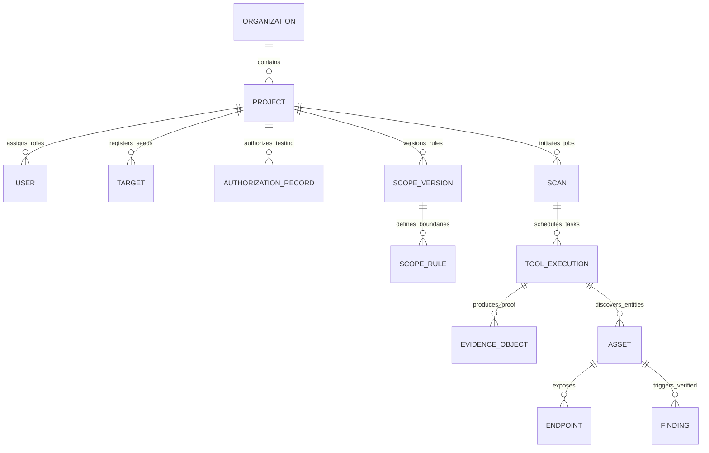
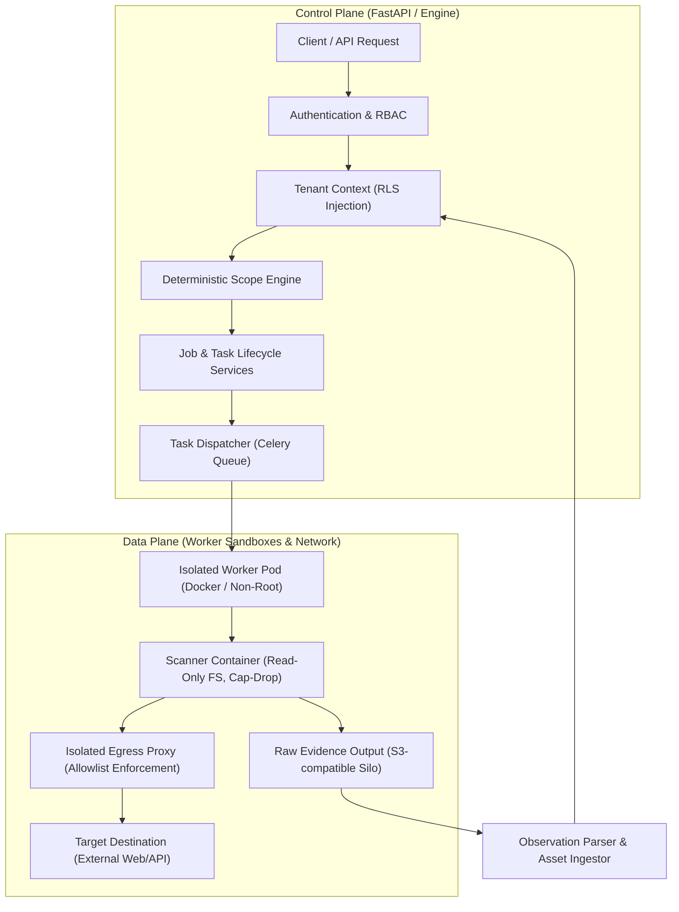
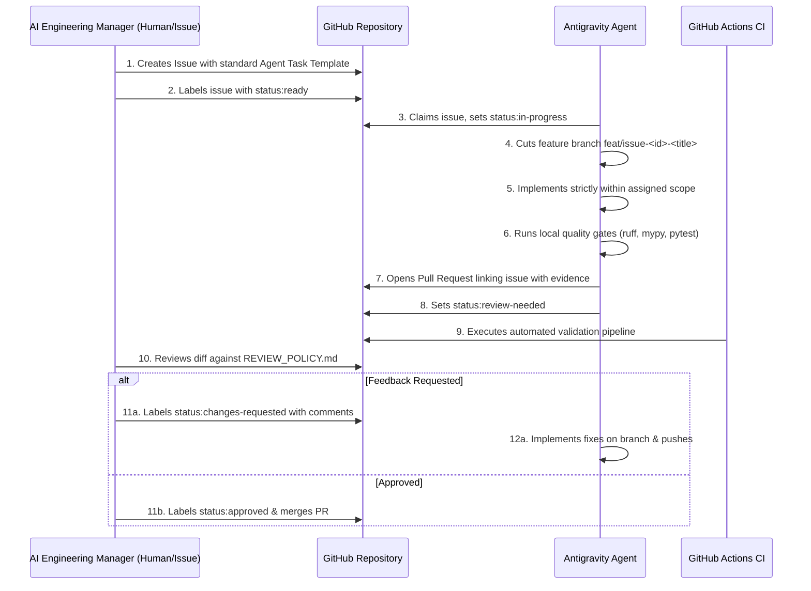

# VulnOS — System & AI Engineering Architecture
## Dual-Plane Technical Architecture & Agent Orchestration Blueprint

**Document Version:** 1.0.0  
**Effective Date:** 2026-11-02  
**Target Path:** `.orchestrator/ARCHITECTURE.md`  

---

## 1. Repository Layout & Component Responsibilities

The VulnOS codebase is organized into clean functional directories:

```text
.
├── .github/                # CI workflows, issue templates, PR templates
│   ├── workflows/          # GitHub Actions (ci.yml)
│   └── ISSUE_TEMPLATE/     # Standardized AI agent task templates
├── .orchestrator/          # AI Engineering Manager policies, context, roadmap
├── backend/                # Primary FastAPI application and database service
│   ├── alembic/            # Database migrations (0001 to 0004)
│   ├── app/                # Application source code
│   │   ├── api/v1/         # Versioned REST routers (auth, api_keys, targets, scope)
│   │   ├── auth/           # Passwords, JWTs, Redis sessions, API keys, dependencies
│   │   ├── authorization/  # RBAC matrices and project permissions
│   │   ├── core/           # Config (pydantic-settings), errors, logging, middleware
│   │   ├── db/             # SQLAlchemy engine, session, RLS tenant context, models
│   │   │   └── models/     # Relational schemas (identity, assets, scan, execution, etc.)
│   │   ├── recon/          # Scan & task lifecycle state machines, fencing services
│   │   └── scope/          # Normalization, rule matching, authorizations, versioning
│   └── tests/              # 477 automated tests (security, unit, lifecycle)
├── engine/                 # Domain processing engines (recon pipeline, discovery, TISE)
├── workers/                # Celery worker entrypoints and task definitions
├── infra/                  # Dockerfiles, Compose specs, egress proxy configs
├── docs/                   # Blueprints, implementation records, and audits
│   ├── architecture/       # Phase 1 architectural blueprints
│   ├── implementation/     # Detailed technical implementation records
│   └── audits/             # Project stabilization and security audits
├── pyproject.toml          # uv configuration, dependency declarations, tool settings
└── compose.yaml            # Canonical development environment (API, Postgres, Redis, Silo)
```

---

## 2. Core Domain Entity Graph

VulnOS models security operations deterministically:



### Invariant Relationships:
- **Scan $\rightarrow$ AuthorizationRecord & ScopeVersion:** A `Scan` permanently pins the exact `authorization_id` and `scope_version_id` active at creation time. If an authorization expires or is revoked, in-flight tasks fail closed immediately.
- **Scan $\rightarrow$ ToolExecution:** A `Scan` is the parent job (`scan_type='recon'`). A `ToolExecution` is an individual containerized task (`stage='recon'`).
- **Hierarchical Locking:** Any operation mutating a `ToolExecution` must first acquire a row-level lock on the parent `Scan`, then the child `ToolExecution`.

---

## 3. Dual-Plane Security Architecture



1. **Tenant Isolation:** Every tenant query enforces `project_id`. PostgreSQL Row-Level Security (RLS) ensures queries cannot bleed across projects.
2. **Deterministic Scope Gate:** Destinations are normalized (Punycode, canonical IPv4/IPv6, CIDR matching). Any attempt to scan non-approved targets is rejected fail-closed.
3. **Runtime Egress Proxy:** Workers do not have direct Internet access; egress is routed through an HTTP/SOCKS5 proxy enforcing the exact destination allowlist.

---

## 4. AI Software Engineering Orchestrator Architecture

The **AI Software Engineering Orchestrator** governs how the AI Engineering Manager and autonomous AI developer (Antigravity) collaborate:



### Components of the AI Orchestrator:
- **Task Specification Standard:** Defined in `.github/ISSUE_TEMPLATE/agent_task.yml`.
- **Review Policy:** Defined in `.orchestrator/REVIEW_POLICY.md`.
- **Execution Rules:** Defined in `.orchestrator/EXECUTION_POLICY.md`.
- **Roadmap & Tracking:** Defined in `.orchestrator/ROADMAP.md`.
