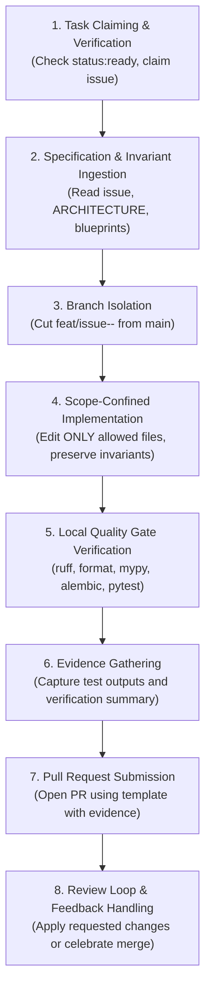

# VulnOS — AI Agent Autonomous Execution Protocol
## Step-by-Step Operating Guide for Antigravity & AI Engineering Agents

**Document Version:** 1.0.0  
**Effective Date:** 2026-11-02  
**Target Path:** `.orchestrator/EXECUTION_PROTOCOL.md`  

---

## 1. Overview of the Autonomous Protocol

This protocol defines the exact lifecycle an **Antigravity agent** follows when taking an engineering task from assignment to completion.



---

## 2. Step-by-Step Agent Execution Workflow

### Step 1: Task Claiming & Verification
1. Inspect the issue to ensure it has:
   - Label `status:ready`.
   - Clear objective, allowed scope, prohibited actions, acceptance criteria, and verification commands.
2. Apply label `status:in-progress` (or notify the AI Engineering Manager in chat).
3. Do NOT begin work on an issue labeled `status:draft` or `status:blocked`.

### Step 2: Specification & Invariant Ingestion
1. Read the issue body thoroughly.
2. Review relevant sections of:
   - `.orchestrator/PROJECT_CONTEXT.md` (core invariants, baseline state)
   - `.orchestrator/ARCHITECTURE.md` (component layout, entity graph, security boundaries)
   - Relevant Phase blueprints in `docs/architecture/` or implementation docs in `docs/implementation/`.
3. Identify existing test files related to the component.

### Step 3: Branch Isolation
1. Ensure the working tree is clean and aligned with `origin/main`.
2. Create and switch to a dedicated feature branch following naming standards:
   ```bash
   git checkout -b feat/issue-<id>-<short-description>
   ```
3. Never develop directly on `main`.

### Step 4: Scope-Confined Implementation
1. Modify or create **only** the files specified in the issue's *Allowed File Scope*.
2. Implement the minimal necessary logic to fulfill the acceptance criteria.
3. Strictly preserve all security invariants:
   - Tenant isolation: always filter by `project_id`.
   - Scope checks: pass network operations through `evaluate_scope_validation()`.
   - Lock ordering: always lock `Scan` FOR UPDATE first, `ToolExecution` FOR UPDATE second.
   - Server timestamps: generate UTC timestamps on the server (`utc_now()`).
   - Audit trail: record an `AuditLog` row in the same transaction.
   - Redaction: scrub secrets from logs and audit metadata.
4. Add comprehensive unit and adversarial tests covering:
   - Happy paths.
   - Error scenarios and boundary conditions.
   - Attack vectors / illegal state transitions.

### Step 5: Local Quality Gate Verification
Run all 5 required quality checks locally. All checks must pass with zero errors:

```bash
# Gate 1: Linting
uv run ruff check .

# Gate 2: Code Formatting
uv run ruff format --check .

# Gate 3: Static Type Analysis
uv run mypy backend tests

# Gate 4: Database Schema Alignment
uv run alembic heads

# Gate 5: Automated Test Suite
uv run pytest -v
```

If any check fails, fix the code immediately and re-run.

### Step 6: Evidence Gathering
Record exact outputs from the quality gate run:
- Total number of tests passed and execution duration.
- Linter output confirming 0 issues.
- Mypy output confirming 0 type errors.
- Alembic revision output.
- List of modified and created files.

### Step 7: Pull Request Submission
1. Stage and commit changes with a Conventional Commit message:
   ```bash
   git add <allowed_files>
   git commit -m "feat(<component>): <action summary> (Closes #<id>)"
   ```
2. Push feature branch to remote:
   ```bash
   git push -u origin feat/issue-<id>-<short-description>
   ```
3. Open a Pull Request targeting `main` using `.github/pull_request_template.md`.
4. Fill in all sections: summary, file list, checklist confirmation, and pasted terminal verification evidence.
5. Apply label `status:review-needed`.

### Step 8: Review Loop & Feedback Handling
1. The AI Engineering Manager reviews the PR against `.orchestrator/REVIEW_POLICY.md`.
2. **If Approved (`status:approved`):** The PR is merged into `main`. The task is complete.
3. **If Changes Requested (`status:changes-requested`):**
   - The agent reads the reviewer's feedback carefully.
   - The agent stays on the same feature branch.
   - The agent implements the exact corrections requested.
   - The agent re-runs all 5 quality gates.
   - The agent commits the corrections, pushes to the branch, updates the PR with new evidence, and reapplies `status:review-needed`.
