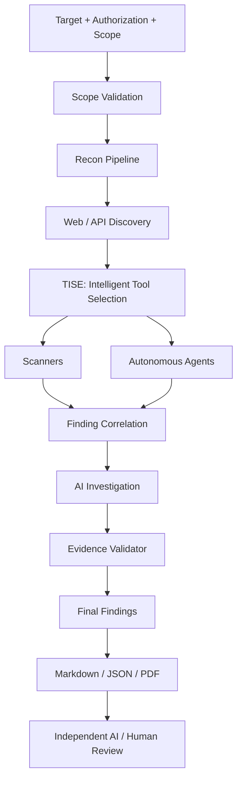

# VulnOS

**An AI-assisted, evidence-based web and API vulnerability discovery engine.**

VulnOS is designed to find, investigate and validate vulnerabilities on systems you are
explicitly authorized to test. It combines reconnaissance, web/API discovery, specialist
scanners, autonomous penetration-testing agents and a model-agnostic AI investigation layer
behind a single orchestration and evidence pipeline.

> **Status: Phase 2.1 — Backend and Infrastructure Scaffold Complete.**
> The initial runnable backend, typed configuration, structured logging, middleware pipeline,
> readiness probes, Docker Compose definitions, and CI quality gates are implemented and tested.
> Database models, authentication, scanning, and AI features begin in Phase 2.2+.

---

## Why VulnOS

Scanner output is not proof. Running every tool against every endpoint produces duplicates,
false positives and wasted spend. VulnOS is optimized for:

**unique, independently validated vulnerabilities per authorized testing hour and unit of cost.**

That means the platform is built around four constraints:

1. **Scope is authoritative.** Every outbound request is checked against an immutable,
   versioned scope policy — in the orchestrator *and* at the network edge.
2. **Every tool goes through one adapter contract.** No scanner or agent gets a private
   execution path.
3. **Findings are hypotheses until validated.** An LLM may investigate, but it may never
   mark a finding confirmed on its own reasoning.
4. **Selection is deliberate.** The Tool Intelligence & Selection Engine (TISE) decides what
   runs, what is skipped, and why — rather than blanket-running tools.

---

## Architecture at a glance



The detailed architecture, source-of-truth decisions and invariants live in
[docs/architecture/SYSTEM_ARCHITECTURE.md](docs/architecture/SYSTEM_ARCHITECTURE.md).

---

## Documentation

| Document | Contents |
|---|---|
| [SYSTEM_ARCHITECTURE.md](docs/architecture/SYSTEM_ARCHITECTURE.md) | System context, containers, repository layout, invariants, key decisions |
| [COMPONENT_RESPONSIBILITIES.md](docs/architecture/COMPONENT_RESPONSIBILITIES.md) | One responsibility per component, boundaries and anti-responsibilities |
| [DATA_FLOW.md](docs/architecture/DATA_FLOW.md) | End-to-end data flow, stage contracts, events, deduplication points |
| [DATABASE_DESIGN.md](docs/architecture/DATABASE_DESIGN.md) | ERD, tables, columns, keys, indexes, retention and project isolation |
| [API_CONTRACTS.md](docs/architecture/API_CONTRACTS.md) | REST contracts, auth/authz, schemas and error model |
| [TOOL_INTEGRATION.md](docs/architecture/TOOL_INTEGRATION.md) | Universal adapter, registry, normalization and tool catalog |
| [AGENT_ORCHESTRATION.md](docs/architecture/AGENT_ORCHESTRATION.md) | Agent sandboxing, leases, budgets and benchmark protocol |
| [AI_AND_VALIDATION.md](docs/architecture/AI_AND_VALIDATION.md) | Provider-independent routing, investigation and evidence validation |
| [SECURITY_ARCHITECTURE.md](docs/architecture/SECURITY_ARCHITECTURE.md) | Threat model, scope enforcement, worker isolation, secrets, AI security |
| [IMPLEMENTATION_ROADMAP.md](docs/architecture/IMPLEMENTATION_ROADMAP.md) | Seven phases, deliverables, exit criteria and open decisions |

---

## Project status

**Phase 2.1 — Backend and Infrastructure Scaffold Complete.**

The foundational FastAPI backend and development infrastructure are in place:

- **Runnable FastAPI application:** Factory pattern, lifecycle hooks, versioned router (`/api/v1`), OpenAPI (`/docs`), `/health` (liveness), and `/ready` (bounded TCP readiness).
- **Hardened settings:** Pydantic Settings with fail-fast production rejection of placeholder secrets, wildcard hosts, and debug flags.
- **Security middleware & logging:** Request correlation IDs (`X-Request-ID`), defense-in-depth headers (nosniff, frame-ancestors, CSP, HSTS), access logging with query-string redaction, recursive sensitive-value redactor.
- **Standard error envelope:** Consistent structure matching `API_CONTRACTS.md §5` for all HTTP, validation, and internal errors.
- **Infrastructure & CI:** Canonical `compose.yaml` (API, PostgreSQL 16, Redis 7, Silo object storage fork pinned by verified digest), hardened multi-stage Dockerfile (non-root, read-only FS, cap_drop ALL), and GitHub Actions CI workflow.

---

## Getting started

### Prerequisites

- Python 3.13+ (or 3.11/3.12 managed via `uv`)
- [uv](https://docs.astral.sh/uv/) (v0.11+) package and tool manager
- Docker & Docker Compose (optional for local API execution; required for containerized stack)

### 1. Installation

Clone repository and synchronize reproducible virtual environment:

```bash
git clone https://github.com/VarshSec/vulnos.git
cd vulnos
uv sync --all-extras
```

### 2. Configuration

Copy the development environment template:

```bash
cp .env.example .env
```

Review `.env` settings. The default values provide safe development defaults. Never commit `.env` or real production credentials.

### 3. Running the API locally

Start the development server with hot-reload:

```bash
uv run uvicorn backend.app.main:app --reload --host 127.0.0.1 --port 8000
```

Verify status endpoints:
- Liveness probe: `http://127.0.0.1:8000/health`
- Bounded readiness: `http://127.0.0.1:8000/ready`
- Interactive OpenAPI documentation: `http://127.0.0.1:8000/docs`
- Versioned root info: `http://127.0.0.1:8000/api/v1`

### 4. Running with Docker Compose

To run the complete local stack (API, PostgreSQL, Redis, and Silo object storage):

```bash
docker compose up -d
```

Check service health:

```bash
docker compose ps
```

*Note on Object Storage:* Per architectural decision ADR-010 and the P2.1 plan, local development uses the `pgsty/silo` image pinned by exact digest (`sha256:7bb2aff6...`), preserving the S3 abstraction while public MinIO registry issues are bypassed.

### 5. Running Quality Checks and Tests

Run the full automated test suite with coverage:

```bash
uv run pytest -v --cov=backend/app --cov-report=term-missing
```

Run code formatting and linting:

```bash
uv run ruff check .
uv run ruff format --check .
```

Run static type checking:

```bash
uv run mypy backend tests
```

---

## Known limitations (P2.1)

1. **Docker Runtime:** If Docker Desktop is not running or available on the host, static Compose and Dockerfile tests pass, but runtime container tests are blocked.
2. **Database Schema & Models:** Relational models and Alembic migrations begin in Phase 2.2.
3. **Authentication:** User sessions, API keys, and RBAC enforcement begin in Phase 2.4.
4. **Scanners and Agents:** Scanning engines, TISE, and autonomous agents begin in Phase 3+.

---

## Contributing

Architecture changes require an explicit decision record. Do not silently alter the agreed
pipeline, introduce a new infrastructure dependency, or claim a tool integration is
functional before it has a passing contract test. See the change-control rules in
[IMPLEMENTATION_ROADMAP.md](docs/architecture/IMPLEMENTATION_ROADMAP.md#14-change-control).

## License

**Unresolved.** No license has been selected. This public repository is published for review;
no reuse or redistribution license is granted until a license file is added. The chosen
license must be compatible with every bundled third-party tool. Several security tools use
GPL-family licenses, so distribution implications must be reviewed before packaging them into
a single image or installer.
