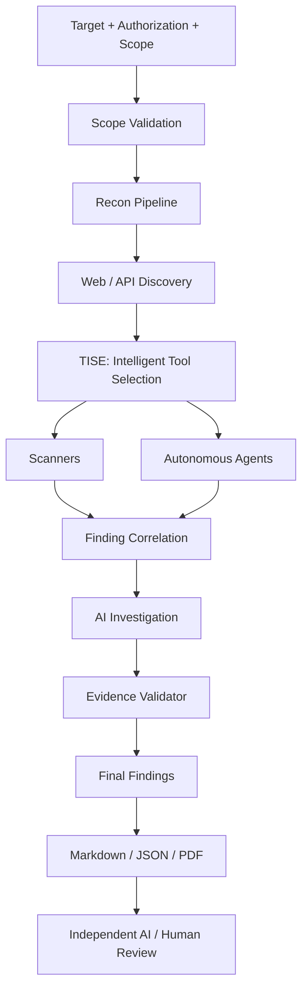

# VulnOS

**An AI-assisted, evidence-based web and API vulnerability discovery engine.**

VulnOS is designed to find, investigate and validate vulnerabilities on systems you are
explicitly authorized to test. It combines reconnaissance, web/API discovery, specialist
scanners, autonomous penetration-testing agents and a model-agnostic AI investigation layer
behind a single orchestration and evidence pipeline.

> **Status: Phase 1 — Architecture blueprint only.**
> No VulnOS runtime code exists yet. Nothing in this repository should be interpreted as a
> working scanner, a tested integration or a benchmark result. Implementation begins in Phase 2.

---

## Why VulnOS

Scanner output is not proof. Running every tool against every endpoint produces duplicates,
false positives and wasted spend. VulnOS is optimized for:

**unique, independently validated vulnerabilities per authorized testing hour and unit of cost.**

That means the platform is built around four constraints:

1. **Scope is authoritative.** Every outbound request is checked against an immutable,
   versioned scope policy — in the orchestrator *and* at the network edge.
2. **Every tool goes through one adapter contract.** No scanner or agent gets a private
   execution path.
3. **Findings are hypotheses until validated.** An LLM may investigate, but it may never
   mark a finding confirmed on its own reasoning.
4. **Selection is deliberate.** The Tool Intelligence & Selection Engine (TISE) decides what
   runs, what is skipped, and why — rather than blanket-running tools.

---

## Architecture at a glance



The detailed architecture, source-of-truth decisions and invariants live in
[docs/architecture/SYSTEM_ARCHITECTURE.md](docs/architecture/SYSTEM_ARCHITECTURE.md).

---

## Documentation

| Document | Contents |
|---|---|
| [SYSTEM_ARCHITECTURE.md](docs/architecture/SYSTEM_ARCHITECTURE.md) | System context, containers, repository layout, invariants, key decisions |
| [COMPONENT_RESPONSIBILITIES.md](docs/architecture/COMPONENT_RESPONSIBILITIES.md) | One responsibility per component, boundaries and anti-responsibilities |
| [DATA_FLOW.md](docs/architecture/DATA_FLOW.md) | End-to-end data flow, stage contracts, events, deduplication points |
| [DATABASE_DESIGN.md](docs/architecture/DATABASE_DESIGN.md) | ERD, tables, columns, keys, indexes, retention and project isolation |
| [API_CONTRACTS.md](docs/architecture/API_CONTRACTS.md) | REST contracts, auth/authz, schemas and error model |
| [TOOL_INTEGRATION.md](docs/architecture/TOOL_INTEGRATION.md) | Universal adapter, registry, normalization and tool catalog |
| [AGENT_ORCHESTRATION.md](docs/architecture/AGENT_ORCHESTRATION.md) | Agent sandboxing, leases, budgets and benchmark protocol |
| [AI_AND_VALIDATION.md](docs/architecture/AI_AND_VALIDATION.md) | Provider-independent routing, investigation and evidence validation |
| [SECURITY_ARCHITECTURE.md](docs/architecture/SECURITY_ARCHITECTURE.md) | Threat model, scope enforcement, worker isolation, secrets, AI security |
| [IMPLEMENTATION_ROADMAP.md](docs/architecture/IMPLEMENTATION_ROADMAP.md) | Seven phases, deliverables, exit criteria and open decisions |

---

## Project status

**Phase 1 — engineering blueprint only.** This repository currently contains architecture
documentation and configuration templates. There is no runtime code, database schema,
scanner integration, agent integration or AI integration yet. Implementation begins with
Phase 2 in the [roadmap](docs/architecture/IMPLEMENTATION_ROADMAP.md).

The blueprint was authored before any VulnOS application code existed. It is a design
document, not a description of deployed software. No credentials, customer data or
unrelated projects are included in this repository.

---

## Proposed repository layout

```text
.
├── backend/            FastAPI application: HTTP, auth, schemas, repositories
├── engine/             Domain and orchestration logic, independent of HTTP
│   ├── orchestrator/   Scan state machine and stage scheduling
│   ├── scope/          Authoritative scope policy and egress guard
│   ├── recon/          Asset discovery pipeline
│   ├── discovery/      Crawling, parameters, API schemas
│   ├── registry/       Tool registry and capability metadata
│   ├── tise/           Tool Intelligence & Selection Engine
│   ├── adapters/       Universal scanner and agent adapters
│   ├── correlation/    Finding deduplication and clustering
│   ├── investigation/  AI-assisted investigation plans
│   ├── validation/     Evidence-based validation gates
│   ├── reporting/      Markdown / JSON / PDF reports
│   ├── ai/             Provider-independent model router
│   ├── evidence/       Evidence object storage abstraction
│   └── db/             SQLAlchemy models and repositories
├── workers/            Celery entrypoints; no business logic
├── frontend/           React + TypeScript SPA
├── tools/              Pinned Docker images and metadata for external tools
├── infra/              Compose, egress proxy, Docker hardening
├── docs/               Architecture and operational documentation
├── tests/              Cross-package contract and end-to-end tests
└── scripts/            Developer and operator utilities
```

Every directory responsibility is defined in
[COMPONENT_RESPONSIBILITIES.md](docs/architecture/COMPONENT_RESPONSIBILITIES.md#6-repository-layout-detailed).

---

## Technology stack

| Layer | Technology |
|---|---|
| Frontend | React + TypeScript |
| Backend | Python + FastAPI |
| Database | PostgreSQL |
| ORM / migrations | SQLAlchemy + Alembic |
| Background jobs | Redis + Celery |
| HTTP client | HTTPX |
| Browser automation | Playwright |
| Tool isolation | Docker |
| Evidence storage | S3-compatible object storage |
| Testing | Pytest |
| API documentation | OpenAPI |
| Logging | Structured JSON |

No Kubernetes, microservice split or graph database is introduced in the initial phase.

---

## Safety and authorization

VulnOS is intended only for **authorized security testing**. The platform does not include,
and will not include in the initial scope, stealth/evasion, credential theft, persistence or
destructive exploitation. Operating it against systems without written authorization may be
illegal.

Mandatory controls designed in Phase 1 and implemented in later phases:

- Explicit, versioned authorization records and allow/deny scope rules.
- Default-deny scope checks before every request, every redirect and every DNS resolution.
- Blocking of loopback, link-local, private and cloud-metadata destinations unless explicitly
  authorized.
- Human approval for state-changing or destructive operations.
- Docker isolation with non-root users, resource limits and egress through an allowlisting proxy.
- Prompt-injection defenses that prevent target content from changing scope or permissions.

See [SECURITY_ARCHITECTURE.md](docs/architecture/SECURITY_ARCHITECTURE.md).

---

## Getting started

Phase 1 delivers documentation only. There is no runnable application.

Phase 2 will add the FastAPI service, PostgreSQL schema, migrations, authentication and the
project/target/scope APIs. Until then, read the blueprint in this order:

1. [SYSTEM_ARCHITECTURE.md](docs/architecture/SYSTEM_ARCHITECTURE.md)
2. [COMPONENT_RESPONSIBILITIES.md](docs/architecture/COMPONENT_RESPONSIBILITIES.md)
3. [DATA_FLOW.md](docs/architecture/DATA_FLOW.md)
4. [DATABASE_DESIGN.md](docs/architecture/DATABASE_DESIGN.md)
5. [API_CONTRACTS.md](docs/architecture/API_CONTRACTS.md)
6. [TOOL_INTEGRATION.md](docs/architecture/TOOL_INTEGRATION.md)
7. [AGENT_ORCHESTRATION.md](docs/architecture/AGENT_ORCHESTRATION.md)
8. [AI_AND_VALIDATION.md](docs/architecture/AI_AND_VALIDATION.md)
9. [SECURITY_ARCHITECTURE.md](docs/architecture/SECURITY_ARCHITECTURE.md)
10. [IMPLEMENTATION_ROADMAP.md](docs/architecture/IMPLEMENTATION_ROADMAP.md)

---

## Contributing

Architecture changes require an explicit decision record. Do not silently alter the agreed
pipeline, introduce a new infrastructure dependency, or claim a tool integration is
functional before it has a passing contract test. See the change-control rules in
[IMPLEMENTATION_ROADMAP.md](docs/architecture/IMPLEMENTATION_ROADMAP.md#14-change-control).

## License

**Unresolved.** No license has been selected. This public repository is published for review;
no reuse or redistribution license is granted until a license file is added. The chosen
license must be compatible with every bundled third-party tool. Several security tools use
GPL-family licenses, so distribution implications must be reviewed before packaging them into
a single image or installer.
