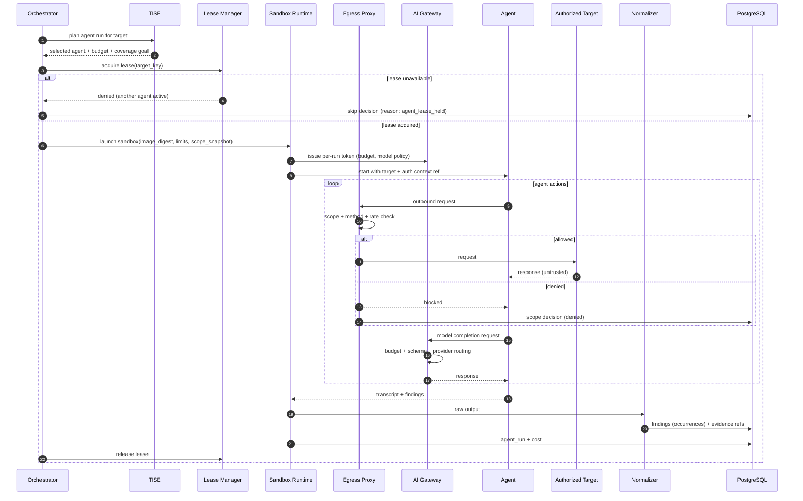

# VulnOS — Agent Orchestration

**Document status:** Phase 1 baseline
**Version:** 1.0
**Companion to:** [TOOL_INTEGRATION.md](TOOL_INTEGRATION.md), [SECURITY_ARCHITECTURE.md](SECURITY_ARCHITECTURE.md)

---

## 1. Purpose

This document defines how autonomous penetration-testing agents are selected, sandboxed,
leased, budgeted, normalized and benchmarked. Agents are powerful and unpredictable; they
are treated as **untrusted tool processes**, not as trusted operators.

> **No agent integration exists in Phase 1.** Strix, RedAmon, PentAGI and Shannon are
> candidate projects named in the product brief. Their capabilities, licenses, maintenance
> status and safety behavior must be verified in Phase 5 before integration. Nothing in this
> document is a claim that any of them works as described.

---

## 2. Candidate roles

| Agent | Proposed role | Rationale | Status |
|---|---|---|---|
| **Strix** | Primary autonomous pentesting candidate | Product brief designates it as the primary candidate | Unverified |
| **RedAmon** | Alternative and benchmark candidate | Direct comparison against Strix under identical conditions | Unverified |
| **PentAGI** | Optional experimental alternative | Explored only if it offers a distinct capability; not required for Phase 5 exit | Unverified |
| **Shannon** | White-box / source-assisted candidate | Used only when source code is in scope; not a black-box substitute | Unverified |

Rules:

- Only **one primary agent per target execution** by default.
- A benchmark may run agents sequentially against an identical target snapshot, never
  simultaneously against the same live target.
- An agent is selectable only through TISE and only if its adapter is `contract_tested`.
- The platform must remain fully functional with agents disabled
  (`FEATURE_AUTONOMOUS_AGENTS=false`).

---

## 3. Agent invariants

| ID | Invariant |
|---|---|
| AG-01 | An agent cannot add, remove or modify scope. Scope is immutable for the run. |
| AG-02 | An agent cannot call VulnOS administrative APIs. |
| AG-03 | An agent cannot access the Docker socket, host filesystem or cloud metadata. |
| AG-04 | An agent cannot install tools at runtime; its toolset is baked into the image and allowlisted. |
| AG-05 | An agent's network egress passes through the scope-enforcing proxy. |
| AG-06 | An agent's model access goes through the VulnOS AI gateway with a per-run token and budget. |
| AG-07 | An agent cannot mark a finding validated or write directly to report-ready state. |
| AG-08 | Every agent run preserves a raw transcript and a normalized finding set. |
| AG-09 | A kill switch stops the container, revokes its token and records the outcome. |
| AG-10 | State-changing or destructive actions require an external approval; the agent may request, never approve. |

---

## 4. Lifecycle



### 4.1 Phases

1. **Eligibility** — TISE selects the agent based on target type, source availability, budget
   and prior coverage.
2. **Lease** — acquire a per-target lease to prevent competing agents.
3. **Sandbox launch** — pinned image, non-root, limits, scope snapshot, per-run AI token.
4. **Execution** — agent acts; every request and model call is mediated.
5. **Collection** — transcript, artifacts, findings and cost are captured.
6. **Normalization** — findings become occurrences; evidence is attached.
7. **Cleanup** — container removed, token revoked, lease released.
8. **Correlation/validation** — normal pipeline; no special agent path.

---

## 5. Leasing and concurrency

### 5.1 One primary agent per target

`agent_runs` records `target_asset_id` and `lease_expires_at`. A partial unique index enforces
at most one active (`queued`/`running`) agent run per `(project_id, target_asset_id)`.

```sql
CREATE UNIQUE INDEX uq_agent_active_per_target
  ON agent_runs (project_id, target_asset_id)
  WHERE status IN ('queued', 'running');
```

A lease has a TTL (default 15 minutes, renewed by heartbeat). If the worker dies, the lease
expires and the orchestrator marks the run `failed`/`timeout` before another can start. Orphan
containers are reaped by a maintenance task.

### 5.2 Interaction with scanners

- By default, scanners and the agent do not run against the same target concurrently.
- The orchestrator pauses scanner dispatch for a target while an agent lease is active,
  unless the operator explicitly enables concurrent mode and the tools are read-only.
- Two different agents never run on the same target in the same scan.
- Benchmarks run sequentially, each from a clean target snapshot.

### 5.3 Why not parallel agents

Parallel agents duplicate reconnaissance, race on state-changing requests, inflate cost and
make attribution impossible. The product objective rewards validated findings per cost, not
raw agent concurrency.

---

## 6. Sandbox

| Control | Requirement |
|---|---|
| Image | Pinned by digest; built by VulnOS; no `latest` |
| User | Non-root UID/GID |
| Root filesystem | Read-only; writable `/tmp` tmpfs |
| Capabilities | `--cap-drop ALL` |
| Privileges | `no-new-privileges` |
| Resources | CPU, memory, PID and disk limits |
| Time | Hard wall-clock timeout + idle timeout |
| Network | Only `vulnos-egress` network; no direct route |
| Docker socket | Never mounted |
| Host mounts | None except read-only job input and writable output |
| Secrets | Injected as short-lived file/env; revoked after run |
| AI access | Per-run token to the AI gateway, never provider keys |
| Toolset | Baked into image; runtime installation blocked |
| Logging | stdout/stderr captured and redacted |
| Cleanup | Container removed; volumes destroyed |

The agent may use a browser, CLI tools and scripts inside its image. It may not reach the
host, the database, Redis, object storage credentials or other projects.

---

## 7. Scope enforcement for agents

An agent is treated exactly like a scanner at the network layer:

1. It receives only targets that passed scope validation.
2. Every request goes through the egress proxy and/or scope-pinned client.
3. Redirects are revalidated; DNS is pinned; private/metadata ranges are blocked unless
   explicitly authorized.
4. A denied request is logged with the agent run ID and the matched rule.
5. Repeated denials or an attempt to reach a blocked destination is a security event:
   the run is terminated and the transcript preserved.

Agents cannot change scope because:

- scope is not passed as editable configuration;
- the proxy enforces the pinned policy independently;
- the AI gateway does not expose scope-management tools;
- administrative APIs require credentials the sandbox never receives.

Prompt injection from a target cannot grant permissions: the model has no authority to alter
the proxy or the policy snapshot.

---

## 8. Budgets and cost

Per agent run:

| Budget | Enforcement |
|---|---|
| Wall clock | Container timeout + orchestrator deadline |
| Tool requests | Proxy/request counter; hard stop |
| AI input/output tokens | AI gateway per-run quota |
| AI cost | Gateway cost ledger; hard stop |
| Model calls | Max calls per run |
| Findings | Optional cap to stop runaway output |

The agent's model calls are routed through the **AI gateway**, an OpenAI-compatible facade
over the VulnOS AI Router. The gateway:

- authenticates the run with a short-lived token;
- injects the provider key server-side;
- enforces model allowlist and budget;
- records `ai_invocations`;
- validates structured outputs;
- revokes the token at run end.

The agent never sees a provider API key.

Budget exhaustion is a normal terminal condition: capture results, mark `partial`, release
the lease. It is not a crash.

---

## 9. Authentication contexts

- Agents may use an auth context only if the authorization record permits authenticated
  testing and the context is explicitly attached to the run.
- Credentials are resolved by the Secret Service at launch, injected as a short-lived file,
  and never written to the transcript.
- The agent cannot create identities or escalate privileges beyond the provided context.
- Browser storage state is isolated per run and destroyed afterward.
- Authorization testing with two identities (e.g. user A vs user B) is allowed only when the
  authorization and scope explicitly cover it. Advanced multi-identity matrices are deferred.

---

## 10. Output normalization

Agents produce heterogeneous output: prose, tool calls, screenshots, HTTP traces, scripts and
sometimes structured reports. The adapter must:

1. Preserve the **entire transcript** as an encrypted evidence object.
2. Deterministically extract structured findings where the agent provides JSON/markdown
   tables.
3. Use the AI Router with a strict schema only as a fallback for unstructured prose.
4. Map every extracted finding to the normalized occurrence schema.
5. Attach evidence IDs for each claim (request/response, screenshot, callback, command output).
6. Never accept an agent's severity or "confirmed" label as validation.
7. Record extraction method (`deterministic` or `model`) in the finding metadata.

An agent finding without reproducible evidence is still a finding, but it enters
`needs_validation` like any other. It does not skip correlation.

### 10.1 Agent-specific fields

Store in `findings.metadata` or `agent_runs`:

- agent name and version;
- model provider and model ID;
- prompt/policy version;
- toolset image digest;
- number of steps/tool calls;
- token and cost totals;
- whether the agent claimed exploitation;
- limitations reported by the agent.

---

## 11. Failure handling

| Failure | Handling |
|---|---|
| Agent crashes | Preserve transcript; mark failed; no automatic retry unless idempotent and approved |
| Agent loops | Step/time budget stops it; mark `timeout` |
| Agent attempts out-of-scope request | Block, log security event, terminate on repeat |
| Agent attempts destructive action | Block unless approval exists; record request |
| AI gateway budget exhausted | Stop model calls; allow graceful shutdown; mark partial |
| Provider outage | Router fallback; if exhausted, agent stops; partial results retained |
| Lease lost | Orchestrator stops container; another run may start after reconciliation |
| Transcript too large | Stream to object storage with cap; truncate with hash and marker |
| Prompt injection suspected | Preserve evidence; do not auto-execute; require human review |

No failure may cause an agent to be treated as validated or to bypass the normal pipeline.

---

## 12. Benchmark protocol

The purpose is to choose a primary agent with evidence, not marketing. No benchmark has been
run in Phase 1.

### 12.1 Controls

- Identical target snapshot and reset procedure.
- Identical scope and authorization.
- Identical accounts and auth contexts.
- Identical wall-clock, request, token and cost budgets.
- Identical model/provider and model version (if the agent allows configuration).
- Identical hardware/worker limits.
- Same evaluator and validation pipeline for all agents.
- At least 3 runs per agent; report median and range.
- Randomize run order to reduce warm-cache bias.

### 12.2 Metrics

| Metric | Definition |
|---|---|
| Unique validated vulnerabilities | Clusters reaching `validated` after independent review |
| False-positive rate | Rejected / total reported |
| Duplicate rate | Occurrences merged into existing clusters / total |
| Evidence reproducibility | Validated findings with a successful independent re-test / validated |
| API authorization coverage | Endpoint × identity-pair combinations actually tested / planned |
| Time per validated finding | Wall-clock hours / validated findings |
| Cost per validated finding | Total cost (tool + AI + infra) / validated findings |
| Coverage breadth | Distinct endpoints/classes touched |
| Crash/timeout rate | Failed runs / total runs |
| Scope violations | Denied out-of-scope attempts (must be zero successful) |

### 12.3 Reporting

Results are stored as a benchmark report with:

- exact agent/model/tool versions and image digests;
- target snapshot hash;
- budgets and limits;
- per-run raw metrics;
- validation method;
- limitations and threats to validity.

**Do not publish a winner without the raw data and reproduction instructions.**

### 12.4 Evaluation safeguards

- Benchmarks run only against authorized, isolated lab targets or explicitly authorized
  client environments.
- No public-internet scanning.
- A human reviews every claimed critical finding before it enters the benchmark score.
- Agents are not tuned per target in a way that cannot generalize; any tuning is disclosed.

---

## 13. Verification gate for agent integration

Before an agent adapter reaches `contract_tested`:

- [ ] License and redistribution terms reviewed.
- [ ] Upstream maintenance status and last release verified.
- [ ] Project capabilities verified by running it, not by reading a README.
- [ ] Container image builds reproducibly and runs non-root.
- [ ] Toolset is inventoried and allowlisted.
- [ ] Network egress is confirmed to pass through the proxy only.
- [ ] Scope denial test passes (including redirect and DNS rebinding).
- [ ] Destructive actions are blocked without approval.
- [ ] AI gateway token is short-lived and budget-capped.
- [ ] Transcript and evidence capture works.
- [ ] Findings normalize into the common schema.
- [ ] Kill switch works within the target SLA.
- [ ] Crash/timeout recovery leaves no orphan containers.
- [ ] Cost and token accounting reconciles with the provider.

Unverified agents are not selectable, regardless of operator request.

---

## 14. Phase 5 plan

| Step | Deliverable |
|---|---|
| 5.1 | Agent adapter interface implementation on top of the universal adapter |
| 5.2 | Sandbox image, lease mechanism, AI gateway token issuance, kill switch |
| 5.3 | Strix adapter + contract tests (primary candidate) |
| 5.4 | RedAmon adapter + contract tests (benchmark) |
| 5.5 | PentAGI adapter only if a distinct capability is demonstrated |
| 5.6 | Shannon adapter for source-assisted mode, gated on source scope |
| 5.7 | Benchmark harness and report (no fabricated results) |
| 5.8 | Operator documentation and approval workflow |

Exit criteria:

- At least Strix and one alternative are contract-tested.
- Scope cannot be bypassed in any test.
- A kill switch is demonstrated.
- Cost accounting is reconciled.
- No agent can mark a finding validated.
- A benchmark report exists with raw data, or the benchmark is explicitly deferred with a
  recorded reason.

---

## 15. Open decisions

| ID | Decision | Options | Recommendation | Deadline |
|---|---|---|---|---|
| AG-01 | Primary agent | Strix vs RedAmon | Strix first per brief; confirm by benchmark | Phase 5 |
| AG-02 | Agent concurrency | Single vs scanner+agent parallel | Single primary per target; concurrency off by default | Phase 5 |
| AG-03 | Agent model access | Direct provider vs AI gateway | Gateway only | Phase 5 |
| AG-04 | Agent transcript retention | 30/90/180 days | 180 days for now, configurable per project | Phase 5 |
| AG-05 | PentAGI inclusion | Required vs optional | Optional/experimental; do not block exit | Phase 5 |
| AG-06 | Shannon scope | Source-only vs black-box too | Source-assisted only | Phase 5 |
| AG-07 | Agent benchmark target | Local lab vs client | Local lab for repeatability; client only with explicit approval | Phase 5 |

---

## 16. Explicit non-claims

- No agent has been installed, run or benchmarked.
- No agent capability, license or maintenance claim is verified.
- No benchmark numbers exist.
- No agent is approved for use against client targets.
- The only approved mode in Phase 1 is: agents disabled.
