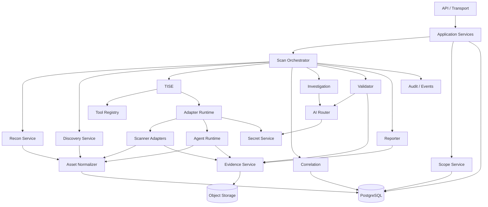

# VulnOS — Component Responsibilities

**Document status:** Phase 1 baseline
**Version:** 1.0
**Companion to:** [SYSTEM_ARCHITECTURE.md](SYSTEM_ARCHITECTURE.md)

---

## 1. Purpose

This document assigns exactly one primary responsibility to each VulnOS component, defines
its inputs and outputs, names the tables it owns, and states what it must **not** do. It is
the reference for code review: a pull request that gives a component a second
responsibility must be rejected or accompanied by an ADR.

---

## 2. Responsibility map

---

## 3. Component catalog

### 3.1 API / Transport (`backend/app/api`, `backend/app/schemas`)

| Aspect | Definition |
|---|---|
| **Single responsibility** | Translate HTTP requests into authenticated application-service calls and responses. |
| **Inputs** | HTTP requests, bearer token/session, idempotency keys, query parameters |
| **Outputs** | JSON resources, paginated collections, standardized errors, OpenAPI schema |
| **Owns** | No tables. Reads through repositories/services. |
| **Must not** | Query the database directly; execute tools; hold scan state in memory; implement business rules. |
| **Failure mode** | Return a typed error; never leak stack traces or secrets. |

Authentication, authorization and request validation belong here, but the *policy* they
enforce is owned by the Scope and Auth services.

---

### 3.2 Application Services (`backend/app/services`)

| Aspect | Definition |
|---|---|
| **Single responsibility** | Orchestrate one use case (create project, add target, request scan, export report) as a transaction. |
| **Inputs** | Validated DTOs, authenticated principal, repositories |
| **Outputs** | Domain results, outbox events, audit records |
| **Owns** | Transaction boundaries for API-initiated operations |
| **Must not** | Know HTTP status codes; call adapters; perform network I/O. |
| **Failure mode** | Roll back the transaction; emit no event. |

---

### 3.3 Scan Orchestrator (`engine/orchestrator`)

| Aspect | Definition |
|---|---|
| **Single responsibility** | Advance a scan through the approved pipeline, enforcing stage order, budgets, scope pinning and idempotency. |
| **Inputs** | Scan command, scope version, authorization, budget, stage results |
| **Outputs** | `scan_stage_runs`, queued Celery tasks, state transitions, outbox events |
| **Owns** | `scans`, `scan_stage_runs` |
| **Must not** | Parse tool output; select tools (TISE does); talk to targets; validate findings. |
| **Failure mode** | Mark the stage `failed` or `partial`; retry per policy; stop new work when authorization expires. |

The orchestrator is the only writer of scan status. It uses a PostgreSQL advisory lock per
scan to prevent concurrent stage advancement.

---

### 3.4 Scope Service (`engine/scope`)

| Aspect | Definition |
|---|---|
| **Single responsibility** | Decide whether a specific network action is authorized under an immutable scope version. |
| **Inputs** | URL/host/IP/port, method, scope version ID, resolver results, timestamp |
| **Outputs** | Allow/deny decision with matched rule, reason code, resolved and pinned IPs, policy hash |
| **Owns** | `scope_versions`, `scope_rules`, `authorization_records` (with services) |
| **Must not** | Perform scans; cache a decision beyond the lifetime of a resolution without revalidation; allow a model or target to mutate scope. |
| **Failure mode** | **Fail closed** on resolver errors, ambiguous matches or expired authorization. |

This service is used by the orchestrator for planning and by the worker/runtime for every
outbound request. It is deliberately dependency-light so it can be tested exhaustively.

---

### 3.5 Recon Service (`engine/recon`)

| Aspect | Definition |
|---|---|
| **Single responsibility** | Expand authorized seeds into structured domains, hosts, addresses, services and technologies. |
| **Inputs** | Validated targets, scope version, budget, previous asset intelligence |
| **Outputs** | Normalized asset candidates with source and timestamp |
| **Owns** | Stage logic only; persistence goes through Asset Normalizer. |
| **Must not** | Crawl application endpoints; run vulnerability payloads; persist duplicates. |
| **Failure mode** | Record partial coverage; never silently mark missing stages as complete. |

---

### 3.6 Discovery Service (`engine/discovery`)

| Aspect | Definition |
|---|---|
| **Single responsibility** | Turn known hosts/services into endpoints, parameters and API schemas. |
| **Inputs** | Hosts/services, auth contexts, scope, budget |
| **Outputs** | Endpoint candidates, parameter candidates, parsed API schemas, JS-derived routes |
| **Owns** | Stage logic only; persistence through Asset Normalizer. |
| **Must not** | Send attack payloads; claim complete API coverage; treat discovered endpoints as authorized without scope check. |
| **Failure mode** | Record discovery gaps and confidence; keep raw crawl evidence. |

---

### 3.7 Asset Normalizer (`engine/discovery/normalizer` + repositories)

| Aspect | Definition |
|---|---|
| **Single responsibility** | Convert heterogeneous observations into canonical, deduplicated assets and endpoints. |
| **Inputs** | Raw observations from recon/discovery/tools |
| **Outputs** | `assets`, `domains`, `hosts`, `host_addresses`, `services`, `endpoints`, `parameters`, `technologies`, `asset_discoveries` |
| **Owns** | Canonical key generation and upsert semantics |
| **Must not** | Decide authorization; merge endpoints using only human-readable paths; discard provenance. |
| **Failure mode** | Reject malformed observations with a recorded parse error; never overwrite first-seen provenance. |

Canonicalization rules are defined in [DATABASE_DESIGN.md](DATABASE_DESIGN.md#7-deduplication-strategy).

---

### 3.8 Tool Registry (`engine/registry`)

| Aspect | Definition |
|---|---|
| **Single responsibility** | Maintain the catalog of tools, versions, capabilities, safety profiles and verification status. |
| **Inputs** | Tool manifests, image digests, verification test results, operator overrides |
| **Outputs** | `tools`, `tool_versions`, `tool_capabilities`; capability queries for TISE |
| **Owns** | Tool metadata |
| **Must not** | Execute tools; infer capabilities from a tool's name; mark a tool verified without a passing contract test. |
| **Failure mode** | Exclude unverified/unavailable tools from selection and expose the reason. |

Verification states: `declared` → `smoke_tested` → `contract_tested` → `production_verified`.
Only `contract_tested` and above are selectable.

---

### 3.9 TISE (`engine/tise`)

| Aspect | Definition |
|---|---|
| **Single responsibility** | Choose which tools run, on which coverage units, in which order, and record why others were skipped. |
| **Inputs** | Target profile, endpoints/parameters, technologies, auth contexts, prior executions, findings, coverage gaps, registry, budget |
| **Outputs** | Ordered execution plan, `tool_selection_decisions`, coverage expectations |
| **Owns** | Selection policy and scoring |
| **Must not** | Execute tools; parse results; run every scanner by default; allow an LLM to add tools outside the registry. |
| **Failure mode** | If no tool qualifies, emit an explicit coverage gap; never fabricate coverage. |

TISE is a pure, testable module: `plan(input) -> plan_output`, with no I/O except reading a
snapshot passed by the orchestrator.

---

### 3.10 Adapter Runtime (`engine/adapters/runtime`)

| Aspect | Definition |
|---|---|
| **Single responsibility** | Execute one adapter job in an isolated container with enforced scope, timeouts, budgets and evidence capture. |
| **Inputs** | Prepared input, tool image, scope decision, credentials reference, budget |
| **Outputs** | Exit status, raw output evidence, normalized findings, coverage summary, cost |
| **Owns** | `tool_executions`, `http_exchanges` (execution-scoped) |
| **Must not** | Select tools; expand scope; write findings directly to report-ready state; access the Docker socket; persist secrets. |
| **Failure mode** | Kill the process group, capture partial output, mark `timeout`/`failed`, never retry destructively without approval. |

---

### 3.11 Scanner Adapters (`engine/adapters/scanners/*`)

| Aspect | Definition |
|---|---|
| **Single responsibility** | Translate one scanner's CLI/API contract into VulnOS input and normalized findings. |
| **Inputs** | `PreparedInput`, tool binary, scope-approved targets |
| **Outputs** | Raw output artifact, `NormalizedFinding[]`, evidence candidates, coverage summary |
| **Owns** | Tool-specific parsing only |
| **Must not** | Implement selection policy; invent fields the tool did not produce; claim a vulnerability class the tool cannot test; suppress raw output. |
| **Failure mode** | Return a parse error with a sample of redacted output; do not drop findings silently. |

One adapter per tool. Adapters may share a base class and parsers, but not execution logic.

---

### 3.12 Agent Runtime (`engine/adapters/agents`)

| Aspect | Definition |
|---|---|
| **Single responsibility** | Run one autonomous agent under a lease, budget, sandbox and scope policy, then normalize its output. |
| **Inputs** | Target set, auth contexts, agent image, model config, budget, approval token |
| **Outputs** | `agent_runs`, transcript evidence, normalized findings, cost |
| **Owns** | Agent lifecycle and sandbox configuration |
| **Must not** | Run two primary agents on the same target concurrently; let an agent change scope; let an agent install arbitrary tools; accept unverified agent claims. |
| **Failure mode** | Terminate the sandbox, preserve partial transcript, mark `failed`/`timeout`; require human review if scope violation is detected. |

---

### 3.13 Correlation (`engine/correlation`)

| Aspect | Definition |
|---|---|
| **Single responsibility** | Determine whether findings are exact duplicates, related, distinct or conflicting, and maintain canonical clusters. |
| **Inputs** | Normalized findings, evidence, asset/endpoint keys, auth context, root-cause signals |
| **Outputs** | `finding_clusters`, `findings.cluster_id`, `finding_evidence`, conflict records |
| **Owns** | Fingerprints and clustering policy |
| **Must not** | Validate a vulnerability; merge on title similarity alone; discard source attribution. |
| **Failure mode** | Leave findings unclustered (visible as `correlation_pending`) rather than merge incorrectly. |

---

### 3.14 Investigation (`engine/investigation`)

| Aspect | Definition |
|---|---|
| **Single responsibility** | Build an evidence-grounded investigation plan and hypothesis for a cluster. |
| **Inputs** | Cluster, evidence summaries, endpoint/tech/auth context, budget, routing policy |
| **Outputs** | `InvestigationPlan` (tests to run, controls, expected signals), AI invocations, updated hypothesis |
| **Owns** | Investigation planning |
| **Must not** | Mark a finding validated; execute network actions; read secrets not scoped to the project; exceed budget. |
| **Failure mode** | Return `needs_more_evidence` with a bounded next-step plan. |

---

### 3.15 Validator (`engine/validation`)

| Aspect | Definition |
|---|---|
| **Single responsibility** | Decide whether evidence satisfies the validation gates for a finding cluster, independently of the discovering tool or model. |
| **Inputs** | Cluster, evidence, scope decision, reproduction results, control comparisons, independent review |
| **Outputs** | `validations`, `validation_checks`, verdict, confidence factors, state transition |
| **Owns** | Gate definitions and confidence model |
| **Must not** | Accept an LLM assertion as proof; validate out-of-scope targets; re-use another project's evidence; mark a finding validated without the required checks. |
| **Failure mode** | Default to `needs_more_evidence`, never to `validated`. |

---

### 3.16 Reporter (`engine/reporting`)

| Aspect | Definition |
|---|---|
| **Single responsibility** | Render report-ready findings and their evidence into Markdown, JSON and PDF artifacts. |
| **Inputs** | Validated/report-ready clusters, evidence metadata, project/scan metadata, template |
| **Outputs** | `reports` row, signed artifact in object storage, content hash |
| **Owns** | Report formatting and evidence manifests |
| **Must not** | Include rejected findings without an explicit audit appendix; include unredacted secrets; invent findings or remediation. |
| **Failure mode** | Fail the report job; never emit a partial report marked complete. |

---

### 3.17 AI Router (`engine/ai`)

| Aspect | Definition |
|---|---|
| **Single responsibility** | Route a classified AI task to a configured provider/model under budget, schema, retry, fallback and cache policy. |
| **Inputs** | Task class, prompt template, context, schema, budget, routing policy |
| **Outputs** | Validated structured result, `ai_invocations`, cost, cache metadata |
| **Owns** | Provider adapters, routing, token/cost accounting |
| **Must not** | Authorize actions; expose raw prompts with secrets; silently downgrade a complex investigation; hardcode API keys. |
| **Failure mode** | Fallback within policy; if exhausted, return a typed failure and let the caller degrade gracefully. |

---

### 3.18 Evidence Service (`engine/evidence`)

| Aspect | Definition |
|---|---|
| **Single responsibility** | Store, hash, redact, retrieve and expire evidence objects. |
| **Inputs** | Bytes/streams, content type, project, retention, redaction policy |
| **Outputs** | `evidence_objects` metadata, object key, SHA-256, signed download URL |
| **Owns** | `evidence_objects` and object-storage layout |
| **Must not** | Store secrets in metadata; serve anonymous objects; delete evidence referenced by an open audit/investigation. |
| **Failure mode** | Fail the write rather than store unhashed or unredacted data; retry idempotently. |

---

### 3.19 Secret Service (`engine/security/secrets`)

| Aspect | Definition |
|---|---|
| **Single responsibility** | Resolve a secret reference to a short-lived credential for a specific project and execution. |
| **Inputs** | `secret_ref_id`, project, execution context, purpose |
| **Outputs** | In-memory secret handle; audit record; redaction registration |
| **Owns** | `secret_refs` metadata (not values) |
| **Must not** | Log values; return secrets to the API; allow cross-project resolution; persist plaintext. |
| **Failure mode** | Deny access and fail the job; never fall back to a shared credential. |

---

### 3.20 Audit & Events (`engine/events`, `backend/app/core/audit`)

| Aspect | Definition |
|---|---|
| **Single responsibility** | Record immutable audit entries and deliver reliable domain events via the transactional outbox. |
| **Inputs** | Domain state changes, actor, request ID |
| **Outputs** | `audit_logs`, `outbox_events`, Celery dispatches |
| **Owns** | Audit schema and event catalog |
| **Must not** | Store secrets or raw evidence; be optional for security-relevant actions. |
| **Failure mode** | The transaction fails if the audit write fails for a security-relevant action. |

---

## 4. Interaction rules

| From → To | Allowed? | Rule |
|---|---|---|
| API → Orchestrator | Yes | Command only; orchestrator owns state |
| API → Adapter | **No** | All execution via orchestrator/TISE |
| Orchestrator → Adapter | Yes | Through the runtime, never direct subprocess |
| TISE → Adapter | **No** | TISE returns a plan |
| Adapter → TISE | **No** | Results flow back to orchestrator |
| Adapter → PostgreSQL | Restricted | Only through the result repository/role |
| Adapter → Scope Service | Yes | Mandatory before network egress |
| Adapter → AI Router | **No** | AI is control-plane only |
| Investigation → Adapter | **No** | It proposes; orchestrator executes after policy approval |
| Validator → Adapter | Conditional | Only controlled validation jobs approved by policy |
| Reporter → Evidence | Read-only | Signed retrieval only |
| Any component → Secret values | Deny by default | Secret Service only |

---

## 5. Ownership matrix

`R` = responsible, `A` = accountable, `C` = consulted, `I` = informed.

| Activity | API | Orchestrator | Scope | TISE | Adapter | Correlation | Validator | Reporter |
|---|---|---|---|---|---|---|---|---|
| Project/scope CRUD | A/R | I | C | I | I | I | I | I |
| Scope decision | I | A | R | C | C | I | C | I |
| Scan lifecycle | C | A/R | C | C | I | I | I | I |
| Tool selection | I | A | C | R | I | I | I | I |
| Tool execution | I | A | C | I | R | I | I | I |
| Finding clustering | I | A | I | I | C | R | C | I |
| AI investigation | I | A | I | I | I | C | C | I |
| Validation verdict | I | A | C | I | C | C | R | I |
| Report generation | I | A | I | I | I | I | C | R |

---

## 6. Repository layout (detailed)

### 6.1 `backend/`

| Path | Responsibility |
|---|---|
| `app/main.py` | App factory, lifespan, middleware registration |
| `app/core/config.py` | Typed settings from environment; fails fast on missing required values |
| `app/core/logging.py` | Structured JSON logging + redaction processor |
| `app/core/errors.py` | Error taxonomy and exception handlers |
| `app/api/v1/projects.py` | Project CRUD |
| `app/api/v1/targets.py` | Targets and scope |
| `app/api/v1/assets.py` | Assets, endpoints, discovery history |
| `app/api/v1/tools.py` | Tool catalog and status |
| `app/api/v1/scans.py` | Scan creation/status/cancel/executions |
| `app/api/v1/findings.py` | Findings, evidence, validation requests |
| `app/api/v1/reports.py` | Report creation and download |
| `app/auth/` | Password/OIDC, sessions, API keys, RBAC |
| `app/repositories/` | SQLAlchemy queries; every query takes `project_id` |
| `app/services/` | Use cases and transaction boundaries |
| `app/schemas/` | Pydantic models, shared with OpenAPI |

### 6.2 `engine/`

| Path | Responsibility |
|---|---|
| `orchestrator/state_machine.py` | Legal scan/stage transitions |
| `orchestrator/scheduler.py` | Stage queueing, retries, budget checks |
| `scope/canonicalize.py` | URL/host/IP normalization |
| `scope/policy.py` | Allow/deny evaluation |
| `scope/dns_pin.py` | Resolution pinning and rebinding defense |
| `recon/stages/*.py` | Subdomain, DNS, port, HTTP, technology stages |
| `discovery/crawl.py` | Crawl orchestration |
| `discovery/js.py` | JS parsing and route extraction |
| `discovery/params.py` | Parameter discovery |
| `discovery/api_schema.py` | OpenAPI/GraphQL/Postman import |
| `registry/catalog.py` | Tool catalog service |
| `tise/candidates.py` | Candidate generation |
| `tise/scoring.py` | Coverage/cost/overlap scoring |
| `tise/planner.py` | Ordered plan and decisions |
| `adapters/base.py` | Universal adapter contract |
| `adapters/runtime.py` | Container execution, timeouts, evidence |
| `adapters/scanners/*.py` | One module per scanner |
| `adapters/agents/*.py` | One module per agent |
| `correlation/fingerprint.py` | Deterministic fingerprints |
| `correlation/cluster.py` | Exact/fuzzy clustering |
| `investigation/planner.py` | Investigation plans |
| `validation/gates.py` | Hard gates |
| `validation/confidence.py` | Explainable confidence factors |
| `reporting/builders/*.py` | Markdown/JSON/PDF builders |
| `ai/router.py` | Task routing |
| `ai/providers/*.py` | Provider adapters |
| `ai/budget.py` | Token/cost budgets |
| `evidence/store.py` | S3 abstraction |
| `evidence/redact.py` | Header/body redaction |
| `events/outbox.py` | Transactional outbox |
| `security/approvals.py` | Action hashing and approval tokens |
| `db/models/*.py` | SQLAlchemy models by domain |
| `db/repositories/*.py` | Persistence helpers |

### 6.3 `workers/`

| Path | Responsibility |
|---|---|
| `celery_app.py` | Broker config, queues, routing, signals |
| `tasks/recon.py` | Thin wrapper around `engine.recon` |
| `tasks/scan.py` | Thin wrapper around adapter runtime |
| `tasks/agent.py` | Thin wrapper around agent runtime |
| `tasks/validation.py` | Controlled validation jobs |
| `tasks/report.py` | Report rendering |
| `tasks/maintenance.py` | Retention, cache expiry, outbox relay |

Workers contain **no business logic**; they deserialize a task, call an engine function,
and map exceptions to task states.

### 6.4 `frontend/`

| Path | Responsibility |
|---|---|
| `src/app/` | Routing, layout, providers |
| `src/api/` | Generated/typed API client |
| `src/features/projects/` | Project and scope management |
| `src/features/scans/` | Scan creation, progress, coverage |
| `src/features/assets/` | Asset/endpoint explorer |
| `src/features/findings/` | Findings, evidence viewer, validation status |
| `src/features/reports/` | Report generation and download |
| `src/components/` | Shared presentational components |
| `src/lib/` | Auth, query client, formatting |

### 6.5 `infra/`

| Path | Responsibility |
|---|---|
| `compose/docker-compose.yml` | Local stack |
| `compose/docker-compose.prod.yml` | Single-host production |
| `egress-proxy/` | Allowlist proxy config and scope-sync sidecar |
| `docker/worker.Dockerfile` | Hardened worker base |
| `docker/api.Dockerfile` | API image |
| `observability/` | Log shipping and metrics config |

### 6.6 `tools/`

| Path | Responsibility |
|---|---|
| `tools/catalog.yaml` | Declarative tool metadata mirrored into the registry |
| `tools/images/<tool>/Dockerfile` | Pinned tool image |
| `tools/images/<tool>/VERSION` | Upstream version + digest |
| `tools/contract-tests/` | Adapter contract fixtures |

---

## 7. Anti-patterns explicitly rejected

| Anti-pattern | Why rejected |
|---|---|
| API calls scanner binaries | Bypasses scope, isolation, TISE and evidence capture |
| TISE hardcodes "run all scanners" | Violates optimization objective and cost control |
| Adapter writes directly to `finding_clusters` | Bypasses correlation and validation |
| LLM picks tools and executes them | Prompt injection can expand scope; no auditability |
| Storing raw HTTP bodies in PostgreSQL | Bloat, backup cost, weaker encryption/lifecycle control |
| Storing credentials in `auth_contexts` | Database compromise would expose them |
| Treating tool severity as final severity | Tool severity is a claim; validation determines impact |
| Merging findings by title | Produces false duplicates and loses distinct issues |
| Agent runs with host Docker socket | Trivial host takeover |
| Shared mutable scope during a scan | Changes authorization mid-test without consent |

---

## 8. Review checklist

For any new component or module:

- [ ] It has one sentence describing its responsibility.
- [ ] Its inputs and outputs are typed.
- [ ] It owns or explicitly avoids each table it touches.
- [ ] It has a defined failure mode that fails closed for security decisions.
- [ ] It cannot execute a tool outside the adapter runtime.
- [ ] It cannot bypass scope validation.
- [ ] It cannot mark a finding validated.
- [ ] It logs structured events without secrets.
- [ ] It has unit tests for its policy/decision logic.
- [ ] It is listed in this document or an ADR explains why not.
