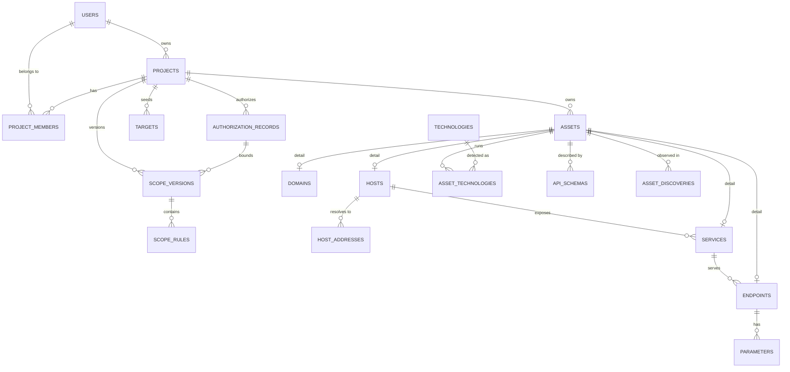
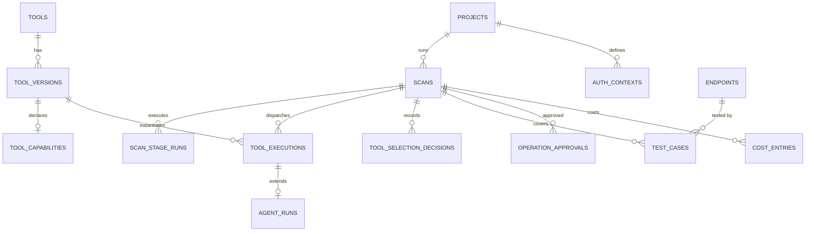
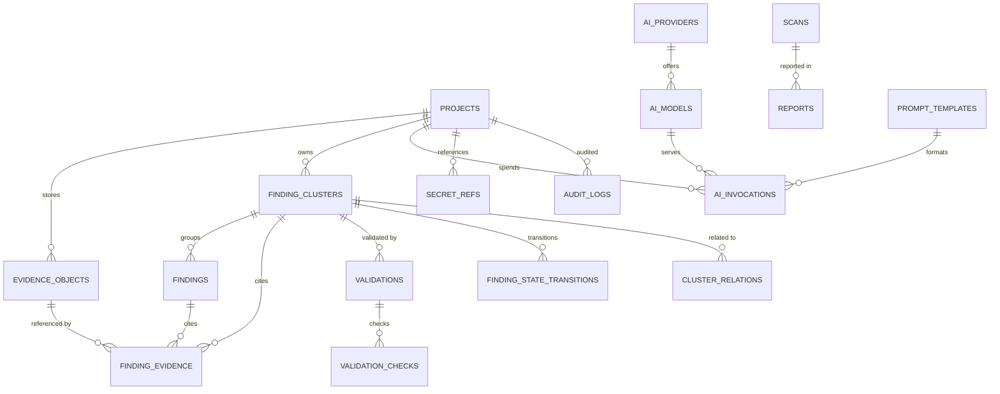

# VulnOS — Database Design

**Document status:** Phase 1 baseline
**Version:** 1.0
**Database:** PostgreSQL 16+
**ORM:** SQLAlchemy 2.x + Alembic
**Companion to:** [DATA_FLOW.md](DATA_FLOW.md), [SECURITY_ARCHITECTURE.md](SECURITY_ARCHITECTURE.md)

---

## 1. Design goals

1. PostgreSQL is the single durable system of record.
2. Every project-scoped row is isolated by `project_id` and protected by application scoping
   plus row-level security.
3. Assets, endpoints, coverage and findings are deduplicated with deterministic keys.
4. Raw evidence is stored in encrypted object storage; PostgreSQL stores metadata, hashes
   and references.
5. Every execution is reproducible: tool version, image digest, model, prompt, scope and
   authorization are recorded.
6. Finding lifecycle and validation are explicit state machines with an append-only history.
7. The schema supports historical intelligence across scans without silently reusing stale
   results.

---

## 2. Conventions

| Convention | Rule |
|---|---|
| Primary keys | `uuid` generated by the application using UUIDv7 (time-ordered) for domain entities; `bigint identity` for high-volume append-only logs |
| Timestamps | `timestamptz`, UTC, `created_at default now()` |
| Naming | `snake_case`, plural table names, singular column names |
| Foreign keys | Explicit, with deliberate `ON DELETE` behavior; no silent cascades across evidence |
| Enums | `text` + `CHECK` constraints (not native PostgreSQL enums) for evolvability |
| Money | `numeric(12,6)` USD; never floating point |
| Hashes | `bytea` (SHA-256), not hex text |
| IP addresses | `inet` / `cidr` |
| Ranges | `int4range` for ports where appropriate |
| Flexible data | `jsonb` only for genuinely open metadata, never for fields that need constraints or joins |
| Soft delete | Only `projects.archived_at`; other deletions follow retention policy |
| Tenant column | `project_id` is duplicated on child tables for RLS, indexing and safe querying, even when derivable through a parent |
| Naming of constraints | `pk_`, `fk_`, `uq_`, `ck_`, `ix_` prefixes |
| Case | Emails and hostnames normalized to lowercase before storage; display names preserve case |

### 2.1 Why `project_id` is denormalized

Every child table carries `project_id` even though it is reachable through its parent. This is
intentional:

- Row-level security policies can be applied uniformly.
- Queries never need a multi-table join to prove tenancy.
- Composite indexes `(project_id, ...)` support the dominant access pattern.
- Cross-project integrity is enforced with composite foreign keys where practical.

The cost (a redundant column) is far lower than the risk of a missing tenant filter.

---

## 3. Entity-relationship overview

### 3.1 Tenancy, authorization and assets



### 3.2 Tools, scans and execution



### 3.3 Findings, evidence, validation and AI



### 3.4 Table count and rationale

The initial model contains **50 tables**. This is not gratuitous normalization: each table
has a distinct lifecycle or access pattern. Cross-reference tables (`project_members`,
`asset_technologies`, `finding_evidence`) exist because many-to-many relationships carry
their own attributes or history. High-volume logs (`http_exchanges`, `audit_logs`) are
partitioned rather than folded into parent rows.

No table is created "for the future" without a named Phase 2–7 consumer.

### 3.5 Table responsibilities

| Table | Responsibility | Why it is separate |
|---|---|---|
| `users` | Human identities | Auth is platform-wide, not project-scoped |
| `api_keys` | Machine credentials | Separate lifecycle and revocation |
| `projects` | Top-level isolation boundary | Retention, ownership, status |
| `project_members` | Role assignments | Many-to-many with role |
| `authorization_records` | Legal/contractual authorization | Validity window and destructive policy |
| `scope_versions` | Immutable scope snapshots | Running scans must pin a version |
| `scope_rules` | Allow/deny rules within a version | Versioned rule sets |
| `scope_decisions` | Per-request authorization audit | Append-only, high volume, partitioned |
| `targets` | Operator-supplied seeds | Seeds are not authorized assets |
| `assets` | Canonical asset identity | Uniform finding/evidence linkage |
| `domains` | Domain-specific attributes | Distinct canonicalization |
| `hosts` | Host identity | Hostname/IP dedup |
| `host_addresses` | DNS resolution history | IPs change over time |
| `services` | Port/transport identity | Service-level scanning |
| `endpoints` | Method + URL identity | Vulnerability coverage unit |
| `parameters` | Input locations and names | Parameter-level testing |
| `technologies` | Technology catalog | Reusable across assets |
| `asset_technologies` | Detected tech + version | Many-to-many with confidence |
| `api_schemas` | Imported OpenAPI/GraphQL/Postman/HAR specs | Schema-aware API testing |
| `asset_discoveries` | Append-only observation provenance | Source + timestamp history |
| `tools` | Tool catalog | Stable identity across versions |
| `tool_versions` | Pinned versions/digests/verification | Reproducible execution |
| `tool_capabilities` | Capability and safety declarations | TISE matching and overlap |
| `scans` | Engagement execution unit | Budget, scope/auth pinning |
| `scan_stage_runs` | Stage attempts and metrics | Resume/retry and audit |
| `tool_executions` | One tool/agent run | Execution history |
| `tool_selection_decisions` | Selected/skipped rationale | Explainability |
| `agent_runs` | Agent-specific execution state | Lease, model, transcript |
| `auth_contexts` | Identity labels for testing | Credential references, not secrets |
| `test_cases` | Coverage units | Prevents redundant testing |
| `operation_approvals` | Destructive/state-changing approvals | Bound to exact action hash |
| `evidence_objects` | Evidence metadata and storage references | Large bytes live in S3 |
| `http_exchanges` | Request/response metadata | High-volume, partitioned |
| `findings` | Per-source occurrences | Preserve attribution |
| `finding_clusters` | Canonical findings and lifecycle | Reportable unit |
| `finding_evidence` | Evidence links | Many-to-many with roles |
| `cluster_relations` | Duplicates, related, shared endpoint, conflicts | Avoid destructive merging |
| `validations` | Validation attempts and verdicts | Independent lifecycle |
| `validation_checks` | Individual gate results | Explainable decisions |
| `finding_state_transitions` | Append-only lifecycle history | Audit and reporting |
| `reports` | Generated artifacts and versions | Immutable deliverables |
| `ai_providers` | Provider configuration | Secrets by reference |
| `ai_models` | Model catalog and price snapshot | Routing and cost |
| `prompt_templates` | Versioned prompts and schemas | Reproducibility |
| `ai_routing_policies` | Task-class routing rules | No hardcoded model IDs |
| `ai_invocations` | Every model call | Cost, cache, fallback, audit |
| `cost_entries` | Unified cost ledger | Cost per validated finding |
| `secret_refs` | Secret-manager references only | No secret values in PostgreSQL |
| `audit_logs` | Security-relevant actions | Append-only, partitioned |
| `outbox_events` | Reliable event delivery | Avoid dual-write inconsistency |

---

## 4. Table definitions

### 4.1 Identity and tenancy

#### `users`

| Column | Type | Constraints / notes |
|---|---|---|
| `id` | `uuid` | PK |
| `email` | `text` | NOT NULL; unique on `lower(email)` |
| `display_name` | `text` | NOT NULL |
| `password_hash` | `text` | NULL when OIDC-only; Argon2id |
| `auth_provider` | `text` | NOT NULL default `local`; `CHECK IN ('local','oidc')` |
| `is_active` | `boolean` | NOT NULL default true |
| `created_at` | `timestamptz` | NOT NULL default now() |
| `updated_at` | `timestamptz` | NOT NULL default now() |
| `last_login_at` | `timestamptz` | NULL |

#### `api_keys`

| Column | Type | Constraints / notes |
|---|---|---|
| `id` | `uuid` | PK |
| `user_id` | `uuid` | FK → `users(id)` ON DELETE CASCADE |
| `name` | `text` | NOT NULL |
| `key_prefix` | `text` | NOT NULL; first 8 chars for identification |
| `key_hash` | `bytea` | NOT NULL; unique; HMAC-SHA-256 with pepper |
| `scopes` | `text[]` | NOT NULL default `{}`; API scopes, not project roles |
| `expires_at` | `timestamptz` | NULL = no expiry |
| `last_used_at` | `timestamptz` | NULL |
| `revoked_at` | `timestamptz` | NULL |
| `created_at` | `timestamptz` | NOT NULL default now() |

#### `projects`

| Column | Type | Constraints / notes |
|---|---|---|
| `id` | `uuid` | PK |
| `name` | `text` | NOT NULL; 1–200 chars |
| `slug` | `text` | NOT NULL; unique; lowercase `[a-z0-9-]{3,80}` |
| `description` | `text` | NULL |
| `status` | `text` | NOT NULL default `active`; `CHECK IN ('active','archived')` |
| `owner_id` | `uuid` | FK → `users(id)`; NOT NULL |
| `default_retention_days` | `integer` | NOT NULL default 90; `CHECK BETWEEN 1 AND 3650` |
| `created_at` | `timestamptz` | NOT NULL default now() |
| `updated_at` | `timestamptz` | NOT NULL default now() |
| `archived_at` | `timestamptz` | NULL |

#### `project_members`

| Column | Type | Constraints / notes |
|---|---|---|
| `project_id` | `uuid` | PK part; FK → `projects(id)` ON DELETE CASCADE |
| `user_id` | `uuid` | PK part; FK → `users(id)` ON DELETE CASCADE |
| `role` | `text` | NOT NULL; `CHECK IN ('owner','admin','operator','viewer')` |
| `created_at` | `timestamptz` | NOT NULL default now() |

`PRIMARY KEY (project_id, user_id)`.

#### `authorization_records`

| Column | Type | Constraints / notes |
|---|---|---|
| `id` | `uuid` | PK |
| `project_id` | `uuid` | FK → `projects(id)` ON DELETE CASCADE; NOT NULL |
| `reference` | `text` | NOT NULL; contract/ticket/email identifier (not the document body) |
| `document_evidence_id` | `uuid` | FK → `evidence_objects(id)`; NULL allowed, encrypted storage |
| `authorized_by_name` | `text` | NOT NULL |
| `authorized_by_contact` | `text` | NOT NULL |
| `valid_from` | `timestamptz` | NOT NULL |
| `valid_to` | `timestamptz` | NOT NULL; `CHECK (valid_to > valid_from)` |
| `allowed_actions` | `text[]` | NOT NULL; e.g. `scan`, `validate`, `agent_run` |
| `destructive_allowed` | `boolean` | NOT NULL default false |
| `allow_private_ranges` | `boolean` | NOT NULL default false; required for private CIDRs in scope |
| `max_requests_per_scan` | `bigint` | NULL; hard cap |
| `notes` | `text` | NULL |
| `created_by` | `uuid` | FK → `users(id)`; NOT NULL |
| `created_at` | `timestamptz` | NOT NULL default now() |
| `revoked_at` | `timestamptz` | NULL |

#### `scope_versions`

| Column | Type | Constraints / notes |
|---|---|---|
| `id` | `uuid` | PK |
| `project_id` | `uuid` | FK → `projects(id)` ON DELETE CASCADE; NOT NULL |
| `authorization_id` | `uuid` | FK → `authorization_records(id)`; NOT NULL |
| `version` | `integer` | NOT NULL; `CHECK (version > 0)` |
| `status` | `text` | NOT NULL default `draft`; `CHECK IN ('draft','active','superseded')` |
| `content_hash` | `bytea` | NOT NULL; SHA-256 of canonicalized rules |
| `created_by` | `uuid` | FK → `users(id)`; NOT NULL |
| `created_at` | `timestamptz` | NOT NULL default now() |
| `activated_at` | `timestamptz` | NULL |
| `superseded_at` | `timestamptz` | NULL |

Constraints: `UNIQUE (project_id, version)`; partial unique index ensuring at most one
`active` version per project.

#### `scope_rules`

| Column | Type | Constraints / notes |
|---|---|---|
| `id` | `uuid` | PK |
| `scope_version_id` | `uuid` | FK → `scope_versions(id)` ON DELETE CASCADE; NOT NULL |
| `effect` | `text` | NOT NULL; `CHECK IN ('allow','deny')` |
| `match_type` | `text` | NOT NULL; `CHECK IN ('exact_url','url_prefix','exact_host','domain_suffix','wildcard_domain','ip','cidr')` |
| `value` | `text` | NOT NULL; canonicalized form |
| `ports` | `int4range` | NULL = any |
| `protocols` | `text[]` | NULL = any; allowed values `http`, `https`, `tcp`, `udp` |
| `priority` | `integer` | NOT NULL default 100; higher wins within effect |
| `note` | `text` | NULL |
| `created_at` | `timestamptz` | NOT NULL default now() |

Deny rules always override allow rules regardless of priority.

#### `scope_decisions`

| Column | Type | Constraints / notes |
|---|---|---|
| `id` | `bigint` | PK part `(id, decided_at)`; identity |
| `project_id` | `uuid` | NOT NULL; FK → `projects(id)` |
| `scan_id` | `uuid` | FK → `scans(id)`; NULL for pre-scan checks |
| `scope_version_id` | `uuid` | FK → `scope_versions(id)`; NOT NULL |
| `authorization_id` | `uuid` | FK → `authorization_records(id)`; NOT NULL |
| `subject` | `text` | NOT NULL; redacted URL/host/IP being evaluated |
| `method` | `text` | NULL |
| `allowed` | `boolean` | NOT NULL |
| `reason_code` | `text` | NOT NULL; `allowed_rule`, `explicit_deny`, `default_deny`, `authorization_expired`, `private_range_blocked`, `metadata_blocked`, `dns_failure`, `invalid_target` |
| `matched_rule_id` | `uuid` | FK → `scope_rules(id)`; NULL |
| `resolved_ips` | `inet[]` | NOT NULL default `{}` |
| `policy_hash` | `bytea` | NOT NULL |
| `decided_at` | `timestamptz` | NOT NULL default now(); partition key |
| `context` | `jsonb` | NOT NULL default `{}` |

Scope decisions are append-only and partitioned monthly. They are the authoritative audit
trail proving that a request was authorized at the time it was made.

#### `targets`

| Column | Type | Constraints / notes |
|---|---|---|
| `id` | `uuid` | PK |
| `project_id` | `uuid` | FK → `projects(id)` ON DELETE CASCADE; NOT NULL |
| `name` | `text` | NOT NULL |
| `seed_type` | `text` | NOT NULL; `CHECK IN ('domain','host','ip','url','api_base','repository')` |
| `seed_value` | `text` | NOT NULL; canonicalized |
| `description` | `text` | NULL |
| `status` | `text` | NOT NULL default `active`; `CHECK IN ('active','archived')` |
| `created_by` | `uuid` | FK → `users(id)`; NOT NULL |
| `created_at` | `timestamptz` | NOT NULL default now() |
| `archived_at` | `timestamptz` | NULL |

`UNIQUE (project_id, seed_type, seed_value)`.

---

### 4.2 Assets and discovery

#### `assets`

| Column | Type | Constraints / notes |
|---|---|---|
| `id` | `uuid` | PK |
| `project_id` | `uuid` | FK → `projects(id)` ON DELETE CASCADE; NOT NULL |
| `kind` | `text` | NOT NULL; `CHECK IN ('domain','host','service','endpoint','repository')` |
| `canonical_key` | `text` | NOT NULL; deterministic, ≤ 2048 chars |
| `display_name` | `text` | NOT NULL |
| `first_seen_at` | `timestamptz` | NOT NULL |
| `last_seen_at` | `timestamptz` | NOT NULL |
| `source_count` | `integer` | NOT NULL default 1 |
| `confidence` | `numeric(4,3)` | NOT NULL default 1.000; `CHECK BETWEEN 0 AND 1` |
| `attributes` | `jsonb` | NOT NULL default `{}` |
| `created_at` | `timestamptz` | NOT NULL default now() |
| `updated_at` | `timestamptz` | NOT NULL default now() |

`UNIQUE (project_id, kind, canonical_key)`.

#### `domains`

| Column | Type | Constraints / notes |
|---|---|---|
| `asset_id` | `uuid` | PK; FK → `assets(id)` ON DELETE CASCADE |
| `project_id` | `uuid` | NOT NULL; FK → `projects(id)` |
| `name` | `text` | NOT NULL; lowercase IDNA |
| `registrable_domain` | `text` | NULL |
| `parent_domain` | `text` | NULL |

`UNIQUE (project_id, name)`.

#### `hosts`

| Column | Type | Constraints / notes |
|---|---|---|
| `asset_id` | `uuid` | PK; FK → `assets(id)` ON DELETE CASCADE |
| `project_id` | `uuid` | NOT NULL; FK → `projects(id)` |
| `canonical_name` | `text` | NOT NULL; lowercase FQDN or compressed IP |
| `host_kind` | `text` | NOT NULL; `CHECK IN ('hostname','ip')` |
| `created_at` | `timestamptz` | NOT NULL default now() |

`UNIQUE (project_id, canonical_name)`.

#### `host_addresses`

| Column | Type | Constraints / notes |
|---|---|---|
| `id` | `uuid` | PK |
| `project_id` | `uuid` | NOT NULL; FK → `projects(id)` |
| `host_id` | `uuid` | FK → `hosts(asset_id)` ON DELETE CASCADE; NOT NULL |
| `ip` | `inet` | NOT NULL |
| `first_seen_at` | `timestamptz` | NOT NULL |
| `last_seen_at` | `timestamptz` | NOT NULL |
| `source` | `text` | NOT NULL |
| `last_tool_execution_id` | `uuid` | FK → `tool_executions(id)`; NULL |

`UNIQUE (host_id, ip)`.

#### `services`

| Column | Type | Constraints / notes |
|---|---|---|
| `asset_id` | `uuid` | PK; FK → `assets(id)` ON DELETE CASCADE |
| `project_id` | `uuid` | NOT NULL; FK → `projects(id)` |
| `host_id` | `uuid` | FK → `hosts(asset_id)` ON DELETE CASCADE; NOT NULL |
| `port` | `integer` | NOT NULL; `CHECK BETWEEN 1 AND 65535` |
| `transport` | `text` | NOT NULL; `CHECK IN ('tcp','udp')` |
| `protocol` | `text` | NULL; e.g. `http`, `https`, `ssh` |
| `state` | `text` | NOT NULL default `open`; `CHECK IN ('open','filtered','closed','unknown')` |
| `banner` | `text` | NULL; truncated, redacted |
| `tls` | `boolean` | NOT NULL default false |
| `first_seen_at` | `timestamptz` | NOT NULL |
| `last_seen_at` | `timestamptz` | NOT NULL |

`UNIQUE (host_id, port, transport)`.

#### `endpoints`

| Column | Type | Constraints / notes |
|---|---|---|
| `asset_id` | `uuid` | PK; FK → `assets(id)` ON DELETE CASCADE |
| `project_id` | `uuid` | NOT NULL; FK → `projects(id)` |
| `host_id` | `uuid` | FK → `hosts(asset_id)`; NOT NULL |
| `service_id` | `uuid` | FK → `services(asset_id)`; NULL |
| `method` | `text` | NOT NULL; uppercase; `CHECK IN ('GET','POST','PUT','PATCH','DELETE','HEAD','OPTIONS','TRACE','CONNECT')` |
| `scheme` | `text` | NOT NULL; `CHECK IN ('http','https')` |
| `host` | `text` | NOT NULL |
| `port` | `integer` | NOT NULL |
| `path` | `text` | NOT NULL; exact path, ≤ 4096 chars |
| `query_template` | `text` | NULL; sorted keys with empty values |
| `path_template` | `text` | NULL; from API schema, e.g. `/v1/users/{id}` |
| `normalized_url` | `text` | NOT NULL; redacted display form |
| `url_hash` | `bytea` | NOT NULL; SHA-256 of canonical identity |
| `auth_required` | `boolean` | NULL = unknown |
| `content_type` | `text` | NULL |
| `last_status_code` | `integer` | NULL |
| `first_seen_at` | `timestamptz` | NOT NULL |
| `last_seen_at` | `timestamptz` | NOT NULL |

`UNIQUE (project_id, method, url_hash)`.

#### `parameters`

| Column | Type | Constraints / notes |
|---|---|---|
| `id` | `uuid` | PK |
| `project_id` | `uuid` | NOT NULL; FK → `projects(id)` |
| `endpoint_id` | `uuid` | FK → `endpoints(asset_id)` ON DELETE CASCADE; NOT NULL |
| `location` | `text` | NOT NULL; `CHECK IN ('query','path','header','cookie','body_json','body_form','graphql_arg')` |
| `name` | `text` | NOT NULL |
| `data_type` | `text` | NULL |
| `sample_redacted` | `text` | NULL; never a secret |
| `first_seen_at` | `timestamptz` | NOT NULL |
| `last_seen_at` | `timestamptz` | NOT NULL |

`UNIQUE (endpoint_id, location, name)`.

#### `technologies`

| Column | Type | Constraints / notes |
|---|---|---|
| `id` | `uuid` | PK |
| `name` | `text` | NOT NULL |
| `category` | `text` | NOT NULL; e.g. `web_server`, `framework`, `cms`, `language`, `library` |
| `vendor` | `text` | NULL |
| `cpe` | `text` | NULL |
| `created_at` | `timestamptz` | NOT NULL default now() |

`UNIQUE (name, category)`.

#### `asset_technologies`

| Column | Type | Constraints / notes |
|---|---|---|
| `asset_id` | `uuid` | PK part; FK → `assets(id)` ON DELETE CASCADE |
| `technology_id` | `uuid` | PK part; FK → `technologies(id)` |
| `project_id` | `uuid` | NOT NULL; FK → `projects(id)` |
| `version` | `text` | NULL |
| `confidence` | `numeric(4,3)` | NOT NULL default 1.000 |
| `evidence_id` | `uuid` | FK → `evidence_objects(id)`; NULL |
| `first_seen_at` | `timestamptz` | NOT NULL |
| `last_seen_at` | `timestamptz` | NOT NULL |

`PRIMARY KEY (asset_id, technology_id)`.

#### `api_schemas`

| Column | Type | Constraints / notes |
|---|---|---|
| `id` | `uuid` | PK |
| `project_id` | `uuid` | NOT NULL; FK → `projects(id)` |
| `asset_id` | `uuid` | FK → `assets(id)` ON DELETE CASCADE; NOT NULL |
| `schema_type` | `text` | NOT NULL; `CHECK IN ('openapi','graphql','postman','har')` |
| `version_label` | `text` | NULL |
| `source_url` | `text` | NULL; redacted |
| `spec_evidence_id` | `uuid` | FK → `evidence_objects(id)`; NOT NULL |
| `spec_hash` | `bytea` | NOT NULL; SHA-256 |
| `operation_count` | `integer` | NOT NULL default 0 |
| `created_at` | `timestamptz` | NOT NULL default now() |

`UNIQUE (project_id, asset_id, schema_type, spec_hash)`.

#### `asset_discoveries`

| Column | Type | Constraints / notes |
|---|---|---|
| `id` | `bigint` | PK identity |
| `project_id` | `uuid` | NOT NULL; FK → `projects(id)` |
| `asset_id` | `uuid` | FK → `assets(id)` ON DELETE CASCADE; NOT NULL |
| `scan_id` | `uuid` | FK → `scans(id)`; NULL for imports |
| `tool_execution_id` | `uuid` | FK → `tool_executions(id)`; NULL |
| `source` | `text` | NOT NULL; tool name or `manual` |
| `discovered_at` | `timestamptz` | NOT NULL |
| `confidence` | `numeric(4,3)` | NOT NULL default 1.000 |
| `metadata` | `jsonb` | NOT NULL default `{}` |

This table is append-only and provides the required source/timestamp provenance for every
discovered asset.

---

### 4.3 Tools, scans and execution

#### `tools`

| Column | Type | Constraints / notes |
|---|---|---|
| `id` | `uuid` | PK |
| `name` | `text` | NOT NULL; unique; e.g. `nuclei` |
| `category` | `text` | NOT NULL; `recon`, `discovery`, `scanner`, `api`, `agent`, `sast`, `secrets`, `sca` |
| `vendor` | `text` | NULL |
| `upstream_url` | `text` | NULL |
| `license` | `text` | NULL; verified value, not guessed |
| `description` | `text` | NULL |
| `maintenance_status` | `text` | NOT NULL default `unknown`; `CHECK IN ('active','maintenance','stale','unknown','abandoned')` |
| `default_image` | `text` | NULL |
| `created_at` | `timestamptz` | NOT NULL default now() |
| `updated_at` | `timestamptz` | NOT NULL default now() |

#### `tool_versions`

| Column | Type | Constraints / notes |
|---|---|---|
| `id` | `uuid` | PK |
| `tool_id` | `uuid` | FK → `tools(id)` ON DELETE CASCADE; NOT NULL |
| `version` | `text` | NOT NULL |
| `image_ref` | `text` | NOT NULL |
| `image_digest` | `text` | NOT NULL; `sha256:...` |
| `released_at` | `timestamptz` | NULL |
| `verified_at` | `timestamptz` | NULL |
| `verification_status` | `text` | NOT NULL default `declared`; `CHECK IN ('declared','smoke_tested','contract_tested','production_verified','quarantined')` |
| `capabilities_hash` | `bytea` | NULL |
| `created_at` | `timestamptz` | NOT NULL default now() |

`UNIQUE (tool_id, version, image_digest)`.

#### `tool_capabilities`

| Column | Type | Constraints / notes |
|---|---|---|
| `id` | `uuid` | PK |
| `tool_version_id` | `uuid` | FK → `tool_versions(id)` ON DELETE CASCADE; NOT NULL; UNIQUE |
| `vulnerability_classes` | `text[]` | NOT NULL default `{}` |
| `target_types` | `text[]` | NOT NULL default `{}`; e.g. `web`, `api`, `graphql`, `source` |
| `required_inputs` | `text[]` | NOT NULL default `{}` |
| `install_requirements` | `text[]` | NOT NULL default `{}` |
| `input_schema` | `jsonb` | NOT NULL default `{}` |
| `output_formats` | `text[]` | NOT NULL default `{}` |
| `auth_support` | `boolean` | NOT NULL default false |
| `passive` | `boolean` | NOT NULL default false |
| `active` | `boolean` | NOT NULL default false |
| `state_changing` | `boolean` | NOT NULL default false |
| `destructive` | `boolean` | NOT NULL default false |
| `cost_tier` | `text` | NOT NULL; `CHECK IN ('low','medium','high')` |
| `expected_duration_seconds` | `integer` | NULL |
| `overlap_group` | `text` | NOT NULL; selection uses this to suppress redundant work |
| `max_concurrency` | `integer` | NOT NULL default 1 |
| `requires_approval` | `boolean` | NOT NULL default false |
| `metadata` | `jsonb` | NOT NULL default `{}`; capability metadata, rate limits, template packs |
| `notes` | `text` | NULL |

`CHECK (passive OR active)`; `CHECK (NOT destructive OR requires_approval)`.

#### `scans`

| Column | Type | Constraints / notes |
|---|---|---|
| `id` | `uuid` | PK |
| `project_id` | `uuid` | NOT NULL; FK → `projects(id)` ON DELETE CASCADE |
| `name` | `text` | NOT NULL |
| `scan_type` | `text` | NOT NULL; `CHECK IN ('recon','discovery','web','api','agent','full','validation')` |
| `status` | `text` | NOT NULL default `draft`; `CHECK IN ('draft','queued','running','paused','completed','failed','cancelled')` |
| `scope_version_id` | `uuid` | FK → `scope_versions(id)`; NOT NULL |
| `authorization_id` | `uuid` | FK → `authorization_records(id)`; NOT NULL |
| `target_ids` | `uuid[]` | NOT NULL |
| `profile` | `jsonb` | NOT NULL default `{}` |
| `budget` | `jsonb` | NOT NULL; wall-clock, requests, cost, tokens |
| `requested_by` | `uuid` | FK → `users(id)`; NOT NULL |
| `started_at` | `timestamptz` | NULL |
| `finished_at` | `timestamptz` | NULL |
| `cancel_requested_at` | `timestamptz` | NULL |
| `cost_usd` | `numeric(12,6)` | NOT NULL default 0 |
| `stats` | `jsonb` | NOT NULL default `{}` |
| `created_at` | `timestamptz` | NOT NULL default now() |
| `updated_at` | `timestamptz` | NOT NULL default now() |

#### `scan_stage_runs`

| Column | Type | Constraints / notes |
|---|---|---|
| `id` | `uuid` | PK |
| `project_id` | `uuid` | NOT NULL; FK → `projects(id)` |
| `scan_id` | `uuid` | FK → `scans(id)` ON DELETE CASCADE; NOT NULL |
| `stage` | `text` | NOT NULL; `CHECK IN ('scope','recon','discovery','selection','scanning','agent','correlation','investigation','validation','reporting')` |
| `attempt` | `integer` | NOT NULL default 1; `CHECK (attempt > 0)` |
| `status` | `text` | NOT NULL; `CHECK IN ('pending','running','succeeded','partial','failed','skipped','cancelled')` |
| `started_at` | `timestamptz` | NULL |
| `finished_at` | `timestamptz` | NULL |
| `metrics` | `jsonb` | NOT NULL default `{}` |
| `error_code` | `text` | NULL |
| `error_message` | `text` | NULL; redacted |
| `created_at` | `timestamptz` | NOT NULL default now() |

`UNIQUE (scan_id, stage, attempt)`.

#### `tool_executions`

| Column | Type | Constraints / notes |
|---|---|---|
| `id` | `uuid` | PK |
| `project_id` | `uuid` | NOT NULL; FK → `projects(id)` |
| `scan_id` | `uuid` | FK → `scans(id)` ON DELETE CASCADE; NOT NULL |
| `stage` | `text` | NOT NULL |
| `tool_version_id` | `uuid` | FK → `tool_versions(id)`; NOT NULL |
| `status` | `text` | NOT NULL; `CHECK IN ('queued','running','succeeded','failed','timeout','cancelled','skipped','scope_violation')` |
| `target_asset_id` | `uuid` | FK → `assets(id)`; NULL |
| `endpoint_id` | `uuid` | FK → `endpoints(asset_id)`; NULL |
| `auth_context_id` | `uuid` | FK → `auth_contexts(id)`; NULL |
| `input` | `jsonb` | NOT NULL default `{}`; redacted |
| `command_redacted` | `text` | NULL |
| `worker_id` | `text` | NULL |
| `attempt` | `integer` | NOT NULL default 1 |
| `parent_execution_id` | `uuid` | FK → `tool_executions(id)`; NULL |
| `started_at` | `timestamptz` | NULL |
| `finished_at` | `timestamptz` | NULL |
| `exit_code` | `integer` | NULL |
| `error_code` | `text` | NULL |
| `error_message` | `text` | NULL |
| `coverage_summary` | `jsonb` | NOT NULL default `{}` |
| `stats` | `jsonb` | NOT NULL default `{}` |
| `cost_usd` | `numeric(12,6)` | NOT NULL default 0 |
| `created_at` | `timestamptz` | NOT NULL default now() |

#### `tool_selection_decisions`

| Column | Type | Constraints / notes |
|---|---|---|
| `id` | `uuid` | PK |
| `project_id` | `uuid` | NOT NULL; FK → `projects(id)` |
| `scan_id` | `uuid` | FK → `scans(id)` ON DELETE CASCADE; NOT NULL |
| `tool_version_id` | `uuid` | FK → `tool_versions(id)`; NOT NULL |
| `decision` | `text` | NOT NULL; `CHECK IN ('selected','skipped')` |
| `reason_code` | `text` | NOT NULL; e.g. `coverage_gain`, `already_covered`, `overlap`, `no_capability`, `budget`, `unverified`, `scope`, `approval_required` |
| `rationale` | `text` | NOT NULL |
| `score` | `numeric(12,6)` | NULL |
| `coverage_gap` | `jsonb` | NULL |
| `budget_snapshot` | `jsonb` | NOT NULL default `{}` |
| `created_at` | `timestamptz` | NOT NULL default now() |

#### `agent_runs`

| Column | Type | Constraints / notes |
|---|---|---|
| `execution_id` | `uuid` | PK; FK → `tool_executions(id)` ON DELETE CASCADE |
| `project_id` | `uuid` | NOT NULL; FK → `projects(id)` |
| `target_asset_id` | `uuid` | FK → `assets(id)`; NOT NULL; target for lease scope |
| `agent_name` | `text` | NOT NULL |
| `agent_version` | `text` | NOT NULL |
| `model_provider` | `text` | NULL |
| `model_id` | `text` | NULL |
| `config_hash` | `bytea` | NOT NULL |
| `sandbox_id` | `text` | NULL |
| `budget` | `jsonb` | NOT NULL |
| `status` | `text` | NOT NULL; `CHECK IN ('queued','running','succeeded','failed','timeout','cancelled','scope_violation')` |
| `lease_expires_at` | `timestamptz` | NULL; heartbeat-renewed |
| `started_at` | `timestamptz` | NULL |
| `finished_at` | `timestamptz` | NULL |
| `findings_count` | `integer` | NOT NULL default 0 |
| `transcript_evidence_id` | `uuid` | FK → `evidence_objects(id)`; NULL |
| `created_at` | `timestamptz` | NOT NULL default now() |

An agent is still a tool execution; `agent_runs` is a 1:1 extension, not a parallel pipeline.

Partial unique index:

```sql
CREATE UNIQUE INDEX uq_agent_active_per_target
  ON agent_runs (project_id, target_asset_id)
  WHERE status IN ('queued', 'running');
```

This enforces one active primary agent per target.

#### `auth_contexts`

| Column | Type | Constraints / notes |
|---|---|---|
| `id` | `uuid` | PK |
| `project_id` | `uuid` | NOT NULL; FK → `projects(id)` |
| `label` | `text` | NOT NULL; e.g. `anonymous`, `user-a`, `admin` |
| `identity_type` | `text` | NOT NULL; `CHECK IN ('anonymous','user','admin','service')` |
| `secret_ref_id` | `uuid` | FK → `secret_refs(id)`; NULL for anonymous |
| `attributes` | `jsonb` | NOT NULL default `{}`; roles/scopes, never secrets |
| `created_at` | `timestamptz` | NOT NULL default now() |
| `revoked_at` | `timestamptz` | NULL |

`UNIQUE (project_id, label)`.

#### `test_cases`

| Column | Type | Constraints / notes |
|---|---|---|
| `id` | `uuid` | PK |
| `project_id` | `uuid` | NOT NULL; FK → `projects(id)` |
| `scan_id` | `uuid` | FK → `scans(id)` ON DELETE CASCADE; NOT NULL |
| `endpoint_id` | `uuid` | FK → `endpoints(asset_id)`; NOT NULL |
| `vulnerability_class` | `text` | NOT NULL |
| `auth_context_id` | `uuid` | FK → `auth_contexts(id)`; NULL = anonymous |
| `coverage_key` | `bytea` | NOT NULL; SHA-256 of project/endpoint/class/auth |
| `status` | `text` | NOT NULL; `CHECK IN ('planned','running','tested','not_applicable','error','skipped')` |
| `tool_execution_id` | `uuid` | FK → `tool_executions(id)`; NULL |
| `created_at` | `timestamptz` | NOT NULL default now() |
| `updated_at` | `timestamptz` | NOT NULL default now() |

`UNIQUE (scan_id, coverage_key)`.

#### `operation_approvals`

| Column | Type | Constraints / notes |
|---|---|---|
| `id` | `uuid` | PK |
| `project_id` | `uuid` | NOT NULL; FK → `projects(id)` |
| `scan_id` | `uuid` | FK → `scans(id)` ON DELETE CASCADE; NOT NULL |
| `action_hash` | `bytea` | NOT NULL; SHA-256 of canonical action |
| `action_description` | `text` | NOT NULL; human-readable |
| `risk_level` | `text` | NOT NULL; `CHECK IN ('state_changing','destructive')` |
| `requested_by_execution_id` | `uuid` | FK → `tool_executions(id)`; NULL |
| `approved_by` | `uuid` | FK → `users(id)`; NOT NULL |
| `approved_at` | `timestamptz` | NOT NULL |
| `expires_at` | `timestamptz` | NOT NULL; `CHECK (expires_at > approved_at)` |
| `consumed_at` | `timestamptz` | NULL |
| `scope_snapshot` | `jsonb` | NOT NULL |

`UNIQUE (scan_id, action_hash)`.

---

### 4.4 Findings, evidence and validation

#### `evidence_objects`

| Column | Type | Constraints / notes |
|---|---|---|
| `id` | `uuid` | PK |
| `project_id` | `uuid` | NOT NULL; FK → `projects(id)` ON DELETE CASCADE |
| `kind` | `text` | NOT NULL; `CHECK IN ('http_request','http_response','screenshot','tool_output','agent_transcript','report','authorization_document','api_spec','other')` |
| `storage_backend` | `text` | NOT NULL; `s3` |
| `bucket` | `text` | NOT NULL |
| `object_key` | `text` | NOT NULL; `projects/{project_id}/{kind}/{sha256}` |
| `sha256` | `bytea` | NOT NULL |
| `size_bytes` | `bigint` | NOT NULL; `CHECK (size_bytes >= 0)` |
| `content_type` | `text` | NOT NULL |
| `encryption_mode` | `text` | NOT NULL; `CHECK IN ('sse-s3','sse-kms','client_envelope')` |
| `encryption_key_ref` | `text` | NULL; KMS key ARN/name, never key material |
| `redaction_status` | `text` | NOT NULL; `CHECK IN ('pending','redacted','not_required','failed')` |
| `retention_until` | `timestamptz` | NOT NULL |
| `created_by_execution_id` | `uuid` | FK → `tool_executions(id)`; NULL |
| `created_at` | `timestamptz` | NOT NULL default now() |
| `deleted_at` | `timestamptz` | NULL |

`UNIQUE (project_id, sha256, kind)`.

#### `http_exchanges`

| Column | Type | Constraints / notes |
|---|---|---|
| `id` | `bigint` | PK part `(id, occurred_at)`; identity |
| `project_id` | `uuid` | NOT NULL; FK → `projects(id)` |
| `scan_id` | `uuid` | FK → `scans(id)` ON DELETE CASCADE; NOT NULL |
| `tool_execution_id` | `uuid` | FK → `tool_executions(id)`; NULL |
| `endpoint_id` | `uuid` | FK → `endpoints(asset_id)`; NULL |
| `method` | `text` | NOT NULL |
| `url_redacted` | `text` | NOT NULL |
| `request_evidence_id` | `uuid` | FK → `evidence_objects(id)`; NULL |
| `response_evidence_id` | `uuid` | FK → `evidence_objects(id)`; NULL |
| `status_code` | `integer` | NULL |
| `request_bytes` | `integer` | NULL |
| `response_bytes` | `integer` | NULL |
| `duration_ms` | `integer` | NULL |
| `occurred_at` | `timestamptz` | NOT NULL; partition key |
| `redirect_chain` | `jsonb` | NOT NULL default `[]` |
| `tls` | `jsonb` | NOT NULL default `{}` |
| `error_code` | `text` | NULL |

Partitioned by range on `occurred_at` (monthly).

#### `finding_clusters`

| Column | Type | Constraints / notes |
|---|---|---|
| `id` | `uuid` | PK |
| `project_id` | `uuid` | NOT NULL; FK → `projects(id)` ON DELETE CASCADE |
| `canonical_key` | `bytea` | NOT NULL |
| `vulnerability_class` | `text` | NOT NULL |
| `title` | `text` | NOT NULL |
| `severity` | `text` | NOT NULL; `CHECK IN ('info','low','medium','high','critical')` |
| `status` | `text` | NOT NULL default `detected`; `CHECK IN ('detected','needs_validation','validated','rejected','report_ready')` |
| `asset_id` | `uuid` | FK → `assets(id)`; NOT NULL |
| `endpoint_id` | `uuid` | FK → `endpoints(asset_id)`; NULL |
| `parameter_id` | `uuid` | FK → `parameters(id)`; NULL |
| `auth_context_id` | `uuid` | FK → `auth_contexts(id)`; NULL |
| `first_detected_at` | `timestamptz` | NOT NULL |
| `last_seen_at` | `timestamptz` | NOT NULL |
| `validated_at` | `timestamptz` | NULL |
| `report_ready_at` | `timestamptz` | NULL |
| `confidence_score` | `numeric(5,2)` | NULL; `CHECK BETWEEN 0 AND 100`; triage aid, never proof |
| `confidence_factors` | `jsonb` | NOT NULL default `{}` |
| `root_cause` | `text` | NULL; consolidated root-cause explanation |
| `impact_summary` | `text` | NULL |
| `remediation` | `text` | NULL |
| `created_at` | `timestamptz` | NOT NULL default now() |
| `updated_at` | `timestamptz` | NOT NULL default now() |

`UNIQUE (project_id, canonical_key)`.

#### `findings`

| Column | Type | Constraints / notes |
|---|---|---|
| `id` | `uuid` | PK |
| `project_id` | `uuid` | NOT NULL; FK → `projects(id)` ON DELETE CASCADE |
| `cluster_id` | `uuid` | FK → `finding_clusters(id)`; NULL until correlated |
| `source_type` | `text` | NOT NULL; `CHECK IN ('scanner','agent','static','import','manual','ai')` |
| `source_tool_version_id` | `uuid` | FK → `tool_versions(id)`; NULL |
| `agent_run_id` | `uuid` | FK → `agent_runs(execution_id)`; NULL |
| `asset_id` | `uuid` | FK → `assets(id)`; NOT NULL |
| `endpoint_id` | `uuid` | FK → `endpoints(asset_id)`; NULL |
| `parameter_id` | `uuid` | FK → `parameters(id)`; NULL |
| `vulnerability_class` | `text` | NOT NULL |
| `title` | `text` | NOT NULL |
| `severity_claimed` | `text` | NULL; tool's claim |
| `confidence_claimed` | `numeric(4,3)` | NULL |
| `description` | `text` | NULL; sanitized |
| `root_cause_key` | `text` | NULL; normalized root-cause signal for correlation |
| `raw_output_evidence_id` | `uuid` | FK → `evidence_objects(id)`; NULL |
| `detected_at` | `timestamptz` | NOT NULL |
| `status` | `text` | NOT NULL default `new`; `CHECK IN ('new','correlated','duplicate','suppressed')` |
| `fingerprint` | `bytea` | NOT NULL |
| `created_at` | `timestamptz` | NOT NULL default now() |

#### `finding_evidence`

| Column | Type | Constraints / notes |
|---|---|---|
| `id` | `uuid` | PK |
| `project_id` | `uuid` | NOT NULL; FK → `projects(id)` |
| `cluster_id` | `uuid` | FK → `finding_clusters(id)` ON DELETE CASCADE; NULL until correlated |
| `finding_id` | `uuid` | FK → `findings(id)`; NULL |
| `evidence_id` | `uuid` | FK → `evidence_objects(id)`; NOT NULL |
| `role` | `text` | NOT NULL; `CHECK IN ('request','response','poc','screenshot','log','transcript','control','document','other')` |
| `created_at` | `timestamptz` | NOT NULL default now() |

`CHECK (cluster_id IS NOT NULL OR finding_id IS NOT NULL)`. Partial unique indexes:
`(finding_id, evidence_id, role) WHERE finding_id IS NOT NULL` and
`(cluster_id, evidence_id, role) WHERE cluster_id IS NOT NULL`. This allows evidence to be
attached to an occurrence before correlation and promoted to a cluster afterward.

#### `cluster_relations`

| Column | Type | Constraints / notes |
|---|---|---|
| `id` | `uuid` | PK |
| `project_id` | `uuid` | NOT NULL; FK → `projects(id)` |
| `from_cluster_id` | `uuid` | FK → `finding_clusters(id)` ON DELETE CASCADE; NOT NULL |
| `to_cluster_id` | `uuid` | FK → `finding_clusters(id)` ON DELETE CASCADE; NOT NULL |
| `relation_type` | `text` | NOT NULL; `CHECK IN ('duplicate_candidate','related','shares_endpoint','conflict')` |
| `confidence` | `numeric(4,3)` | NULL |
| `details` | `jsonb` | NOT NULL default `{}` |
| `reviewed_by` | `uuid` | FK → `users(id)`; NULL |
| `reviewed_at` | `timestamptz` | NULL |
| `created_at` | `timestamptz` | NOT NULL default now() |

`CHECK (from_cluster_id <> to_cluster_id)`; `UNIQUE (from_cluster_id, to_cluster_id, relation_type)`.

#### `validations`

| Column | Type | Constraints / notes |
|---|---|---|
| `id` | `uuid` | PK |
| `project_id` | `uuid` | NOT NULL; FK → `projects(id)` |
| `cluster_id` | `uuid` | FK → `finding_clusters(id)` ON DELETE CASCADE; NOT NULL |
| `requested_by` | `uuid` | FK → `users(id)`; NULL for automated |
| `stage` | `text` | NOT NULL; `CHECK IN ('evidence_review','plan','controlled_validation','independent_review','complete')` |
| `status` | `text` | NOT NULL; `CHECK IN ('pending','running','passed','failed','inconclusive','cancelled')` |
| `plan` | `jsonb` | NOT NULL default `{}` |
| `performed_by_execution_id` | `uuid` | FK → `tool_executions(id)`; NULL |
| `reviewer_type` | `text` | NULL; `CHECK IN ('human','model')` |
| `reviewer_model_invocation_id` | `uuid` | FK → `ai_invocations(id)`; NULL |
| `reviewer_user_id` | `uuid` | FK → `users(id)`; NULL |
| `verdict` | `text` | NULL; `CHECK IN ('validated','rejected','needs_more_evidence')` |
| `rationale` | `text` | NULL |
| `confidence_score` | `numeric(5,2)` | NULL |
| `started_at` | `timestamptz` | NULL |
| `finished_at` | `timestamptz` | NULL |
| `created_at` | `timestamptz` | NOT NULL default now() |

#### `validation_checks`

| Column | Type | Constraints / notes |
|---|---|---|
| `id` | `uuid` | PK |
| `validation_id` | `uuid` | FK → `validations(id)` ON DELETE CASCADE; NOT NULL |
| `check_type` | `text` | NOT NULL; `CHECK IN ('scope','reproducibility','evidence_completeness','control_comparison','impact','alternative_explanation','duplicate','independent_review','authorization_context')` |
| `result` | `text` | NOT NULL; `CHECK IN ('pass','fail','inconclusive','not_applicable')` |
| `evidence_id` | `uuid` | FK → `evidence_objects(id)`; NULL |
| `details` | `jsonb` | NOT NULL default `{}` |
| `created_at` | `timestamptz` | NOT NULL default now() |

#### `finding_state_transitions`

| Column | Type | Constraints / notes |
|---|---|---|
| `id` | `bigint` | PK identity |
| `project_id` | `uuid` | NOT NULL; FK → `projects(id)` |
| `cluster_id` | `uuid` | FK → `finding_clusters(id)` ON DELETE CASCADE; NOT NULL |
| `from_status` | `text` | NULL |
| `to_status` | `text` | NOT NULL |
| `reason` | `text` | NULL |
| `actor_type` | `text` | NOT NULL; `CHECK IN ('user','system','model')` |
| `actor_id` | `text` | NULL |
| `validation_id` | `uuid` | FK → `validations(id)`; NULL |
| `created_at` | `timestamptz` | NOT NULL default now() |

#### `reports`

| Column | Type | Constraints / notes |
|---|---|---|
| `id` | `uuid` | PK |
| `project_id` | `uuid` | NOT NULL; FK → `projects(id)` |
| `scan_id` | `uuid` | FK → `scans(id)`; NOT NULL |
| `format` | `text` | NOT NULL; `CHECK IN ('markdown','json','pdf')` |
| `status` | `text` | NOT NULL; `CHECK IN ('queued','running','ready','failed')` |
| `version` | `integer` | NOT NULL; `CHECK (version > 0)` |
| `finding_ids` | `uuid[]` | NOT NULL |
| `filters` | `jsonb` | NOT NULL default `{}` |
| `artifact_evidence_id` | `uuid` | FK → `evidence_objects(id)`; NULL |
| `content_hash` | `bytea` | NULL |
| `generated_by` | `uuid` | FK → `users(id)`; NULL |
| `generated_at` | `timestamptz` | NULL |
| `created_at` | `timestamptz` | NOT NULL default now() |

`UNIQUE (scan_id, version, format)`.

---

### 4.5 AI, cost and platform

#### `ai_providers`

| Column | Type | Constraints / notes |
|---|---|---|
| `id` | `uuid` | PK |
| `name` | `text` | NOT NULL; unique |
| `kind` | `text` | NOT NULL; `CHECK IN ('openai_compatible','anthropic','google','local')` |
| `base_url` | `text` | NULL for provider default |
| `secret_ref_id` | `uuid` | FK → `secret_refs(id)`; NULL for local |
| `enabled` | `boolean` | NOT NULL default true |
| `config` | `jsonb` | NOT NULL default `{}` |
| `created_at` | `timestamptz` | NOT NULL default now() |

#### `ai_models`

| Column | Type | Constraints / notes |
|---|---|---|
| `id` | `uuid` | PK |
| `provider_id` | `uuid` | FK → `ai_providers(id)` ON DELETE CASCADE; NOT NULL |
| `model_id` | `text` | NOT NULL |
| `display_name` | `text` | NOT NULL |
| `context_window` | `integer` | NULL |
| `max_output_tokens` | `integer` | NULL |
| `input_price_per_mtok` | `numeric(12,6)` | NULL |
| `output_price_per_mtok` | `numeric(12,6)` | NULL |
| `capabilities` | `text[]` | NOT NULL default `{}`; `structured_output`, `long_context`, `vision` |
| `status` | `text` | NOT NULL default `active`; `CHECK IN ('active','degraded','disabled')` |
| `created_at` | `timestamptz` | NOT NULL default now() |

`UNIQUE (provider_id, model_id)`.

#### `prompt_templates`

| Column | Type | Constraints / notes |
|---|---|---|
| `id` | `uuid` | PK |
| `name` | `text` | NOT NULL |
| `version` | `integer` | NOT NULL; `CHECK (version > 0)` |
| `task_class` | `text` | NOT NULL |
| `template` | `text` | NOT NULL |
| `output_schema` | `jsonb` | NOT NULL |
| `hash` | `bytea` | NOT NULL |
| `created_at` | `timestamptz` | NOT NULL default now() |

`UNIQUE (name, version)`.

#### `ai_routing_policies`

| Column | Type | Constraints / notes |
|---|---|---|
| `id` | `uuid` | PK |
| `task_class` | `text` | NOT NULL; unique |
| `min_tier` | `text` | NOT NULL; `CHECK IN ('small','medium','strong')` |
| `preferred_model_id` | `uuid` | FK → `ai_models(id)`; NOT NULL |
| `fallback_model_ids` | `uuid[]` | NOT NULL default `{}` |
| `max_input_tokens` | `integer` | NOT NULL |
| `max_output_tokens` | `integer` | NOT NULL |
| `max_cost_usd` | `numeric(12,6)` | NOT NULL |
| `temperature` | `numeric(3,2)` | NOT NULL default 0.00; `CHECK BETWEEN 0 AND 2` |
| `prompt_template_id` | `uuid` | FK → `prompt_templates(id)`; NOT NULL |
| `updated_at` | `timestamptz` | NOT NULL default now() |

#### `ai_invocations`

| Column | Type | Constraints / notes |
|---|---|---|
| `id` | `uuid` | PK |
| `project_id` | `uuid` | NOT NULL; FK → `projects(id)` |
| `scan_id` | `uuid` | FK → `scans(id)`; NULL |
| `task_class` | `text` | NOT NULL |
| `model_id` | `uuid` | FK → `ai_models(id)`; NOT NULL |
| `prompt_template_id` | `uuid` | FK → `prompt_templates(id)`; NOT NULL |
| `request_hash` | `bytea` | NOT NULL |
| `input_tokens` | `integer` | NULL |
| `output_tokens` | `integer` | NULL |
| `cached_tokens` | `integer` | NULL |
| `cost_usd` | `numeric(12,6)` | NOT NULL default 0 |
| `latency_ms` | `integer` | NULL |
| `status` | `text` | NOT NULL; `CHECK IN ('succeeded','failed','timeout','schema_error','budget_exceeded')` |
| `response_evidence_id` | `uuid` | FK → `evidence_objects(id)`; NULL |
| `cache_hit` | `boolean` | NOT NULL default false |
| `fallback_from_id` | `uuid` | FK → `ai_invocations(id)`; NULL |
| `error_code` | `text` | NULL |
| `created_at` | `timestamptz` | NOT NULL default now() |

#### `cost_entries`

| Column | Type | Constraints / notes |
|---|---|---|
| `id` | `bigint` | PK identity |
| `project_id` | `uuid` | NOT NULL; FK → `projects(id)` |
| `scan_id` | `uuid` | FK → `scans(id)`; NULL |
| `category` | `text` | NOT NULL; `CHECK IN ('tool_compute','ai_tokens','storage','network','other')` |
| `amount_usd` | `numeric(12,6)` | NOT NULL |
| `quantity` | `numeric(18,6)` | NULL |
| `unit` | `text` | NULL; `requests`, `tokens`, `gb_month` |
| `reference_type` | `text` | NULL; `tool_execution`, `ai_invocation` |
| `reference_id` | `uuid` | NULL |
| `created_at` | `timestamptz` | NOT NULL default now() |

#### `secret_refs`

| Column | Type | Constraints / notes |
|---|---|---|
| `id` | `uuid` | PK |
| `project_id` | `uuid` | NULL for global; FK → `projects(id)` ON DELETE CASCADE |
| `name` | `text` | NOT NULL |
| `backend` | `text` | NOT NULL; `CHECK IN ('env','file','vault','aws_secrets_manager','gcp_secret_manager')` |
| `path` | `text` | NOT NULL; secret-manager path, never a value |
| `version` | `text` | NULL |
| `created_by` | `uuid` | FK → `users(id)`; NOT NULL |
| `created_at` | `timestamptz` | NOT NULL default now() |
| `rotated_at` | `timestamptz` | NULL |

`UNIQUE (project_id, name)`; no column stores secret material.

#### `audit_logs`

| Column | Type | Constraints / notes |
|---|---|---|
| `id` | `bigint` | PK part `(id, created_at)`; identity |
| `project_id` | `uuid` | NULL; FK → `projects(id)` |
| `actor_type` | `text` | NOT NULL; `CHECK IN ('user','api_key','system','worker','model')` |
| `actor_id` | `text` | NULL |
| `action` | `text` | NOT NULL |
| `entity_type` | `text` | NOT NULL |
| `entity_id` | `text` | NULL |
| `before_hash` | `bytea` | NULL |
| `after_hash` | `bytea` | NULL |
| `ip` | `inet` | NULL |
| `user_agent` | `text` | NULL |
| `request_id` | `text` | NULL |
| `metadata` | `jsonb` | NOT NULL default `{}`; never secrets |
| `created_at` | `timestamptz` | NOT NULL default now(); partition key |

#### `outbox_events`

| Column | Type | Constraints / notes |
|---|---|---|
| `id` | `bigint` | PK identity |
| `aggregate_type` | `text` | NOT NULL |
| `aggregate_id` | `uuid` | NOT NULL |
| `event_type` | `text` | NOT NULL |
| `payload` | `jsonb` | NOT NULL |
| `created_at` | `timestamptz` | NOT NULL default now() |
| `published_at` | `timestamptz` | NULL |
| `attempts` | `integer` | NOT NULL default 0 |

Index on `(published_at) WHERE published_at IS NULL`.

---

## 5. Indexing strategy

Indexes exist for measured access patterns, not every column.

| Table | Index | Purpose |
|---|---|---|
| `project_members` | PK `(project_id, user_id)`; `(user_id)` | Authorization lookup |
| `targets` | unique `(project_id, seed_type, seed_value)`; `(project_id, status)` | List active targets |
| `scope_rules` | `(scope_version_id, effect)` | Policy evaluation |
| `scope_decisions` | `(project_id, decided_at DESC)`; `(scan_id)`; `(allowed, reason_code)` | Authorization audit |
| `scope_versions` | partial unique `(project_id) WHERE status='active'` | At most one active scope |
| `assets` | unique `(project_id, kind, canonical_key)`; `(project_id, last_seen_at DESC)` | Dedup and recency |
| `hosts` | unique `(project_id, canonical_name)` | Dedup |
| `host_addresses` | `(host_id, ip)` | Resolution history |
| `services` | unique `(host_id, port, transport)` | Dedup |
| `endpoints` | unique `(project_id, method, url_hash)`; `(project_id, host_id)`; `(endpoint path_template)` optional | Dedup and listing |
| `parameters` | unique `(endpoint_id, location, name)` | Dedup |
| `asset_discoveries` | `(asset_id, discovered_at DESC)`; `(scan_id)` | Provenance and scan review |
| `tool_capabilities` | GIN `(vulnerability_classes)`; `(overlap_group)` | TISE candidate queries |
| `tool_executions` | `(scan_id, status)`; `(project_id, created_at DESC)`; `(tool_version_id)` | Execution history |
| `tool_selection_decisions` | `(scan_id, decision)` | Explainability |
| `agent_runs` | partial unique `(project_id, target_asset_id) WHERE status IN ('queued','running')` | One active agent per target |
| `test_cases` | unique `(scan_id, coverage_key)`; `(project_id, endpoint_id, vulnerability_class)` | Coverage lookup |
| `evidence_objects` | unique `(project_id, sha256, kind)`; `(retention_until) WHERE deleted_at IS NULL` | Dedup and retention |
| `http_exchanges` | `(project_id, occurred_at DESC)`; `(scan_id)` | Investigation and audit |
| `findings` | `(project_id, cluster_id)`; `(fingerprint)`; `(project_id, detected_at DESC)` | Correlation |
| `finding_clusters` | unique `(project_id, canonical_key)`; `(project_id, status, severity)` | Triage lists |
| `validations` | `(cluster_id, created_at DESC)`; `(status)` | Validation queue |
| `validation_checks` | `(validation_id, check_type)` | Gate evaluation |
| `finding_state_transitions` | `(cluster_id, created_at)` | Lifecycle audit |
| `reports` | unique `(scan_id, version, format)` | Versioning |
| `ai_invocations` | `(project_id, created_at DESC)`; `(scan_id)`; `(task_class, status)` | Cost and routing analytics |
| `cost_entries` | `(project_id, created_at)`; `(scan_id, category)` | Cost per finding |
| `audit_logs` | `(project_id, created_at DESC)`; `(actor_type, actor_id)` | Audit review |
| `outbox_events` | partial `(created_at) WHERE published_at IS NULL` | Relay |

Guidelines:

- Prefer composite indexes starting with `project_id`.
- Use partial indexes for active/status-filtered queries.
- Use GIN only for array/JSONB fields actually queried.
- Do not index low-selectivity booleans alone.
- Verify with `EXPLAIN (ANALYZE, BUFFERS)` before adding indexes.
- For partitioned tables, create indexes on the parent; PostgreSQL propagates them.

---

## 6. Evidence storage references

Raw evidence never lives in PostgreSQL. The contract is:

1. The caller streams bytes to the Evidence Service.
2. The service redacts sensitive headers/values, computes SHA-256, and writes to
   `s3://{bucket}/projects/{project_id}/{kind}/{sha256}`.
3. It inserts `evidence_objects` with metadata, hash, size, encryption mode, key reference,
   redaction status and `retention_until`.
4. Callers store only `evidence_id` references.
5. Downloads use short-lived signed URLs after an authorization check.

Rules:

- Object keys are opaque and project-prefixed; never include target hostnames or secrets.
- Encryption: SSE-KMS in production; optional client-side envelope encryption for
  authorization documents and captured credentials-adjacent evidence.
- Integrity is verified on read by comparing the stored SHA-256.
- Deleting an object requires a retention job that checks references from validations,
  findings and reports.
- Evidence is immutable; corrections create a new object and link both.

---

## 7. Deduplication strategy

### 7.1 Canonicalization

| Entity | Canonical key | Rules |
|---|---|---|
| Domain | `lower(IDNA(name)).rstrip('.')` | Reject wildcard as an asset; wildcard is a scope concept |
| Host | lowercase FQDN or compressed IP | IPv6 compressed; IPv4-mapped IPv6 normalized |
| Service | `host_key + ':' + port + '/' + transport` | Port range validated |
| Endpoint | `METHOD + ' ' + normalized_url` | Lowercase scheme/host, IDNA, strip default ports, remove fragment, sort query keys, drop query values, normalize percent-encoding of unreserved characters, resolve dot segments, **do not** collapse numeric/UUID path segments |
| Parameter | `endpoint_key + '|' + location + '|' + name` | Name case preserved; location exact |
| Finding | see §7.2 | Deterministic hash |
| Coverage | `project + endpoint + vulnerability_class + auth_context` | One coverage unit per test context |

`path_template` is stored separately and used for API-aware grouping. It is **not** part of
endpoint identity, because `/users/1` and `/users/2` may have different authorization
behavior and must both be testable.

### 7.2 Finding fingerprint

```text
sha256(
  project_id || 0x1f ||
  asset_canonical_key || 0x1f ||
  method || 0x1f ||
  normalized_path || 0x1f ||
  parameter_location || ":" || parameter_name || 0x1f ||
  vulnerability_class || 0x1f ||
  auth_context_key || 0x1f ||
  coalesce(root_cause_key, 'unknown') || 0x1f ||
  evidence_signature
)
```

`evidence_signature` is a normalized signal, not the raw payload:

- response differential class (status/body-length/header change);
- sink or reflection marker;
- error signature;
- out-of-band callback identity;
- for SAST: rule ID + source/sink location.

Including the payload hash would make every payload variant a new finding. Excluding the
signal would merge unrelated issues on the same endpoint.

### 7.3 Merge policy

| Situation | Action |
|---|---|
| Same fingerprint from two tools | One cluster; both occurrences retained |
| Same asset/class, different parameter or auth context | Separate clusters |
| Same endpoint, different vulnerability class | Separate clusters; link `shares_endpoint` |
| Similar title only | **No merge** |
| Fuzzy similarity above threshold | Create `duplicate_candidate` relation for review; do not auto-merge |
| Conflicting results | `conflict` relation; escalate to validation |
| Same finding in a later scan | Attach new occurrence to the existing project cluster; update `last_seen_at` |

### 7.4 Asset merge policy

Assets merge only when canonical keys match. If a hostname later resolves to an additional
IP, a new `host_addresses` row is added; the host asset is not duplicated. If two hostnames
are CNAMEs of the same host, they remain distinct hosts with a discovered relationship in
`attributes` until a future explicit alias model exists.

---

## 8. Execution history model

```text
scans
  └── scan_stage_runs (stage, attempt)
        └── tool_executions (tool_version, target, auth context)
              ├── agent_runs (1:1 for agents)
              ├── test_cases (coverage units)
              ├── http_exchanges (bounded metadata)
              └── cost_entries
```

Requirements satisfied:

- **Tool version reproducibility:** `tool_versions.image_digest` + `command_redacted`.
- **Model reproducibility:** `agent_runs.model_provider/model_id`, `ai_invocations.model_id`,
  `prompt_template_id`, `request_hash`.
- **Scope reproducibility:** `scans.scope_version_id` + `authorization_id`.
- **Selection explainability:** `tool_selection_decisions` for selected and skipped tools.
- **Coverage:** `test_cases` + `tool_executions.coverage_summary`.
- **Cost:** `tool_executions.cost_usd`, `ai_invocations.cost_usd`, unified `cost_entries`.
- **History:** append-only stage/execution/transition rows; retries create new attempts.

No execution row is deleted while its scan is retained. Sensitive inputs are redacted before
storage; raw output remains in evidence storage with its own retention.

---

## 9. Finding lifecycle model

### 9.1 Cluster status

Only five statuses are permitted:

| Status | Meaning |
|---|---|
| `detected` | Occurrence recorded, not yet correlated |
| `needs_validation` | Correlated and awaiting or undergoing validation |
| `validated` | All mandatory gates passed and independent review accepted |
| `rejected` | Validation disproved the hypothesis, or it is out of scope/duplicate |
| `report_ready` | Validated and approved for inclusion in a report |

### 9.2 Validation stages

`validations.stage` tracks the internal process without overloading cluster status:

`evidence_review` → `plan` → `controlled_validation` → `independent_review` → `complete`.

### 9.3 Transition rules

| From | To | Allowed when |
|---|---|---|
| — | `detected` | First occurrence inserted |
| `detected` | `needs_validation` | Correlated to a cluster and evidence attached |
| `needs_validation` | `validated` | All mandatory checks pass + independent review |
| `needs_validation` | `rejected` | A mandatory check fails definitively, or duplicate/out-of-scope |
| `needs_validation` | `needs_validation` | More evidence requested; remains open |
| `validated` | `report_ready` | Report inclusion approved |
| `rejected` | `needs_validation` | New evidence attached and a new validation is opened |
| `report_ready` | `validated` | Report retracted; audit reason required |

Every transition writes `finding_state_transitions`. Direct updates that skip a transition are
rejected by the service layer and by a database trigger (Phase 6 hardening).

### 9.4 Confidence model

`confidence_score` is an explainable triage aid, not proof. The validator computes factors:

| Factor | Weight | Input |
|---|---|---|
| Reproducibility | 0.25 | Independent controlled re-test |
| Evidence completeness | 0.20 | Request/response, timestamps, auth context, tool version |
| Control comparison | 0.15 | Negative/positive control behavior |
| Demonstrated impact | 0.15 | Concrete security consequence |
| Scope/auth clarity | 0.10 | In-scope, identity context understood |
| Independent review | 0.10 | Separate model/provider or human |
| Signal consistency | 0.05 | No alternative explanation / conflicting results |

`score = 100 * Σ(weight_i * factor_i)`, with each factor ∈ [0,1]. The score and factor
values are stored in `finding_clusters.confidence_factors`. A score below the configured
threshold routes to `needs_more_evidence`; a score above it **does not** bypass gates.

---

## 10. Project isolation strategy

Three layers:

1. **Application scoping.** Every repository method requires a `project_id` derived from the
   authenticated request, never from a client-supplied body. Cross-project IDs return 404,
   not 403, to avoid existence leaks.
2. **PostgreSQL row-level security.** All project-scoped tables enable RLS with a policy
   `project_id = current_setting('app.project_id')::uuid`. The application sets
   `SET LOCAL app.project_id` at transaction start. A dedicated maintenance role bypasses RLS
   only for retention jobs, and its use is audited.
3. **Storage isolation.** Object keys are prefixed with the project ID; signed URLs are
   scoped to a single object; bucket policies deny cross-prefix listing.

Additional controls:

- Composite foreign keys (e.g. `(project_id, scan_id)`) prevent attaching a child to a parent
  in another project.
- `project_members` is checked on every API request; membership is cached for at most 60 s.
- Rate limits and budgets are per project.
- Audit queries are project-scoped; platform-wide audit requires an explicit operator role.

---

## 11. Retention and partitioning

| Data class | Default retention | Mechanism |
|---|---|---|
| Raw HTTP request/response evidence | 90 days | `evidence_objects.retention_until` + S3 lifecycle |
| Screenshots / browser traces | 30 days | Same |
| Agent transcripts | 180 days | Same |
| Tool raw output | 90 days | Same |
| Authorization documents | Life of project + 2 years | Separate policy |
| Findings and validations | 2 years after last update | Row retention job |
| Reports | 7 years or project setting | Immutable artifacts |
| AI invocation metadata | 1 year | Row retention |
| AI prompt/response bodies | 90 days | Evidence retention |
| Audit logs | 2 years | Monthly partitions |
| Scope decisions | 2 years | Monthly partitions |
| `http_exchanges` metadata | 180 days | Monthly partitions, drop old partitions |
| Cost entries | 2 years | Row retention |

Partitioned tables: `scope_decisions`, `http_exchanges`, `audit_logs`. Partitioned tables use a
composite primary key that includes the partition column, as PostgreSQL requires. Consider `cost_entries` if volume grows.
Partition maintenance is automated; a missing future partition is an alert, not a silent
failure.

---

## 12. Migration policy

- Alembic is the only schema change mechanism. No manual production DDL.
- One logical change per migration; descriptive revision messages.
- Naming conventions are enforced via SQLAlchemy metadata.
- CI runs `alembic upgrade head` against a fresh PostgreSQL container and `alembic check`
  to detect model drift.
- Production migrations are forward-only; down migrations are maintained for development.
- Destructive changes (drop column/table, type narrowing) use expand/contract:
  1. add nullable/new structure;
  2. dual-write/backfill;
  3. switch reads;
  4. remove old structure in a later release.
- Enum-like `CHECK` constraints evolve by dropping and re-adding the constraint in a
  transaction; no native enum migrations.
- Large backfills run in batches outside the migration transaction and are idempotent.
- Every migration has a rollback note in the PR even when no down migration is shipped.

---

## 13. Reference DDL (critical tables)

```sql
CREATE TABLE projects (
    id                     uuid PRIMARY KEY,
    name                   text NOT NULL CHECK (char_length(name) BETWEEN 1 AND 200),
    slug                   text NOT NULL UNIQUE CHECK (slug ~ '^[a-z0-9-]{3,80}$'),
    description            text,
    status                 text NOT NULL DEFAULT 'active'
                           CHECK (status IN ('active','archived')),
    owner_id               uuid NOT NULL REFERENCES users(id),
    default_retention_days integer NOT NULL DEFAULT 90
                           CHECK (default_retention_days BETWEEN 1 AND 3650),
    created_at             timestamptz NOT NULL DEFAULT now(),
    updated_at             timestamptz NOT NULL DEFAULT now(),
    archived_at            timestamptz
);

CREATE TABLE scope_versions (
    id               uuid PRIMARY KEY,
    project_id       uuid NOT NULL REFERENCES projects(id) ON DELETE CASCADE,
    authorization_id uuid NOT NULL REFERENCES authorization_records(id),
    version          integer NOT NULL CHECK (version > 0),
    status           text NOT NULL DEFAULT 'draft'
                     CHECK (status IN ('draft','active','superseded')),
    content_hash     bytea NOT NULL,
    created_by       uuid NOT NULL REFERENCES users(id),
    created_at       timestamptz NOT NULL DEFAULT now(),
    activated_at     timestamptz,
    superseded_at    timestamptz,
    UNIQUE (project_id, version)
);
CREATE UNIQUE INDEX uq_scope_active
    ON scope_versions (project_id) WHERE status = 'active';

CREATE TABLE endpoints (
    asset_id        uuid PRIMARY KEY REFERENCES assets(id) ON DELETE CASCADE,
    project_id      uuid NOT NULL REFERENCES projects(id),
    host_id         uuid NOT NULL REFERENCES hosts(asset_id),
    service_id      uuid REFERENCES services(asset_id),
    method          text NOT NULL CHECK (method IN
                    ('GET','POST','PUT','PATCH','DELETE','HEAD','OPTIONS','TRACE','CONNECT')),
    scheme          text NOT NULL CHECK (scheme IN ('http','https')),
    host            text NOT NULL,
    port            integer NOT NULL CHECK (port BETWEEN 1 AND 65535),
    path            text NOT NULL,
    query_template  text,
    path_template   text,
    normalized_url  text NOT NULL,
    url_hash        bytea NOT NULL,
    auth_required   boolean,
    content_type    text,
    last_status_code integer,
    first_seen_at   timestamptz NOT NULL,
    last_seen_at    timestamptz NOT NULL,
    UNIQUE (project_id, method, url_hash)
);

CREATE TABLE finding_clusters (
    id                 uuid PRIMARY KEY,
    project_id         uuid NOT NULL REFERENCES projects(id) ON DELETE CASCADE,
    canonical_key      bytea NOT NULL,
    vulnerability_class text NOT NULL,
    title              text NOT NULL,
    severity           text NOT NULL
                       CHECK (severity IN ('info','low','medium','high','critical')),
    status             text NOT NULL DEFAULT 'detected'
                       CHECK (status IN ('detected','needs_validation',
                                         'validated','rejected','report_ready')),
    asset_id           uuid NOT NULL REFERENCES assets(id),
    endpoint_id        uuid REFERENCES endpoints(asset_id),
    parameter_id       uuid REFERENCES parameters(id),
    auth_context_id    uuid REFERENCES auth_contexts(id),
    first_detected_at  timestamptz NOT NULL,
    last_seen_at       timestamptz NOT NULL,
    validated_at       timestamptz,
    report_ready_at    timestamptz,
    confidence_score   numeric(5,2) CHECK (confidence_score BETWEEN 0 AND 100),
    confidence_factors jsonb NOT NULL DEFAULT '{}',
    impact_summary     text,
    remediation        text,
    created_at         timestamptz NOT NULL DEFAULT now(),
    updated_at         timestamptz NOT NULL DEFAULT now(),
    UNIQUE (project_id, canonical_key)
);

CREATE TABLE validations (
    id                            uuid PRIMARY KEY,
    project_id                    uuid NOT NULL REFERENCES projects(id),
    cluster_id                    uuid NOT NULL REFERENCES finding_clusters(id) ON DELETE CASCADE,
    requested_by                  uuid REFERENCES users(id),
    stage                         text NOT NULL CHECK (stage IN
                                  ('evidence_review','plan','controlled_validation',
                                   'independent_review','complete')),
    status                        text NOT NULL CHECK (status IN
                                  ('pending','running','passed','failed','inconclusive','cancelled')),
    plan                          jsonb NOT NULL DEFAULT '{}',
    performed_by_execution_id     uuid REFERENCES tool_executions(id),
    reviewer_type                 text CHECK (reviewer_type IN ('human','model')),
    reviewer_model_invocation_id  uuid REFERENCES ai_invocations(id),
    reviewer_user_id              uuid REFERENCES users(id),
    verdict                       text CHECK (verdict IN
                                  ('validated','rejected','needs_more_evidence')),
    rationale                     text,
    confidence_score              numeric(5,2),
    started_at                    timestamptz,
    finished_at                   timestamptz,
    created_at                    timestamptz NOT NULL DEFAULT now()
);
```

---

## 14. Open database decisions

| ID | Decision | Options | Recommendation | Deadline |
|---|---|---|---|---|
| DB-01 | RLS mandatory in Phase 2 vs Phase 6 | Both | Implement table creation + policies in Phase 2; enable in production by Phase 3 | Phase 2 |
| DB-02 | JSONB vs typed columns for tool stats | JSONB only, hybrid | JSONB for free-form stats; typed for queried fields | Phase 2 |
| DB-03 | Embeddings storage | `pgvector` vs application-side cosine | `pgvector` optional; deterministic fingerprints are the primary dedup mechanism | Phase 6 |
| DB-04 | Partition automation | `pg_partman` vs app cron | App cron in Phase 2; evaluate `pg_partman` in Phase 7 | Phase 2 |
| DB-05 | Cross-project evidence sharing | Never vs content-addressed share | Never share raw evidence across projects; dedup within project only | Accepted |
| DB-06 | Native enums | text+CHECK vs enum | text+CHECK | Accepted |
| DB-07 | UUIDv7 generation | app vs `pg_uuidv7` | Application-side, to keep DB portable | Phase 2 |

---

## 15. Consistency checklist

- [ ] Every table has a primary key.
- [ ] Every project-scoped table has `project_id`.
- [ ] Every foreign key has an explicit delete behavior.
- [ ] Every status has a `CHECK` constraint.
- [ ] Every unique business key has a unique constraint.
- [ ] Every high-volume query has a supporting index.
- [ ] Raw evidence has a retention and encryption path.
- [ ] No secret value is stored in any column.
- [ ] Findings cannot skip the lifecycle.
- [ ] Validation cannot be recorded without checks.
- [ ] Migrations are reversible in development.
