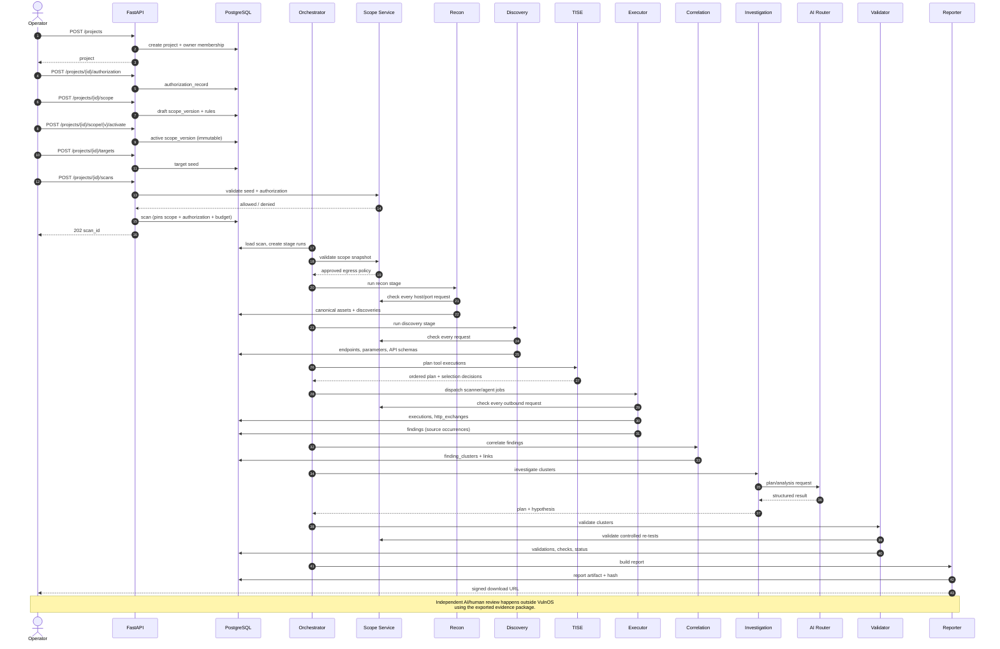
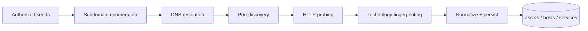
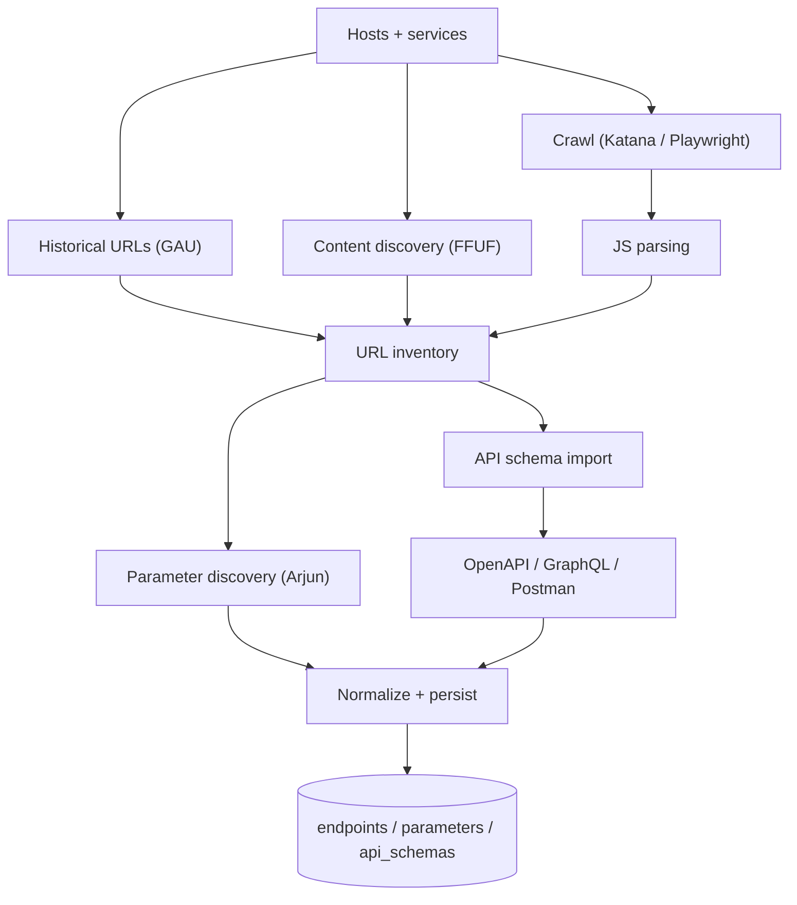
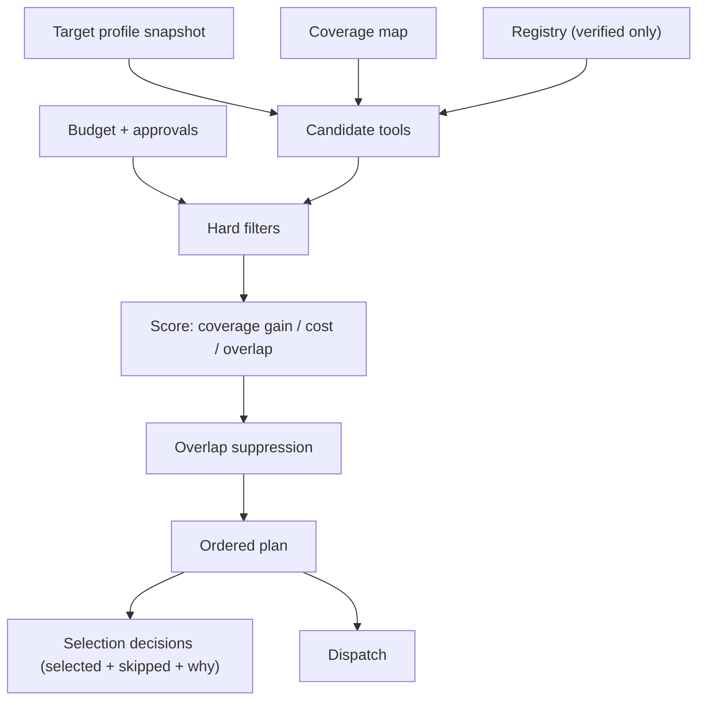
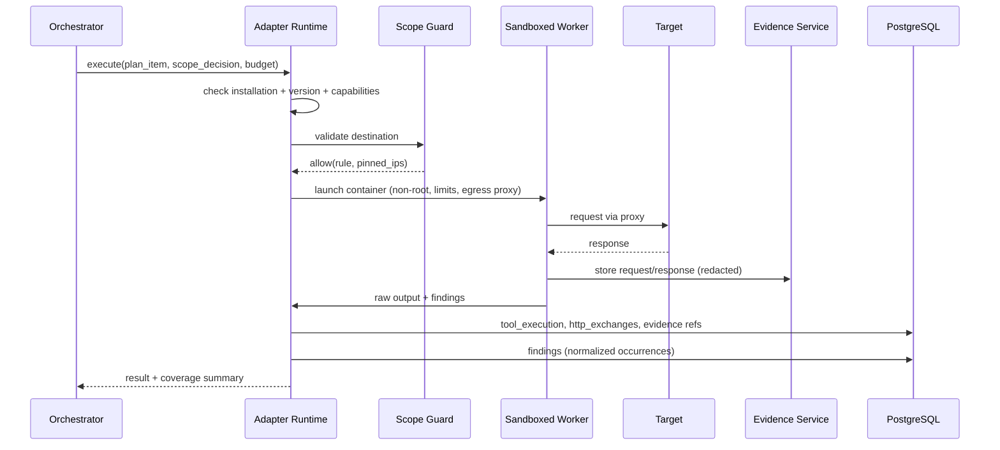
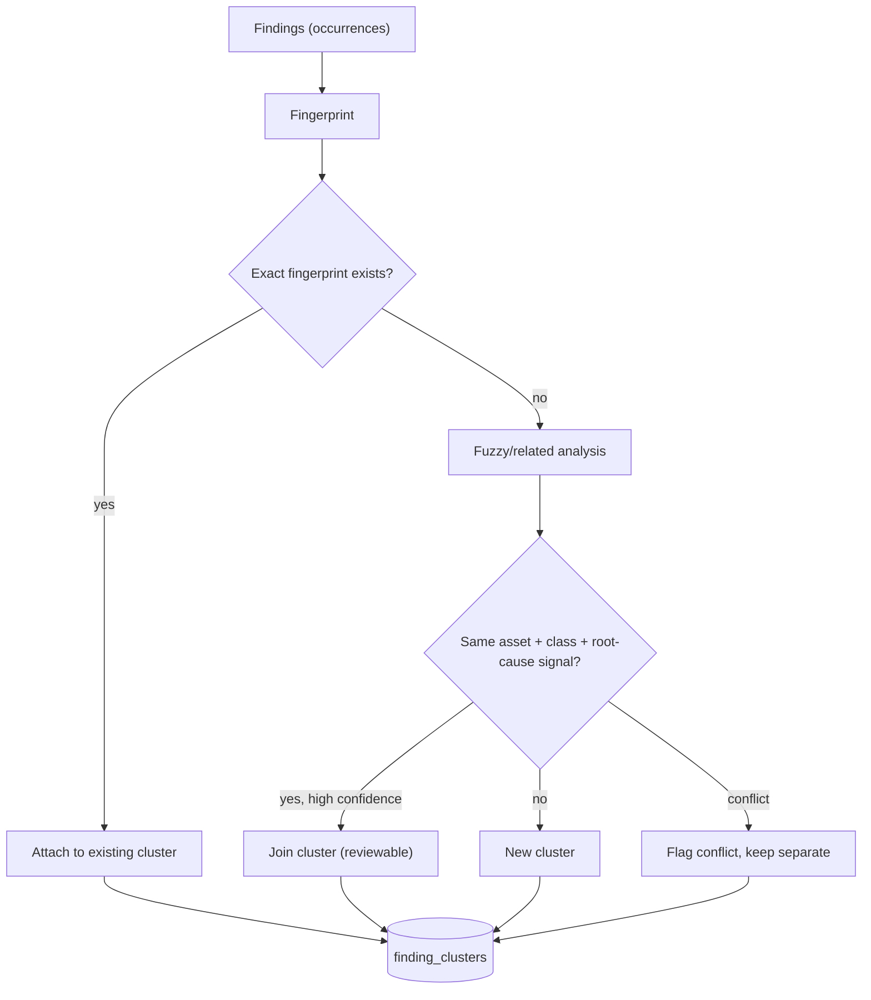
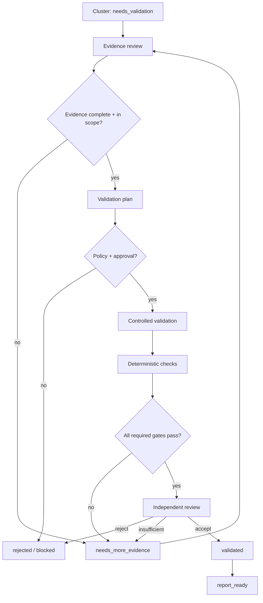

# VulnOS — Data Flow

**Document status:** Phase 1 baseline
**Version:** 1.0
**Companion to:** [SYSTEM_ARCHITECTURE.md](SYSTEM_ARCHITECTURE.md)

---

## 1. Purpose

This document describes how data moves through VulnOS: from an authorized target to a
reviewable report. It defines stage contracts, idempotency points, deduplication points,
reuse rules, events and failure handling. Every implementation phase must conform to these
flows.

---

## 2. End-to-end flow



---

## 3. Stage-by-stage contracts

### 3.1 Stage 0 — Project, authorization and scope

**Inputs:** operator identity, project metadata, authorization document reference, scope rules.

**Outputs (PostgreSQL):**
`projects`, `project_members`, `authorization_records`, `scope_versions`, `scope_rules`,
`targets`, `audit_logs`.

**Rules:**

1. A project must have at least one owner.
2. An authorization record must define validity dates, authorized actions and whether
   destructive actions are permitted.
3. Scope rules are allow/deny with a match type. Deny overrides allow.
4. A scope version is immutable once activated. Changes create a new version.
5. A scan pins both `scope_version_id` and `authorization_id`.
6. A target seed does **not** grant authorization; scope does.

**Data contract — scope rule:**

```json
{
  "effect": "allow",
  "match_type": "domain_suffix",
  "value": "example.com",
  "ports": [80, 443],
  "protocols": ["https"],
  "priority": 100,
  "note": "In scope per engagement contract section 2.1"
}
```

---

### 3.2 Stage 1 — Scope validation

**Inputs:** targets, active scope version, authorization record, current time.

**Outputs:** `scope_decisions` (persisted), approved seed list, `scan_stage_runs` row.

A decision includes:

| Field | Meaning |
|---|---|
| `allowed` | Boolean |
| `reason_code` | `allowed_rule`, `no_match_default_deny`, `explicit_deny`, `authorization_expired`, `private_range_blocked`, `metadata_blocked`, `dns_failure`, `invalid_target` |
| `matched_rule_id` | Rule that decided |
| `policy_hash` | Hash of the immutable scope version |
| `resolved_ips` | Addresses at decision time |
| `expires_at` | Short validity; decisions are not cached indefinitely |

Fail-closed cases: resolver error, ambiguous rule, expired authorization, no membership.

---

### 3.3 Stage 2 — Recon



**Inputs:** approved seeds, budget, prior asset intelligence.

**Outputs:** `assets`, `domains`, `hosts`, `host_addresses`, `services`, `technologies`,
`asset_technologies`, `asset_discoveries`, `tool_executions`, `evidence_objects`.

**Rules:**

- Every observation carries `source`, `tool_execution_id`, `discovered_at`, `confidence`.
- First-seen is never overwritten; last-seen is updated.
- A discovered host is **not** automatically authorized. It must match the pinned scope
  before any request is made.
- Overlapping recon tools are selected by TISE (Phase 4), not hardcoded. In Phase 3, the
  stage uses a minimal default plan and records every execution so TISE can optimize later.
- A stage may return `partial` with explicit gaps.

**Data contract — asset observation:**

```json
{
  "kind": "host",
  "canonical_name": "api.example.com",
  "ip_addresses": ["203.0.113.10"],
  "source": "subfinder",
  "tool_execution_id": "uuid",
  "observed_at": "2026-11-01T10:00:00Z",
  "confidence": 0.95,
  "attributes": {"resolver": "1.1.1.1"}
}
```

---

### 3.4 Stage 3 — Web/API discovery



**Rules:**

- Browser contexts are isolated per auth context; storage state is never shared across
  projects or identities.
- JS parsing only extracts routes/parameters; it does not execute untrusted JS outside the
  sandboxed browser.
- API schemas are imported as evidence; parsed operations are normalized into endpoints with
  `path_template` when the schema provides one.
- Discovery never asserts that an endpoint is vulnerable.
- Every endpoint retains its discovery source and timestamp.

**Data contract — endpoint observation:**

```json
{
  "method": "GET",
  "scheme": "https",
  "host": "api.example.com",
  "port": 443,
  "path": "/v1/users/12345",
  "path_template": "/v1/users/{id}",
  "query_keys": ["include"],
  "source": "openapi_import",
  "source_ref": "api_schemas:uuid",
  "observed_at": "2026-11-01T10:10:00Z"
}
```

Path templating is stored **in addition to** the exact path. Exact paths remain distinct;
templates support grouping and API-aware testing without merging distinct resources.

---

### 3.5 Stage 4 — TISE planning

**Inputs:** target profile, assets/endpoints/parameters, technologies, auth contexts,
coverage records, existing findings, tool registry, budget, approvals.

**Outputs:** ordered plan, `tool_selection_decisions`, queued jobs.



**Rules:**

- No tool runs without a `tool_selection_decision` row.
- A tool with `verification_status < contract_tested` is never selectable.
- A destructive tool requires a matching `operation_approvals` row.
- If the budget cannot fund the plan, the plan is truncated with explicit uncovered gaps.
- Re-planning occurs after recon, after discovery, and after a stage failure changes the
  target profile.

**Data contract — plan item:**

```json
{
  "tool": "nuclei",
  "tool_version_id": "uuid",
  "coverage_units": ["endpoint:uuid:xss_reflected", "endpoint:uuid:misconfig"],
  "priority": 10,
  "estimated_cost_usd": 0.02,
  "estimated_seconds": 120,
  "overlap_group": "web_vuln_scanner",
  "reason_code": "technology_match",
  "rationale": "Detected nginx + Spring Boot; nuclei template set covers known CVEs for this stack."
}
```

---

### 3.6 Stage 5 — Scanner and agent execution



**Rules:**

- One adapter job = one container execution context.
- Raw output is preserved before parsing.
- Findings are inserted as **occurrences**, never as validated canonical findings.
- The adapter's declared safety profile is enforced by the runtime; a mismatch aborts.
- Timeouts kill the process group and capture partial evidence.
- Agents obey an additional lease (one primary agent per target) and budget.

---

### 3.7 Stage 6 — Correlation



**Rules:**

- Fingerprints are deterministic (`sha256` over canonical fields, including a root-cause
  signal when available).
- Title similarity alone never merges findings.
- Source attribution is preserved in `findings`; the cluster is the canonical unit.
- Root cause, reproduction behavior and authentication context are compared before a
  related-finding link is proposed.
- Conflicting tool results (e.g., one says vulnerable, one says not) remain visible and are
  escalated to validation, not averaged away.
- Clusters start at `detected`; correlation sets `needs_validation`.

---

### 3.8 Stage 7 — AI investigation

**Inputs:** cluster, evidence summaries, endpoint/tech/auth context, routing policy, budget.

**Outputs:** `InvestigationPlan`, `ai_invocations`, optional new evidence requests.

The plan is a **proposal**, not an execution order. It contains:

- hypothesis and vulnerability class;
- required preconditions;
- proposed control and payload comparisons;
- expected observable signal;
- stop conditions;
- estimated requests/cost;
- risk classification.

A deterministic policy engine checks the plan against scope, tool allowlist, destructive
policy and budget before any validation job is queued.

---

### 3.9 Stage 8 — Evidence validation



**Rules:**

- The discovering tool and the investigating model cannot cast the deciding validation vote.
- Every check stores its evidence reference and result.
- `validated` requires all mandatory gates; a high confidence score alone is insufficient.
- `rejected` is a terminal state unless new evidence is attached, which reopens validation.
- `report_ready` is reachable only from `validated`.

---

### 3.10 Stage 9 — Reporting

**Inputs:** `report_ready` clusters, evidence manifest, scan coverage/gaps, project metadata.

**Outputs:** `reports` row, Markdown/JSON/PDF artifact, SHA-256, signed URL.

**Rules:**

- Reports include **coverage and limitations**, not only findings.
- Rejected findings appear only in an explicit audit appendix, never mixed with validated
  findings.
- Evidence links are signed and time-limited.
- A report is immutable once generated; regeneration creates a new version.
- The JSON export is the machine-review format; Markdown is human-readable; PDF is a
  rendered snapshot.

---

## 4. Events

Events are written to `outbox_events` in the same transaction as the state change and
relayed to Celery by a poller. Consumers must be idempotent.

| Event | Producer | Key consumers |
|---|---|---|
| `project.created` | Project service | Audit |
| `scope.version_activated` | Scope service | Orchestrator (invalidate drafts), audit |
| `target.created` | Target service | Recon planning |
| `scan.created` | Scan service | Orchestrator |
| `scan.stage_started` | Orchestrator | Frontend progress, audit |
| `scan.stage_completed` | Orchestrator | Next stage |
| `scan.stage_failed` | Orchestrator | Retry policy, alerting |
| `scan.cancel_requested` | API | Orchestrator, workers |
| `asset.discovered` | Normalizer | Discovery planning |
| `tool.execution_requested` | Orchestrator | Adapter queue |
| `tool.execution_completed` | Runtime | Correlation, budget ledger |
| `finding.observed` | Adapter result ingest | Correlation |
| `finding.clustered` | Correlation | Investigation |
| `investigation.requested` | Orchestrator | AI queue |
| `validation.requested` | Validator/API | Validation queue |
| `validation.completed` | Validator | Reporting, audit |
| `report.requested` | API/Orchestrator | Reporter |
| `report.completed` | Reporter | Frontend notification |
| `approval.requested` | Runtime/policy | Human approver |
| `approval.granted` | API | Runtime |

Event payloads contain identifiers and minimal state, not raw evidence or secrets.

---

## 5. Idempotency

| Operation | Idempotency key | Semantics |
|---|---|---|
| Create project | `Idempotency-Key` header | Same key + same body returns the original result |
| Create scan | `Idempotency-Key` header | Prevent duplicate scans on retry |
| Stage execution | `(scan_id, stage, attempt)` | At most one active stage row |
| Tool execution | `(scan_id, tool_version_id, coverage_key, attempt)` | Prevent duplicate dispatch |
| Finding occurrence | `finding_fingerprint` + source execution | Duplicate inserts ignored |
| Evidence write | `sha256(project_id + content + content_type)` | Content-addressed dedup within a project |
| Report generation | `(scan_id, report_version)` | Immutable, versioned |
| Outbox relay | `event_id` | Consumers dedupe by event ID |

Celery task retries must never create a second destructive execution. The adapter runtime
checks for an existing non-terminal execution with the same key before launching.

---

## 6. Reuse and freshness

Discovery intelligence is reusable across scans, but not blindly. Default freshness windows
(configurable per project):

| Data | Reuse window | Invalidate when |
|---|---|---|
| Registrable domains | 30 days | Scope expands or DNS changes materially |
| Subdomains | 7 days | New certificate transparency events (optional) |
| DNS addresses | 24 hours | Resolution differs; TTL elapsed |
| Open ports | 7 days | New service/tech observed; scan profile demands fresh ports |
| HTTP endpoints | 24 hours | Tech change; new crawl; auth context change |
| Parameters | 7 days | Endpoint changed; new crawl |
| API schema | 7 days | Source schema hash changed |
| Technology fingerprint | 7 days | Headers/banners changed |
| Coverage (tool tested endpoint+class) | Until target profile changes | New tech, new parameter, new auth context, prior inconclusive |

TISE must consult coverage before selection. Re-running a tool on the same coverage unit
requires one of:

- prior execution failed or timed out;
- prior result was inconclusive;
- target profile changed materially;
- a different tool provides an independent method with justified benefit;
- the operator explicitly requests re-testing.

Every reuse decision is recorded, including why fresh reconnaissance was skipped.

---

## 7. Deduplication points

Deduplication happens at four distinct layers. They must not be conflated.

| Layer | Key | Prevents |
|---|---|---|
| Asset | `(project_id, kind, canonical_key)` | Same host/domain/endpoint stored repeatedly |
| Endpoint | `(project_id, method, normalized_url_hash)` | Query ordering and default-port variants creating duplicates |
| Coverage | `sha256(project_id, endpoint_id, vulnerability_class, auth_context_id)` | Same tool/test repeated |
| Finding | `sha256(project_id, asset, endpoint, method, parameter, class, auth_context, evidence_signature)` | Payload variants creating duplicate findings |

`endpoint_clusters`/path templates are a grouping aid, **not** an identity key. Two distinct
resource IDs can share a template and must remain distinct for authorization testing.

---

## 8. Failure handling

| Failure | Behavior |
|---|---|
| DNS failure | Scope decision denies; recon marks host unresolved; no request |
| Tool missing | `tool_execution.status = skipped`, reason `dependency_missing`; TISE substitutes only per plan |
| Tool timeout | Kill process group; preserve partial output; mark `timeout`; retry only if safe |
| Parse failure | Preserve raw output; record `parse_error`; do not emit findings |
| Scope violation | Abort execution; mark `scope_violation`; create security audit entry; require review |
| Authorization expired mid-scan | Stop new requests; finish in-flight bounded jobs; mark scan `partial`/`cancelled` |
| Budget exhausted | Stop dispatching; preserve results; mark coverage gaps |
| AI provider failure | Fallback per policy; if exhausted, mark investigation `deferred`, keep finding unvalidated |
| Independent reviewer unavailable | Finding stays `needs_validation`; report excludes it from validated section |
| Database failure | No in-memory fallback; task retries with idempotency; evidence already written is reconciled |

No failure path may convert an unvalidated finding into `validated`.

---

## 9. Retention and deletion flow

1. Retention is configured per project (`default_retention_days`) and per data class.
2. A maintenance task finds expired `evidence_objects` not referenced by an open validation.
3. Object storage lifecycle rules provide a second line of defense.
4. Metadata rows are deleted or anonymized; audit logs retain the deletion event.
5. Deleting a project archives it first; a separate, explicit purge requires owner
   confirmation and produces an audit record.
6. Findings referenced by a published report are retained for the report's retention period.

Deletion is **not** cascaded blindly across evidence that a validation or audit still needs.

---

## 10. Data flow invariants checklist

- [ ] No outbound request without a scope decision.
- [ ] No discovery result without source and timestamp.
- [ ] No tool run without a TISE decision.
- [ ] No finding without an evidence reference where evidence was captured.
- [ ] No cluster without at least one occurrence.
- [ ] No validated cluster without all mandatory checks.
- [ ] No report without coverage/limitations.
- [ ] No event published before its transaction commits.
- [ ] No raw evidence or secret in an event payload.
- [ ] No cross-project read or write path.
