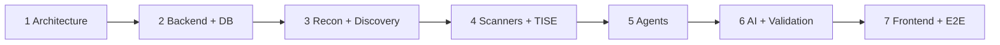

# VulnOS — Implementation Roadmap

**Document status:** Phase 1 baseline
**Version:** 1.0
**Companion to:** all architecture documents
**Rule:** Prompt 2 does not begin until this blueprint is reviewed and approved.

---

## 1. Purpose

This roadmap maps the agreed architecture to seven implementation phases. It defines
deliverables, dependencies, exit criteria, test gates and the decisions that must be made
before each phase starts.

The phase boundaries are part of the architecture. Moving a responsibility between phases
requires a recorded change and a reason; it is not a scheduling convenience.

---

## 2. Phase overview

| Phase | Name | Primary output | Depends on |
|---|---|---|---|
| 1 | Architecture & project foundation | This blueprint, repo structure, DB design, API contracts, integration specs | — |
| 2 | Backend & intelligence database | FastAPI, PostgreSQL, migrations, auth, projects/targets/scope/assets/endpoints, execution history | 1 |
| 3 | Reconnaissance & discovery | Recon/discovery adapters, normalization, persistence, evidence | 2 |
| 4 | Vulnerability scanners & TISE | Tool registry, TISE, scanner/API adapters, selection rationale, occurrences | 3 |
| 5 | Autonomous agents | Agent runtime, sandbox, leases, Strix + benchmark candidate | 4 |
| 6 | AI investigation & validation | Provider-independent router, correlation, investigation, evidence validation, cost control | 5 |
| 7 | Frontend, integration & testing | React UI, reports, e2e, deployment, documentation, production hardening | 6 |

---

## 3. Phase 1 — Architecture and project foundation

### Deliverables

- Repository inspection report (confirmed facts vs assumptions).
- Ten architecture documents in `docs/architecture/`.
- Root `README.md`, `.gitignore`, `.env.example`.
- ERD, table definitions, indexes, retention and isolation strategy.
- REST contracts with auth/authz and error model.
- Universal adapter, registry and normalization specification.
- Agent orchestration, sandbox and benchmark protocol.
- AI routing and validation gate design.
- Threat model, scope enforcement algorithm and security acceptance tests.
- Roadmap, risks and unresolved decisions.

### Explicit non-deliverables

- No application code.
- No database migrations.
- No tool integration.
- No scans.
- No commits or pushes without approval.

### Exit criteria

- [ ] The blueprint is stored in a clean, standalone repository.
- [ ] No unrelated projects or sensitive artifacts are included in the repository.
- [ ] Every major component has one responsibility.
- [ ] All tools use the universal adapter.
- [ ] TISE is the only selector.
- [ ] Findings flow through correlation and validation.
- [ ] PostgreSQL is the sole durable store.
- [ ] AI routing is provider-independent.
- [ ] Agents cannot bypass scope.
- [ ] Deferred features are absent from the initial scope.
- [ ] Phases 2–7 do not contradict each other.
- [ ] Human review approves the blueprint.

---

## 4. Phase 2 — Backend and intelligence database

### Goal

Deliver a runnable, tested FastAPI backend with PostgreSQL, migrations, authentication,
project/target/scope management, asset/endpoint read models and execution history. No
scanning yet.

### Deliverables

1. **Repository scaffold**
   - `backend/`, `engine/`, `workers/`, `tools/`, `infra/`, `frontend/`, `tests/`, `scripts/`
   - Python project metadata, lockfile, lint/format/type-check configuration
   - Docker Compose for API, PostgreSQL, Redis, MinIO, egress proxy (proxy may be a stub)
2. **Core platform**
   - Settings, structured JSON logging, redaction, error taxonomy
   - Request IDs, CORS, security headers, health/readiness
   - Alembic baseline + migration test
3. **Database**
   - Phase 2 tables: users, api_keys, projects, members, authorizations, scope versions/rules,
     targets, assets/domains/hosts/addresses/services/endpoints/parameters/technologies,
     asset discoveries, scans, stage runs, tool executions, test cases, auth contexts,
     evidence metadata, audit logs, outbox, cost entries
   - Constraints, indexes, RLS policies
   - Repository layer with mandatory `project_id`
4. **Auth and authorization**
   - Local password (Argon2id) + session cookie + CSRF
   - API keys (hashed, scoped, revocable)
   - RBAC: owner/admin/operator/viewer
   - Recent re-authentication for sensitive operations
5. **APIs**
   - Projects, members, authorizations, scope (draft/activate/validate), targets
   - Assets, endpoints, discovery history
   - Scans (create/status/cancel/stages), execution history
   - Tool registry read skeleton
   - Audit log read
6. **Scope service**
   - Canonicalization, deny-overrides, default deny
   - DNS resolution + IP classification (metadata/private/link-local)
   - Immutable scope version + pinned decisions
   - Unit and property tests
7. **Evidence metadata**
   - Object storage abstraction with a local MinIO adapter
   - Hash, size, content type, retention, redaction status
   - Signed URL retrieval (no raw proxy)
8. **Tests**
   - API contract tests for implemented endpoints
   - Repository/RLS cross-project tests
   - Scope enforcement unit tests
   - Migration up/down tests
   - Auth/RBAC matrix

### Explicit non-deliverables

- No real scanner or recon execution.
- No AI calls.
- No findings correlation/validation.
- No agent runtime.

### Exit criteria

- [ ] `docker compose up` starts API, PostgreSQL, Redis, MinIO.
- [ ] Migrations apply from zero and downgrade in development.
- [ ] All implemented endpoints match [API_CONTRACTS.md](API_CONTRACTS.md).
- [ ] Cross-project access returns 404 in tests.
- [ ] Scope denial tests (metadata, private, redirect, rebinding unit-level) pass.
- [ ] Secrets never appear in logs/evidence in tests.
- [ ] Audit records are written for security-relevant actions.
- [ ] OpenAPI is generated and contract-tested.
- [ ] CI runs lint, type-check, unit, integration and migration tests.

### Decisions required before start

- Repository location (clean repo vs subdirectory).
- Secret backend for development.
- Object storage for development.
- Auth model (local only vs OIDC-ready).
- Egress proxy implementation/phase.
- RLS on/off in development.

---

## 5. Phase 3 — Reconnaissance and discovery

### Goal

Turn authorized seeds into structured, deduplicated asset and endpoint intelligence, with
provenance and evidence, using the universal adapter contract.

### Deliverables

1. **Adapter framework (minimal runtime)**
   - `ToolAdapter` interface implemented
   - Container runner with limits, timeout, cancellation, evidence capture
   - Registry seed for recon/discovery tools with `declared` status
   - Contract test harness + local fixture
2. **Recon stage**
   - Scope validation gate
   - Subdomain enumeration (BBOT/Amass/Subfinder; selection may be minimal in Phase 3 but
     every execution is recorded)
   - DNS resolution (DNSx)
   - Port discovery (Naabu; Nmap for depth)
   - HTTP probing + technology detection (HTTPx)
   - Asset normalization and persistence with first/last seen + source
3. **Discovery stage**
   - Crawling (Katana) and browser-driven discovery (Playwright)
   - Historical URLs (GAU)
   - Content discovery (FFUF) with rate/budget controls
   - Parameter discovery (Arjun)
   - JS endpoint extraction
   - API schema import (OpenAPI/GraphQL/Postman)
4. **Normalizer**
   - Canonical keys, endpoint URL hash, path templates
   - Dedup/upsert, provenance, confidence
   - Reuse/freshness rules from [DATA_FLOW.md](DATA_FLOW.md#6-reuse-and-freshness)
5. **Evidence**
   - Request/response and tool output capture with redaction
   - Retention metadata
6. **Coverage records**
   - `test_cases` for discovery/preparation; TISE consumes them in Phase 4
7. **Tests**
   - Adapter contract tests for every integrated recon tool
   - Parser golden files
   - Scope denial at the network layer
   - Dedup/freshness tests

### Exit criteria

- [ ] An authorized seed produces persisted domains, hosts, services, technologies and
      endpoints with source and timestamp.
- [ ] Re-running the same scan does not duplicate assets/endpoints.
- [ ] Out-of-scope discoveries are stored as intelligence but never contacted.
- [ ] Every tool execution has a version, image digest, status and evidence reference.
- [ ] Missing tools report `dependency_missing`, not success.
- [ ] A recon run can be cancelled and leaves no orphan containers.
- [ ] Budgets stop excessive requests.
- [ ] Contract tests pass for all Phase 3 adapters.

### Decisions required

- Which recon tools are in the minimum verified set.
- Wordlist/template storage and licensing.
- Freshness defaults per project.
- Whether Phase 3 includes Nmap depth or defers it.

---

## 6. Phase 4 — Vulnerability scanners and TISE

### Goal

Implement the Tool Intelligence & Selection Engine and the scanner/API adapter set, with
explainable selection, overlap suppression and normalized finding occurrences.

### Deliverables

1. **Tool registry**
   - Full metadata schema, verification states, image digests
   - Tool status endpoint backed by real checks
   - Capability indexing for selection
2. **TISE**
   - Candidate generation from target profile + registry
   - Hard filters: scope, verification, auth, safety, budget, approval
   - Scoring: expected coverage gain, class priority, success probability, cost, duration,
     overlap penalty
   - Overlap suppression within groups
   - Plan output + `tool_selection_decisions` for selected and skipped
   - Re-planning after stages
   - Property/unit tests with synthetic profiles
3. **Scanner adapters**
   - Nuclei, ZAP, Wapiti, Dalfox, SQLmap, Nikto
   - Commix, SSRFmap, testssl.sh, Retire.js, Trivy
   - Optional Greenbone/OpenVAS
4. **API adapters**
   - Hadrian (if license/availability confirmed), Schemathesis, RESTler, Kiterunner,
     mitmproxy, graphw00f
   - Explicit limitation: no claim of complete BOLA/IDOR coverage without an identity model
5. **Static/secrets/SCA (may move to Phase 6 with a recorded reason)**
   - Semgrep, Gitleaks, TruffleHog, OSV-Scanner
6. **Findings**
   - Normalized occurrences with fingerprints
   - Raw output evidence
   - No correlation/validation yet (Phase 6)
7. **Tests**
   - Contract test per adapter
   - TISE determinism, overlap, budget, scope, destructive gating
   - Parser fixtures
   - No duplicate execution on retry

### Exit criteria

- [ ] No scanner runs without a TISE decision row.
- [ ] Every skipped tool has a reason.
- [ ] TISE avoids redundant tools in the same overlap group unless justified.
- [ ] Unverified tools are never selected.
- [ ] Destructive tools are blocked without approval.
- [ ] Findings are stored as occurrences with evidence and fingerprints.
- [ ] API authz coverage is reported honestly; no exaggerated BOLA claims.
- [ ] Contract tests pass for all integrated scanners.
- [ ] Scan budget and cancellation work end to end.

### Decisions required

- Minimum verified scanner set for exit.
- Which API tools are licensed/available.
- Whether static analysis is Phase 4 or Phase 6.
- Rate-limit defaults per tool.

---

## 7. Phase 5 — Autonomous agents

### Goal

Integrate one primary autonomous agent and at least one benchmark alternative behind the
universal adapter, with leases, sandboxing, budgets and normalized output.

### Deliverables

1. Agent adapter interface + runtime extensions.
2. Sandbox image(s), egress enforcement, AI gateway token issuance.
3. Per-target lease + partial unique index + orphan reaper.
4. Kill switch and cancellation.
5. **Strix** adapter (primary candidate) + contract tests.
6. **RedAmon** adapter (benchmark) + contract tests.
7. **PentAGI** only if a distinct capability is demonstrated.
8. **Shannon** source-assisted adapter, gated on source scope.
9. Transcript/evidence capture and normalizer.
10. Benchmark harness and report (no fabricated results).

### Exit criteria

- [ ] One active primary agent per target enforced in tests.
- [ ] Agent cannot reach host, DB, Redis, Docker socket or metadata.
- [ ] Agent traffic is scope-checked at proxy + application layers.
- [ ] Agent cannot change scope, budget or toolset.
- [ ] Agent cannot validate findings.
- [ ] Kill switch stops a run within the target SLA.
- [ ] Transcripts are preserved and redacted.
- [ ] At least two agents are contract-tested.
- [ ] Benchmark report exists with raw data, or benchmark is explicitly deferred with reason.
- [ ] Agents remain disabled by default.

### Decisions required

- Primary agent after benchmark.
- Agent concurrency policy.
- Transcript retention.
- PentAGI/Shannon inclusion.
- Benchmark target and repetitions.

---

## 8. Phase 6 — AI investigation and validation

### Goal

Implement provider-independent AI routing, finding correlation, investigation planning and
evidence-based validation with independent review.

### Deliverables

1. **AI router**
   - Provider interface + OpenAI-compatible adapter + fake provider
   - Task classes, routing policies, minimum tiers
   - Token/cost budgets, exact cache, retries, fallback, circuit breaker
   - Structured output + schema validation
   - `ai_invocations` + cost ledger
2. **Correlation**
   - Deterministic fingerprints
   - Clustering, relations/conflicts, source attribution
   - Duplicate-candidate review
3. **Investigation**
   - Context assembly + redaction
   - Plan schema + policy approval
   - Controlled validation jobs
   - Max rounds/budget
4. **Validator**
   - Mandatory gates + conditional checks
   - Confidence factors
   - Independent review (model/provider/human)
   - State transitions + audit
5. **Cost**
   - Cost per validated finding query/report
   - Budget enforcement tests
6. **Security**
   - Prompt-injection fixture suite
   - No LLM-only validation test
   - Cross-project evidence denial test
7. **Tests**
   - Router, fallback, cache, schema, budget
   - Correlation dedup/relations
   - Gate engine
   - Reviewer independence
   - End-to-end from occurrence to validated/rejected

### Exit criteria

- [ ] No code path validates from model reasoning alone.
- [ ] Every validated cluster has all mandatory checks + independent review.
- [ ] Prompt injection cannot change scope, tools, budget or approval.
- [ ] Strong tasks never silently downgrade.
- [ ] Budget overruns are impossible in tests.
- [ ] Duplicates do not merge on title alone.
- [ ] Cost per validated finding is computed from real ledger entries.
- [ ] Rejected findings remain auditable.
- [ ] Critical findings require human review when independent-provider review is absent.

### Decisions required

- Embeddings approach.
- Reviewer model/provider policy.
- Investigation round limit.
- Confidence threshold for triage (not proof).
- Cache TTL.

---

## 9. Phase 7 — Frontend, integration and testing

### Goal

Deliver the operator-facing application, reports, end-to-end tests, deployment and
documentation.

### Deliverables

1. **Frontend**
   - Project/authorization/scope management with scope preview
   - Scan creation, progress, coverage/gaps
   - Asset/endpoint explorer
   - Findings, evidence viewer, validation status
   - Tool status and TISE rationale
   - Reports and downloads
   - Approval workflow
   - Empty/error/loading states, accessibility
2. **Reports**
   - Markdown, JSON, PDF
   - Evidence manifest, hashes, scope, limitations, coverage
   - Rejected appendix (optional)
   - Immutable versions
3. **Integration**
   - API client generated from OpenAPI
   - E2E tests across API/workers/DB/storage
   - Seed/demo data (no fabricated findings)
4. **Deployment**
   - Single-host Compose production profile
   - TLS, backups, restore test
   - Secret manager integration
   - Logging/metrics/alerts
   - Upgrade/rollback runbook
5. **Hardening**
   - SBOM, image signing, dependency scanning
   - Security acceptance tests SEC-01..20
   - Load/performance test within budgets
6. **Documentation**
   - Operator guide, authorization workflow, tool onboarding, incident runbooks

### Exit criteria

- [ ] A new operator can create a project, scope, target and scan through the UI.
- [ ] Coverage gaps are visible and included in reports.
- [ ] Evidence is accessible only through signed, authorized URLs.
- [ ] Reports are reproducible and hash-verified.
- [ ] E2E suite passes on a clean deployment.
- [ ] All security acceptance tests pass.
- [ ] Backup/restore is tested.
- [ ] Upgrade/rollback is documented and tested.
- [ ] Agents and destructive actions remain opt-in.
- [ ] No critical/high dependency vulnerabilities in shipped images (or documented exception).

---

## 10. Cross-phase test strategy

| Layer | Scope | Tooling |
|---|---|---|
| Unit | Pure logic: scope policy, TISE scoring, fingerprints, confidence, parsers | Pytest |
| Integration | API + PostgreSQL + Redis + MinIO | Pytest + containers |
| Contract | One suite per adapter, fixture target | Pytest |
| Migration | Upgrade from zero, downgrade, drift | Alembic + CI |
| Security | SEC-01..20, RLS, redaction, prompt injection | Pytest + fixtures |
| E2E | Compose stack through the UI/API | Playwright + Pytest |
| Performance | Budget enforcement, concurrency, large asset sets | Locust/k6 optional |
| Supply chain | SBOM, image scan, lockfile audit | CI |

CI gates (from Phase 2):

- lint + format + type check
- unit + integration tests
- migration up/down
- OpenAPI contract check
- secret scan
- dependency audit (non-blocking for low, blocking for critical)
- container build

---

## 11. Definition of done

A phase is done only when:

1. All deliverables exist and are documented.
2. Exit criteria are demonstrably met.
3. Tests pass in CI, including the security tests relevant to the phase.
4. No feature claims exceed what is implemented and tested.
5. Architecture documents are updated for any deviation.
6. Known limitations are recorded.
7. A reviewer has approved the phase.
8. No unresolved critical security issue remains.

"Works on my machine" is not done. A green CI run on a clean checkout is.

---

## 12. Risks by phase

| Phase | Risk | Mitigation |
|---|---|---|
| 1 | Blueprint diverges from reality | Explicit confirmed-vs-proposed sections; review gate |
| 2 | Schema churn | Design full model now; additive migrations later |
| 2 | RLS complexity | Test cross-project access from day one; use a dedicated DB role |
| 3 | Tool fragility/licensing | Contract tests; pinned images; verify before promotion |
| 3 | Asset explosion | Budgets, dedup, freshness, rate limits |
| 4 | TISE over/under-selects | Property tests, coverage metrics, explainability |
| 4 | Scanner false positives | Normalize as occurrences; no direct validation |
| 5 | Agent escapes sandbox | Defense in depth; no socket; proxy; limits; kill switch |
| 5 | Agent cost blowout | AI gateway quotas; wall clock; request caps |
| 6 | AI false confidence | Gates + independent review; no LLM-only validation |
| 6 | Prompt injection | Fixtures, separation of powers, no tool authority |
| 7 | UI exposes secrets | Redaction, evidence viewer as text, signed URLs |
| 7 | Deployment complexity | Single-host Compose; documented prerequisites |

---

## 13. Unresolved decisions

These must be resolved by the named phase. Until then, the recommended option is a default,
not an approved decision.

The repository-location and unrelated-project decisions were resolved before publication:
VulnOS lives in a clean, standalone repository, and no unrelated projects are included. See
ADR-011 and ADR-012 in
[SYSTEM_ARCHITECTURE.md](SYSTEM_ARCHITECTURE.md#14-key-decisions-adr-summary).

| ID | Decision | Options | Recommendation | Deadline |
|---|---|---|---|---|
| R-01 | Secret backend (dev/prod) | File / Vault / cloud KMS | File dev; Vault or cloud KMS prod | Phase 2 |
| R-02 | Object storage | MinIO / AWS S3 / other S3-compatible | MinIO dev; managed S3 prod | Phase 2 |
| R-03 | Auth | Local only vs OIDC-ready | Local + OIDC-ready interface | Phase 2 |
| R-04 | RLS | App-only vs RLS | RLS in production | Phase 2 |
| R-05 | Egress proxy | Envoy / HAProxy / custom | Evaluate Envoy/HAProxy; avoid custom | Phase 2 |
| R-06 | Private range authorization | Global vs per-CIDR | Per-CIDR + `allow_private_ranges` | Phase 2 |
| R-07 | Retention defaults | 30/90/180/365 days | 90 days raw evidence; configurable | Phase 2 |
| R-08 | Recon minimum set | All vs core | Core: BBOT/Subfinder, DNSx, Naabu, HTTPx; add Amass/Nmap after verification | Phase 3 |
| R-09 | Static analysis phase | 4 vs 6 | Phase 4 if capacity; otherwise Phase 6 with recorded reason | Phase 4 |
| R-10 | API tool availability | All vs subset | Verify licenses; Hadrian/OpenVAS optional | Phase 4 |
| R-11 | Primary agent | Strix vs RedAmon | Strix first; benchmark decides | Phase 5 |
| R-12 | Agent benchmark target | Lab vs client | Lab, repeatable | Phase 5 |
| R-13 | Embeddings | pgvector vs app-side | Optional pgvector | Phase 6 |
| R-14 | Independent reviewer | Provider vs human | Provider + human for critical | Phase 6 |
| R-15 | PDF renderer | Playwright vs WeasyPrint | Playwright (already a dependency) | Phase 7 |
| R-16 | License | TBD | Must be compatible with bundled tools | Before distributing implementation code |
| R-17 | Windows development | Docker Desktop/WSL2 vs Linux host | Linux containers via Docker Desktop/WSL2; workers are Linux | Phase 2 |
| R-18 | Multi-user model | Single-user vs team | Team-capable project membership from Phase 2; no org hierarchy | Phase 2 |

---

## 14. Change control

Architecture changes require:

1. A written proposal stating the problem, options, decision and consequences.
2. An ADR in `docs/architecture/adr/` (created in Phase 2).
3. Updates to every affected document and diagram.
4. A migration/compatibility note if data or APIs change.
5. Reviewer approval.

Prohibited without explicit approval:

- Adding Kubernetes, a graph database or microservices.
- Replacing PostgreSQL as system of record.
- Letting scanners/agents bypass TISE or the adapter runtime.
- Letting an LLM validate a finding.
- Allowing an agent to modify scope.
- Moving a responsibility between phases without a recorded reason.
- Committing secrets or raw evidence.
- Deleting existing project files.

---

## 15. Phase handoff protocol

At the end of each phase, provide:

1. What was implemented (with file paths).
2. What was tested (commands + results).
3. What was **not** implemented or verified.
4. Deviations from the blueprint and their approval status.
5. Open risks and decisions.
6. Confirmation that the next phase's prerequisites are met.

A phase is not handed off with unstated gaps.

---

## 16. Prompt 2 readiness checklist

Before starting Prompt 2:

- [ ] This roadmap and the nine companion documents are reviewed.
- [ ] The repository contains only VulnOS files and no secrets or unrelated projects.
- [ ] Development platform (Docker Desktop/WSL2 or Linux) is confirmed.
- [ ] Secret/object-storage defaults are chosen.
- [ ] Phase 2 exit criteria are accepted.
- [ ] No scanner, agent or AI feature is expected in Phase 2.

When these are true, Phase 2 may begin. Until then, VulnOS remains a blueprint, not a
running system.
