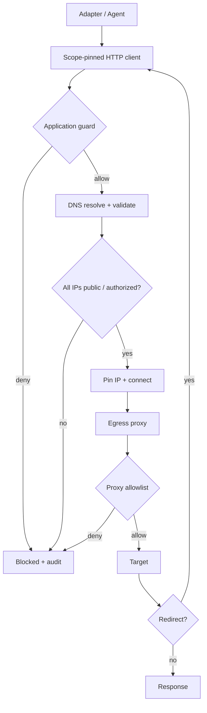

# VulnOS — Security Architecture

**Document status:** Phase 1 baseline
**Version:** 1.0
**Classification:** Internal / security-critical
**Companion to:** [SYSTEM_ARCHITECTURE.md](SYSTEM_ARCHITECTURE.md), [AI_AND_VALIDATION.md](AI_AND_VALIDATION.md)

---

## 1. Purpose

VulnOS is itself a security-sensitive platform that sends offensive traffic. A defect can
cause unauthorized testing, data loss, credential exposure or host compromise. This document
defines the threat model, mandatory controls and acceptance tests.

Security is **fail-closed**: when authorization, scope, identity or evidence is ambiguous, the
platform denies or stops.

---

## 2. Security objectives

| Objective | Property |
|---|---|
| Authorization | No outbound request without a valid, pinned scope decision |
| Isolation | A compromised tool or agent cannot reach the host, database, other projects or cloud metadata |
| Confidentiality | Credentials and evidence are encrypted, redacted and access-controlled |
| Integrity | Evidence, findings, approvals and audit records cannot be silently altered |
| Accountability | Every security-relevant action is attributable to an actor, scan and policy version |
| Containment | A runaway or malicious run can be stopped quickly and completely |
| Non-repudiation | Reports and evidence carry hashes and generation metadata |
| Least privilege | Every component and identity gets only what its responsibility requires |

---

## 3. Threat model

### 3.1 Assets

- Authorization records and scope definitions.
- Target credentials, session cookies and API keys.
- Raw HTTP evidence, screenshots, agent transcripts and findings.
- AI provider keys and prompts.
- PostgreSQL, object storage and secret-manager access.
- The host running workers.
- Report integrity and the platform's reputation.

### 3.2 Actors

| Actor | Trust |
|---|---|
| Platform operator | Trusted but audited |
| Project owner/admin/operator/viewer | Authenticated, role-bounded |
| Target application and its content | **Untrusted** |
| Scanner/agent binaries | Untrusted supply chain |
| AI providers | Semi-trusted; outputs are data |
| External attacker | Untrusted |

### 3.3 Threats and controls

| ID | Threat | Vector | Controls | Residual |
|---|---|---|---|---|
| T-01 | Scope escape via redirect | 302 to internal host | Revalidate every hop; strip auth cross-origin; egress proxy | Low |
| T-02 | Scope escape via DNS rebinding | Resolve public, connect private | Resolve once, pin IP, connect to pinned IP, re-check at proxy | Low |
| T-03 | SSRF to cloud metadata | Tool fetches 169.254.169.254 | Hard block metadata ranges; no credentials in sandbox; egress proxy | Low |
| T-04 | Worker escape | Container exploit | Non-root, caps dropped, no socket, read-only FS, seccomp/AppArmor, limits | Low–medium |
| T-05 | Cross-project data access | IDOR/ID guessing | Project scoping + RLS + 404 + object prefix isolation | Low |
| T-06 | Credential theft | DB dump, logs, evidence | Secret manager, no DB secrets, redaction, encryption | Medium |
| T-07 | Prompt injection | Malicious target response | Instruction hierarchy, no tool authority, output schema, gateway | Medium |
| T-08 | Evidence tampering | Insider or compromised worker | Hashing, object versioning/immutability, audit, signed reports | Medium |
| T-09 | Malicious tool image | Supply chain | Pinned digests, SBOM, signing, no runtime downloads, network isolation | Medium |
| T-10 | Runaway scan | Bug or malicious agent | Budgets, timeouts, rate limits, kill switch, leases | Low |
| T-11 | Destructive action | Tool flag or agent choice | Safety profile, approval token, allowlist, method limits | Low–medium |
| T-12 | Unauthorized use of VulnOS | Operator acts outside authorization | Authorization records, audit, operator identity, legal terms | Medium |
| T-13 | Data exfiltration via AI | Prompt injection asks model to leak secrets | No secrets in prompts, redaction, canary, output limits | Medium |
| T-14 | Denial of service on target | Aggressive scanning | Rate limits, concurrency limits, budget, authorization caps | Medium |
| T-15 | Audit repudiation | Attacker edits logs | Append-only partitions, hashes, restricted role, export | Low |
| T-16 | Stale authorization | Expired contract still scanning | Pin validity, stop at expiry, re-check before validation | Low |

---

## 4. Scope enforcement

### 4.1 Enforcement layers

Scope is enforced at **three independent layers**. Any one must be sufficient to stop an
outbound request.

1. **Orchestrator** — refuses to plan or dispatch a target outside the pinned scope.
2. **Worker request guard** — every HTTPX request and browser navigation is checked; redirects
   are rechecked; DNS is pinned.
3. **Egress proxy** — network-level allowlist independent of application code. A compromised
   adapter cannot bypass it without network access, which the sandbox does not have.



### 4.2 Canonicalization

Before any decision:

- Parse with a strict URL parser; reject malformed and non-`http(s)` schemes for web actions.
- Lowercase scheme and host; IDNA-encode; strip trailing dot.
- Remove default ports; reject userinfo (`user:pass@`).
- Resolve dot segments; normalize percent-encoding of unreserved characters.
- Remove fragments.
- Sort query keys; never use query values as a scope identity.
- For DNS/port actions, use canonical host/IP and explicit port/transport.

### 4.3 Decision algorithm

```text
1. Load immutable scope_version + authorization pinned to the scan.
2. If now > authorization.valid_to or revoked → DENY (authorization_expired).
3. If subject is malformed or scheme unsupported → DENY (invalid_target).
4. Evaluate DENY rules first. Any match → DENY (explicit_deny).
5. Evaluate ALLOW rules by match type + port + protocol. No match → DENY (default_deny).
6. Resolve DNS (A/AAAA) with a bounded timeout.
   - Failure → DENY (dns_failure).
   - Any resolved IP in a blocked range and not explicitly authorized → DENY.
7. Pin the resolved IP(s). Connect to the pinned IP with the original Host/SNI.
8. Re-check every redirect hop from step 1.
9. Record scope_decision (allow/deny, rule, policy hash, IPs, timestamp).
10. Proxy independently verifies the destination and denies on mismatch.
```

### 4.4 Blocked destinations

Hard-blocked unless the authorization explicitly permits a private CIDR **and** the scope
contains that CIDR:

| Category | Examples |
|---|---|
| Loopback | `127.0.0.0/8`, `::1/128` |
| Private IPv4 | `10/8`, `172.16/12`, `192.168/16` |
| Link-local | `169.254/16`, `fe80::/10` |
| Carrier-grade NAT | `100.64/10` |
| Documentation/test | `192.0.2/24`, `198.51.100/24`, `203.0.113/24`, `2001:db8::/32` |
| Multicast/reserved | `224/4`, `240/4`, `ff00::/8` |
| Cloud metadata | `169.254.169.254`, `fd00:ec2::254`, `100.100.100.200` |
| IPv4-mapped IPv6 | `::ffff:0:0/96` — evaluate the embedded IPv4 |
| NAT64 | `64:ff9b::/96` — evaluate the embedded IPv4 |
| Unspecified | `0.0.0.0/8`, `::/128` |

Cloud metadata is **never** allowed, even with private-range authorization. There is no
legitimate reason for VulnOS to read instance credentials.

### 4.5 Wildcard semantics

- `domain_suffix: example.com` allows `example.com` and `*.example.com`, not
  `notexample.com`.
- `wildcard_domain: *.example.com` allows subdomains but not the apex.
- A wildcard never allows a different registrable domain, including via CNAME.
- Scope preview must show exactly what a rule matches before activation.
- Deny rules override allow rules regardless of specificity or priority.
- Redirects from an allowed host to a denied host are blocked; the response is recorded.

### 4.6 Authorization expiry

- Every request checks the authorization validity window.
- At expiry, no new requests are dispatched; in-flight jobs are bounded and stopped.
- Validation after expiry is impossible; the finding cannot become `validated`.
- A new authorization/scope version is required to continue; it does not retroactively
  legitimize earlier traffic.

### 4.7 Scope change control

- Scope versions are immutable once active.
- Activation requires `admin`/`owner` plus recent re-authentication.
- A running scan keeps its pinned version.
- Scope changes are audited with before/after hashes.
- A model, target response or agent cannot call the scope API.

---

## 5. Worker isolation

### 5.1 Container controls

| Control | Requirement |
|---|---|
| Runtime | Docker (rootless where available) |
| User | Non-root, fixed UID/GID |
| Root FS | Read-only |
| Writable paths | `/tmp` tmpfs, `/output` bounded volume |
| Capabilities | Drop all |
| Privileges | `no-new-privileges` |
| Seccomp | Default profile + tool-specific allowlist if needed |
| AppArmor/SELinux | Enabled on hosts that support it |
| PID limit | Enforced |
| CPU/memory | Enforced |
| Disk | Output size cap; tmpfs size cap |
| Network | Dedicated bridge with egress proxy only; no direct internet |
| Host mounts | None except job input/output |
| Docker socket | Never |
| Devices | None |
| Time | Hard timeout + idle timeout |

### 5.2 Credential and data access

- Workers do not receive database credentials in the initial design; results are submitted
  through a restricted result API or a narrowly scoped role.
- Workers never receive object-storage write credentials; the runtime streams evidence through
  the Evidence Service.
- Secrets are resolved at launch and written to a tmpfs file with tight permissions, or passed
  via a short-lived environment variable that is redacted from logs.
- The AI gateway token is scoped to one run, one budget and an allowlisted model set.

### 5.3 Egress proxy

- Default deny; destinations must match the scan's scope snapshot.
- The proxy resolves the hostname and compares it with the pinned IP set; mismatch → deny.
- It blocks CONNECT to arbitrary ports unless the scope permits them.
- It strips hop-by-hop headers and enforces request/response size caps.
- It logs destination, decision, rule and byte counts (never bodies).
- The proxy control plane is not writable by workers.

### 5.4 Kill switch

- `POST /scans/{id}/cancel` sets `cancel_requested_at`.
- The orchestrator stops dispatching, signals workers, revokes AI tokens and terminates
  containers after a grace period.
- A worker that does not stop is killed by the runtime.
- Orphan containers are reaped by a maintenance job.
- Cancellation is audited; partial evidence is retained.

---

## 6. Credential security

### 6.1 Storage

- Credentials live in a secret manager (Vault, AWS/GCP secret manager, or a local encrypted
  file for development).
- PostgreSQL stores only `secret_refs` metadata: backend, path, version, owner.
- No credential is stored in `auth_contexts`, prompts, evidence, logs or environment files.
- Production uses short-lived credentials where the target supports them.

### 6.2 Encryption

- Secrets at rest: secret-manager encryption + per-project isolation.
- Evidence at rest: SSE-KMS; optional client-side envelope encryption with a per-project data
  key wrapped by KMS.
- Database: encrypted volumes; backups encrypted.
- TLS in transit for database, Redis (if sensitive), object storage and AI providers.

### 6.3 Access

- Secret resolution requires project membership and an execution context.
- A worker can resolve only secrets attached to its job.
- Cross-project resolution is denied and audited.
- Secret reads are audited (who/what/when), never the value.
- Rotation is supported without changing findings or evidence references.

### 6.4 Redaction

- Structured logging has a redaction processor for `authorization`, `cookie`, `set-cookie`,
  `x-api-key`, `token`, `password`, `secret`, `session`, `jwt`.
- Evidence redaction happens before storage.
- Tool command lines are stored redacted; raw argv with secrets is never persisted.
- Reports and AI prompts use redacted evidence only.
- A redaction failure fails the write; it does not store raw data "temporarily".

### 6.5 Logging prohibitions

Never log:

- Authorization/Cookie headers or values;
- API keys, passwords, private keys, session tokens;
- Full request/response bodies by default;
- Secret-manager paths with embedded credentials;
- AI provider keys or full prompts containing sensitive data.

---

## 7. Evidence integrity and confidentiality

| Control | Requirement |
|---|---|
| Encryption | SSE-KMS at rest; TLS in transit |
| Access | Project-scoped signed URLs (default 300 s) |
| Integrity | SHA-256 on write, verified on read |
| Immutability | Object versioning; corrections create new objects |
| Retention | Per-project + per-class lifecycle rules |
| Deletion | Reference-checked; audited |
| Sharing | No public buckets; no cross-project links |
| Reports | Content hash + generation metadata; signed download |
| Backups | Encrypted; restore tested |

Evidence is never rendered inline as HTML without sandboxing; stored responses may contain
malicious scripts. The UI renders evidence as text/download, not as executable content.

---

## 8. AI security

Detailed in [AI_AND_VALIDATION.md](AI_AND_VALIDATION.md#3-ai-security). Mandatory controls:

- Target content is untrusted data, never instructions.
- Model output cannot call tools, change scope, change budget or approve actions.
- The model proposes; a deterministic policy engine authorizes.
- Structured output is schema-validated; free-form output is never executed.
- Secrets are not placed in prompts; evidence is redacted first.
- Agent model access goes through the AI gateway with a per-run token and budget.
- Prompt-injection fixtures are part of the test suite.
- Critical findings require human review when independent-provider review is unavailable.

---

## 9. Human approval

### 9.1 Approval matrix

| Action | Approval |
|---|---|
| Passive recon | Authorization record permits `scan` |
| Active non-destructive scanning | Authorization permits `scan` |
| Authenticated scanning | Authorization + attached auth context |
| State-changing request | `operation_approvals`, owner/admin, recent re-auth |
| Destructive testing | `operation_approvals` + `destructive_allowed=true` + owner/admin |
| Scope activation | admin/owner + recent re-auth |
| Permanent project purge | owner + confirmation token |
| Report publication | operator; owner for external sharing (Phase 7) |

### 9.2 Approval binding

An approval is bound to:

- `scan_id`
- SHA-256 of the canonical action (method, URL/host, payload family, parameters)
- scope snapshot hash
- expiry (short, default 15 minutes)
- approver identity

Changing the action invalidates the approval. An approval cannot be reused across scans or
targets. Consumption is recorded.

### 9.3 Separation of duties

- The requester cannot silently self-approve a destructive action in a multi-user project;
  a second admin/owner is required.
- In a single-user deployment, self-approval is allowed only with an explicit warning and an
  audit record; destructive testing remains off by default.
- Agents can request approval but cannot grant it.

---

## 10. Audit and monitoring

### 10.1 Audited events

- Authentication success/failure, key creation/revocation.
- Project/member/role changes.
- Authorization creation/revocation.
- Scope draft/activation/supersede.
- Target changes.
- Scan creation/cancel/state transitions.
- Tool selection, execution start/end, scope denial.
- Approval request/grant/deny/consumption.
- Finding state transitions, validation verdicts, report generation.
- Secret reference creation/rotation (not values).
- Retention/deletion.
- Admin configuration changes.

### 10.2 Audit properties

- Append-only; application role cannot update/delete.
- Monthly partitions; exportable.
- `before_hash`/`after_hash` for changed entities.
- Request ID, actor type/ID, IP, user agent.
- Optional hash chain for tamper evidence (Phase 7).
- Retained for 2 years by default.

### 10.3 Alerts

- Scope denial spike or repeated blocked destinations.
- Worker attempting metadata/private ranges.
- Secret resolution failure or cross-project attempt.
- Destructive approval requested/denied.
- Budget overrun or runaway request rate.
- Tool image digest mismatch.
- Validation marked `validated` without mandatory checks (should be impossible; alert if it
  occurs).
- AI provider auth failure or prompt-injection signature spike.

---

## 11. Supply chain

- Tool images built from pinned upstream releases; registry references digests only.
- No runtime downloads of tools, templates or wordlists.
- SBOM generated per image; vulnerability scan before promotion.
- Images signed (cosign or equivalent) in Phase 7; runtime verifies signatures.
- Python/Node dependencies pinned with lockfiles; CI runs dependency and secret scanning.
- Base images rebuilt on a schedule; critical CVEs trigger a rebuild.
- A quarantined tool cannot be selected, even if installed.
- Build provenance is recorded with `tool_versions`.

---

## 12. Abuse prevention and legal controls

VulnOS is not a public scanning service.

- Every project requires an authorization record before scans.
- Scope must be explicit; no "scan the internet" mode.
- Rate limits and request budgets are enforced.
- Operators are identified and audited.
- The platform forbids stealth/evasion, credential theft, persistence and destructive
  exploitation beyond approved impact demonstration.
- Terms of use must require lawful authorization and prohibit use against third parties.
- A kill switch and emergency stop are available to operators.
- Reports include scope, limitations and authorization references.

These controls reduce abuse risk but do not replace the operator's legal responsibility.

---

## 13. Incident response

| Incident | Immediate action | Follow-up |
|---|---|---|
| Scope violation | Stop scan; preserve evidence; notify owner; audit | Root-cause review; policy/test fix |
| Credential exposure | Revoke/rotate; stop affected runs; preserve logs | Forensic review; notify affected parties |
| Worker compromise | Kill container; isolate host; revoke tokens | Rebuild; image/digest audit |
| Evidence tampering | Freeze project writes; verify hashes; restore | Audit review; access changes |
| Prompt injection success | Stop run; preserve transcript; human review | Prompt/guard hardening; test case |
| Tool supply-chain compromise | Quarantine tool; block digest; rescan | Rebuild images; notify |
| Unauthorized target traffic | Stop all scans; revoke keys; preserve audit | Legal/notification process |

---

## 14. Security acceptance tests

These tests are mandatory before Phase 3 and repeated in CI where feasible.

| ID | Test | Expected |
|---|---|---|
| SEC-01 | Request to `169.254.169.254` | Blocked before connection; audited |
| SEC-02 | Redirect from allowed host to `127.0.0.1` | Blocked; response recorded |
| SEC-03 | DNS returns public then private on re-resolution | Pinned IP used; rebinding blocked |
| SEC-04 | IPv4-mapped IPv6 private address | Blocked |
| SEC-05 | Scope deny rule overlapping allow | Deny wins |
| SEC-06 | Expired authorization mid-scan | No new requests; scan stops |
| SEC-07 | Cross-project asset/finding ID | 404; no data |
| SEC-08 | Worker tries Docker socket | Socket absent |
| SEC-09 | Worker tries direct internet | No route; proxy only |
| SEC-10 | Secret in header reaches evidence | Redacted; test fails if present |
| SEC-11 | Secret in log message | Redacted |
| SEC-12 | Prompt injection requests scope change | No scope change; flagged |
| SEC-13 | Destructive tool without approval | Blocked |
| SEC-14 | Approval reused for different URL | Rejected |
| SEC-15 | Signed evidence URL after expiry | 403 |
| SEC-16 | RLS with wrong `app.project_id` | Zero rows |
| SEC-17 | Audit row update/delete by app role | Denied |
| SEC-18 | Tool image digest mismatch | Quarantined; no execution |
| SEC-19 | Validation without checks | Rejected by service/DB |
| SEC-20 | Agent tries host filesystem | Mount absent; denied |

---

## 15. Open security decisions

| ID | Decision | Options | Recommendation | Deadline |
|---|---|---|---|---|
| SEC-01 | Secret backend default | File vs Vault vs cloud KMS | File for dev; Vault/KMS for production | Phase 2 |
| SEC-02 | Egress proxy implementation | Envoy vs HAProxy vs custom | Evaluate in Phase 2; custom must not become a project | Phase 2 |
| SEC-03 | Worker DB access | No DB vs restricted role | Restricted result API preferred; role only if needed | Phase 2 |
| SEC-04 | RLS enforcement | App only vs RLS | RLS mandatory in production | Phase 2 |
| SEC-05 | Client-side evidence encryption | SSE-KMS only vs envelope | Envelope for authorization docs/credentials-adjacent evidence | Phase 4 |
| SEC-06 | Image signing | cosign vs none | cosign in Phase 7 | Phase 7 |
| SEC-07 | Multi-user approval | Second admin vs self-approval | Second admin; self-approval with warning only in single-user mode | Phase 4 |
| SEC-08 | Private-range authorization | Global flag vs per-CIDR | Per-CIDR in scope + `allow_private_ranges` on authorization | Phase 2 |

---

## 16. Security checklist for every PR

- [ ] No new outbound request path bypasses the scope guard.
- [ ] No secret enters logs, evidence, prompts or the database.
- [ ] No tool executes outside the adapter runtime.
- [ ] No endpoint returns cross-project data.
- [ ] No model output is treated as authorization.
- [ ] No destructive path lacks an approval check.
- [ ] No evidence is stored unredacted or unencrypted.
- [ ] No new dependency is unpinned.
- [ ] Security-relevant action writes an audit record.
- [ ] Failure mode is fail-closed.
- [ ] A test covers the new boundary.
