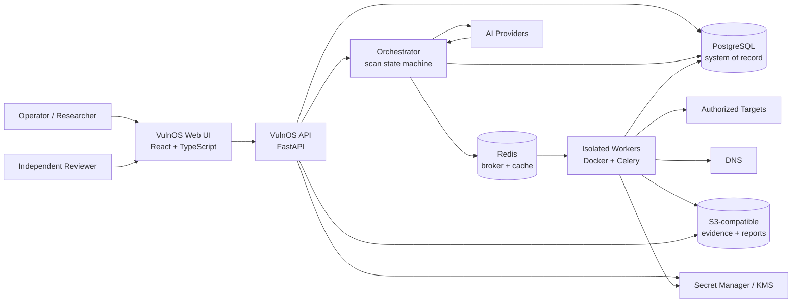
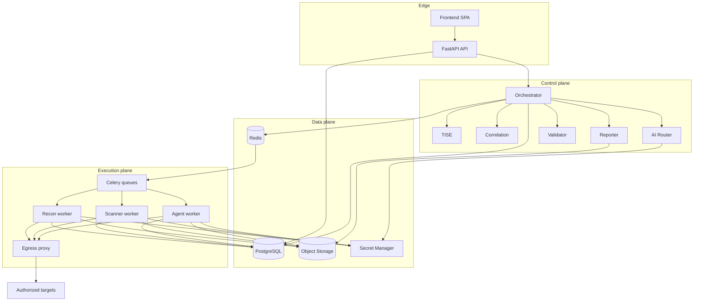
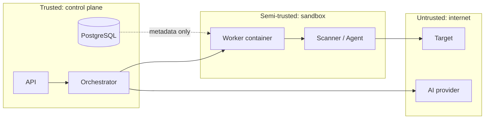

# VulnOS — System Architecture

**Document status:** Phase 1 baseline (approved-pending-review)
**Version:** 1.0
**Date:** 2026-11-01
**Owners:** Principal Architect / Security Engineering
**Normative:** yes, for Phases 2–7

---

## 1. Purpose and scope

This document defines the system context, container boundaries, runtime topology and
non-negotiable invariants for VulnOS. It is the entry point for all other architecture
documents.

VulnOS is an **authorized** web and API vulnerability discovery engine. It coordinates
reconnaissance, discovery, specialist scanners, autonomous agents, AI-assisted investigation
and evidence-based validation, then produces reviewable reports.

It is **not**:

- a generic security dashboard;
- a scanner wrapper that runs every tool against every endpoint;
- an exploitation framework;
- a system that treats model output as proof;
- a multi-tenant SaaS in the initial phase.

### 1.1 Optimization objective

Maximize **unique, independently validated vulnerabilities per authorized testing hour and
unit of cost**, while minimizing false positives, duplicates, redundant scanner and agent
execution, token consumption, repeated reconnaissance, unnecessary HTTP requests and
unverified claims.

The objective is enforced architecturally:

| Lever | Architectural mechanism |
|---|---|
| Fewer duplicates | Canonical asset keys, coverage keys, finding fingerprints and clustering |
| Less redundant work | TISE overlap groups and coverage records |
| Lower false-positive rate | Mandatory validation gates and independent review |
| Lower token cost | Deterministic-first routing, budgets, caching, context retrieval |
| Less repeated recon | Persisted asset intelligence with freshness windows |
| Safer testing | Immutable scope versions, egress proxy, approvals |

---

## 2. Repository baseline: greenfield

### 2.1 Confirmed baseline (2026-11-01)

VulnOS starts as a greenfield design. At the Phase 1 baseline:

1. No VulnOS application code, database schema, API implementation, tests or prior VulnOS
   architecture existed.
2. The repository contains only the Phase 1 blueprint: `README.md`, `.env.example`,
   `.gitignore` and `docs/architecture/`.
3. No tool integration, scan, finding or production credential is included.
4. The Python/FastAPI backend, PostgreSQL schema, Celery workers, TISE, adapters, AI router,
   validator and deployment topology in this document are a **design proposal**, not deployed
   software.

### 2.2 Proposed (not yet implemented)

Everything described beyond the Phase 1 baseline is a design target. It must not be
described as existing functionality until the relevant phase and its exit criteria are
complete.

### 2.3 Relationship to other projects

VulnOS is standalone. No unrelated application is migrated into VulnOS, and there is no
runtime dependency, shared schema or shared deployment with any other project. Any reuse
from unrelated work is limited to non-binding design reference. The clean-repository
decision is recorded as ADR-012.

---

## 3. Goals and non-goals

### 3.1 Goals

- Discover assets and endpoints from an authorized seed.
- Persist reusable, provenance-tagged intelligence.
- Select tools deliberately, with recorded rationale.
- Run scanners and agents through one isolated adapter contract.
- Correlate findings without losing source attribution.
- Investigate findings with provider-independent AI under hard budgets.
- Validate findings with reproducible evidence and independent review.
- Produce Markdown, JSON and PDF reports suitable for another AI or a human reviewer.
- Remain operable on a single Docker host in the initial phase.

### 3.2 Non-goals (initial phase)

- Kubernetes, service mesh, event streaming platforms.
- Graph database.
- Advanced multi-identity authorization matrices and business-logic graphs.
- Payout prediction or bug-bounty economics.
- Enterprise collaboration (SSO federations, fine-grained org hierarchies).
- Stealth, evasion, persistence or credential theft.
- Automatic exploitation beyond the minimum needed to demonstrate impact within an
  approved, non-destructive validation plan.
- Public SaaS billing.

Deferred features are listed in [§12](#12-deliberately-deferred-features).

---

## 4. Architectural invariants

These invariants are mandatory. Any implementation that violates one is a defect, even if
tests pass.

| ID | Invariant |
|---|---|
| INV-01 | PostgreSQL is the system of record. Redis is ephemeral coordination, never the source of truth. |
| INV-02 | Every project-scoped row carries `project_id`; every data access is scoped by the authenticated principal's project membership. |
| INV-03 | A scan pins an immutable `scope_version_id` and `authorization_id`. Editing scope never mutates a running scan's authorization. |
| INV-04 | Scope is checked before every outbound request, every redirect and every DNS-resolution change. Default deny. |
| INV-05 | No scanner or agent bypasses the universal adapter. There is no direct `subprocess` call from orchestration or API code. |
| INV-06 | TISE is the only component that decides which tool to run. Adapters execute; they do not self-select. |
| INV-07 | Every finding belongs to a cluster and passes through correlation. No finding goes directly to a report. |
| INV-08 | A finding cannot become `validated` from model reasoning alone. Hard validation gates and independent review are required. |
| INV-09 | AI recommendations and execution permissions are separate. A model may propose an action; a deterministic policy engine authorizes it. |
| INV-10 | Secrets never live in PostgreSQL, source code, logs, prompts or evidence. The database stores references only. |
| INV-11 | Raw tool output and raw HTTP bodies live in encrypted object storage; PostgreSQL stores metadata, hashes and references. |
| INV-12 | AI providers are accessed through the router. No feature imports a provider SDK directly. |
| INV-13 | Destructive or state-changing operations require an explicit, short-lived human approval bound to an action hash. |
| INV-14 | Every state transition that affects authorization, execution or findings is audited. |
| INV-15 | A missing dependency or unverified tool is reported as unavailable, never silently skipped or faked. |

---

## 5. System context

### 5.1 Actors

| Actor | Interaction |
|---|---|
| Security researcher / operator | Creates projects, authorization records and scope; starts scans; reviews evidence; approves risky actions |
| Reviewer (human or external AI) | Independently reviews exported reports and evidence packages |
| Project administrator | Manages membership, credentials, retention and tool availability |
| Platform operator | Deploys, monitors, rotates secrets, maintains tool images |

### 5.2 External systems

| System | Purpose | Trust |
|---|---|---|
| Authorized target(s) | Scan subjects | **Untrusted** — all responses may contain prompt injection or malicious content |
| DNS resolvers | Name resolution | Untrusted answers; validated against scope |
| AI providers | Investigation, triage, reporting, review | Semi-trusted; outputs schema-validated and never directly executable |
| S3-compatible storage | Evidence and reports | Trusted infrastructure, encrypted at rest |
| Secret manager / KMS | Credentials and encryption keys | Trusted |
| Tool upstreams / image registry | Scanner and agent images | Supply-chain risk; pinned and verified |

### 5.3 Context diagram



---

## 6. Container architecture

| Container | Responsibility | Must not |
|---|---|---|
| **Frontend** | React SPA: projects, scans, assets, findings, evidence viewer, reports | Contain scan logic or secrets |
| **API** | REST/OpenAPI, authentication, authorization, request validation, read models, command submission | Execute tools, hold long-lived scan state in memory |
| **Orchestrator** | Scan state machine, stage scheduling, scope/authorization pinning, budgeting, retries, events | Make raw network requests to targets |
| **Worker** | Execute one adapter job in an isolated container; stream evidence; report results | Select tools, expand scope, access the Docker socket |
| **Egress proxy** | Enforce allowlisted destinations at the network layer; log connections | Be bypassable by workers |
| **PostgreSQL** | Durable system of record | Store raw large evidence or secret values |
| **Redis** | Celery broker, distributed locks, rate limits, short-lived cache | Be the only copy of any durable state |
| **Object storage** | Encrypted raw HTTP, tool output, screenshots, agent transcripts, reports | Be publicly readable |
| **Secret manager** | Credentials, API keys, per-project encryption keys | Store secrets in env vars in production |

### 6.1 Container diagram



**Control plane / data plane / execution plane** separation is deliberate. The control plane
never has network access to targets; execution workers never have database write access
beyond a narrow result API (or a restricted DB role). This limits blast radius if an agent or
tool is compromised.

> **Implementation note:** in Phase 2 the worker may write through the same service layer
> using a restricted database role. A separate result-ingest service is a Phase 6/7 hardening
> option, not an initial requirement.

---

## 7. Logical pipeline

The agreed flow is preserved exactly:

```text
TARGET + AUTHORIZATION + SCOPE
        -> SCOPE VALIDATION
        -> RECON PIPELINE
        -> WEB/API DISCOVERY
        -> INTELLIGENT TOOL SELECTION (TISE)
        -> SCANNERS | PENTEST AGENTS
        -> FINDING CORRELATION
        -> AI INVESTIGATION
        -> EVIDENCE VALIDATOR
        -> FINAL FINDINGS
        -> MARKDOWN / JSON / PDF
        -> INDEPENDENT AI / HUMAN REVIEW
```

Stages are implemented as persisted `scan_stage_runs`, not as one long-running function.
Each stage:

1. Loads only the inputs it needs from PostgreSQL.
2. Re-validates scope where it can produce network traffic.
3. Writes outputs and provenance in a single transaction where possible.
4. Emits an outbox event after commit.
5. Is idempotent for a given `(scan_id, stage, attempt)` key.

### 7.1 Stage contracts

| Stage | Consumes | Produces | May make target traffic? |
|---|---|---|---|
| Scope validation | Target seeds, scope version, authorization | `scope_decisions`, validated targets | No |
| Recon | Validated seeds, budget | Domains, hosts, addresses, services, technologies, discoveries | Yes (allowlisted) |
| Discovery | Recon assets, auth contexts | Endpoints, parameters, API schemas, discoveries | Yes (allowlisted) |
| TISE | Asset profile, coverage, registry, budget | Selection plan + decisions | No |
| Scanning | Selection plan, scope | Tool executions, raw output, findings | Yes (allowlisted) |
| Agent run | Selection plan, scope, approval | Agent run, transcript, findings | Yes (allowlisted, sandboxed) |
| Correlation | Findings + evidence | Finding clusters, links | No |
| Investigation | Clusters, evidence summaries, budget | Investigation plans, AI invocations | No (may read evidence only) |
| Validation | Cluster, plan, evidence, scope | Validation checks, verdict, state transition | Yes (controlled, allowlisted) |
| Reporting | Report-ready clusters | Markdown/JSON/PDF in object storage | No |

### 7.2 Orchestration state

A scan moves through:

```text
draft -> queued -> running -> (paused) -> completed
                                  |-> failed
                                  |-> cancelled
```

Stage-level failures do not automatically fail the scan. A stage may be marked
`partial` with recorded gaps; TISE and the report must disclose incomplete coverage. This
prevents a single flaky tool from destroying an otherwise useful engagement.

---

## 8. Repository layout

The target repository layout separates HTTP, domain logic, execution and infrastructure.
Paths are relative to the VulnOS repository root.

```text
.
├── backend/                     FastAPI application
│   ├── app/
│   │   ├── api/v1/              Routers; transport concerns only
│   │   ├── core/                Settings, logging, errors, security primitives
│   │   ├── auth/                Authentication, sessions, API keys, RBAC
│   │   ├── schemas/             Pydantic request/response models
│   │   ├── repositories/        Project-scoped persistence
│   │   ├── services/            Application use cases
│   │   └── main.py              App factory
│   ├── alembic/                 Migrations
│   └── tests/                   API, repository, migration tests
├── engine/                      Domain + orchestration; no FastAPI imports
│   ├── orchestrator/            Scan state machine, stage scheduling, budgets
│   ├── scope/                   Canonicalization, policy evaluation, DNS pinning
│   ├── recon/                   Subdomain, DNS, port, HTTP, technology stages
│   ├── discovery/               Crawling, JS parsing, parameters, API schemas
│   ├── registry/                Tool metadata and version verification
│   ├── tise/                    Candidate generation, scoring, coverage planning
│   ├── adapters/                Universal adapter contract
│   │   ├── scanners/            One adapter per scanner
│   │   └── agents/              One adapter per autonomous agent
│   ├── correlation/             Fingerprints, clustering, conflict detection
│   ├── investigation/           Investigation plans and context assembly
│   ├── validation/              Validation gates and confidence model
│   ├── reporting/               Report builders and renderers
│   ├── ai/                      Provider interfaces, router, budgets, cache
│   ├── evidence/                Object storage, hashing, redaction, retention
│   ├── events/                  Outbox, event types, publishers
│   ├── db/                      SQLAlchemy models, session, unit of work
│   └── security/                Redaction, approval tokens, policy engine
├── workers/                     Celery app and task entrypoints
├── frontend/                    React + TypeScript + Vite SPA
├── tools/                       Dockerfiles/build metadata for external tools
├── infra/
│   ├── compose/                 Local and single-host deployment
│   ├── egress-proxy/            Allowlisting forward proxy
│   ├── docker/                  Hardened worker base images
│   └── observability/           Log/metric configuration
├── docs/                        Architecture, operations, ADRs
├── tests/                       Cross-package contract and e2e tests
└── scripts/                     Developer and operator utilities
```

### 8.1 Directory responsibilities

| Directory | Responsibility | Forbidden dependency |
|---|---|---|
| `backend/api` | HTTP routing, status codes, OpenAPI | Direct DB queries, scanner calls |
| `backend/services` | Use cases and transactions | FastAPI request objects |
| `backend/repositories` | SQLAlchemy persistence, project scoping | Business rules beyond data access |
| `engine/orchestrator` | Pipeline state, scheduling, retries, budgets | Tool-specific parsing |
| `engine/scope` | Authoritative allow/deny decisions | Knowledge of specific scanners |
| `engine/recon` | Discovery of assets | Persisting without normalization |
| `engine/discovery` | Endpoint/parameter/schema discovery | Running vulnerability payloads |
| `engine/registry` | Tool metadata and verification state | Execution |
| `engine/tise` | Selection and coverage planning | Executing tools |
| `engine/adapters` | Translate registry/plan into tool execution and normalized findings | Selection policy |
| `engine/correlation` | Duplicate/related-finding analysis | Validation verdicts |
| `engine/investigation` | AI-assisted hypotheses and plans | Marking findings validated |
| `engine/validation` | Deterministic gates, evidence sufficiency, review | Scope expansion |
| `engine/reporting` | Render reports from validated clusters | Discovering evidence |
| `engine/ai` | Provider abstraction, routing, budgets | Tool execution |
| `engine/evidence` | Store/retrieve/hash/redact evidence | Business decisions |
| `engine/db` | ORM models and transactions | HTTP or CLI concerns |
| `workers` | Task wiring, concurrency, signals | Domain logic |
| `tools` | Reproducible tool images | Application code |

### 8.2 Dependency rule

```text
backend -> engine/services -> engine/domain
workers -> engine/adapters + engine/orchestrator
engine/* must not import backend/*
adapters must not import each other
```

Enforce with an import-linter check in CI from Phase 2.

---

## 9. Runtime topology

### 9.1 Development / single-host (initial)

Docker Compose services:

| Service | Notes |
|---|---|
| `api` | Uvicorn, 2 workers |
| `orchestrator` | Celery worker on a dedicated queue; single concurrency to avoid duplicate stage scheduling |
| `worker-recon` | Celery queue `recon`; network via `egress-proxy` |
| `worker-scan` | Celery queue `scan`; one container per job or a pooled worker with per-job sandbox |
| `worker-agent` | Celery queue `agent`; isolated, higher resource limits |
| `postgres` | 16+, persistent volume |
| `redis` | Broker/cache; persistence optional |
| `minio` | S3-compatible dev storage |
| `egress-proxy` | Envoy/HAProxy or a small dedicated proxy with allowlist integration |
| `frontend` | Vite dev server or static build behind the API in production |

Production single-host is the same topology with TLS termination, managed PostgreSQL/S3
or hardened self-hosted equivalents, and no development ports exposed.

### 9.2 Why not microservices

The control plane and workers are already separate processes with clear queues. Splitting
recon, TISE, correlation and reporting into network services would add deployment and
consistency costs without improving isolation; tool isolation is achieved at the worker
container boundary. Revisit only when a measured bottleneck requires it.

### 9.3 Scaling path

1. Add worker replicas per queue (stateless).
2. Partition `http_exchanges` and `audit_logs` by month.
3. Move evidence to a managed S3 with lifecycle rules.
4. Add a read replica for reporting if needed.
5. Only then consider service extraction.

No Kubernetes in the initial architecture.

---

## 10. Technology decisions

| Decision | Choice | Rationale | Alternatives rejected |
|---|---|---|---|
| API | FastAPI | Async, OpenAPI-native, Pydantic schemas | Django (heavier), Flask (weaker contracts) |
| ORM | SQLAlchemy 2.x | Mature, explicit transactions, Alembic | Raw SQL only (harder to evolve) |
| DB | PostgreSQL | JSONB, partitioning, constraints, extensions | SQLite (concurrency/isolation), D1 (runtime mismatch) |
| Queue | Redis + Celery | Simple, proven, Python-native | Kafka/RabbitMQ (operational overhead) |
| HTTP | HTTPX | Async, transport hooks for scope-pinned connections | requests (sync), aiohttp (less central) |
| Browser | Playwright | Controlled browser contexts, auth workflows | Selenium (heavier) |
| Isolation | Docker | Required stack; per-job sandbox | Process-only (insufficient) |
| Evidence | S3-compatible | Scalable, encrypted, lifecycle policies | PostgreSQL blobs (bloat) |
| AI | Provider-independent router | Avoid lock-in, cost/fallback control | Direct SDK usage |
| Logging | Structured JSON | Machine-parseable, redaction pipeline | Plain text |
| Tests | Pytest | Standard, fixtures, async support | unittest |

### 10.1 Version policy

- Pin exact versions in lockfiles and Docker image digests.
- Python: latest stable supported by FastAPI/SQLAlchemy at Phase 2 start; pin minor.
- Node: current LTS (≥22) for the frontend.
- PostgreSQL: 16 or newer.
- Every tool image is referenced by digest, never `latest`.

---

## 11. Trust boundaries and security posture



Boundary rules:

- Target responses are untrusted data, never instructions.
- AI provider responses are untrusted data, never authorization.
- Tool output is untrusted; parsers are defensive and schema-validated.
- Workers have no Docker socket, no host filesystem, no direct internet.
- PostgreSQL is not reachable from worker containers except through a restricted role or the
  result-ingest API.
- Secrets are resolved at execution time and injected into the sandbox only for the duration
  of the job.

Full controls: [SECURITY_ARCHITECTURE.md](SECURITY_ARCHITECTURE.md).

---

## 12. Deliberately deferred features

The following are explicitly **out of initial scope** and must not appear in Phases 2–7:

- Advanced multi-identity authorization engine and role matrices.
- Complex business-logic workflow discovery and business-process graphs.
- Payout prediction or bounty analytics.
- Enterprise collaboration (organizations, SSO federations, granular sharing).
- Microservice decomposition.
- Graph database.
- Kubernetes.
- Autonomous exploitation beyond approved impact demonstration.
- Stealth, evasion, persistence, credential dumping.

Basic authentication contexts (anonymous, user, admin) and ordinary authorization testing
(e.g., comparing two identities) remain in scope.

---

## 13. Architectural risks and trade-offs

| Risk | Impact | Mitigation | Residual |
|---|---|---|---|
| Scope bypass via redirect/DNS rebinding | Unauthorized testing | Multi-layer scope guard, DNS pinning, egress proxy, deny metadata/private ranges | Low if proxy is enforced |
| Tool output is malicious | Parser compromise, prompt injection | Sandbox, schema validation, no shell, content treated as data | Medium |
| Agent escapes sandbox | Host compromise | Non-root, no socket, caps dropped, read-only FS, resource limits | Low–medium |
| False validation | Reputation/legal | Hard gates, independent reviewer, evidence retention | Medium |
| AI cost overrun | Budget loss | Pre-flight budgets, hard caps, caching, deterministic-first | Low |
| Evidence leakage | Credential/PII exposure | Encryption, redaction, signed URLs, retention | Medium |
| Scope model too permissive (wildcards) | Wider testing than intended | Explicit wildcard semantics, preview/dry-run, deny overrides | Medium |
| Tool licensing conflicts | Distribution risk | License audit before packaging | Unknown |
| Single-host bottleneck | Slow large scans | Queue-based horizontal workers, partitioning | Medium |
| Accidental secret commit | Credential exposure | `.gitignore`, secret scanning, review before commit | Medium |

---

## 14. Key decisions (ADR summary)

| ADR | Decision | Status |
|---|---|---|
| ADR-001 | Preserve the agreed eight-stage pipeline | Accepted |
| ADR-002 | PostgreSQL as sole system of record; Redis ephemeral | Accepted |
| ADR-003 | Immutable scope versions pinned per scan | Accepted |
| ADR-004 | One universal adapter contract for scanners and agents | Accepted |
| ADR-005 | TISE is the only tool selector | Accepted |
| ADR-006 | Findings are per-source occurrences clustered into canonical findings | Accepted |
| ADR-007 | Validation requires deterministic checks + independent review | Accepted |
| ADR-008 | AI providers behind a router; no direct SDK imports | Accepted |
| ADR-009 | Docker isolation with egress proxy; no Kubernetes | Accepted |
| ADR-010 | Evidence in encrypted object storage, metadata in PostgreSQL | Accepted |
| ADR-011 | VulnOS is a standalone greenfield project; unrelated applications are not migrated | Accepted |
| ADR-012 | VulnOS uses a clean, standalone repository | Accepted |
| ADR-013 | Secret backend default (file vs Vault vs cloud KMS) | **Open** |
| ADR-014 | Embeddings storage (pgvector vs application-side) | **Open** |

---

## 15. Consistency checklist

Before Phase 2 begins, confirm:

- [ ] Every component in [COMPONENT_RESPONSIBILITIES.md](COMPONENT_RESPONSIBILITIES.md) has one responsibility.
- [ ] Every tool path in [TOOL_INTEGRATION.md](TOOL_INTEGRATION.md) uses the universal adapter.
- [ ] TISE is the only selector in [DATA_FLOW.md](DATA_FLOW.md) and the API.
- [ ] All findings flow through correlation and validation.
- [ ] PostgreSQL is the only durable store in every diagram.
- [ ] AI routing is provider-independent and cannot authorize actions.
- [ ] Agents cannot bypass scope (see [SECURITY_ARCHITECTURE.md](SECURITY_ARCHITECTURE.md)).
- [ ] Deferred features do not appear in the roadmap.
- [ ] Phases 2–7 do not contradict each other.

---

## 16. Related documents

- [COMPONENT_RESPONSIBILITIES.md](COMPONENT_RESPONSIBILITIES.md)
- [DATA_FLOW.md](DATA_FLOW.md)
- [DATABASE_DESIGN.md](DATABASE_DESIGN.md)
- [API_CONTRACTS.md](API_CONTRACTS.md)
- [TOOL_INTEGRATION.md](TOOL_INTEGRATION.md)
- [AGENT_ORCHESTRATION.md](AGENT_ORCHESTRATION.md)
- [AI_AND_VALIDATION.md](AI_AND_VALIDATION.md)
- [SECURITY_ARCHITECTURE.md](SECURITY_ARCHITECTURE.md)
- [IMPLEMENTATION_ROADMAP.md](IMPLEMENTATION_ROADMAP.md)
