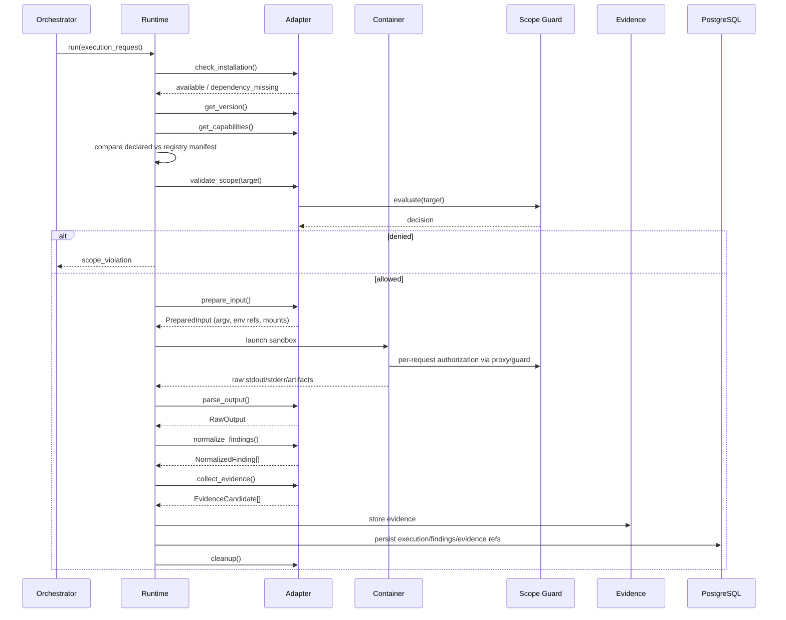

# VulnOS — Tool Integration Architecture

**Document status:** Phase 1 baseline
**Version:** 1.0
**Companion to:** [SYSTEM_ARCHITECTURE.md](SYSTEM_ARCHITECTURE.md), [DATABASE_DESIGN.md](DATABASE_DESIGN.md)

---

## 1. Purpose

This document defines the **universal adapter contract** that every scanner and autonomous
agent must implement, the tool registry that describes capabilities, the safety model, the
finding normalization schema and the integration roadmap.

> **No tool integration exists in Phase 1.** Every entry in the catalog below is a proposed
> integration. Capabilities, versions, licenses, authentication support and destructive
> behavior must be verified against upstream sources and a local contract test before a tool
> is marked selectable. Until then its status is `declared` and TISE must skip it.

---

## 2. Integration principles

1. **One contract.** Scanners and agents implement the same adapter interface.
2. **Execution is isolated.** Every run happens in a Docker container with resource limits,
   a read-only root filesystem, no Docker socket and egress through an allowlisting proxy.
3. **Selection is external.** Adapters execute what TISE plans; they never decide to run
   themselves or add tools.
4. **Raw output is preserved.** Parsing never destroys the original artifact.
5. **Normalization is lossy by design, not by accident.** Source-specific fields are kept in
   `metadata`; the common schema contains only what correlation needs.
6. **Capabilities are declarations, not proof.** A tool is only selectable after a contract
   test proves the declared capability on a controlled fixture.
7. **No shell injection.** Commands are argv arrays; user input is never interpolated into a
   shell string.
8. **Missing dependency is a first-class result.** The adapter reports `dependency_missing`
   rather than pretending success.

---

## 3. Universal adapter contract

### 3.1 Interface

```python
from typing import Protocol, ClassVar
from dataclasses import dataclass


class ToolAdapter(Protocol):
    name: ClassVar[str]
    adapter_version: ClassVar[str]

    async def check_installation(self, ctx: "ToolContext") -> "InstallationStatus": ...
    async def get_version(self, ctx: "ToolContext") -> "ToolVersionInfo": ...
    async def get_capabilities(self) -> "CapabilitySet": ...
    async def validate_scope(self, ctx: "ToolContext", target: "TargetRef") -> "ScopeDecision": ...
    async def prepare_input(self, ctx: "ToolContext", request: "ExecutionRequest") -> "PreparedInput": ...
    async def execute(self, ctx: "ToolContext", prepared: "PreparedInput") -> "ExecutionResult": ...
    async def parse_output(self, ctx: "ToolContext", result: "ExecutionResult") -> "RawOutput": ...
    async def normalize_findings(self, ctx: "ToolContext", raw: "RawOutput") -> list["NormalizedFinding"]: ...
    async def collect_evidence(self, ctx: "ToolContext", result: "ExecutionResult") -> list["EvidenceCandidate"]: ...
    async def cleanup(self, ctx: "ToolContext") -> None: ...
```

`validate_scope` is **mandatory**, but it is a defensive check only. The authoritative check
is performed by the runtime immediately before each outbound request. An adapter cannot
override a denial.

### 3.2 Context

`ToolContext` is the only way an adapter touches the platform:

| Member | Purpose |
|---|---|
| `scope_guard` | Authoritative allow/deny for a URL/host/IP + method |
| `http_client` | Scope-pinned HTTPX client; redirects revalidated |
| `browser` | Playwright context factory (isolated per auth context) |
| `evidence_sink` | Stream request/response/tool output to encrypted storage |
| `secret_resolver` | Resolve `secret_ref_id` for this project/execution only |
| `budget` | Remaining requests, wall clock, cost and tokens |
| `cancellation` | Cooperative cancellation token |
| `logger` | Structured logger with automatic secret redaction |
| `execution_id` | Correlation ID for all evidence and findings |

Adapters receive no database session, no Docker socket and no network client other than the
scope-pinned one.

### 3.3 Lifecycle



### 3.4 Failure semantics

| Condition | Adapter result | Runtime behavior |
|---|---|---|
| Binary missing | `dependency_missing` | Mark `skipped`; record reason; no retry |
| Version mismatch | `version_mismatch` | Quarantine version; no execution |
| Capability mismatch | `capability_mismatch` | Reject plan item; audit |
| Scope denied | `scope_violation` | Abort; security audit; no retry |
| Timeout | `timeout` | Kill process group; keep partial evidence |
| Non-zero exit | `failed` | Preserve stderr; parse partial output if safe |
| Parse error | `parse_error` | Preserve raw; emit zero findings, not garbage |
| Budget exhausted | `budget_exceeded` | Stop; mark partial coverage |
| Secret resolution failure | `credential_unavailable` | Abort; never fall back to shared credentials |

Adapters must never swallow an exception and return an empty successful result.

---

## 4. Normalized finding schema

Adapters emit **occurrences**, not canonical findings and not validation verdicts.

```json
{
  "source": {
    "source_type": "scanner",
    "tool": "dalfox",
    "tool_version_id": "0192...",
    "execution_id": "0192..."
  },
  "vulnerability_class": "xss_reflected",
  "title": "Reflected cross-site scripting in q",
  "asset": {
    "kind": "endpoint",
    "canonical_key": "https://api.example.com/search?q="
  },
  "endpoint": {
    "method": "GET",
    "url": "https://api.example.com/search?q=FUZZ",
    "path_template": "/search"
  },
  "parameter": {"name": "q", "location": "query"},
  "auth_context": {"label": "anonymous", "identity_type": "anonymous"},
  "severity_claimed": "high",
  "confidence_claimed": 0.86,
  "description": "The q parameter reflects an unescaped payload into the HTML body.",
  "reproduction": {
    "request_evidence_id": "0192...",
    "response_evidence_id": "0192...",
    "payload_family": "html_context_breakout",
    "notes": "Control request with a benign value did not reflect."
  },
  "evidence_candidates": [
    {"role": "request", "kind": "http_request"},
    {"role": "response", "kind": "http_response"}
  ],
  "metadata": {
    "tool_rule_id": "xss-reflected",
    "tool_severity": "High"
  }
}
```

Rules:

- `vulnerability_class` uses a controlled vocabulary (shared with TISE capability metadata).
- `title` is a short human label, not the verdict.
- `severity_claimed` is the tool's claim; VulnOS severity is assigned during validation.
- `reproduction` must point to evidence IDs or recorded sequences, not prose alone.
- `metadata` may contain tool-specific fields but must not contain secrets.
- Adapters **cannot** set `cluster_id`, `status`, `validated_at` or `report_ready`.

### 4.1 Controlled vulnerability classes (initial)

`xss_reflected`, `xss_stored`, `sqli`, `nosqli`, `command_injection`, `ssti`, `ssrf`,
`open_redirect`, `path_traversal`, `lfi`, `rfi`, `xxe`, `csrf`, `idor`, `bola`, `bfla`,
`broken_auth`, `session_issue`, `jwt_issue`, `cors_misconfiguration`, `security_headers`,
`tls_misconfiguration`, `exposed_secret`, `sensitive_file_exposure`, `directory_listing`,
`default_credentials`, `outdated_component`, `known_cve`, `graphql_misconfiguration`,
`api_rate_limit`, `api_schema_issue`, `http_request_smuggling`, `host_header_injection`,
`crlf_injection`, `prototype_pollution`, `deserialization`, `race_condition`,
`business_logic`, `source_code_issue`, `dependency_vulnerability`, `other`.

Adding a class requires updating the shared vocabulary and the TISE capability index. Adapters
must not invent free-text classes.

---

## 5. Tool registry

### 5.1 Registry entry fields

| Field | Required | Purpose |
|---|---|---|
| `name` | yes | Stable identifier |
| `category` | yes | recon, discovery, scanner, api, agent, sast, secrets, sca |
| `version` | yes | Upstream version |
| `image_ref` + `image_digest` | yes | Reproducible execution |
| `vulnerability_classes` | yes | Capability matching |
| `target_types` | yes | web, api, graphql, host, source, container |
| `required_inputs` | yes | URLs, hosts, schema, repo, image |
| `auth_support` | yes | Whether authenticated scanning is possible |
| `output_format` | yes | JSON preferred; XML/text adapters allowed |
| `install_requirements` | yes | Image, binary, wordlists, templates |
| `execution_cost` | yes | low/medium/high |
| `expected_duration_seconds` | yes | Planning estimate |
| `capability_metadata` | yes | Rate limits, concurrency, template packs |
| `overlap_group` | yes | Redundancy suppression |
| `behavior` | yes | passive/active |
| `state_changing` | yes | May modify target state |
| `destructive` | yes | May cause damage |
| `maintenance_status` | yes | active/maintenance/stale/abandoned/unknown |
| `license` | yes | Verified SPDX identifier or `unknown` |
| `verification_status` | yes | declared/smoke/contract/production/quarantined |

### 5.2 Verification states

| State | Meaning | Selectable by TISE |
|---|---|---|
| `declared` | Metadata entered from upstream documentation | No |
| `smoke_tested` | Image builds and `--version` / health check works | No |
| `contract_tested` | Fixture target test passes, parser tests pass, scope and timeout tests pass | Yes |
| `production_verified` | Used successfully in an authorized engagement with metrics | Yes |
| `quarantined` | Known broken, unsafe or license-blocked | No |

A tool cannot be promoted by editing a YAML file. Promotion requires a test result recorded
in `tool_versions.verified_at` and `verification_status`.

### 5.3 Registry source of truth

`tools/catalog.yaml` is the declarative source for metadata, but PostgreSQL is the runtime
source of truth. CI validates YAML against a schema, builds images, runs contract tests, and
then seeds the registry. TISE reads only the database snapshot.

---

## 6. Safety profile

Every adapter declares:

```python
@dataclass(frozen=True)
class SafetyProfile:
    passive: bool
    active: bool
    authenticated: bool
    state_changing: bool
    destructive: bool
    requires_approval: bool
    max_default_rate_rps: float
    allowed_methods: frozenset[str]
    max_redirects: int
```

Runtime enforcement:

- `state_changing` or `destructive` requires a matching `operation_approvals` row bound to
  the action hash, scan and expiry.
- An adapter cannot send a method outside `allowed_methods`.
- Rate limits are enforced by the runtime/proxy, not trusted to the tool.
- A tool that declares `passive` but attempts an active request is a contract violation and
  is quarantined.
- Any tool attempting a request outside scope is terminated and audited.

### 6.1 Approval boundary

| Operation class | Example | Approval |
|---|---|---|
| Passive read | DNS, certificate transparency, source scan | None |
| Active non-destructive | GET-based crawling, template checks, reflected payload probes | Authorization record's `allowed_actions` includes `scan` |
| Authenticated active | Scanning with a user session | Explicit auth context + authorization |
| State-changing | Creating/deleting resources, POST/PUT/DELETE tests | `operation_approvals` required |
| Destructive | Payloads that may corrupt data, service disruption, password changes | `owner`/`admin` approval + `destructive_allowed=true` |
| Post-exploitation | Any persistence, data exfiltration, lateral movement | **Out of scope** |

---

## 7. Overlap groups

TISE uses overlap groups to prevent redundant work. Within a group, a second tool is selected
only when it provides an independent method, different coverage, or the first result was
inconclusive.

| Overlap group | Tools (proposed) | Selection note |
|---|---|---|
| `subdomain_enumeration` | BBOT, Amass, Subfinder | Different sources; one primary + one diversity pick |
| `subdomain_permutation` | AlterX | Only after a base domain set exists |
| `dns_resolution` | DNSx | Shared resolver stage; avoid per-tool duplication |
| `port_scanning` | Naabu, Nmap | Naabu for breadth; Nmap for service/version depth |
| `http_probing` | HTTPx | Single canonical probe stage |
| `crawling` | Katana, Playwright | Katana for breadth; Playwright for JS/SPA/auth flows |
| `historical_urls` | GAU | Passive; complements crawl |
| `content_discovery` | FFUF | Requires wordlist strategy and rate budget |
| `parameter_discovery` | Arjun | Only where parameters are unknown |
| `web_vuln_scanner` | Nuclei, ZAP, Wapiti, Nikto | Nuclei for templates; ZAP/Wapiti for session-aware active scanning; Nikto for legacy server checks |
| `xss` | Dalfox | Specialist; avoid if Nuclei already tested with equivalent payloads |
| `sqli` | SQLmap | Specialist; requires parameter targeting and rate limits |
| `command_injection` | Commix | Specialist; high-risk, approval-gated |
| `ssrf` | SSRFmap | Specialist; OOB infrastructure required |
| `tls` | testssl.sh | Per-service TLS assessment |
| `js_libraries` | Retire.js | JS dependency fingerprinting |
| `container_iac` | Trivy | Image/filesystem scan |
| `network_vuln` | Greenbone/OpenVAS | Heavy; optional, infrastructure-dependent |
| `api_route_discovery` | Kiterunner, GAU, Katana | Route discovery from wordlists/history/crawl |
| `api_schema_testing` | Schemathesis | Requires OpenAPI/GraphQL schema |
| `api_stateful_testing` | RESTler | Requires schema + sequences; state-changing approval |
| `api_traffic` | mitmproxy | Capture/replay; replay is active |
| `graphql` | graphw00f | Fingerprinting before GraphQL-specific tests |
| `autonomous_agent` | Strix, RedAmon, PentAGI, Shannon | One primary agent per target |
| `sast` | Semgrep, CodeQL | Different depth/cost; CodeQL optional |
| `secrets` | Gitleaks, TruffleHog | One primary; dedup by secret fingerprint |
| `sca` | OSV-Scanner, Trivy | Dependency databases differ; dedup by advisory ID + package |

---

## 8. Tool catalog (proposed integrations)

Legend for **Auth**: `Y*` = upstream claims or design intent to support authentication;
`N*` = no authenticated mode expected; `P*` = partial/mode-dependent. Every `*` must be
verified in the integration phase.

Legend for **Safety**: `P` passive, `A` active, `S` state-changing, `D` destructive.

| Tool | Category | Design purpose | Overlap group | Safety | Auth | Phase | Status |
|---|---|---|---|---|---|---|---|
| BBOT | Recon | Modular subdomain/asset enumeration | `subdomain_enumeration` | A | P* | 3 | Unverified |
| OWASP Amass | Recon | Subdomain and DNS intelligence | `subdomain_enumeration` | A | N* | 3 | Unverified |
| Subfinder | Recon | Passive subdomain enumeration | `subdomain_enumeration` | P | N* | 3 | Unverified |
| DNSx | Recon | DNS resolution and records | `dns_resolution` | A | N* | 3 | Unverified |
| Naabu | Recon | Port scanning | `port_scanning` | A | N* | 3 | Unverified |
| HTTPx | Recon | HTTP probing, tech detection | `http_probing` | A | P* | 3 | Unverified |
| Nmap | Recon | Service/version detection | `port_scanning` | A | N* | 3 | Unverified |
| AlterX | Recon | Subdomain permutation generation | `subdomain_permutation` | P | N* | 3 | Unverified |
| Katana | Discovery | Crawling and JS endpoint extraction | `crawling` | A | Y* | 3 | Unverified |
| Playwright | Discovery | Browser-driven discovery, auth flows | `crawling` | A | Y* | 3 | Unverified |
| GAU | Discovery | Historical URL retrieval | `historical_urls` | P | N* | 3 | Unverified |
| FFUF | Discovery | Content/route discovery | `content_discovery` | A | Y* | 3 | Unverified |
| Arjun | Discovery | Parameter discovery | `parameter_discovery` | A | Y* | 3 | Unverified |
| Nuclei | Scanner | Template-based vulnerability checks | `web_vuln_scanner` | A | Y* | 4 | Unverified |
| OWASP ZAP | Scanner | Session-aware web scanning | `web_vuln_scanner` | A/S | Y* | 4 | Unverified |
| Wapiti | Scanner | Web application scanning | `web_vuln_scanner` | A | Y* | 4 | Unverified |
| Dalfox | Scanner | XSS scanning | `xss` | A | Y* | 4 | Unverified |
| SQLmap | Scanner | SQL injection testing | `sqli` | A/S | Y* | 4 | Unverified |
| Nikto | Scanner | Legacy web server checks | `web_vuln_scanner` | A | N* | 4 | Unverified |
| Commix | Scanner | Command injection testing | `command_injection` | A/S/D | Y* | 4 | Unverified |
| SSRFmap | Scanner | SSRF testing | `ssrf` | A | Y* | 4 | Unverified |
| testssl.sh | Scanner | TLS/SSL configuration | `tls` | A | N* | 4 | Unverified |
| Retire.js | Scanner | Vulnerable JS libraries | `js_libraries` | P | N* | 4 | Unverified |
| Trivy | Scanner | Container/filesystem vulnerabilities | `container_iac` | P | N* | 4 | Unverified |
| Greenbone/OpenVAS | Scanner | Network vulnerability scanning | `network_vuln` | A/S | Y* | 4 (optional) | Unverified |
| Hadrian | API | API security scanning | `api_schema_testing` | A/S | Y* | 4 | Unverified |
| Schemathesis | API | Property-based OpenAPI testing | `api_schema_testing` | A/S | Y* | 4 | Unverified |
| RESTler | API | Stateful REST API testing | `api_stateful_testing` | A/S | Y* | 4 | Unverified |
| Kiterunner | API | API route discovery | `api_route_discovery` | A | Y* | 4 | Unverified |
| mitmproxy | API | Traffic capture and replay | `api_traffic` | P/A | Y* | 4 | Unverified |
| graphw00f | API | GraphQL fingerprinting | `graphql` | A | N* | 4 | Unverified |
| Strix | Agent | Primary autonomous pentesting candidate | `autonomous_agent` | A/S | Y* | 5 | Unverified |
| RedAmon | Agent | Alternative/benchmark agent | `autonomous_agent` | A/S | Y* | 5 | Unverified |
| PentAGI | Agent | Optional experimental agent | `autonomous_agent` | A/S | Y* | 5 | Unverified |
| Shannon | Agent | White-box/source-assisted candidate | `autonomous_agent` | A/S | Y* | 5 | Unverified |
| Semgrep | SAST | Source pattern analysis | `sast` | P | N/A | 4 | Unverified |
| CodeQL | SAST | Deep source analysis | `sast` | P | N/A | 7 (optional) | Unverified |
| Gitleaks | Secrets | Secret detection in source/history | `secrets` | P | N/A | 4 | Unverified |
| TruffleHog | Secrets | Secret detection and verification | `secrets` | P | N/A | 4 | Unverified |
| OSV-Scanner | SCA | Dependency vulnerability scanning | `sca` | P | N/A | 4 | Unverified |

### 8.1 Catalog caveats

- **No version, license or maintenance claim is made here.** These must be recorded from
  upstream during the integration phase.
- `Safety` describes the *default intended mode*. Many tools have flags that make them
  state-changing or destructive; the adapter must expose and gate those modes explicitly.
- `Auth` is a design expectation. It is not a tested capability.
- Static-analysis findings (`source_type = static`) are stored and reported separately from
  runtime-confirmed vulnerabilities. A Semgrep/CodeQL hit is never labelled runtime-confirmed
  without code-level or controlled runtime validation.
- Hadrian may be commercial; availability and licensing must be confirmed before use.
- Greenbone/OpenVAS is heavy and operationally distinct; it remains optional.
- CodeQL licensing and build requirements differ from Semgrep; it is optional.
- Shannon is only meaningful with source-code access; it is not a black-box replacement.
- Agent entries are candidates, not endorsements. See
  [AGENT_ORCHESTRATION.md](AGENT_ORCHESTRATION.md).

---

## 9. Selection hints (not selection rules)

TISE may use these signals, but the final decision is a scored plan, not an `if` statement:

| Signal | Candidate implication |
|---|---|
| Detected CMS/framework | Templates/rules matching that technology |
| OpenAPI/GraphQL schema present | Schema-aware API testing |
| Auth context available | Authenticated crawling and authorization tests |
| Parameters of type `url`/`redirect` | SSRF/open-redirect candidates |
| Parameters reflected in HTML | XSS candidates |
| SQL error signatures observed | SQLi candidates |
| JS-heavy SPA | Playwright before Katana-only |
| Historical URLs available | GAU complements crawl |
| Large host surface, tight budget | Naabu + HTTPx breadth; defer deep scanners |
| Source repository provided | SAST/secrets/SCA before runtime agents |

These hints are inputs to scoring. They must not be implemented as a hardcoded "if WordPress
then run everything".

---

## 10. Execution packaging

- One Docker image per tool (or a small, explicitly documented shared base).
- Images are built from pinned upstream releases and referenced by digest.
- No `latest` tags in the registry.
- Non-root user, read-only root filesystem, `tmpfs` for `/tmp`, dropped capabilities,
  `no-new-privileges`, PID/CPU/memory limits.
- Tool input mounted read-only; output mounted writable with a size cap.
- Network namespace has no direct route; all egress goes through the proxy.
- Tool binaries are installed at image build time; adapters never download tools at runtime.
- Wordlists/templates are versioned artifacts with hashes, not downloaded per scan.
- Image SBOMs are generated and scanned before promotion (Phase 7 hardening).

### 10.1 Container invocation

```text
docker run --rm \
  --network vulnos-egress \
  --read-only \
  --tmpfs /tmp:size=512m \
  --cap-drop ALL \
  --security-opt no-new-privileges \
  --pids-limit 256 \
  --memory 2g --cpus 2 \
  --user 10001:10001 \
  -v /jobs/{execution_id}/input:/input:ro \
  -v /jobs/{execution_id}/output:/output:rw \
  vulnos/tool-nuclei@sha256:...
```

The runtime constructs this; adapters provide only argv, environment references and mount
requests that the runtime validates against an allowlist.

---

## 11. Output parsing and evidence

### 11.1 Parsing rules

- Prefer JSON/JSONL output. XML/text formats get a dedicated parser with fixtures.
- Parsers are pure functions where possible; no network access.
- Unknown fields are preserved in `metadata`, not dropped.
- Malformed lines are counted and reported; one bad line must not discard the whole run.
- Never `eval`, `pickle` or deserialize untrusted tool output.
- Size limits: stdout/stderr capped (default 50 MB each), with truncation recorded and the
  full artifact streamed to object storage when enabled.

### 11.2 Evidence capture

| Evidence | When | Redaction |
|---|---|---|
| Request/response pair | Every finding reproduction + sampled coverage | Headers (Authorization, Cookie), tokens, PII patterns |
| Raw stdout/stderr | Every execution | Secret patterns, auth headers |
| Screenshots | Browser-based discovery/validation | Blurred credential fields if configured |
| HAR/trace | Playwright sessions (optional) | Same header/cookie redaction |
| Tool config | Every execution (redacted) | Env values replaced with references |

Redaction happens **before** writing to object storage, not at render time. The
`redaction_status` field records whether it was applied.

---

## 12. Contract tests

Every adapter must pass, on a controlled local fixture:

| Test | Assertion |
|---|---|
| Installation | Missing binary → `dependency_missing`, not crash |
| Version | Reported version matches registry; mismatch quarantines |
| Capabilities | Declared classes match the manifest |
| Happy path | Known fixture vulnerability is detected |
| Negative control | Non-vulnerable fixture is not reported |
| Parser | Golden output fixture → expected normalized findings |
| Scope denial | Out-of-scope target is rejected before any request |
| Redirect | Redirect to a blocked IP is denied |
| Timeout | Process group is killed; partial evidence preserved |
| Rate limit | Runtime enforces the configured cap |
| Secrets | Auth headers/cookies never appear in evidence or logs |
| Cleanup | No containers, temp files or processes remain |
| Idempotency | Re-running the same execution key does not duplicate findings |

Contract tests use an authorized local test application (for example a deliberately
vulnerable lab container) and recorded fixtures. They do not scan the public internet.

### 12.1 Promotion checklist

Before `contract_tested`:

- [ ] Upstream project is reachable and maintained (last release reviewed).
- [ ] License recorded and compatible with distribution.
- [ ] Image digest pinned; build reproducible.
- [ ] CLI/API flags documented and allowlisted.
- [ ] Destructive/state-changing modes identified and gated.
- [ ] Auth support verified against a local fixture.
- [ ] Output parser tested with golden files.
- [ ] Timeout/cancellation tested.
- [ ] Scope denial tested at the network layer.
- [ ] Evidence redaction tested.
- [ ] Resource limits tested.

---

## 13. Tool status and health

`GET /tools/status` reflects **verified runtime state**:

```json
{
  "tool": "nuclei",
  "version": "vX.Y.Z",
  "verification_status": "contract_tested",
  "available": true,
  "last_successful_execution_at": "2026-11-01T10:30:00Z",
  "reason": null
}
```

When a tool is unavailable:

```json
{
  "tool": "sqlmap",
  "available": false,
  "reason": "dependency_missing",
  "detail": "Image digest not present on worker node"
}
```

The API must never infer availability from a registry row alone.

---

## 14. Phase mapping

| Phase | Tool work |
|---|---|
| 2 | Adapter interface definition, registry schema, execution tables; no tool execution |
| 3 | Recon/discovery adapters (BBOT, Amass, Subfinder, DNSx, Naabu, HTTPx, Nmap, AlterX, Katana, Playwright, GAU, FFUF, Arjun) + normalizer |
| 4 | Scanner adapters (Nuclei, ZAP, Wapiti, Dalfox, SQLmap, Nikto, Commix, SSRFmap, testssl.sh, Retire.js, Trivy, optional OpenVAS), API tools, TISE, overlap suppression |
| 5 | Agent adapters (Strix primary; RedAmon/PentAGI/Shannon evaluated) |
| 6 | Static/secrets/SCA adapters may be integrated here if Phase 4 capacity is insufficient; AI investigation consumes normalized findings |
| 7 | Tool status UI, SBOM/signing, production verification |

If static analysis slips from Phase 4 to Phase 6, record the reason in the roadmap change log.
Do not silently move responsibilities.

---

## 15. Explicit non-claims

- No adapter is implemented.
- No tool has been installed, version-checked or license-audited.
- No capability or authentication support has been verified.
- No benchmark result exists.
- No destructive mode is approved for use.
- The catalog is a design scope, not a statement of working integrations.
