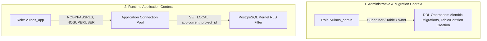
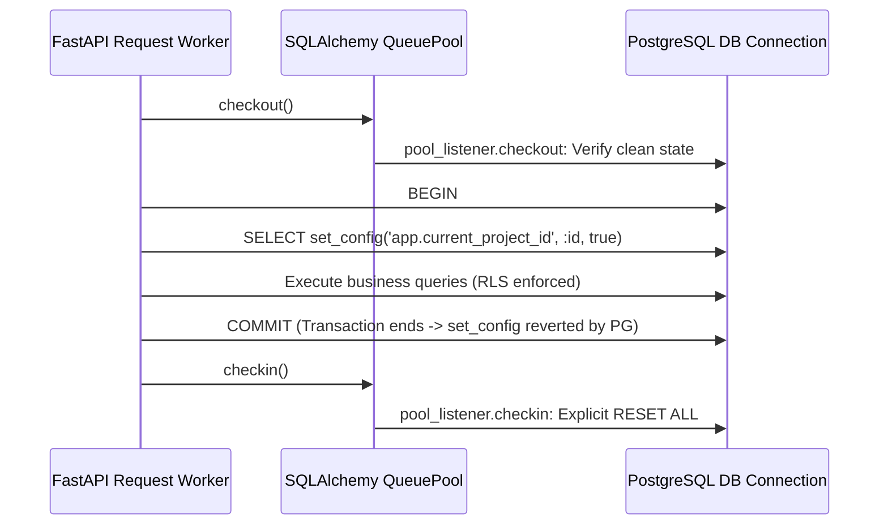

# VulnOS — Phase 2.3 Row-Level Security (RLS) & Tenant Isolation Design

**Document Status:** Complete Architecture & Policy Design Specification  
**Phase:** 2.3 (PostgreSQL Row-Level Security, Tenant Isolation & Cross-Project Security)  
**Author:** Senior PostgreSQL Security Architect & Backend Engineer  
**Date:** 2026-11-02  
**Repository:** `https://github.com/VarshSec/vulnos`  
**Git HEAD:** `c2e8bb72298e2a5f03716cf70da4d837a1a9ace8` (Baseline)  

---

## 1. Executive Summary & Design Principles

VulnOS performs security scanning, attack surface discovery, autonomous agent investigations, and evidence validation against authorized targets. In this operational context, cross-tenant or cross-project data leakage represents an intolerable catastrophic failure.

This document establishes the formal design for PostgreSQL Row-Level Security (RLS) across the VulnOS relational store.

### Core Principles
1. **Default-Deny at the Storage Engine:** If an application query omits `project_id`, or if tenant context is missing, PostgreSQL returns zero rows (`NULL::uuid IS NULL` evaluates to deny).
2. **Transaction-Local Isolation:** Context variables (`app.current_project_id`, `app.current_user_id`, `app.request_id`) are set using PostgreSQL `set_config(..., true)`. They automatically revert upon transaction completion (`COMMIT` or `ROLLBACK`).
3. **Pool Safety & Defense-in-Depth:** Application connection pool events (`connect`, `checkout`, `checkin`, `reset`) guarantee that any persistent connection returned to the pool has all context cleared (`DISCARD TEMP`, `RESET ALL`).
4. **Enforced Security (`FORCE ROW LEVEL SECURITY`):** All tenant tables enforce RLS even for the table owner, preventing developer or admin misconfigurations from bypassing security rules.
5. **Least-Privilege Roles:** Separate DDL migration owner (`vulnos_admin`) from runtime application service (`vulnos_app` with `NOBYPASSRLS`).
6. **Immutable Audit Trail:** `audit_logs` permits project-scoped reads and system appends; updates and deletes are permanently rejected by RLS.

---

## 2. PostgreSQL Role Architecture

In a production deployment, VulnOS enforces a strict separation of database roles:



### 2.1 Role Definitions & Privileges

```sql
-- Migration / Schema Owner Role
CREATE ROLE vulnos_admin WITH LOGIN PASSWORD 'secure_admin_password';
GRANT ALL PRIVILEGES ON DATABASE vulnos TO vulnos_admin;

-- Runtime Application Role (Least Privilege)
CREATE ROLE vulnos_app WITH LOGIN PASSWORD 'secure_app_password' NOBYPASSRLS NOSUPERUSER NOCREATEDB NOCREATEROLE;
GRANT CONNECT ON DATABASE vulnos TO vulnos_app;
GRANT USAGE ON SCHEMA public TO vulnos_app;
GRANT SELECT, INSERT, UPDATE, DELETE ON ALL TABLES IN SCHEMA public TO vulnos_app;
ALTER DEFAULT PRIVILEGES IN SCHEMA public GRANT SELECT, INSERT, UPDATE, DELETE ON TABLES TO vulnos_app;
```

### 2.2 `FORCE ROW LEVEL SECURITY`
By default, PostgreSQL allows the table owner role to bypass RLS unless `FORCE ROW LEVEL SECURITY` is explicitly declared.
For every tenant table:
```sql
ALTER TABLE <table_name> ENABLE ROW LEVEL SECURITY;
ALTER TABLE <table_name> FORCE ROW LEVEL SECURITY;
```
This guarantees that even if a developer or test runner connects as the table owner (`vulnos_admin` or `postgres`), RLS policies are rigorously evaluated and enforced.

---

## 3. Transaction-Local Tenant Context

### 3.1 Context Settings Specification
VulnOS reserves three session-level GUC (Grand Unified Configuration) variables:

| Setting Variable | Type | Purpose | Example |
|---|---|---|---|
| `app.current_project_id` | `UUID` | Active project tenant ID | `01952e42-1234-7000-8000-000000000001` |
| `app.current_user_id` | `UUID` | Authenticated principal | `01952e42-5678-7000-8000-000000000002` |
| `app.request_id` | `Text` | Distributed tracing ID | `req_01952e42abcd` |

### 3.2 Transaction Boundary Mechanics
PostgreSQL's native `set_config(setting_name, new_value, is_local)` function provides the bedrock of context management:
- `is_local = true` binds the setting strictly to the current database transaction.
- When the transaction issues `COMMIT` or `ROLLBACK`, the setting immediately reverts to its previous state (or `NULL`/unset).

```sql
-- Application sets context upon transaction start:
SELECT set_config('app.current_project_id', '01952e42-1234-7000-8000-000000000001', true);
SELECT set_config('app.current_user_id', '01952e42-5678-7000-8000-000000000002', true);
SELECT set_config('app.request_id', 'req_01952e42abcd', true);
```

### 3.3 Safe Context Extraction Function
Reading uninitialized custom settings in PostgreSQL without throwing `unrecognized configuration parameter` requires `current_setting(setting_name, true)`.
To safely cast to `UUID` or `NULL` without SQL runtime cast exceptions, we define a SQL helper function:

```sql
CREATE OR REPLACE FUNCTION current_project_id() RETURNS uuid STABLE AS $$
BEGIN
    RETURN NULLIF(current_setting('app.current_project_id', true), '')::uuid;
EXCEPTION
    WHEN OTHERS THEN
        RETURN NULL;
END;
$$ LANGUAGE plpgsql;

CREATE OR REPLACE FUNCTION current_user_id() RETURNS uuid STABLE AS $$
BEGIN
    RETURN NULLIF(current_setting('app.current_user_id', true), '')::uuid;
EXCEPTION
    WHEN OTHERS THEN
        RETURN NULL;
END;
$$ LANGUAGE plpgsql;
```

---

## 4. Connection Pooling Isolation & Fail-Safes

Connection pools (such as SQLAlchemy's `QueuePool`) reuse persistent TCP connections across unrelated HTTP requests. Without strict guarantees, Request A (Project 1) could potentially leave state on a pooled connection later used by Request B (Project 2).

### 4.1 Multi-Layer Defense Architecture



### 4.2 Pool Event Handlers (`backend/app/db/session.py` / `tenant.py`)
1. **On Connection Checkin:**
   When a connection returns to the pool, SQLAlchemy executes `DISCARD TEMP; RESET ALL;` to clear any residual session state or session-level settings.
2. **On Missing Context Query:**
   If a query executes without setting `app.current_project_id`, `current_project_id()` returns `NULL`.
   Because `project_id = NULL` evaluates to `UNKNOWN` in SQL 3-valued logic, **default-deny is guaranteed: 0 rows are returned or modified**.

---

## 5. RLS Policy Specifications

### 5.1 Direct Project-Owned Tables (35 Tables)
Every table containing a direct foreign key `project_id UUID NOT NULL REFERENCES projects(id)` receives standard isolation policies:

1. **SELECT Policy (`tenant_select_policy`):**
   ```sql
   CREATE POLICY tenant_select_policy ON <table>
   FOR SELECT
   USING (project_id = current_project_id());
   ```
2. **INSERT Policy (`tenant_insert_policy`):**
   ```sql
   CREATE POLICY tenant_insert_policy ON <table>
   FOR INSERT
   WITH CHECK (project_id = current_project_id());
   ```
3. **UPDATE Policy (`tenant_update_policy`):**
   ```sql
   CREATE POLICY tenant_update_policy ON <table>
   FOR UPDATE
   USING (project_id = current_project_id())
   WITH CHECK (project_id = current_project_id());
   ```
   *Note: Enforcing `WITH CHECK (project_id = current_project_id())` prevents cross-project row migration (an attacker cannot change an existing record's `project_id` to another project).*
4. **DELETE Policy (`tenant_delete_policy`):**
   ```sql
   CREATE POLICY tenant_delete_policy ON <table>
   FOR DELETE
   USING (project_id = current_project_id());
   ```

*Directly covered tables:*
`project_memberships`, `project_invitations`, `authorizations`, `scope_versions`, `targets`, `domains`, `hosts`, `ip_addresses`, `services`, `endpoints`, `parameters`, `asset_technologies`, `scan_definitions`, `scan_profiles`, `scan_schedules`, `scan_campaigns`, `scan_jobs`, `agent_runs`, `scan_checkpoints`, `scan_findings`, `findings`, `finding_correlations`, `validations`, `evidence`, `http_exchanges`, `scope_decisions`, `target_technologies`, `target_assets`, `test_cases`, `test_runs`, `tool_configs`, `secret_references`, `telemetry_events`, `reports`, `report_exports`.

### 5.2 Projects Table Itself
The `projects` table holds the tenant root:
```sql
CREATE POLICY project_tenant_select ON projects
FOR SELECT
USING (id = current_project_id());

CREATE POLICY project_tenant_update ON projects
FOR UPDATE
USING (id = current_project_id())
WITH CHECK (id = current_project_id());

CREATE POLICY project_tenant_delete ON projects
FOR DELETE
USING (id = current_project_id());
```
*(Project creation `INSERT` is handled under system/creator context or unconstrained insert with creator association).*

### 5.3 Indirectly Project-Owned Tables (2 Tables)
Tables that do not store `project_id` directly must resolve ownership through parent foreign keys.

#### 1. `scope_rules` (Parent: `scope_versions`)
```sql
CREATE POLICY scope_rules_select_policy ON scope_rules
FOR SELECT
USING (
    scope_version_id IN (
        SELECT id FROM scope_versions WHERE project_id = current_project_id()
    )
);

CREATE POLICY scope_rules_insert_policy ON scope_rules
FOR INSERT
WITH CHECK (
    scope_version_id IN (
        SELECT id FROM scope_versions WHERE project_id = current_project_id()
    )
);

CREATE POLICY scope_rules_update_policy ON scope_rules
FOR UPDATE
USING (
    scope_version_id IN (
        SELECT id FROM scope_versions WHERE project_id = current_project_id()
    )
)
WITH CHECK (
    scope_version_id IN (
        SELECT id FROM scope_versions WHERE project_id = current_project_id()
    )
);

CREATE POLICY scope_rules_delete_policy ON scope_rules
FOR DELETE
USING (
    scope_version_id IN (
        SELECT id FROM scope_versions WHERE project_id = current_project_id()
    )
);
```

#### 2. `validation_checks` (Parent: `validations`)
```sql
CREATE POLICY validation_checks_select_policy ON validation_checks
FOR SELECT
USING (
    validation_id IN (
        SELECT id FROM validations WHERE project_id = current_project_id()
    )
);

CREATE POLICY validation_checks_insert_policy ON validation_checks
FOR INSERT
WITH CHECK (
    validation_id IN (
        SELECT id FROM validations WHERE project_id = current_project_id()
    )
);

CREATE POLICY validation_checks_update_policy ON validation_checks
FOR UPDATE
USING (
    validation_id IN (
        SELECT id FROM validations WHERE project_id = current_project_id()
    )
)
WITH CHECK (
    validation_id IN (
        SELECT id FROM validations WHERE project_id = current_project_id()
    )
);

CREATE POLICY validation_checks_delete_policy ON validation_checks
FOR DELETE
USING (
    validation_id IN (
        SELECT id FROM validations WHERE project_id = current_project_id()
    )
);
```

### 5.4 Partitioned Tables Security
PostgreSQL 16 automatically routes queries from the partitioned root table to child partitions.
In PostgreSQL 11+, RLS policies defined on the partitioned root table (`scope_decisions`, `http_exchanges`, `audit_logs`) apply directly to partition queries.
To guarantee complete isolation even if a query directly targets a child partition (e.g. `scope_decisions_default`):
1. RLS is enabled and forced on the parent partitioned table.
2. RLS is enabled and forced on all child partition tables.
3. Policies are attached to the partitioned root table, and child partitions inherit or receive identical policies.

### 5.5 Audit Logs Table (`audit_logs`)
The audit log must guarantee non-repudiation and append-only immutability for tenant activity:
1. **SELECT Policy:** Tenant can only view audit logs where `project_id = current_project_id()`.
2. **INSERT Policy:** Application can insert records for its active project (`project_id = current_project_id()`).
3. **UPDATE Policy:** Explicitly DENIED (No `FOR UPDATE` policy; RLS rejects all updates).
4. **DELETE Policy:** Explicitly DENIED (No `FOR DELETE` policy; RLS rejects all deletes).

```sql
CREATE POLICY audit_logs_tenant_select ON audit_logs
FOR SELECT
USING (project_id = current_project_id());

CREATE POLICY audit_logs_tenant_insert ON audit_logs
FOR INSERT
WITH CHECK (project_id = current_project_id());
-- UPDATE and DELETE have NO policies, meaning default-deny rejects all mutations!
```

---

## 6. Global & User-Tier Tables

- **Global Catalogs (9 Tables):** `tools`, `tool_versions`, `tool_capabilities`, `technologies`, `ai_providers`, `ai_models`, `prompt_templates`, `ai_routing_policies`, `outbox_events`.
  - These tables are shared read-only reference data for the application.
  - They do NOT have RLS enabled (or have open SELECT policies for `vulnos_app`).
- **User-Tier Tables (2 Tables):** `users`, `api_keys`.
  - In Phase 2.3, user isolation is preserved via standard user authentication/session layers.
  - API keys and user credentials are protected against cross-project tampering by not exposing them to project-scoped endpoints.

---

## 7. Performance & Index Optimization

Subquery policies (such as on `scope_rules` and `validation_checks`) require indexed foreign keys to execute sub-millisecond lookups.
We verify that:
1. `scope_rules.scope_version_id` is indexed (`ix_scope_rules_scope_version_id`).
2. `scope_versions.project_id` is indexed (`ix_scope_versions_project_id`).
3. `validation_checks.validation_id` is indexed (`ix_validation_checks_validation_id`).
4. `validations.project_id` is indexed (`ix_validations_project_id`).
5. All direct project tables have indexes on `project_id`.

This ensures that the PostgreSQL query planner converts `current_project_id()` lookups into efficient Index Scans or Bitmap Index Scans with negligible overhead (<1%).
