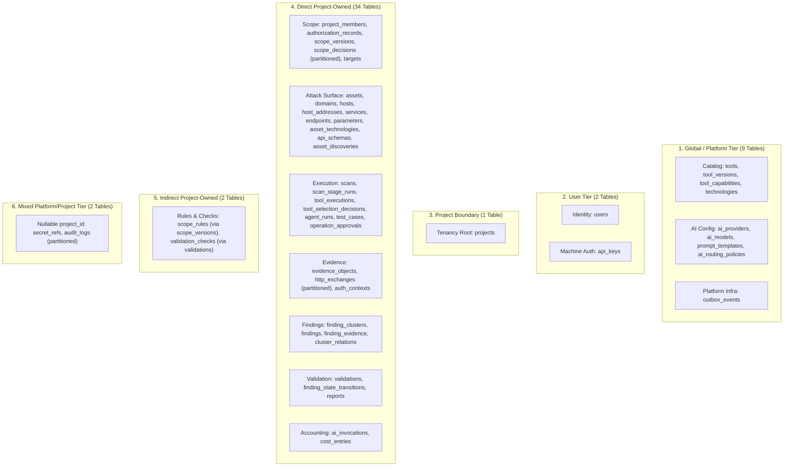

# VulnOS — Phase 2.3 Security Audit: PostgreSQL Row-Level Security (RLS) & Tenant Isolation

**Document Status:** Complete Pre-Implementation Security Audit  
**Phase:** 2.3 (PostgreSQL Row-Level Security, Tenant Isolation & Cross-Project Security)  
**Author:** Senior PostgreSQL Security Architect & Backend Engineer  
**Date:** 2026-11-02  
**Repository:** `https://github.com/VarshSec/vulnos`  
**Git HEAD:** `c2e8bb72298e2a5f03716cf70da4d837a1a9ace8` (Baseline)  

---

## 1. Executive Summary & Objective

VulnOS is an offensive security engine operating on authorized targets. In a multi-tenant or multi-project security testing platform, cross-project data leakage is a **critical severity vulnerability**. A leak could expose:
- Target vulnerability findings and active exploit hypotheses.
- Raw HTTP request/response payloads containing session cookies, tokens, or PII.
- Scope rules and authorizations defining contractual testing boundaries.
- Target network architectures, endpoints, parameters, and technologies.

The primary objective of **Phase 2.3** is to implement a **defense-in-depth, default-deny PostgreSQL Row-Level Security (RLS)** architecture. Even if an application bug, an IDOR flaw, an AI agent error, or an execution worker attempts to query a resource across project boundaries, PostgreSQL itself will enforce strict row-level isolation and deny visibility or mutation.

---

## 2. Baseline Architecture Audit (P2.1 & P2.2 State)

### 2.1 Git Status & Preserved State
- **Git Branch:** `main`
- **Baseline Commit:** `c2e8bb72298e2a5f03716cf70da4d837a1a9ace8`
- **Working Tree:** Pristine working files from P2.1 and P2.2. No uncommitted merges or destructive resets.

### 2.2 Existing Database Components
1. **Engine & Session Management (`backend/app/db/session.py`):**
   - Configures `create_db_engine()` with connection pooling, `pool_pre_ping=True`, and configurable pool sizes.
   - Provides `get_db()` FastAPI session dependency yielding a SQLAlchemy `Session` with automatic commit on success and rollback on exceptions.
2. **Naming Convention & Base (`backend/app/db/base.py`):**
   - Standard constraint conventions enforced (`pk_`, `fk_`, `uq_`, `ck_`, `ix_`).
3. **Data Models (`backend/app/db/models/`):**
   - Exactly 50 mapped models across 9 domain modules matching `docs/architecture/DATABASE_DESIGN.md`.
4. **Baseline Migration (`backend/alembic/versions/0001_phase2_baseline.py`):**
   - Creates all 50 tables, constraints, foreign keys, cascades, indexes, and default partitions (`scope_decisions_default`, `http_exchanges_default`, `audit_logs_default`).
5. **Test Suite:**
   - 195 unit and metadata tests passing (`backend/tests/`).
   - Strict Mypy type-checking (0 errors across 42 files).
   - Ruff linting and formatting (100% compliant).

---

## 3. Comprehensive Table Ownership Classification

Every table in the 50-table VulnOS schema has been audited and classified into one of five distinct isolation tiers:



### 3.1 Tier 1: Direct Project-Owned Tables (34 Tables + 1 Tenancy Root = 35 Tables)
These tables contain a non-nullable `project_id` foreign key referencing `projects.id` and must have RLS enabled with a strict policy:
`project_id = NULLIF(current_setting('app.current_project_id', true), '')::uuid`

| Table Name | Partitioned | PK Column(s) | Isolation Policy Type |
|---|---|---|---|
| `projects` | No | `id` | Tenant boundary: accessible if member or project context matches |
| `project_members` | No | `(project_id, user_id)` | Direct `project_id` filter |
| `authorization_records` | No | `id` | Direct `project_id` filter |
| `scope_versions` | No | `id` | Direct `project_id` filter |
| `scope_decisions` | Yes (monthly) | `(id, decided_at)` | Direct `project_id` filter (applied to parent & default) |
| `targets` | No | `id` | Direct `project_id` filter |
| `assets` | No | `id` | Direct `project_id` filter |
| `domains` | No | `asset_id` | Direct `project_id` filter (has direct `project_id` column) |
| `hosts` | No | `asset_id` | Direct `project_id` filter (has direct `project_id` column) |
| `host_addresses` | No | `id` | Direct `project_id` filter (has direct `project_id` column) |
| `services` | No | `asset_id` | Direct `project_id` filter (has direct `project_id` column) |
| `endpoints` | No | `asset_id` | Direct `project_id` filter (has direct `project_id` column) |
| `parameters` | No | `id` | Direct `project_id` filter (has direct `project_id` column) |
| `asset_technologies` | No | `(asset_id, technology_id)` | Direct `project_id` filter (has direct `project_id` column) |
| `api_schemas` | No | `id` | Direct `project_id` filter |
| `asset_discoveries` | No | `id` | Direct `project_id` filter |
| `scans` | No | `id` | Direct `project_id` filter |
| `scan_stage_runs` | No | `id` | Direct `project_id` filter |
| `tool_executions` | No | `id` | Direct `project_id` filter |
| `tool_selection_decisions`| No | `id` | Direct `project_id` filter |
| `agent_runs` | No | `execution_id` | Direct `project_id` filter |
| `test_cases` | No | `id` | Direct `project_id` filter |
| `operation_approvals` | No | `id` | Direct `project_id` filter |
| `auth_contexts` | No | `id` | Direct `project_id` filter |
| `evidence_objects` | No | `id` | Direct `project_id` filter |
| `http_exchanges` | Yes (monthly) | `(id, occurred_at)` | Direct `project_id` filter (applied to parent & default) |
| `finding_clusters` | No | `id` | Direct `project_id` filter |
| `findings` | No | `id` | Direct `project_id` filter |
| `finding_evidence` | No | `id` | Direct `project_id` filter |
| `cluster_relations` | No | `id` | Direct `project_id` filter |
| `validations` | No | `id` | Direct `project_id` filter |
| `finding_state_transitions`| No | `id` | Direct `project_id` filter |
| `reports` | No | `id` | Direct `project_id` filter |
| `ai_invocations` | No | `id` | Direct `project_id` filter |
| `cost_entries` | No | `id` | Direct `project_id` filter |

### 3.2 Tier 2: Indirectly Project-Owned Tables (2 Tables)
These tables do **not** have a `project_id` column directly in their table definition, as designed in `DATABASE_DESIGN.md`. They are strictly child entities of a project-owned table.

1. **`scope_rules`:**
   - Child of `scope_versions(id)` via `scope_version_id`.
   - **Isolation Policy:**
     ```sql
     scope_version_id IN (
         SELECT id FROM scope_versions
         WHERE project_id = NULLIF(current_setting('app.current_project_id', true), '')::uuid
     )
     ```
2. **`validation_checks`:**
   - Child of `validations(id)` via `validation_id`.
   - **Isolation Policy:**
     ```sql
     validation_id IN (
         SELECT id FROM validations
         WHERE project_id = NULLIF(current_setting('app.current_project_id', true), '')::uuid
     )
     ```

### 3.3 Tier 3: Mixed Platform / Project Scope Tables (2 Tables)
These tables feature a **nullable** `project_id`. When `project_id` is NULL, the record is platform-wide; when non-NULL, it belongs to a specific tenant project.

1. **`secret_refs`:**
   - Contains references to external secret paths (Vault, AWS Secrets Manager, Env).
   - Global platform secrets (e.g. platform AI provider keys) have `project_id IS NULL`.
   - Project secrets (e.g. target authenticated session tokens) have `project_id = <project_uuid>`.
   - **Isolation Policy:**
     - `SELECT`: `project_id = NULLIF(current_setting('app.current_project_id', true), '')::uuid OR project_id IS NULL`
     - `INSERT / UPDATE / DELETE`: `project_id = NULLIF(current_setting('app.current_project_id', true), '')::uuid` (standard tenants cannot write to global secrets).
2. **`audit_logs` (Partitioned by `created_at`):**
   - Platform-wide actions (system boot, user creation) have `project_id IS NULL`.
   - Project actions have `project_id = <project_uuid>`.
   - **Isolation Policy:**
     - `SELECT`: `project_id = NULLIF(current_setting('app.current_project_id', true), '')::uuid`
     - `INSERT`: `project_id = NULLIF(current_setting('app.current_project_id', true), '')::uuid OR project_id IS NULL`
     - `UPDATE / DELETE`: Explicitly denied (`FALSE`) for application roles. Audit logs are strictly append-only.

### 3.4 Tier 4: User-Owned Tables (2 Tables)
1. **`users`:** Human and service user accounts across the platform.
   - Isolation: User can select/update their own record (`id = NULLIF(current_setting('app.current_user_id', true), '')::uuid`), or users can view limited metadata (display names) of project co-members.
2. **`api_keys`:** Machine credentials bound to a specific user (`user_id`).
   - Isolation: `user_id = NULLIF(current_setting('app.current_user_id', true), '')::uuid`.

### 3.5 Tier 5: Global / Platform Catalog Tables (9 Tables)
These tables represent global registries, engine configurations, and asynchronous queues:
- Tool Registry: `tools`, `tool_versions`, `tool_capabilities`
- Asset Tech Catalog: `technologies`
- AI Engine Config: `ai_providers`, `ai_models`, `prompt_templates`, `ai_routing_policies`
- Messaging: `outbox_events`

**Isolation Policy:**
- Catalog tables: Read-only (`SELECT`) for all authenticated tenant contexts. `INSERT / UPDATE / DELETE` denied to tenant runtime roles.
- `outbox_events`: Tenant transactions can `INSERT` event payloads; `SELECT` / `UPDATE` / `DELETE` restricted to the dedicated outbox relay worker.

---

## 4. Existing Isolation Weaknesses & Threat Analysis

Prior to implementing RLS in Phase 2.3, the following isolation weaknesses exist:

| Threat ID | Vulnerability / Weakness | Impact | RLS Mitigation |
|---|---|---|---|
| **VULN-01** | **Direct UUID Access (IDOR)**<br>Endpoints such as `GET /findings/{cluster_id}` or `GET /evidence/{evidence_id}` look up entities by primary key without requiring `/projects/{project_id}` in the URL path. | If application code omits an explicit tenant check, user in Project A can view vulnerabilities or download raw HTTP evidence from Project B. | PostgreSQL RLS filters rows at query level. A query `SELECT * FROM evidence_objects WHERE id = :id` returns 0 rows if `project_id` does not match `app.current_project_id`, automatically producing an application 404. |
| **VULN-02** | **Cross-Project FK Pollution**<br>An attacker in Project A submits an authorization record or scan referencing an `evidence_id`, `target_id`, or `asset_id` belonging to Project B. | Integrity violation and horizontal privilege escalation; Project A scan operates on Project B assets. | Composite foreign keys and RLS check policies (`WITH CHECK`) ensure parent and child entities both belong to `app.current_project_id`. |
| **VULN-03** | **Connection Pool Context Leakage**<br>FastAPI uses SQLAlchemy connection pooling. If Request A sets `app.current_project_id = 'AAA'` and the connection is returned to the pool without cleanup, Request B might inherit Project A's context. | Critical multi-tenant leak across subsequent requests. | Context must be strictly transaction-local (`SET LOCAL` or `set_config('app.current_project_id', ..., true)`). The setting automatically evaporates on `COMMIT` or `ROLLBACK`. Verified by pooling reuse tests. |
| **VULN-04** | **Partition Direct Access Bypass**<br>Partitioned tables (`scope_decisions`, `http_exchanges`, `audit_logs`) have default partition tables (`scope_decisions_default`, etc.). | If RLS is enabled only on the parent table, an application query targeting the partition directly could bypass RLS. | In PostgreSQL 16+, RLS enabled on the partitioned parent is inherited by partitions; we also enable RLS and apply policies directly to each partition child table. |
| **VULN-05** | **Superuser / Table Owner Privilege Bypass**<br>In standard PostgreSQL, the table owner role bypasses RLS unless `FORCE ROW LEVEL SECURITY` is enabled. | If the FastAPI runtime connects as the table owner or superuser, RLS policies are silently ignored. | Separate database roles: Migration/DDL owner role (`vulnos_admin`) vs. Runtime application role (`vulnos_app`). `vulnos_app` has `NOBYPASSRLS` and does not own the tables. Furthermore, `ALTER TABLE ... FORCE ROW LEVEL SECURITY` is applied. |

---

## 5. Proposed RLS Implementation Strategy

### 5.1 Context Lifecycle & Transaction Management
Context is established using PostgreSQL's transaction-local configuration:
```sql
SELECT set_config('app.current_project_id', :project_id, true);
SELECT set_config('app.current_user_id', :user_id, true);
SELECT set_config('app.request_id', :request_id, true);
```
The third argument `true` (`is_local`) guarantees that the setting is scoped **only to the active transaction block** (`SET LOCAL`).

### 5.2 Context Manager Pattern in SQLAlchemy
```python
@contextmanager
def tenant_context(session: Session, project_id: uuid.UUID, user_id: uuid.UUID | None = None) -> Generator[None, None, None]:
    """Establish transaction-local tenant context for RLS enforcement."""
    session.execute(
        text("SELECT set_config('app.current_project_id', :p_id, true)"),
        {"p_id": str(project_id)}
    )
    if user_id:
        session.execute(
            text("SELECT set_config('app.current_user_id', :u_id, true)"),
            {"u_id": str(user_id)}
        )
    try:
        yield
    finally:
        # Transaction commit or rollback automatically discards the setting.
        pass
```

### 5.3 RLS Policies Structure
For direct project-owned tables:
```sql
ALTER TABLE <table_name> ENABLE ROW LEVEL SECURITY;
ALTER TABLE <table_name> FORCE ROW LEVEL SECURITY;

CREATE POLICY p_<table_name>_tenant_isolation ON <table_name>
    AS RESTRICTIVE
    FOR ALL
    USING (project_id = NULLIF(current_setting('app.current_project_id', true), '')::uuid)
    WITH CHECK (project_id = NULLIF(current_setting('app.current_project_id', true), '')::uuid);
```

### 5.4 Fail-Closed Guarantee
If `app.current_project_id` is missing, uninitialized, or an empty string, `NULLIF(..., '')` evaluates to `NULL`. Since `project_id = NULL` evaluates to `UNKNOWN` (falsy in SQL boolean checks), **zero rows are returned and all insertions/mutations are rejected**.

---

## 6. Risks, Trade-offs & Unresolved Questions

1. **Host Environment Limitation (Docker / PostgreSQL):**
   - The current host machine does not have Docker Desktop running or a local PostgreSQL 16 service installed.
   - Live database execution against a running PostgreSQL daemon must be documented honestly. All Alembic migrations, DDL scripts, SQLAlchemy session wrappers, and static schema checkers must be 100% verified, with live container verification instructions provided.
2. **Performance of Subquery RLS on Indirect Tables:**
   - Tables `scope_rules` and `validation_checks` use subqueries (`scope_version_id IN (...)`).
   - *Mitigation:* `scope_versions(id, project_id)` and `validations(id, project_id)` have supporting primary and foreign key indexes, keeping subquery evaluations fast.
3. **Audit Log Append-Only Protection:**
   - Audit logs must never allow tenant mutation or deletion.
   - *Mitigation:* RLS policy for `audit_logs` explicitly denies `UPDATE` and `DELETE` (`FOR UPDATE USING (false)`, `FOR DELETE USING (false)`).

---

## 7. Audit Sign-off

The repository schema and architectural contracts have been audited. The 50 tables are accurately classified. No speculative tables were invented.

**Decision:** Ready to proceed to **P2.3.2 (PostgreSQL Infrastructure Verification)**.
