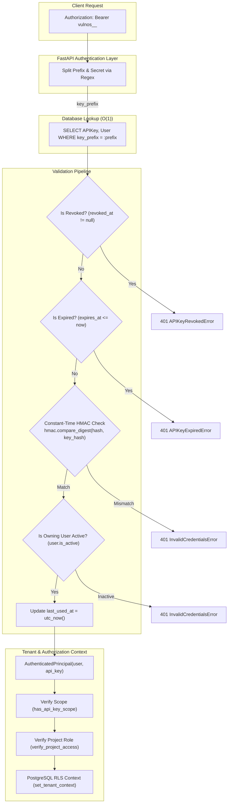
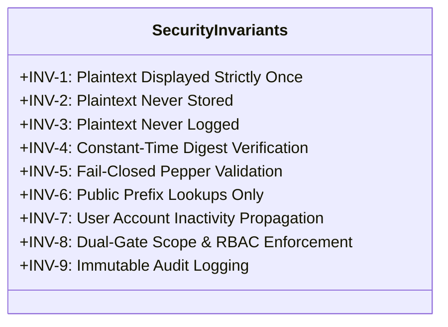

# VulnOS — Phase 2.4 API Key Lifecycle & Security Design

**Document Status:** Complete Architecture & Implementation Design Specification  
**Phase:** 2.4 (Authentication, Session Management, API Keys & RBAC)  
**Author:** Senior Security Documentation Engineer & Backend Architect  
**Date:** 2026-11-02  
**Repository:** `https://github.com/VarshSec/vulnos`  
**Git HEAD:** `c2e8bb72298e2a5f03716cf70da4d837a1a9ace8` (Baseline)  
**Implementation Modules:**
- Core Lifecycle: [`backend/app/auth/api_keys.py`](file:///C:/Users/varsh/.gemini/antigravity/scratch/vulnos/backend/app/auth/api_keys.py)
- Management Router: [`backend/app/api/v1/api_keys.py`](file:///C:/Users/varsh/.gemini/antigravity/scratch/vulnos/backend/app/api/v1/api_keys.py)
- Pydantic Schemas: [`backend/app/auth/schemas.py`](file:///C:/Users/varsh/.gemini/antigravity/scratch/vulnos/backend/app/auth/schemas.py)
- Database Model: [`backend/app/db/models/identity.py`](file:///C:/Users/varsh/.gemini/antigravity/scratch/vulnos/backend/app/db/models/identity.py#L77-L102)
- Server Configuration: [`backend/app/core/config.py`](file:///C:/Users/varsh/.gemini/antigravity/scratch/vulnos/backend/app/core/config.py#L98)
- Scope Enforcement: [`backend/app/authorization/permissions.py`](file:///C:/Users/varsh/.gemini/antigravity/scratch/vulnos/backend/app/authorization/permissions.py#L31-L36)
- Request Authentication Dependency: [`backend/app/auth/dependencies.py`](file:///C:/Users/varsh/.gemini/antigravity/scratch/vulnos/backend/app/auth/dependencies.py#L49-L70)

---

## 1. API Key Architecture Overview

VulnOS provides programmatic machine-to-machine authentication via API keys. API keys are designed for automated systems, external vulnerability scanners, CI/CD pipelines, autonomous orchestration agents, and developer CLI tooling where browser session cookies and interactive JWT refresh token lifecycles are impractical.

### 1.1 Dual-Component Security Model

Unlike traditional monolithic API tokens (where the entire key string must be scanned sequentially or hashed uniformly), VulnOS uses a structured, dual-component design:

1. **Routing Prefix (`key_prefix`):** An 8-character public identifier used for $O(1)$ database indexing and lookup.
2. **Private Secret (`secret`):** A high-entropy cryptographic secret that acts as the proof-of-possession credential.

The two components are joined by underscores under the vendor namespace prefix:
```text
vulnos_{prefix}_{secret}
```



### 1.2 Tenancy and RBAC Decoupling

In VulnOS, an API key is bound to a specific user ([`user_id`](file:///C:/Users/varsh/.gemini/antigravity/scratch/vulnos/backend/app/db/models/identity.py#L83)), not directly to a single project. This decouples credential issuance from project boundaries:
- The API key inherits the owning user's membership and permissions across all projects to which the user has been granted access.
- The permissions exercised by the API key are constrained by two simultaneous authorization gates:
  1. **Project Role:** The user's role (`viewer`, `operator`, `admin`, `owner`) within the target project.
  2. **API Key Scope:** The specific permission scopes (`read`, `scan`, `validate`, `report`, `admin`) assigned to the key.
- An API key can never exceed the permissions of its owning user.

---

## 2. Key Format Specification

VulnOS API keys adhere to a strict structured token format recognizable by secret scanners, security linters, and network proxies:

$$\mathbf{Format:} \quad \texttt{vulnos\_\{prefix\}\_\{secret\}}$$

### 2.1 Format Decomposition

| Component | Length | Character Set | Entropy | Description |
|:---|:---:|:---:|:---:|:---|
| **Namespace Discriminator** | 7 chars (`vulnos_`) | ASCII text | 0 bits | Fixed vendor prefix enabling automated detection by secret-scanning tooling (e.g., TruffleHog, GitGuardian, GitHub Secret Scanning). |
| **Public Prefix (`prefix`)** | 8 chars | Hexadecimal `[a-f0-9]` | 32 bits (4 bytes) | Public index key used for database query routing. Stored in plaintext in `api_keys.key_prefix`. |
| **Delimiter** | 1 char (`_`) | ASCII text | 0 bits | Structural separator between public identifier and private secret. |
| **Private Secret (`secret`)** | 32 chars (default) | Hexadecimal `[a-f0-9]` | 128 bits (16 bytes) | High-entropy secret token. Never stored in plaintext; only its HMAC-SHA-256 digest is persisted. |
| **Total Key Length** | 48 characters | Alphanumeric | 160 bits raw entropy | Full token string provided to the client at creation. |

### 2.2 Format Validation Regex

Incoming API keys are validated using the regular expression defined in [`backend/app/auth/api_keys.py`](file:///C:/Users/varsh/.gemini/antigravity/scratch/vulnos/backend/app/auth/api_keys.py#L29):

```python
API_KEY_PATTERN = re.compile(r"^vulnos_([a-zA-Z0-9]{8})_([a-zA-Z0-9]{32,64})$")
```

The regex enforces:
- Case-insensitive alphanumeric prefix of exactly 8 characters.
- Secret payload of 32 to 64 alphanumeric characters.
- Strict prefix anchoring (`^vulnos_...$`) preventing delimiter injection or prefix smuggling.

---

## 3. Cryptographic Key Generation

API key generation is implemented in [`generate_api_key()`](file:///C:/Users/varsh/.gemini/antigravity/scratch/vulnos/backend/app/auth/api_keys.py#L43-L53) using Python's standard `secrets` module, which interfaces directly with the host operating system's Cryptographically Secure Pseudo-Random Number Generator (CSPRNG):

```python
def generate_api_key() -> tuple[str, str, str, bytes]:
    """Generate a new secure API key with prefix, secret, and keyed hash.

    Returns:
        tuple[full_key, prefix, secret, key_hash]
    """
    prefix = secrets.token_hex(4)   # 4 bytes -> 8 hex characters
    secret = secrets.token_hex(16)  # 16 bytes -> 32 hex characters
    full_key = f"vulnos_{prefix}_{secret}"
    key_hash = compute_key_hash(secret)
    return full_key, prefix, secret, key_hash
```

### 3.1 CSPRNG Entropy Guarantees

- **Prefix Generation:** `secrets.token_hex(4)` extracts 4 bytes (32 bits) from OS entropy (`/dev/urandom` on POSIX systems, `BCryptGenRandom` on Windows), producing an 8-character lowercase hexadecimal string ($2^{32} \approx 4.29 \times 10^9$ possible prefix combinations).
- **Secret Generation:** `secrets.token_hex(16)` extracts 16 bytes (128 bits) of cryptographic entropy, producing a 32-character lowercase hexadecimal string ($2^{128} \approx 3.40 \times 10^{38}$ possible secrets).
- **Brute-Force Resistance:** At $10^9$ hash computations per second, cracking a single 128-bit secret requires over $10^{22}$ years, rendering brute-force attacks mathematically impossible.
- **Collision Resistance:** Birthday paradox analysis shows that with $10^6$ active API keys, the probability of prefix collision is approximately $0.011$ (1.1%), which is safely handled by the database schema where prefix lookups match user records and verification compares the HMAC.

---

## 4. HMAC-SHA-256 Hashing with API_KEY_PEPPER

VulnOS does not store raw secrets or plain SHA-256 hashes in the database. Instead, all API key secrets are transformed into keyed digests using **HMAC-SHA-256** combined with a high-entropy server-side pepper ([`API_KEY_PEPPER`](file:///C:/Users/varsh/.gemini/antigravity/scratch/vulnos/backend/app/core/config.py#L98)).

### 4.1 Cryptographic Transformation

$$\mathbf{key\_hash} = \text{HMAC-SHA-256}\Big(\text{key} = \text{API\_KEY\_PEPPER},\; \text{msg} = \text{secret}\Big)$$

Implemented in [`compute_key_hash()`](file:///C:/Users/varsh/.gemini/antigravity/scratch/vulnos/backend/app/auth/api_keys.py#L32-L40):

```python
def compute_key_hash(secret: str, pepper: str | None = None) -> bytes:
    """Compute HMAC-SHA-256 digest of secret using server-side API_KEY_PEPPER."""
    if pepper is None:
        pepper = get_settings().API_KEY_PEPPER
    return hmac.new(
        key=pepper.encode("utf-8"),
        msg=secret.encode("utf-8"),
        digestmod="sha256",
    ).digest()
```

### 4.2 Server-Side Pepper Configuration

The pepper is managed through Pydantic Settings in [`backend/app/core/config.py`](file:///C:/Users/varsh/.gemini/antigravity/scratch/vulnos/backend/app/core/config.py#L98):

```python
API_KEY_PEPPER: str = "dev-insecure-pepper-change-in-production"
```

### 4.3 Defense-in-Depth Against Database Exfiltration

| Threat Scenario | Vulnerability in Plain SHA-256 / Fast Hashes | VulnOS HMAC-SHA-256 with Pepper Defense |
|:---|:---|:---|
| **SQL Injection / Database Dump** | An attacker obtaining database read access extracts all hashes and computes offline precomputed dictionary/rainbow-table attacks. | Hashes cannot be verified or attacked offline without `API_KEY_PEPPER`. Even with leaked database dumps, keys cannot be forged or tested offline. |
| **Side-Channel Timing Attacks** | Naive string comparison (`==`) leaks key prefixes byte-by-byte via execution duration variations. | VulnOS strictly mandates [`hmac.compare_digest`](file:///C:/Users/varsh/.gemini/antigravity/scratch/vulnos/backend/app/auth/api_keys.py#L124) for constant-time comparison of the 32-byte binary digest. |
| **Credential Re-use Across Environments** | Same key secret yields identical hash in development and production environments. | Different `API_KEY_PEPPER` values in dev, test, and production yield completely different digests, preventing cross-environment credential replay. |

### 4.4 Production Fail-Fast Validation

In production mode (`APP_ENV=production`), [`backend/app/core/config.py`](file:///C:/Users/varsh/.gemini/antigravity/scratch/vulnos/backend/app/core/config.py#L169-L177) enforces strict validation rules at application startup:

```python
# 3. API_KEY_PEPPER validation
if not self.API_KEY_PEPPER or len(self.API_KEY_PEPPER) < 16:
    errors.append("API_KEY_PEPPER must be at least 16 characters long in production.")
if self.API_KEY_PEPPER in DISALLOWED_PRODUCTION_SECRETS or any(
    placeholder in self.API_KEY_PEPPER.lower()
    for placeholder in ("replace", "change-me", "insecure")
):
    errors.append("API_KEY_PEPPER is using an insecure or placeholder value in production.")
```

If these constraints fail, the backend refuses to initialize and exits with a `ValueError`.

---

## 5. Prefix Indexing Strategy & Verification

A primary challenge in API authentication is achieving high throughput (sub-millisecond latency) without compromising cryptographic safety.

### 5.1 Architecture: Prefix Lookup + Constant-Time HMAC Verification

VulnOS resolves this via a two-stage verification strategy:
1. **Public Prefix Lookup ($O(1)$):** The database indexes the 8-character `key_prefix`. When a request arrives, PostgreSQL performs an indexed B-tree lookup on `api_keys.key_prefix`.
2. **Constant-Time Verification:** Once the record is fetched, the application computes `compute_key_hash(secret)` in application memory and performs a constant-time comparison against the stored `key_hash`.

```python
# Look up by public prefix
stmt = (
    select(APIKey, User)
    .join(User, APIKey.user_id == User.id)
    .where(APIKey.key_prefix == prefix)
)
result = db.execute(stmt).first()
if not result:
    raise APIKeyNotFoundError("API key not found")

api_key, user = result

# Verify HMAC digest in constant time
expected_hash = compute_key_hash(secret)
if not hmac.compare_digest(expected_hash, bytes(api_key.key_hash)):
    raise InvalidCredentialsError("Invalid API key credentials")
```

### 5.2 Performance & Security Comparison

| Strategy | Lookup Complexity | Cryptographic Security | Timing Attack Vulnerability | Database Load |
|:---|:---:|:---:|:---:|:---:|
| **Full Table Scan + Hash Verification** | $O(N)$ | High | Low | Extreme — scans entire table on every request. |
| **Bcrypt / Argon2 on Every Request** | $O(1)$ | High | Low | Catastrophic — 64MB memory per request blocks ASGI worker event loop. |
| **Plain Text Token Lookup** | $O(1)$ | None | High | Zero CPU overhead, but complete compromise on database leak. |
| **VulnOS Prefix Index + HMAC-SHA-256** | **$O(1)$ (B-Tree)** | **High (HMAC + Pepper)** | **Zero (`hmac.compare_digest`)** | **Optimal — single indexed join query + microsecond HMAC.** |

---

## 6. Key Lifecycle Endpoints

API key management endpoints are exposed under `/api/v1/api-keys` in [`backend/app/api/v1/api_keys.py`](file:///C:/Users/varsh/.gemini/antigravity/scratch/vulnos/backend/app/api/v1/api_keys.py):

| Method | Path | Summary | Request Schema | Response Schema | Status Code |
|:---|:---|:---|:---|:---|:---:|
| `POST` | `/api/v1/api-keys` | Issue a new API key | [`APIKeyCreateRequest`](file:///C:/Users/varsh/.gemini/antigravity/scratch/vulnos/backend/app/auth/schemas.py#L74-L89) | [`APIKeyCreateResponse`](file:///C:/Users/varsh/.gemini/antigravity/scratch/vulnos/backend/app/auth/schemas.py#L91-L103) | `201 Created` |
| `GET` | `/api/v1/api-keys` | List all API keys for user | None | `list[`[`APIKeyResponse`](file:///C:/Users/varsh/.gemini/antigravity/scratch/vulnos/backend/app/auth/schemas.py#L105-L118)`]` | `200 OK` |
| `GET` | `/api/v1/api-keys/{key_id}` | Retrieve metadata for key | None (Path: `key_id: UUID`) | [`APIKeyResponse`](file:///C:/Users/varsh/.gemini/antigravity/scratch/vulnos/backend/app/auth/schemas.py#L105-L118) | `200 OK` |
| `DELETE` | `/api/v1/api-keys/{key_id}` | Revoke an active API key | None (Path: `key_id: UUID`) | None | `204 No Content` |

### 6.1 Creating an API Key (`POST /api/v1/api-keys`)

#### Request Schema ([`APIKeyCreateRequest`](file:///C:/Users/varsh/.gemini/antigravity/scratch/vulnos/backend/app/auth/schemas.py#L74-L89))
```json
{
  "name": "CI/CD Pipeline Scanner",
  "scopes": ["read", "scan", "report"],
  "expires_at": "2027-11-01T00:00:00Z"
}
```

#### Response Schema ([`APIKeyCreateResponse`](file:///C:/Users/varsh/.gemini/antigravity/scratch/vulnos/backend/app/auth/schemas.py#L91-L103))
> [!IMPORTANT]
> The `api_key` attribute contains the full plaintext key string (`vulnos_{prefix}_{secret}`). This is displayed **strictly once** in this response and is permanently unavailable thereafter.

```json
{
  "id": "0192de10-1234-7000-8000-000000000001",
  "name": "CI/CD Pipeline Scanner",
  "key_prefix": "a1b2c3d4",
  "api_key": "vulnos_a1b2c3d4_e5f60718293a4b5c6d7e8f9012345678",
  "scopes": ["read", "scan", "report"],
  "created_at": "2026-11-02T02:00:00Z",
  "expires_at": "2027-11-01T00:00:00Z"
}
```

#### Audit Event
Upon issuance, an immutable audit event is recorded:
```python
record_auth_audit_event(
    db=db,
    action="api_key.created",
    actor_id=str(user.id),
    actor_type="user",
    details={"name": payload.name, "scopes": payload.scopes},
)
```

### 6.2 Listing API Keys (`GET /api/v1/api-keys`)

Returns all keys owned by the authenticated user, sorted in descending order by creation timestamp ([`created_at DESC`](file:///C:/Users/varsh/.gemini/antigravity/scratch/vulnos/backend/app/api/v1/api_keys.py#L34)):

```json
[
  {
    "id": "0192de10-1234-7000-8000-000000000001",
    "name": "CI/CD Pipeline Scanner",
    "key_prefix": "a1b2c3d4",
    "scopes": ["read", "scan", "report"],
    "created_at": "2026-11-02T02:00:00Z",
    "expires_at": "2027-11-01T00:00:00Z",
    "last_used_at": "2026-11-02T02:15:30Z",
    "revoked_at": null
  }
]
```

### 6.3 Retrieving Metadata (`GET /api/v1/api-keys/{key_id}`)

Enforces strict ownership validation:
```python
stmt = select(APIKey).where(APIKey.id == key_id, APIKey.user_id == user.id)
key_record = db.scalar(stmt)
if not key_record:
    raise HTTPException(
        status_code=status.HTTP_404_NOT_FOUND,
        detail="API key not found",
    )
return APIKeyResponse.model_validate(key_record)
```
If the requested `key_id` belongs to another tenant or user, the query returns `404 Not Found` to prevent ID enumeration.

### 6.4 Revoking an API Key (`DELETE /api/v1/api-keys/{key_id}`)

Revocation is atomic and soft-deletes the key by setting `revoked_at`:
```python
def revoke_api_key(db: Session, key_id: UUID, user_id: UUID) -> APIKey:
    stmt = select(APIKey).where(APIKey.id == key_id, APIKey.user_id == user_id)
    api_key = db.scalar(stmt)
    if not api_key:
        raise APIKeyNotFoundError("API key not found")

    if api_key.revoked_at is None:
        api_key.revoked_at = utc_now()
        db.flush()

    return api_key
```
An audit entry with `action="api_key.revoked"` is recorded, and a `204 No Content` status is returned.

---

## 7. Permission Scopes

VulnOS defines granular permission scopes assigned during API key creation:

### 7.1 Scope Definitions

| Scope | Category | Granted Capabilities | Prohibited Capabilities |
|:---|:---|:---|:---|
| **`read`** | Inspection | Query project assets, targets, execution status, findings, vulnerability evidence, and scan logs. | Initiating scans, modifying targets, changing policies, exporting reports. |
| **`scan`** | Operations | Triggering automated scans, cancelling active jobs, scheduling discovery tasks. | Deleting project resources, adding team members, reconfiguring target scope. |
| **`validate`** | Verification | Executing evidence verification runs, triggering sandbox validation agents, re-testing reported vulnerabilities. | Reconfiguring project policies, deleting findings. |
| **`report`** | Compliance | Generating, customizing, and downloading executive or technical vulnerability reports and compliance summaries. | Triggering live security scans, updating target definitions. |
| **`admin`** | Administration | Full administrative authority across API endpoints; modifies project target scopes, scan profiles, and member configurations. | Actions exceeding the owning user's project role. |

### 7.2 Scope Verification Logic

Scope verification is implemented in [`has_api_key_scope()`](file:///C:/Users/varsh/.gemini/antigravity/scratch/vulnos/backend/app/authorization/permissions.py#L31-L36):

```python
def has_api_key_scope(key_scopes: list[str], required_scope: str) -> bool:
    """Verify that an API key possesses the requested scope or administrative scope."""
    if "admin" in key_scopes:
        return True
    return required_scope in key_scopes
```

- **Administrative Super-Scope:** If `admin` is present in `key_scopes`, it automatically satisfies any required scope (`read`, `scan`, `validate`, `report`).
- **Exact Scope Matching:** Otherwise, the required scope must be explicitly present in the key's assigned scopes list.

### 7.3 Dual-Gate Authorization Pipeline

API key requests undergo dual-gate authorization inside [`require_project_context`](file:///C:/Users/varsh/.gemini/antigravity/scratch/vulnos/backend/app/auth/dependencies.py#L132-L194):

1. **Gate 1 — Scope Check:** If the authenticated principal is an API key and the route requires a scope (e.g., `required_scope="scan"`), the request is rejected with `403 Forbidden` if `has_api_key_scope(principal.api_key.scopes, required_scope)` evaluates to `False`.
2. **Gate 2 — RBAC Role Check:** The owning user's membership and role in the target project is validated via [`verify_project_access`](file:///C:/Users/varsh/.gemini/antigravity/scratch/vulnos/backend/app/authorization/project_access.py). Even if an API key has `admin` scope, if the owning user only has `viewer` role in that project, any state-modifying scan request is rejected with `403 Forbidden`.

---

## 8. Expiration and Revocation Mechanics

### 8.1 Expiration Check

The database stores an optional timestamp:
```python
expires_at: Mapped[datetime | None] = mapped_column(DateTime(timezone=True), nullable=True)
```

During authentication in [`authenticate_api_key()`](file:///C:/Users/varsh/.gemini/antigravity/scratch/vulnos/backend/app/auth/api_keys.py#L112-L120):
```python
if api_key.expires_at is not None:
    now = datetime.now(UTC)
    expires_at = (
        api_key.expires_at
        if api_key.expires_at.tzinfo is not None
        else api_key.expires_at.replace(tzinfo=UTC)
    )
    if expires_at <= now:
        raise APIKeyExpiredError("API key has expired")
```

- Expiration timestamps are strictly enforced against current UTC time.
- If `expires_at <= now`, authentication immediately halts with [`APIKeyExpiredError`](file:///C:/Users/varsh/.gemini/antigravity/scratch/vulnos/backend/app/auth/exceptions.py#L94), mapped to an HTTP `401 Unauthorized` response.

### 8.2 Soft Revocation

Revocation sets `revoked_at = utc_now()`:
```python
if api_key.revoked_at is not None:
    raise APIKeyRevokedError("API key has been revoked")
```

- Keys are soft-revoked rather than deleted to maintain historical auditability and accountability for past scans.
- Revocation takes effect immediately on the next API call.

### 8.3 Account Lifecycle Cascading

API key validity is tied to user account status:
1. **User Deactivation (`user.is_active = False`):**
   ```python
   if not user.is_active:
       raise InvalidCredentialsError("Owning user account is inactive")
   ```
   Deactivating a user instantly disables all of their issued API keys without requiring individual key revocations.
2. **User Deletion:**
   The foreign key in [`APIKey`](file:///C:/Users/varsh/.gemini/antigravity/scratch/vulnos/backend/app/db/models/identity.py#L83-L88) specifies `ondelete="CASCADE"`. Deleting a user record automatically and atomically cascades to delete all associated API key records.

---

## 9. Security Invariants

The VulnOS API key system enforces nine non-negotiable security invariants across architecture, implementation, and operations:



| ID | Invariant | Enforcement Mechanism | Failure Consequence |
|:---|:---|:---|:---|
| **INV-1** | **Plaintext Displayed Strictly Once** | Plaintext `api_key` is constructed in volatile memory during [`create_user_api_key()`](file:///C:/Users/varsh/.gemini/antigravity/scratch/vulnos/backend/app/auth/api_keys.py#L56-L80), returned in [`APIKeyCreateResponse`](file:///C:/Users/varsh/.gemini/antigravity/scratch/vulnos/backend/app/auth/schemas.py#L91-L103), and immediately dropped from scope. | Re-displaying secrets exposes credentials to credential harvesting and shoulder surfing. |
| **INV-2** | **Plaintext Never Stored** | Database table `api_keys` contains only `key_prefix` (text) and `key_hash` (`LargeBinary(32)`). No secret text or decryption keys exist in database storage. | Storing plaintext allows any database breach or unauthorized replica access to compromise all system credentials. |
| **INV-3** | **Plaintext Never Logged** | Audit logging functions ([`record_auth_audit_event`](file:///C:/Users/varsh/.gemini/antigravity/scratch/vulnos/backend/app/auth/rate_limits.py#L12)) log only `name`, `scopes`, and `key_id`. Log formatters and exception handlers never format the raw key. | Logging keys exposes credentials in centralized log aggregators (e.g., Elasticsearch, CloudWatch). |
| **INV-4** | **Constant-Time Verification** | Hash comparisons utilize [`hmac.compare_digest`](file:///C:/Users/varsh/.gemini/antigravity/scratch/vulnos/backend/app/auth/api_keys.py#L124) over fixed 32-byte buffers. | Variable-time comparison allows remote attackers to determine secret digests byte-by-byte via statistical timing analysis. |
| **INV-5** | **Fail-Closed Pepper Validation** | Pydantic model validator [`_validate_production_invariants`](file:///C:/Users/varsh/.gemini/antigravity/scratch/vulnos/backend/app/core/config.py#L149-L204) verifies `API_KEY_PEPPER` length ($\ge 16$) and rejects known placeholders. | Default or blank pepper allows precomputed dictionary attacks against stolen hashes. |
| **INV-6** | **Prefix-Only Query Routing** | SQL queries match strictly on `APIKey.key_prefix == prefix` rather than attempting expensive string transformations or full table scans. | Query performance degrades from $O(1)$ to $O(N)$, enabling denial-of-service via algorithmic exhaustion. |
| **INV-7** | **User Account Inactivity Propagation** | [`authenticate_api_key`](file:///C:/Users/varsh/.gemini/antigravity/scratch/vulnos/backend/app/auth/api_keys.py#L128) checks `user.is_active` within the same transaction. | Orphaned keys remaining active after employee termination or account suspension. |
| **INV-8** | **Dual-Gate Scope & RBAC Enforcement** | The request pipeline in [`dependencies.py`](file:///C:/Users/varsh/.gemini/antigravity/scratch/vulnos/backend/app/auth/dependencies.py#L164-L170) verifies both key scopes and tenant project roles before executing actions. | Privilege escalation where an API key performs operations exceeding its owner's project permissions. |
| **INV-9** | **Immutable Audit Logging** | Key generation (`api_key.created`) and revocation (`api_key.revoked`) trigger structured audit events appended to PostgreSQL audit tables. | Unaccountable credential creation or denial of forensic traceability. |

---

## 10. Database Schema Reference

The underlying relational schema in [`backend/app/db/models/identity.py`](file:///C:/Users/varsh/.gemini/antigravity/scratch/vulnos/backend/app/db/models/identity.py#L77-L102):

```python
class APIKey(Base):
    """Machine credentials bound to users."""

    __tablename__ = "api_keys"

    id: Mapped[uuid.UUID] = mapped_column(UUID(as_uuid=True), primary_key=True, default=uuid7)
    user_id: Mapped[uuid.UUID] = mapped_column(
        UUID(as_uuid=True),
        ForeignKey("users.id", ondelete="CASCADE"),
        nullable=False,
        index=True,
    )
    name: Mapped[str] = mapped_column(Text, nullable=False)
    key_prefix: Mapped[str] = mapped_column(Text, nullable=False)
    key_hash: Mapped[bytes] = mapped_column(LargeBinary, nullable=False, unique=True)
    scopes: Mapped[list[str]] = mapped_column(ARRAY(Text), nullable=False, default=list)
    expires_at: Mapped[datetime | None] = mapped_column(DateTime(timezone=True), nullable=True)
    last_used_at: Mapped[datetime | None] = mapped_column(DateTime(timezone=True), nullable=True)
    revoked_at: Mapped[datetime | None] = mapped_column(DateTime(timezone=True), nullable=True)
    created_at: Mapped[datetime] = mapped_column(
        DateTime(timezone=True), nullable=False, default=utc_now
    )

    # Relationships
    user: Mapped["User"] = relationship("User", back_populates="api_keys")
```

### 10.1 Equivalent PostgreSQL DDL

```sql
CREATE TABLE api_keys (
    id UUID PRIMARY KEY DEFAULT gen_random_uuid(),
    user_id UUID NOT NULL REFERENCES users(id) ON DELETE CASCADE,
    name TEXT NOT NULL,
    key_prefix TEXT NOT NULL,
    key_hash BYTEA NOT NULL UNIQUE,
    scopes TEXT[] NOT NULL DEFAULT '{}',
    expires_at TIMESTAMPTZ,
    last_used_at TIMESTAMPTZ,
    revoked_at TIMESTAMPTZ,
    created_at TIMESTAMPTZ NOT NULL DEFAULT clock_timestamp()
);

-- Index for O(1) prefix lookup during request authentication
CREATE INDEX ix_api_keys_key_prefix ON api_keys(key_prefix);
CREATE INDEX ix_api_keys_user_id ON api_keys(user_id);
```
