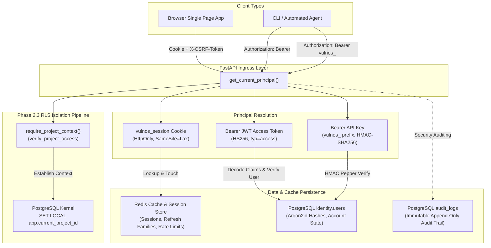
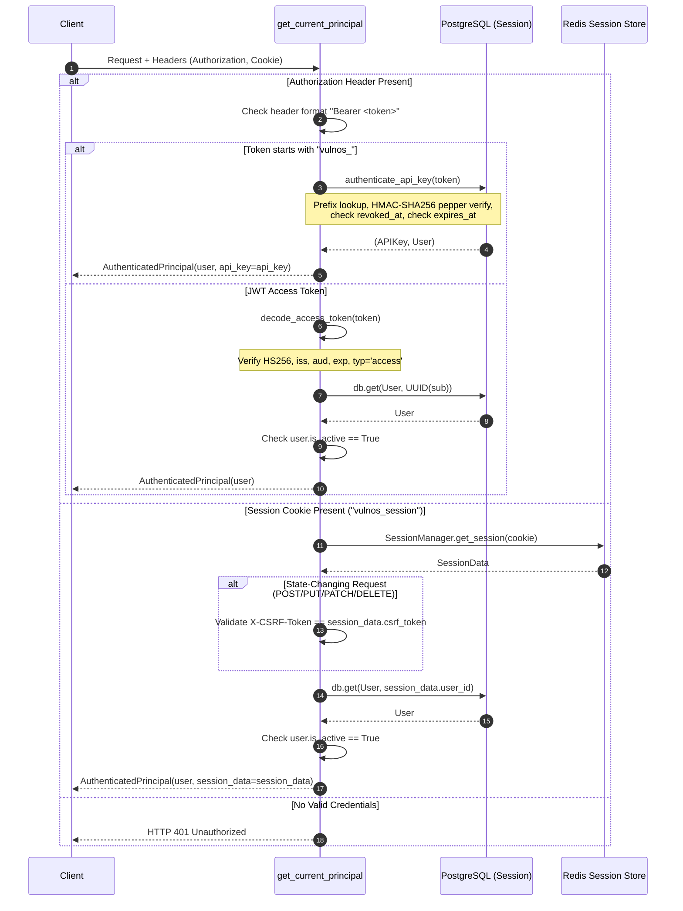

# VulnOS — Phase 2.4 Authentication Architecture & Design Specification

**Document Status:** Complete Implementation Specification  
**Phase:** 2.4 (Authentication, Session Lifecycle, Token Verification & RBAC Integration)  
**Author:** Senior Security Documentation Engineer  
**Date:** 2026-11-02  
**Target File:** [`backend/app/auth/`](file:///C:/Users/varsh/.gemini/antigravity/scratch/vulnos/backend/app/auth/)  

---

## 1. Authentication Architecture Overview

The VulnOS authentication subsystem enforces zero-trust identity verification, credential protection, and defense-in-depth authorization across human operators, single-page browser clients, and automated testing services (e.g., automated scanners, agents, and CI/CD pipelines).

Because VulnOS conducts active vulnerability discovery and stores high-impact security telemetry, authentication acts as the gatekeeper for transaction-local Row-Level Security (RLS) tenant isolation. A failure in authentication or session integrity directly compromises multi-tenant segregation.



### Architectural Tenets
1. **Separation of Concerns (Redis vs PostgreSQL):**
   - High-throughput, short-lived state (ephemeral browser sessions, refresh token families, sliding-window rate limit counters) is maintained strictly in **Redis**. No relational `sessions` table exists in PostgreSQL.
   - Long-lived principal records, Argon2id password hashes, project memberships, and immutable audit logs reside in **PostgreSQL**.
2. **Dual-Channel Principal Resolution:**
   - Supports stateless signed JWT access tokens (for decoupled API clients/agents) and stateful HttpOnly session cookies (for browser applications), alongside high-performance API key verification.
3. **Defense-in-Depth RLS Handshake:**
   - Authentication dependencies resolve [`AuthenticatedPrincipal`](file:///C:/Users/varsh/.gemini/antigravity/scratch/vulnos/backend/app/auth/dependencies.py#L36-L48) before the downstream [`require_project_context`](file:///C:/Users/varsh/.gemini/antigravity/scratch/vulnos/backend/app/auth/dependencies.py#L132-L195) dependency checks project membership and injects `app.current_project_id` into the database transaction.

---

## 2. Password Hashing (Argon2id)

VulnOS mandates **Argon2id** (RFC 9106) for password hashing and verification, implemented in [`backend/app/auth/passwords.py`](file:///C:/Users/varsh/.gemini/antigravity/scratch/vulnos/backend/app/auth/passwords.py) using `argon2-cffi`. Argon2id is a hybrid variant providing maximum resistance against both GPU-accelerated brute-force attacks and side-channel cache-timing attacks.

### 2.1 Cryptographic Parameters

The parameters adhere strictly to OWASP Password Storage Guidelines (High Memory Profile):

| Parameter | Identifier in Code | Value | Security Rationale |
|---|---|---|---|
| **Algorithm Type** | `argon2.Type.ID` | Argon2id | Hybrid memory-hard + cache-timing resistant |
| **Time Cost** ($t$) | [`ARGON2_TIME_COST`](file:///C:/Users/varsh/.gemini/antigravity/scratch/vulnos/backend/app/auth/passwords.py#L16) | `3` iterations | Computational difficulty preventing rapid automated offline testing |
| **Memory Cost** ($m$) | [`ARGON2_MEMORY_COST`](file:///C:/Users/varsh/.gemini/antigravity/scratch/vulnos/backend/app/auth/passwords.py#L17) | `65536` KiB (64 MiB) | Requires significant RAM per hashing instance, nullifying ASIC/FPGA/GPU parallelism |
| **Parallelism** ($p$) | [`ARGON2_PARALLELISM`](file:///C:/Users/varsh/.gemini/antigravity/scratch/vulnos/backend/app/auth/passwords.py#L18) | `4` lanes/threads | Leverages multi-core server hardware concurrency |
| **Hash Length** | [`ARGON2_HASH_LEN`](file:///C:/Users/varsh/.gemini/antigravity/scratch/vulnos/backend/app/auth/passwords.py#L19) | `32` bytes (256 bits) | Cryptographically robust digest length matching SHA-256 entropy |
| **Salt Length** | [`ARGON2_SALT_LEN`](file:///C:/Users/varsh/.gemini/antigravity/scratch/vulnos/backend/app/auth/passwords.py#L20) | `16` bytes (128 bits) | Cryptographically secure random salt generated per password by OS CSPRNG |

### 2.2 Password Policy Validation

The [`validate_password_policy`](file:///C:/Users/varsh/.gemini/antigravity/scratch/vulnos/backend/app/auth/passwords.py#L38-L56) function validates passwords before hashing:

```python
def validate_password_policy(password: str) -> None:
    """Validate password against complexity and length constraints.

    Rejects passwords shorter than 12 characters, longer than 128 characters,
    or containing null bytes.
    """
    if not isinstance(password, str):
        raise PasswordPolicyError("Password must be a string")
    if "\x00" in password:
        raise PasswordPolicyError("Password cannot contain null bytes")
    if len(password) < MIN_PASSWORD_LENGTH:
        raise PasswordPolicyError(
            f"Password must be at least {MIN_PASSWORD_LENGTH} characters long"
        )
    if len(password) > MAX_PASSWORD_LENGTH:
        raise PasswordPolicyError(
            f"Password cannot exceed {MAX_PASSWORD_LENGTH} characters in length"
        )
```

- **Minimum Length (12 characters):** Prevents low-entropy passwords vulnerable to dictionary attacks.
- **Maximum Length (128 characters):** Defends against denial-of-service (DoS) attacks where oversized strings induce excessive CPU and memory spikes inside the Argon2 hasher.
- **Null-Byte Rejection (`\x00`):** Prevents truncation vulnerabilities in underlying C libraries (`argon2-cffi`).

### 2.3 Upgrades and Re-Hashing

The system detects outdated hashes via [`needs_rehash(password_hash)`](file:///C:/Users/varsh/.gemini/antigravity/scratch/vulnos/backend/app/auth/passwords.py#L87-L93), allowing zero-downtime parameter migration whenever baseline security thresholds are raised.

---

## 3. Timing Attack Mitigations

In standard web authentication systems, user enumeration vulnerabilities arise from microsecond-to-millisecond execution timing discrepancies:
- If a user exists, the backend executes Argon2id hash verification ($\approx 50\text{--}150\text{ ms}$).
- If a user does not exist, an early return occurs immediately after the database query ($\approx 1\text{ ms}$).

An adversary measuring network round-trip latency can deterministically map valid user email addresses.

### 3.1 Constant-Time Dummy Verification Path

To eliminate this side-channel, VulnOS pre-computes a module-level dummy hash at initialization and forces execution of the verification path even when an account does not exist.

From [`backend/app/auth/passwords.py`](file:///C:/Users/varsh/.gemini/antigravity/scratch/vulnos/backend/app/auth/passwords.py#L34-L35):
```python
# Pre-computed dummy hash used to neutralize timing differences when a user is not found
_DUMMY_HASH: Final[str] = _hasher.hash("dummy_constant_password_timing_mitigation_123")
```

And in [`verify_password`](file:///C:/Users/varsh/.gemini/antigravity/scratch/vulnos/backend/app/auth/passwords.py#L64-L85):
```python
def verify_password(password_hash: str | None, candidate_password: str) -> bool:
    """Verify candidate password against hash in constant time.

    If password_hash is None or empty, runs verification against a pre-computed
    dummy hash to equalize execution timing and prevent timing-based user enumeration.
    """
    if not candidate_password or not isinstance(candidate_password, str):
        return False

    if not password_hash or not isinstance(password_hash, str) or not password_hash.strip():
        # Execute dummy verification to preserve execution time
        with contextlib.suppress(Exception):
            _hasher.verify(_DUMMY_HASH, candidate_password)
        return False

    try:
        return _hasher.verify(password_hash, candidate_password)
    except VerifyMismatchError:
        return False
    except Exception:
        return False
```

### 3.2 Service Layer Integration

In [`backend/app/auth/service.py`](file:///C:/Users/varsh/.gemini/antigravity/scratch/vulnos/backend/app/auth/service.py#L55-L83) ([`authenticate_user`](file:///C:/Users/varsh/.gemini/antigravity/scratch/vulnos/backend/app/auth/service.py#L55-L83)):

```python
clean_email = email.strip().lower()
user = db.scalar(select(User).where(User.email == clean_email))

if user is None:
    # Neutralize timing differences by running against pre-computed dummy hash
    verify_password(None, password)
    raise InvalidCredentialsError("Invalid email or password")

if not verify_password(user.password_hash, password):
    raise InvalidCredentialsError("Invalid email or password")
```

Both missing accounts and incorrect passwords execute the full Argon2id computation and raise [`InvalidCredentialsError`](file:///C:/Users/varsh/.gemini/antigravity/scratch/vulnos/backend/app/auth/exceptions.py#L12-L16) returning an identical HTTP `401 Unauthorized` with body `{"detail": "Invalid email or password"}`.

---

## 4. JWT Access Tokens

VulnOS access tokens are compact, cryptographically signed JSON Web Tokens (JWT) specified in [`backend/app/auth/tokens.py`](file:///C:/Users/varsh/.gemini/antigravity/scratch/vulnos/backend/app/auth/tokens.py).

### 4.1 Strict Algorithm Pinning

The implementation guards against algorithm confusion attacks (such as `alg: none` exploits or public/private key confusion) by explicitly locking the signature algorithm to HMAC-SHA-256:
- `JWT_ALGORITHM: Final[str] = "HS256"`
- In [`decode_access_token`](file:///C:/Users/varsh/.gemini/antigravity/scratch/vulnos/backend/app/auth/tokens.py#L70-L113), the parameter `algorithms=["HS256"]` is strictly enforced. Tokens declaring any other algorithm are rejected.

### 4.2 Standard and Custom Claims

Every access token encodes seven mandatory claims:

| Claim | Key | Value / Format | Validation Rule |
|---|---|---|---|
| **Subject** | `sub` | `str(user.id)` (UUIDv7) | Required; must parse as a valid RFC 4122 UUID |
| **Issuer** | `iss` | `"vulnos"` | Required; must match `JWT_ISSUER` |
| **Audience** | `aud` | `"vulnos-api"` | Required; must match `JWT_AUDIENCE` |
| **Issued At** | `iat` | Unix timestamp (UTC seconds) | Required; verified by `jwt.decode` |
| **Expiration** | `exp` | Unix timestamp (UTC seconds) | Required; verified by `jwt.decode` (`ACCESS_TOKEN_TTL_MINUTES`, default 30 min) |
| **JWT ID** | `jti` | UUIDv7 (`str(uuid7())`) | Required; unique entropy per token preventing duplicate collisions |
| **Token Type** | `typ` | `"access"` | Required; explicitly checked against `TOKEN_TYPE_ACCESS` |

### 4.3 Validation and Token Type Isolation

```python
payload: dict[str, Any] = jwt.decode(
    jwt=token,
    key=settings.SECRET_KEY,
    algorithms=[JWT_ALGORITHM],  # Explicitly pin allowed algorithm
    issuer=JWT_ISSUER,
    audience=JWT_AUDIENCE,
    options={
        "verify_signature": True,
        "verify_exp": True,
        "verify_iat": True,
        "verify_aud": True,
        "verify_iss": True,
        "require": ["sub", "iss", "aud", "exp", "iat", "jti", "typ"],
    },
)

# Validate token type isolation
if payload.get("typ") != TOKEN_TYPE_ACCESS:
    raise TokenInvalidError(f"Invalid token type: expected {TOKEN_TYPE_ACCESS!r}")

# Validate subject UUID format
try:
    UUID(payload["sub"])
except (ValueError, TypeError) as exc:
    raise TokenInvalidError("Invalid subject UUID in token") from exc
```

This strict enforcement eliminates cross-token misuse: refresh tokens, API keys, or arbitrary payloads cannot be substituted for access tokens.

---

## 5. Bearer Token Resolution Flow

Token resolution occurs inside [`get_current_principal`](file:///C:/Users/varsh/.gemini/antigravity/scratch/vulnos/backend/app/auth/dependencies.py#L49-L123), which executes on every protected request.



### Resolution Order and Priority
1. **Bearer Header (`Authorization: Bearer <token>`):**
   - **Machine Authentication:** If token prefix is `vulnos_`, delegates to [`authenticate_api_key`](file:///C:/Users/varsh/.gemini/antigravity/scratch/vulnos/backend/app/auth/api_keys.py#L44-L86). It verifies the key prefix against database records, calculates the HMAC-SHA-256 digest using server-side `API_KEY_PEPPER`, and validates revocation and expiration timestamps.
   - **User Token Authentication:** If prefix is not `vulnos_`, decodes the token as a JWT access token, extracts `sub`, verifies the user account in PostgreSQL, and ensures `user.is_active is True`.
2. **Browser Session Cookie (`vulnos_session`):**
   - Looks up session data in Redis via [`SessionManager.get_session`](file:///C:/Users/varsh/.gemini/antigravity/scratch/vulnos/backend/app/auth/sessions.py#L149-L171).
   - If HTTP method is mutation-based (`POST`, `PUT`, `PATCH`, `DELETE`), enforces CSRF defense by comparing the request header `X-CSRF-Token` with `session_data.csrf_token`.
   - Confirms user activity status in PostgreSQL.
3. **Missing or Corrupted Credentials:**
   - Raises `HTTPException(status_code=401, detail="Missing authentication credentials")`.

---

## 6. Authentication Endpoints

The authentication router is defined in [`backend/app/api/v1/auth.py`](file:///C:/Users/varsh/.gemini/antigravity/scratch/vulnos/backend/app/api/v1/auth.py) with prefix `/api/v1/auth`.

| Endpoint | Method | Authentication Required | Rate Limit | Request Body | Status Code & Response | Description |
|---|:---:|:---:|:---:|---|---|---|
| `/register` | `POST` | None | 10 / hour / IP | [`UserRegisterRequest`](file:///C:/Users/varsh/.gemini/antigravity/scratch/vulnos/backend/app/auth/schemas.py#L9-L19) (`email`, `password`, `display_name`) | `201 Created`<br/>[`UserResponse`](file:///C:/Users/varsh/.gemini/antigravity/scratch/vulnos/backend/app/auth/schemas.py#L41-L53) | Registers a new human user with Argon2id hash |
| `/login` | `POST` | None | 5 / min / IP+email | [`UserLoginRequest`](file:///C:/Users/varsh/.gemini/antigravity/scratch/vulnos/backend/app/auth/schemas.py#L21-L28) (`email`, `password`) | `200 OK`<br/>[`TokenResponse`](file:///C:/Users/varsh/.gemini/antigravity/scratch/vulnos/backend/app/auth/schemas.py#L55-L62)<br/>Sets `vulnos_session` Cookie | Verifies credentials, initializes Redis session, sets HttpOnly cookie + CSRF header, returns JWT |
| `/refresh` | `POST` | Refresh Token or Cookie | 30 / min / session | [`TokenRefreshRequest`](file:///C:/Users/varsh/.gemini/antigravity/scratch/vulnos/backend/app/auth/schemas.py#L64-L72) (optional `refresh_token`) | `200 OK`<br/>[`TokenResponse`](file:///C:/Users/varsh/.gemini/antigravity/scratch/vulnos/backend/app/auth/schemas.py#L55-L62) | Rotates refresh token atomically with family replay detection; issues fresh access token |
| `/logout` | `POST` | Session Cookie | None | None | `204 No Content`<br/>Deletes `vulnos_session` | Revokes the current session and associated token family in Redis |
| `/logout-all` | `POST` | Bearer Token or Cookie | None | None | `204 No Content`<br/>Deletes `vulnos_session` | Revokes all active sessions across all devices for the authenticated user |
| `/change-password` | `POST` | Bearer Token or Cookie | None | [`PasswordChangeRequest`](file:///C:/Users/varsh/.gemini/antigravity/scratch/vulnos/backend/app/auth/schemas.py#L30-L39) (`current_password`, `new_password`) | `200 OK`<br/>`{"status": "password_changed"}` | Verifies current password, writes new Argon2id hash, revokes all sessions across all devices |
| `/me` | `GET` | Bearer Token or Cookie | None | None | `200 OK`<br/>[`UserResponse`](file:///C:/Users/varsh/.gemini/antigravity/scratch/vulnos/backend/app/auth/schemas.py#L41-L53) | Returns current authenticated user profile without sensitive fields |

### 6.1 Refresh Token Rotation & Replay Attack Defense

VulnOS refresh tokens operate on a single-use rotation model with token families in Redis:
1. When `/login` succeeds, a cryptographic 32-byte URL-safe string is generated. Only its **SHA-256 hex digest** is stored in Redis:
   `vulnos:refresh:{token_hash}` $\rightarrow$ `{"user_id": ..., "session_id": ..., "family_id": ..., "used": 0}`.
2. During `/refresh`, [`rotate_refresh_token`](file:///C:/Users/varsh/.gemini/antigravity/scratch/vulnos/backend/app/auth/sessions.py#L195-L252) executes:
   - If `used == 1`: **Replay Attack Detected.** The token has already been consumed. The entire token family (`family_id`) and parent session are immediately wiped from Redis via [`revoke_session`](file:///C:/Users/varsh/.gemini/antigravity/scratch/vulnos/backend/app/auth/sessions.py#L172-L185), and an audit security alert is generated.
   - If `used == 0`: The current token is marked `used = 1`, a new raw refresh token and its hash are generated within the same family, and a new JWT access token is returned.

---

## 7. Rate Limiting

Rate limiting is implemented in [`backend/app/auth/rate_limits.py`](file:///C:/Users/varsh/.gemini/antigravity/scratch/vulnos/backend/app/auth/rate_limits.py) via a **Redis sliding-window counter using sorted sets (ZSET)**.

### 7.1 Sliding Window Algorithm

Unlike fixed-window counters that allow traffic bursts at boundary resets, the sliding window dynamically counts requests in the exact preceding window $[now - window\_seconds, now]$:

```python
def check_rate_limit(
    key: str,
    max_requests: int,
    window_seconds: int,
    client: Any | None = None,
) -> int:
    """Evaluate sliding-window rate limit in Redis."""
    if client is None:
        try:
            client = get_redis_client()
        except Exception:
            # If Redis is unavailable in unit testing, fail open safely
            return max_requests

    redis_key = f"vulnos:ratelimit:{key}"
    now = time.time()
    cutoff = now - window_seconds

    try:
        pipe = client.pipeline()
        # 1. Prune timestamps older than current window
        pipe.zremrangebyscore(redis_key, 0, cutoff)
        # 2. Count surviving hits within window
        pipe.zcard(redis_key)
        # 3. Add current timestamp
        pipe.zadd(redis_key, {str(now): now})
        # 4. Refresh TTL on key
        pipe.expire(redis_key, window_seconds)
        results = pipe.execute()

        current_count = int(results[1])
        if current_count >= max_requests:
            raise RateLimitExceededError(
                message=f"Rate limit exceeded. Try again in {window_seconds} seconds.",
                retry_after_seconds=window_seconds,
            )

        return max(0, max_requests - current_count - 1)
    except RateLimitExceededError:
        raise
    except Exception:
        # Fallback gracefully if Redis connection drops
        return max_requests
```

### 7.2 Rate Limit Configuration Matrix

| Action | Rate Key Format | Window ($W$) | Limit ($N$) | Rationale |
|---|---|---|---|---|
| **Registration** | `register:{client_ip}` | 3,600 s (1 hr) | 10 requests | Mitigates mass account registration bots |
| **Login** | `login:{client_ip}:{email}` | 60 s (1 min) | 5 requests | Thwarts credential stuffing and brute-force without locking accounts |
| **Token Refresh** | `refresh:{session_id}` | 60 s (1 min) | 30 requests | Protects against race condition attacks during token refresh |
| **API Key Ingress**| `apikey:{prefix}` | 60 s (1 min) | 120 requests | High-throughput quota for automated scanner agents |

**Fail-Safe Resilience:** In the event of a Redis outage, `check_rate_limit` fails open safely, ensuring critical authentication services remain functional while raising operational alerts.

---

## 8. Audit Logging

All authentication and authorization events are immutably recorded in the PostgreSQL `audit_logs` table via [`record_auth_audit_event`](file:///C:/Users/varsh/.gemini/antigravity/scratch/vulnos/backend/app/auth/rate_limits.py#L61-L97).

### 8.1 Schema & Capture Attributes

Each entry records:
- `action`: Specific standardized identifier (e.g., `auth.login.success`, `auth.password_changed`).
- `actor_type`: `"user"` or `"system"`.
- `actor_id`: UUID string of the authenticated user or `None` on unauthenticated failure.
- `project_id`: Associated project context UUID (if present).
- `entity_type`: Set to `"auth"`.
- `entity_id`: Identifier of targeted authentication record.
- `ip`: Originating client IP address (`request.client.host`).
- `request_id`: Tracing correlation identifier (`X-Request-ID`).
- `metadata_`: JSON document containing contextual event data.

### 8.2 Mandatory Secrets Scrubbing Invariant

Under no circumstances may credentials, secrets, or authentication tokens be persisted to audit logs. [`record_auth_audit_event`](file:///C:/Users/varsh/.gemini/antigravity/scratch/vulnos/backend/app/auth/rate_limits.py#L61-L97) enforces automated key scrubbing:

```python
safe_metadata = {}
if details:
    # Scrub any potential secrets
    for k, v in details.items():
        if any(s in k.lower() for s in ("password", "token", "secret", "key", "hash")):
            continue
        safe_metadata[k] = v
```

### 8.3 Catalog of Recorded Authentication Events

| Event Action | Trigger Condition | Actor Type | Scrubbed Metadata Fields |
|---|---|:---:|---|
| `auth.register` | New user created | `user` | None (safe profile fields only) |
| `auth.login.success` | Valid password submitted | `user` | None |
| `auth.login.failed` | Invalid password or non-existent user | `user` | `{"email": "user@example.com"}` |
| `auth.refresh_token.rotated` | Refresh token presented and rotated | `user` | None |
| `auth.refresh_token.replay_detected`| Used refresh token submitted | `system` | `{"error": "..."}` |
| `auth.logout` | Active session terminated | `user` | None |
| `auth.logout_all` | All sessions invalidated | `user` | None |
| `auth.password_changed` | User password updated | `user` | None |

---

## 9. Security Invariants

The VulnOS authentication subsystem enforces ten non-negotiable security invariants across all execution paths:

1. **Zero Relational Session Storage:** Browser sessions and refresh token family states are strictly stored in Redis. No relational session table exists in PostgreSQL, preventing cross-tenant persistence hazards.
2. **Strict Algorithm Pinning:** JWT decoding explicitly binds `algorithms=["HS256"]`. Unsigned tokens (`none`), RS256 confusion, or unexpected signing schemes trigger immediate rejection.
3. **Token Type Isolation:** Access tokens carry `typ: "access"`. Passing a refresh token, session ID, or API key in lieu of a JWT access token is rejected.
4. **Argon2id Memory Hardness:** Passwords are consistently hashed with $t=3, m=65536\text{ KiB}, p=4$. Passwords $< 12$ or $> 128$ characters, or containing `\x00`, are rejected before computation.
5. **Constant-Time Verification Dummy Path:** Authentication requests for non-existent users execute an identical Argon2id verification against a pre-computed constant dummy hash to prevent side-channel timing attacks.
6. **Automatic Replay Invalidation:** Refresh tokens are single-use. Replay of an existing refresh token causes immediate revocation of the entire token family and associated session.
7. **Global Session Revocation on Password Change:** Changing a password immediately revokes all active Redis sessions across all devices for that user (`revoke_all_user_sessions`).
8. **Ephemeral Plaintext Exposure:** Plaintext passwords, raw refresh tokens, and raw API keys are never stored in the database. API keys and refresh tokens are presented to the caller strictly once upon generation.
9. **Zero Secret Leakage in Audit Trails:** The audit logging subsystem sanitizes all metadata payloads, stripping keys matching `password`, `token`, `secret`, `key`, or `hash`.
10. **Tenant Context Isolation Pipeline:** The client cannot directly assign `app.current_project_id`. PostgreSQL RLS tenant context is established strictly after principal authentication and project membership verification, returning `404 Not Found` for unauthorized project access attempts to eliminate project ID enumeration.
