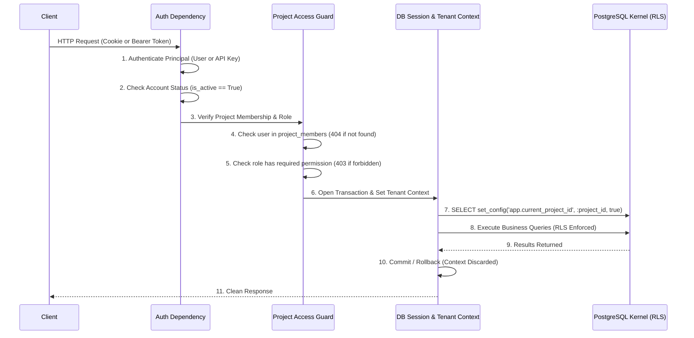

# VulnOS — Phase 2.4 Security Audit: Authentication, Sessions, API Keys & RBAC

**Document Status:** Complete Pre-Implementation Security Audit  
**Phase:** 2.4 (Authentication, Session Management, API Keys & Authorization)  
**Author:** Senior Application Security Architect & Backend Engineer  
**Date:** 2026-11-02  
**Repository:** `https://github.com/VarshSec/vulnos`  
**Git HEAD:** `c2e8bb72298e2a5f03716cf70da4d837a1a9ace8` (Baseline)  

---

## 1. Executive Summary & Objective

In VulnOS, authentication and authorization are foundational security controls. Because VulnOS issues active security tests and stores sensitive vulnerability evidence, a flaw in identity, session handling, API keys, or project-level access control would allow:
- **Authentication Bypass & Impersonation:** An attacker executing scans or accessing sensitive assets without attribution.
- **Cross-Project Access & IDOR:** Compromising client confidentiality by querying scopes, findings, and credentials across tenant boundaries.
- **Token Replay / Session Hijacking:** Persisting unauthorized access through stolen tokens or unrevolving refresh tokens.
- **Tenant Context Injection:** Tricking the storage layer into running queries under an unauthorized `project_id` context in PostgreSQL RLS.

The objective of **Phase 2.4** is to implement an enterprise-grade, defense-in-depth authentication, session management, API key, and project authorization system that seamlessly and securely integrates with the **Phase 2.3 Row-Level Security (RLS)** storage engine.

---

## 2. Existing Identity & Tenancy Baseline (P2.1, P2.2 & P2.3 State)

### 2.1 Git Status & Repository Preservation
- **Branch:** `main`
- **Baseline Git Commit:** `c2e8bb72298e2a5f03716cf70da4d837a1a9ace8`
- **Working Tree State:** Pristine; all P2.1, P2.2, and P2.3 implementation files preserved without uncommitted git mutations.

### 2.2 Existing Data Models (`backend/app/db/models/identity.py`)
1. **`User` (Table: `users`):**
   - `id`: UUIDv7 PK.
   - `email`: Unique text string, indexed.
   - `display_name`: Human-readable name.
   - `password_hash`: Text nullable (allows for local password or OIDC).
   - `auth_provider`: Text with constraint `auth_provider IN ('local', 'oidc')`, default `'local'`.
   - `is_active`: Boolean flag (default `True`).
   - `last_login_at`: Timestamp (UTC).
2. **`APIKey` (Table: `api_keys`):**
   - `id`: UUIDv7 PK.
   - `user_id`: UUID FK referencing `users.id` with `ondelete="CASCADE"`.
   - `name`: Human identifier.
   - `key_prefix`: Public identifier prefix for fast DB indexing and lookup.
   - `key_hash`: Raw binary (`LargeBinary`) unique digest.
   - `scopes`: `ARRAY(Text)` list of permissions (`read`, `scan`, `validate`, `report`, `admin`).
   - `expires_at`, `last_used_at`, `revoked_at`: UTC timestamps.
3. **`Project` (Table: `projects`):**
   - `id`: UUIDv7 PK.
   - `name`, `slug` (unique constraint `uq_projects_slug`), `description`.
   - `owner_id`: UUID FK referencing `users.id`.
   - `status`: `CheckConstraint("status IN ('active', 'archived')")`.
   - Protected by PostgreSQL RLS (`id = current_project_id()`).
4. **`ProjectMember` (Table: `project_members`):**
   - Composite PK: `(project_id, user_id)`.
   - `role`: `CheckConstraint("role IN ('owner', 'admin', 'operator', 'viewer')")`.
   - Protected by PostgreSQL RLS (`project_id = current_project_id()`).

### 2.3 Existing Tenant Context & RLS Integration (`backend/app/db/tenant.py`)
- P2.3 implemented `set_tenant_context()`, `clear_tenant_context()`, and `tenant_context()` context manager.
- Context is transaction-local via PostgreSQL `SELECT set_config('app.current_project_id', :project_id, true)`.
- Pool scavenging listeners automatically run `RESET ALL;` on connection checkin and reset.
- Default-deny is enforced: queries executed without an active project context evaluate `project_id = NULL` to `UNKNOWN` and return 0 rows.

---

## 3. Password Storage & Verification Architecture

### 3.1 Argon2id Parameters
To defend against offline brute-force and GPU/ASIC cracking, VulnOS strictly mandates **Argon2id** (RFC 9106) using `argon2-cffi`:
- **Algorithm:** Argon2id (hybrid memory-hard + side-channel resistant).
- **Time Cost (`t`):** 3 iterations.
- **Memory Cost (`m`):** 65,536 KiB (64 MiB).
- **Parallelism (`p`):** 4 lanes/threads.
- **Hash Length:** 32 bytes (256 bits).
- **Salt Length:** 16 bytes (128 bits) CSPRNG-generated per hash.

### 3.2 Mitigation of Timing Attacks & User Enumeration
- **Constant-Time Verification:** Password verification uses `argon2.PasswordHasher.verify()`, which is constant-time safe.
- **Dummy Hash Verification:** When a login attempt references a non-existent email address, the authentication service executes a full verification against a pre-computed dummy Argon2id hash. This equalizes execution time between valid and invalid usernames, mitigating side-channel user enumeration.
- **Generic Error Responses:** Login failures return a generic error: `Invalid email or password`.

### 3.3 Password Lifecycle
- Minimum password length: 12 characters. Maximum length: 128 characters (preventing DoS via oversized input to Argon2).
- Password changes require verification of the `current_password`.
- Upon successful password change, all existing sessions for that user are revoked in Redis (`logout-all`).

---

## 4. Session Architecture & Redis Management

### 4.1 Strict Architectural Separation: Redis vs PostgreSQL
As established in `DATABASE_DESIGN.md` and `API_CONTRACTS.md`:
- **No relational `sessions` table:** Browser sessions are ephemeral, stateful, high-throughput records stored in Redis.
- Creating a speculative relational session table violates the database architecture and degrades transaction throughput.

### 4.2 Redis Session Key Design & TTL
Redis keys are partitioned under a strict namespace:
```text
vulnos:session:{session_id} -> Hash/JSON {
    "session_id": "c7a8b9...",
    "user_id": "01952e42-...",
    "created_at": 1730510000,
    "last_activity_at": 1730510000,
    "user_agent": "Mozilla/5.0...",
    "ip_address": "192.0.2.1",
    "family_id": "fam_01952e42..."
}
TTL: 1,209,600 seconds (14 days default, REFRESH_TOKEN_TTL_DAYS)

vulnos:user_sessions:{user_id} -> Set of {session_id}
TTL: 1,209,600 seconds
```
- **Lookup by Session ID:** `O(1)` read on every cookie-authenticated request.
- **User Session Index (`vulnos:user_sessions:{user_id}`):** Enables atomic, immediate revocation of all active sessions across all devices (`logout-all` or password change).

### 4.3 Browser Cookie Attributes
Browser session authentication uses a secure cookie:
- `Name`: `vulnos_session`
- `HttpOnly`: `True` (blocks JavaScript access, mitigating XSS session theft).
- `Secure`: `True` in production (`SESSION_COOKIE_SECURE`).
- `SameSite`: `Lax` (defends against cross-site request forgery while permitting safe top-level navigations).
- `Path`: `/`
- `Max-Age`: Configurable (matches refresh token lifetime, default 14 days).

### 4.4 CSRF Protection
For state-changing browser mutations (`POST`, `PUT`, `PATCH`, `DELETE`) authenticated via cookies:
- VulnOS verifies an `X-CSRF-Token` header matching a cryptographically tied synchronizer token or double-submit token stored in the session record.
- Bearer-authenticated API calls (Authorization header) are immune to browser CSRF and bypass CSRF checks.

---

## 5. Token Architecture & Refresh Token Rotation

### 5.1 Access Token Security (JWT)
- **Token Type:** Cryptographically signed JWT bearer token.
- **Signing Algorithm:** Strictly restricted to `HS256` (using `SECRET_KEY` validated to be >= 32 characters in production).
- **Algorithm Header Verification:** Unsigned tokens (`none`), RS256 confusion, or untrusted algorithm declarations are explicitly rejected.
- **Claims Schema:**
  - `sub`: User UUID (`str`).
  - `iss`: `"vulnos"`.
  - `aud`: `"vulnos-api"`.
  - `iat`: UTC epoch timestamp.
  - `exp`: UTC epoch timestamp (short-lived: `ACCESS_TOKEN_TTL_MINUTES`, default 30 minutes).
  - `jti`: Unique UUIDv7 per token (enables selective token blacklisting if needed).
  - `typ`: `"access"` (enforces token type isolation; refresh tokens cannot be used as access tokens).
- **Zero Sensitive Data in Claims:** No passwords, hashes, permissions, or secrets in token payload.

### 5.2 Refresh Token Rotation with Replay Detection
1. **Issuance:** Along with the access token, a cryptographically secure random refresh token (32 bytes / 256 bits hex) is issued.
2. **Digest Storage:** Only the SHA-256 digest of the refresh token is stored in Redis:
   `vulnos:refresh:{token_hash}` -> `{"user_id": ..., "session_id": ..., "family_id": ..., "used": 0}`.
3. **Atomic Rotation:**
   When `/api/v1/auth/refresh` is called:
   - A Redis transaction / Lua script evaluates the token state atomically.
   - If `used == 1`: **Replay Attack Detected!** The entire token family (`family_id`) and the parent session are immediately revoked. An audit log security alert is written.
   - If `used == 0`: The token is marked `used = 1`, and a new access token and refresh token are generated within the same `family_id`.

---

## 6. API Key Architecture & Lifecycle

### 6.1 Format & Key Derivation
API keys are used for machine-to-machine integrations, CI/CD pipelines, and automated scanners.
- **Format:** `vulnos_<prefix>_<secret>`
  - `Prefix`: 8-character unguessable alphanumeric public ID used for indexed database lookup.
  - `Secret`: 32-byte cryptographically secure random secret (hex encoded).
- **Key Display:** The plaintext key is returned **strictly once** upon creation in the `201 Created` response. It is never logged and never stored.
- **Storage Hash:** The secret is hashed with HMAC-SHA-256 using the server-side `API_KEY_PEPPER` from environment configuration:
  $$\text{key\_hash} = \text{HMAC-SHA-256}(\text{key}=\text{API\_KEY\_PEPPER}, \text{msg}=\text{secret})$$
- Stored in `api_keys.key_hash` as binary bytes (`LargeBinary(32)`).

### 6.2 Scope Restrictions
API keys define explicit scopes in `api_keys.scopes`:
- `read`: Read-only access to assets, scans, findings.
- `scan`: Ability to initiate, configure, and cancel scans.
- `validate`: Ability to trigger evidence validation runs.
- `report`: Ability to generate and export reports.
- `admin`: Ability to modify scope rules and project configurations.

An API key can never exercise permissions beyond the role of its owning user in that project.

---

## 7. Project Membership & Role-Based Access Control (RBAC)

### 7.1 Role Hierarchy & Permissions Matrix
Per `API_CONTRACTS.md` Section 4:

| Permission | `viewer` | `operator` | `admin` | `owner` |
|---|:---:|:---:|:---:|:---:|
| Read project resources | ✅ | ✅ | ✅ | ✅ |
| Run scans & executions | ❌ | ✅ | ✅ | ✅ |
| Trigger validations | ❌ | ✅ | ✅ | ✅ |
| Manage targets & scope | ❌ | ❌ | ✅ | ✅ |
| Approve destructive actions | ❌ | ❌ | ✅ | ✅ |
| Manage project members | ❌ | ❌ | ✅ | ✅ |
| Delete / archive project | ❌ | ❌ | ❌ | ✅ |

### 7.2 Strict Non-Disclosure (404 on Unauthorized Access)
To prevent project enumeration and ID guessing (IDOR):
- If an authenticated user queries `/projects/{project_id}/...` for a project where they have no membership, the application returns **`404 not_found`**, not `403 forbidden`.
- `403 forbidden` is returned only when the user is an authorized member of the project but lacks the required role for that specific action (e.g. a `viewer` attempting `POST /projects/{id}/scans`).

---

## 8. Critical P2.3 RLS Integration Pipeline

The request lifecycle must strictly follow the defense-in-depth authorization-to-storage pipeline:



**Security Invariants:**
1. The client **never** sets or influences `app.current_project_id` directly.
2. Tenant context is established **only after** user authentication and project membership verification have passed.
3. In case of an authentication or authorization failure, **no database tenant context is ever established**.
4. Even if an application bug attempts cross-project IDOR, PostgreSQL RLS returns 0 rows.

---

## 9. Rate Limiting & Abuse Prevention Strategy

To prevent credential stuffing, brute force, and token rotation race conditions:
- **Redis-Backed Sliding Window Rate Limiter:**
  - Login attempts: 5 requests per minute per IP / email pair.
  - Registration: 3 requests per hour per IP.
  - Refresh requests: 30 requests per minute per session.
  - API key requests: 120 requests per minute per API key prefix.
- Rate-limiting headers: `Retry-After`, `X-RateLimit-Limit`, `X-RateLimit-Remaining`.
- No permanent account lockout (prevents Denial of Service against legitimate users).

---

## 10. Audit Logging Strategy (Append-Only)

All authentication and authorization events are recorded via `AuditLog`:
- Events: `auth.login.success`, `auth.login.failed`, `auth.logout`, `auth.logout_all`, `auth.password_changed`, `auth.refresh_token.rotated`, `auth.refresh_token.replay_detected`, `api_key.created`, `api_key.revoked`, `rbac.permission_denied`.
- **Sensitive Data Scrubbing:** Never log passwords, raw access tokens, raw refresh tokens, raw API keys, or session secrets.

---

## 11. Implementation Action Plan

| Step | Milestone | Target Deliverable |
|---|---|---|
| **1** | P2.4.1 | Pre-implementation security audit (`P2_4_SECURITY_AUDIT.md`) — **DONE** |
| **2** | P2.4.2 | Password hashing & user auth (`argon2-cffi`, `backend/app/auth/passwords.py`, `service.py`) |
| **3** | P2.4.3 | Access token creation and verification (`pyjwt`, `backend/app/auth/tokens.py`) |
| **4** | P2.4.4 | Redis session management (`backend/app/auth/sessions.py`) |
| **5** | P2.4.5 | Refresh token rotation & replay detection (`backend/app/auth/tokens.py`, atomic Redis rotation) |
| **6** | P2.4.6 | API key lifecycle & pepper digest verification (`backend/app/auth/api_keys.py`) |
| **7** | P2.4.7 | Project membership & RBAC permission checks (`backend/app/authorization/`) |
| **8** | P2.4.8 | FastAPI auth dependencies & middleware (`backend/app/auth/dependencies.py`) |
| **9** | P2.4.9 | P2.3 RLS integration & tenant context enforcement |
| **10** | P2.4.10 | Rate limiting & audit logging integration (`backend/app/auth/rate_limits.py`) |
| **11** | P2.4.11 | Security integration test suite (`backend/tests/security/auth/`) |
| **12** | P2.4.12 | Documentation, design specs, and test matrix |
