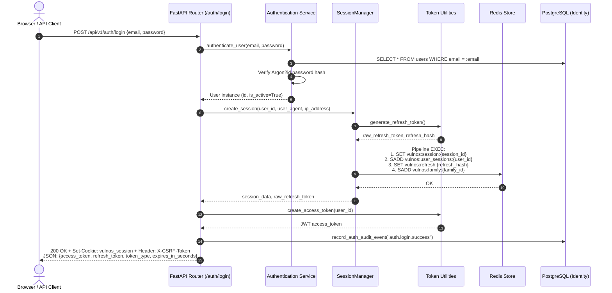
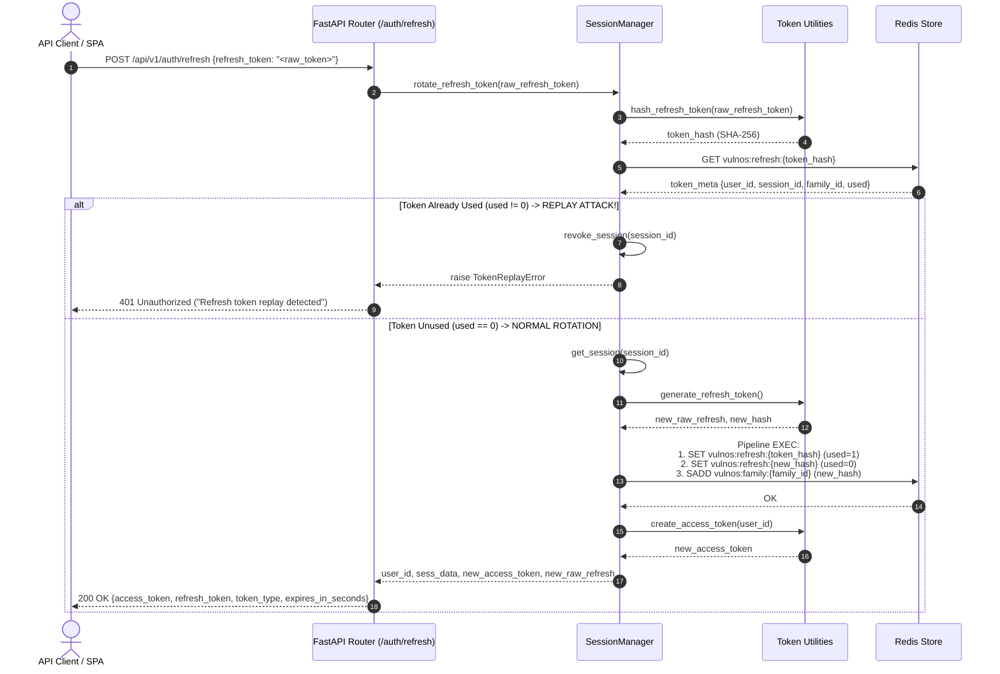

# VulnOS — Phase 2.4 Session Management & Authentication Architecture

**Document Version:** 1.0.0  
**Phase:** 2.4 (Authentication, Session Management, API Keys & RBAC)  
**Author:** Senior Security Documentation Engineer  
**Date:** 2026-11-02  
**Status:** Approved Technical Architecture Reference  
**Implementation Source Files:**
- [`backend/app/auth/sessions.py`](file:///C:/Users/varsh/.gemini/antigravity/scratch/vulnos/backend/app/auth/sessions.py)
- [`backend/app/auth/tokens.py`](file:///C:/Users/varsh/.gemini/antigravity/scratch/vulnos/backend/app/auth/tokens.py)
- [`backend/app/api/v1/auth.py`](file:///C:/Users/varsh/.gemini/antigravity/scratch/vulnos/backend/app/api/v1/auth.py)
- [`backend/app/auth/dependencies.py`](file:///C:/Users/varsh/.gemini/antigravity/scratch/vulnos/backend/app/auth/dependencies.py)
- [`backend/app/core/config.py`](file:///C:/Users/varsh/.gemini/antigravity/scratch/vulnos/backend/app/core/config.py)

---

## 1. Session Architecture Overview

VulnOS enforces a strict architectural boundary between persistent identity data and ephemeral authentication sessions:
- **Persistent Relational Store (PostgreSQL):** Stores durable identity entities, including [`User`](file:///C:/Users/varsh/.gemini/antigravity/scratch/vulnos/backend/app/db/models/identity.py#L25-L42), [`APIKey`](file:///C:/Users/varsh/.gemini/antigravity/scratch/vulnos/backend/app/db/models/identity.py#L45-L65), [`Project`](file:///C:/Users/varsh/.gemini/antigravity/scratch/vulnos/backend/app/db/models/identity.py#L68-L88), and [`ProjectMember`](file:///C:/Users/varsh/.gemini/antigravity/scratch/vulnos/backend/app/db/models/identity.py#L91-L108). PostgreSQL does **not** contain a `sessions` table.
- **In-Memory Stateful Store (Redis):** Stores high-velocity, ephemeral browser sessions, refresh token lifecycle states, token rotation families, and CSRF tokens.

```
                      +-------------------------------------------------------------+
                      |                       Client Request                        |
                      +-------------------------------------------------------------+
                                     /                               \
               (Browser Session Cookie)                       (API Bearer Token)
                                   /                                   \
                                  v                                     v
                 +--------------------------------+   +----------------------------------+
                 | Cookie: vulnos_session=<id>    |   | Authorization: Bearer <JWT>      |
                 | Header: X-CSRF-Token=<token>   |   | Header: Authorization: <APIKey>  |
                 +--------------------------------+   +----------------------------------+
                                  |                                     |
                                  v                                     v
+-------------------------------------------------------------------------------------------------------+
| FastAPI Dependency Pipeline (`backend/app/auth/dependencies.py`)                                       |
|                                                                                                       |
| 1. Cookie Extraction & Session Lookup:                  1. JWT Signature & Claim Decoding:             |
|    - Query Redis `vulnos:session:{id}`                     - Verify HMAC-SHA256 with SECRET_KEY       |
|    - Validate CSRF header against Redis csrf_token         - Pin algorithm HS256, iss, aud, typ       |
|    - Touch session activity timestamp (>60s window)        - Parse sub UUID                           |
| 2. DB Account Status Check:                             2. DB Account Status Check:                   |
|    - Query PostgreSQL `users` table for user.is_active     - Query PostgreSQL `users` table           |
|                                                                                                       |
| Principal Resolved -> `AuthenticatedPrincipal(user=user, session_data=sess)`                         |
+-------------------------------------------------------------------------------------------------------+
                                  |
                                  v
+-------------------------------------------------------------------------------------------------------+
| Project Context & RLS Layer (`require_project_context`)                                               |
| - Verify project membership & role in PostgreSQL                                                      |
| - Set transaction-local tenant context: `SET LOCAL app.current_project_id = :project_id`              |
| - Execute isolated business logic with PostgreSQL Row-Level Security                                  |
+-------------------------------------------------------------------------------------------------------+
```

### Architectural Rationale: Zero Relational Sessions Table

1. **Elimination of Database Write Amplification:** Browser session verification involves continuous activity timestamp updates (`last_activity_at`) and frequent issuance of rotated refresh tokens. Storing this ephemeral data in PostgreSQL would cause table bloat, frequent WAL writes, and excessive connection pool utilization.
2. **Native Expiration (TTL):** Redis handles TTL expiration natively at the key level, avoiding scheduled cleanup cron jobs or table vacuums required by relational databases.
3. **Sub-Millisecond Lookup Latency:** Cookie-based session resolution executes in sub-millisecond memory lookups (`O(1)` string `GET` in Redis) prior to executing authorization pipelines.
4. **Instant Token Family Invalidation:** Replay attack detection requires immediate atomic invalidation of all tokens within a token family and all sessions for a user, which Redis executes in a single non-blocking pipeline (`pipe.execute()`).

### Core Component Responsibilities

| Component | Implementation File | Primary Responsibilities |
| :--- | :--- | :--- |
| [`SessionManager`](file:///C:/Users/varsh/.gemini/antigravity/scratch/vulnos/backend/app/auth/sessions.py#L85-L252) | [`sessions.py`](file:///C:/Users/varsh/.gemini/antigravity/scratch/vulnos/backend/app/auth/sessions.py) | Session creation, touch, single revocation, user-wide revocation, and atomic refresh token rotation. |
| [`SessionData`](file:///C:/Users/varsh/.gemini/antigravity/scratch/vulnos/backend/app/auth/sessions.py#L31-L60) | [`sessions.py`](file:///C:/Users/varsh/.gemini/antigravity/scratch/vulnos/backend/app/auth/sessions.py) | Immutable dataclass defining the serialized session state stored in Redis. |
| Token Utilities | [`tokens.py`](file:///C:/Users/varsh/.gemini/antigravity/scratch/vulnos/backend/app/auth/tokens.py) | Cryptographic refresh token generation, SHA-256 token hashing, JWT access token issuance, and claim validation. |
| Auth API Router | [`auth.py`](file:///C:/Users/varsh/.gemini/antigravity/scratch/vulnos/backend/app/api/v1/auth.py) | Endpoints for `/register`, `/login`, `/refresh`, `/logout`, `/logout-all`, and `/change-password`. |
| Auth Dependencies | [`dependencies.py`](file:///C:/Users/varsh/.gemini/antigravity/scratch/vulnos/backend/app/auth/dependencies.py) | [`get_current_principal`](file:///C:/Users/varsh/.gemini/antigravity/scratch/vulnos/backend/app/auth/dependencies.py#L49-L122), CSRF header enforcement, and integration with PostgreSQL RLS tenant context. |

---

## 2. Redis Key Structure & Data Models

All session and refresh token keys in Redis are namespaced under the `vulnos:` prefix.

### Key Namespace Summary

| Key Pattern | Redis Type | Structure / Payload | Primary Purpose | TTL |
| :--- | :--- | :--- | :--- | :--- |
| `vulnos:session:{session_id}` | String (JSON) | Serialized [`SessionData`](file:///C:/Users/varsh/.gemini/antigravity/scratch/vulnos/backend/app/auth/sessions.py#L31-L60) record | Ephemeral session state, CSRF synchronizer token, and client audit metadata. | `REFRESH_TOKEN_TTL_DAYS * 86400` (14 days) |
| `vulnos:user_sessions:{user_id}` | Set | Set of active `session_id` strings (`SADD`, `SMEMBERS`, `SREM`) | User-to-session index enabling global multi-device logout and password change revocation. | `REFRESH_TOKEN_TTL_DAYS * 86400` (14 days) |
| `vulnos:refresh:{token_hash}` | String (JSON) | `{"user_id": str, "session_id": str, "family_id": str, "used": int}` | Metadata tracking refresh token validity, usage state, and token family association. | `REFRESH_TOKEN_TTL_DAYS * 86400` (14 days) |
| `vulnos:family:{family_id}` | Set | Set of `token_hash` strings belonging to the token rotation family | Tracks token lineage for atomic cascade deletion upon replay attack detection or logout. | `REFRESH_TOKEN_TTL_DAYS * 86400` (14 days) |

### Key Helper Definitions

As implemented in [`backend/app/auth/sessions.py`](file:///C:/Users/varsh/.gemini/antigravity/scratch/vulnos/backend/app/auth/sessions.py#L69-L83):

```python
def _session_key(session_id: str) -> str:
    return f"vulnos:session:{session_id}"

def _user_sessions_key(user_id: UUID | str) -> str:
    return f"vulnos:user_sessions:{user_id}"

def _refresh_key(token_hash: str) -> str:
    return f"vulnos:refresh:{token_hash}"

def _family_key(family_id: str) -> str:
    return f"vulnos:family:{family_id}"
```

### Serialized Payload Schemas

#### 1. Session Record (`vulnos:session:{session_id}`)
Represented by [`SessionData`](file:///C:/Users/varsh/.gemini/antigravity/scratch/vulnos/backend/app/auth/sessions.py#L31-L60):

```json
{
  "session_id": "a98f12c5de7845f0910123456789abcd0123456789abcdef",
  "user_id": "0192e45b-7b2a-7d1a-8e2b-f0d7e48b9c10",
  "family_id": "3f9a7c81d2e5b4a0f6e8c7b9a1d2e3f4",
  "csrf_token": "e7c4f1a2b3d5e6f7a8b9c0d1e2f3a4b5c6d7e8f9a0b1c2d3",
  "created_at": 1730510000,
  "last_activity_at": 1730510065,
  "user_agent": "Mozilla/5.0 (Windows NT 10.0; Win64; x64) AppleWebKit/537.36",
  "ip_address": "192.0.2.45"
}
```

#### 2. Refresh Token Metadata Record (`vulnos:refresh:{token_hash}`)
Indexed strictly by the SHA-256 digest of the raw refresh token:

```json
{
  "user_id": "0192e45b-7b2a-7d1a-8e2b-f0d7e48b9c10",
  "session_id": "a98f12c5de7845f0910123456789abcd0123456789abcdef",
  "family_id": "3f9a7c81d2e5b4a0f6e8c7b9a1d2e3f4",
  "used": 0
}
```

> [!IMPORTANT]
> The raw refresh token is **never** written to Redis or PostgreSQL. Only its SHA-256 hash computed via [`hash_refresh_token()`](file:///C:/Users/varsh/.gemini/antigravity/scratch/vulnos/backend/app/auth/tokens.py#L127-L129) is stored in the key path `vulnos:refresh:{token_hash}`.

---

## 3. Session Creation Flow

The session creation lifecycle begins when a user submits credentials to [`POST /api/v1/auth/login`](file:///C:/Users/varsh/.gemini/antigravity/scratch/vulnos/backend/app/api/v1/auth.py#L78-L152).



### Cryptographic Entropy Generation

During session creation in [`SessionManager.create_session()`](file:///C:/Users/varsh/.gemini/antigravity/scratch/vulnos/backend/app/auth/sessions.py#L97-L147), cryptographically secure random identifiers are instantiated using Python's `secrets` module:

```python
session_id = secrets.token_hex(24)          # 48 hex characters (192 bits of entropy)
family_id = secrets.token_hex(16)           # 32 hex characters (128 bits of entropy)
csrf_token = secrets.token_hex(24)          # 48 hex characters (192 bits of entropy)
raw_refresh_token, refresh_hash = generate_refresh_token()  # 32 URL-safe bytes (256 bits of entropy)
```

### Atomic Redis Pipeline Write

To eliminate race conditions during session creation, all four key relationships are committed simultaneously in a single Redis pipeline:

```python
pipe = self.client.pipeline()
# 1. Store session JSON
pipe.set(_session_key(session_id), json.dumps(sess.to_dict()), ex=ttl_seconds)
# 2. Add to user's set of active sessions
pipe.sadd(_user_sessions_key(user_id), session_id)
pipe.expire(_user_sessions_key(user_id), ttl_seconds)
# 3. Store refresh token metadata
refresh_data = {
    "user_id": str(user_id),
    "session_id": session_id,
    "family_id": family_id,
    "used": 0,
}
pipe.set(_refresh_key(refresh_hash), json.dumps(refresh_data), ex=ttl_seconds)
# 4. Track refresh token in family set for revocation
pipe.sadd(_family_key(family_id), refresh_hash)
pipe.expire(_family_key(family_id), ttl_seconds)
pipe.execute()
```

---

## 4. Cookie Configuration & Security Attributes

For browser clients, VulnOS issues the session identifier inside a dedicated session cookie configured in [`auth.py`](file:///C:/Users/varsh/.gemini/antigravity/scratch/vulnos/backend/app/api/v1/auth.py#L125-L133):

```python
response.set_cookie(
    key="vulnos_session",
    value=session_data.session_id,
    max_age=settings.REFRESH_TOKEN_TTL_DAYS * 86400,
    httponly=True,
    secure=settings.SESSION_COOKIE_SECURE,
    samesite=settings.SESSION_COOKIE_SAMESITE,
    path="/",
)
```

### Security Attribute Specifications

| Cookie Attribute | Configured Value | Security Defense Rationale |
| :--- | :--- | :--- |
| **Name** | `vulnos_session` | Standard application cookie identifier namespace. |
| **Value** | `session_data.session_id` | 192-bit CSPRNG hex string referencing the server-side Redis record. |
| **`HttpOnly`** | `True` | Prevents client-side ECMAScript access (`document.cookie`), mitigating session theft via Cross-Site Scripting (XSS). |
| **`Secure`** | `settings.SESSION_COOKIE_SECURE` (`False` in dev, `True` in prod) | Restricts cookie transmission exclusively to encrypted TLS/HTTPS channels, preventing plaintext interception. |
| **`SameSite`** | `settings.SESSION_COOKIE_SAMESITE` (`"lax"`) | Restricts cross-site request context transmission, mitigating Cross-Site Request Forgery (CSRF) on ambient navigations. |
| **`Path`** | `/` | Scopes cookie transmission across all API and application endpoints. |
| **`Max-Age`** | `REFRESH_TOKEN_TTL_DAYS * 86400` (1,209,600s / 14 days) | Sets persistent cookie expiration aligned with Redis server-side TTL. |

---

## 5. CSRF Protection Architecture

VulnOS implements defense-in-depth against Cross-Site Request Forgery for browser sessions using a double-submit synchronizer token pattern.

### Mechanism

1. **Token Issuance:** When a session is created, a high-entropy `csrf_token` (48-character hex string) is generated and stored inside [`SessionData`](file:///C:/Users/varsh/.gemini/antigravity/scratch/vulnos/backend/app/auth/sessions.py#L31-L60).
2. **Header Delivery:** The login response delivers the token to the client in the `X-CSRF-Token` response header:
   ```python
   response.headers["X-CSRF-Token"] = session_data.csrf_token
   ```
3. **Client Storage:** Single Page Applications (SPAs) store this header value in local memory (non-persistent state).
4. **Request Verification:** On every state-changing request authenticated via cookie, the client must transmit the token in the `X-CSRF-Token` request header.

### Enforcement in `get_current_principal`

The dependency [`get_current_principal()`](file:///C:/Users/varsh/.gemini/antigravity/scratch/vulnos/backend/app/auth/dependencies.py#L102-L110) strictly enforces CSRF token presence and equivalence for unsafe HTTP verbs:

```python
# Enforce CSRF protection for cookie-based state-changing requests
if request.method in {"POST", "PUT", "PATCH", "DELETE"}:
    csrf_header = request.headers.get("X-CSRF-Token")
    if not csrf_header or csrf_header != session_data.csrf_token:
        raise HTTPException(
            status_code=status.HTTP_403_FORBIDDEN,
            detail="CSRF token validation failed",
        )
```

### Transport Isolation Matrix

| Authentication Method | Transport | Requires CSRF Check? | Reason |
| :--- | :--- | :--- | :--- |
| **Browser Session Cookie** | `Cookie: vulnos_session=...` | **Yes** (on `POST`, `PUT`, `PATCH`, `DELETE`) | Cookies are automatically attached by browsers across cross-origin requests. |
| **JWT Access Token** | `Authorization: Bearer <jwt>` | **No** | Custom `Authorization` headers cannot be forged across origins without CORS preflight approval. |
| **API Key** | `Authorization: Bearer vulnos_...` | **No** | Programmatic/machine integration; immune to ambient browser credential attachment. |

---

## 6. Refresh Token Rotation (Atomic & Cryptographic)

VulnOS implements atomic refresh token rotation compliant with RFC 6749 and OAuth 2.0 Security Best Current Practice (BCP). Every call to [`POST /api/v1/auth/refresh`](file:///C:/Users/varsh/.gemini/antigravity/scratch/vulnos/backend/app/api/v1/auth.py#L154-L218) with a raw refresh token invalidates the current token and issues a brand-new token pair.



### Cryptographic Generation & Hashing

In [`backend/app/auth/tokens.py`](file:///C:/Users/varsh/.gemini/antigravity/scratch/vulnos/backend/app/auth/tokens.py#L115-L129):

```python
def generate_refresh_token() -> tuple[str, str]:
    raw_token = secrets.token_urlsafe(32)
    token_hash = hash_refresh_token(raw_token)
    return raw_token, token_hash

def hash_refresh_token(raw_token: str) -> str:
    return hashlib.sha256(raw_token.encode("utf-8")).hexdigest()
```

### Pipeline Rotation Logic

In [`SessionManager.rotate_refresh_token()`](file:///C:/Users/varsh/.gemini/antigravity/scratch/vulnos/backend/app/auth/sessions.py#L230-L251):

```python
# Mark current token as used
token_meta["used"] = 1
settings = get_settings()
ttl_seconds = settings.REFRESH_TOKEN_TTL_DAYS * 86400

# Generate new token pair
new_raw_refresh, new_hash = generate_refresh_token()
new_meta = {
    "user_id": str(user_id),
    "session_id": session_id,
    "family_id": family_id,
    "used": 0,
}

pipe = self.client.pipeline()
pipe.set(_refresh_key(token_hash), json.dumps(token_meta), ex=ttl_seconds)
pipe.set(_refresh_key(new_hash), json.dumps(new_meta), ex=ttl_seconds)
pipe.sadd(_family_key(family_id), new_hash)
pipe.execute()

new_access_token = create_access_token(user_id)
return user_id, session_data, new_access_token, new_raw_refresh
```

---

## 7. Replay Attack Detection & Family Revocation

### Threat Scenario

If an adversary intercepts a refresh token $RT_1$ in transit or exfiltrates it from client storage:
1. The legitimate client exchanges $RT_1$ for $RT_2$. Redis marks $RT_1$ with `used = 1`.
2. The adversary later attempts to exchange $RT_1$.
3. If refresh tokens were not rotated or replay detection was missing, the adversary would obtain unauthorized sessions indefinitely.

### Detection & Automated Mitigation

In VulnOS, when a token is presented with `used != 0`:
1. **Replay Triggered:** [`SessionManager.rotate_refresh_token()`](file:///C:/Users/varsh/.gemini/antigravity/scratch/vulnos/backend/app/auth/sessions.py#L217-L224) detects the compromise immediately:
   ```python
   # Check for replay attack: If token was already marked used!
   if token_meta.get("used", 0) != 0:
       # Revoke entire token family and associated session immediately
       self.revoke_session(session_id)
       raise TokenReplayError(
           "Refresh token replay detected. All tokens in family have been revoked."
       )
   ```
2. **Cascade Family Deletion:** [`revoke_session()`](file:///C:/Users/varsh/.gemini/antigravity/scratch/vulnos/backend/app/auth/sessions.py#L172-L184) invalidates the session and fetches all token hashes linked to `vulnos:family:{family_id}`, executing atomic deletion across Redis:
   - Deletes `vulnos:session:{session_id}`
   - Removes `session_id` from `vulnos:user_sessions:{user_id}`
   - Deletes all `vulnos:refresh:{hash}` records for every token ever generated in that family
   - Deletes `vulnos:family:{family_id}`
3. **Security Audit Logging:** In [`auth.py`](file:///C:/Users/varsh/.gemini/antigravity/scratch/vulnos/backend/app/api/v1/auth.py#L206-L217), the exception is logged to the database audit trail:
   ```python
   record_auth_audit_event(
       db=db,
       action="auth.refresh_token.replay_detected",
       actor_id=None,
       actor_type="system",
       details={"error": str(exc)},
   )
   ```
4. **Client Termination:** The request is rejected with `HTTP 401 Unauthorized`. Both the attacker and the legitimate client are forced to re-authenticate with full credentials.

---

## 8. Session Revocation Workflows

VulnOS provides two distinct levels of session revocation: targeted single-session termination and comprehensive user-wide session invalidation.

### Single Session Revocation

Triggered when a user logs out of their current device ([`POST /api/v1/auth/logout`](file:///C:/Users/varsh/.gemini/antigravity/scratch/vulnos/backend/app/api/v1/auth.py#L220-L240)):

```python
def revoke_session(self, session_id: str) -> None:
    """Revoke a specific session."""
    sess = self.get_session(session_id)
    if sess is not None:
        pipe = self.client.pipeline()
        pipe.delete(_session_key(session_id))
        pipe.srem(_user_sessions_key(sess.user_id), session_id)
        # Revoke all tokens in the family
        family_hashes = self.client.smembers(_family_key(sess.family_id))
        for h in family_hashes:
            pipe.delete(_refresh_key(h))
        pipe.delete(_family_key(sess.family_id))
        pipe.execute()
```

The HTTP endpoint additionally deletes the client cookie:
```python
response.delete_cookie(key="vulnos_session", path="/")
```

### All-Sessions Revocation (Global Kill-Switch)

Triggered when a user terminates all active sessions ([`POST /api/v1/auth/logout-all`](file:///C:/Users/varsh/.gemini/antigravity/scratch/vulnos/backend/app/api/v1/auth.py#L242-L262)) or performs a password change ([`POST /api/v1/auth/change-password`](file:///C:/Users/varsh/.gemini/antigravity/scratch/vulnos/backend/app/api/v1/auth.py#L264-L293)):

```python
def revoke_all_user_sessions(self, user_id: UUID) -> int:
    """Revoke every active session belonging to a user (e.g. after password change)."""
    session_ids = self.client.smembers(_user_sessions_key(user_id))
    count = len(session_ids)
    for sid in session_ids:
        self.revoke_session(str(sid))
    self.client.delete(_user_sessions_key(user_id))
    return count
```

### Revocation Comparison Matrix

| Property | Single Session (`/logout`) | All Sessions (`/logout-all` / Password Change) |
| :--- | :--- | :--- |
| **Endpoint** | `POST /api/v1/auth/logout` | `POST /api/v1/auth/logout-all` |
| **Method** | [`revoke_session(session_id)`](file:///C:/Users/varsh/.gemini/antigravity/scratch/vulnos/backend/app/auth/sessions.py#L172-L184) | [`revoke_all_user_sessions(user_id)`](file:///C:/Users/varsh/.gemini/antigravity/scratch/vulnos/backend/app/auth/sessions.py#L186-L193) |
| **Affected Keys** | 1 session key, 1 family set, member refresh keys | All session keys for user, all family sets, all refresh keys |
| **User Sessions Key** | `SREM vulnos:user_sessions:{user_id} {session_id}` | `DEL vulnos:user_sessions:{user_id}` |
| **Cookie Deletion** | Local device cookie deleted | Local device cookie deleted; remote devices rejected on next request |
| **Audit Action** | `auth.logout` | `auth.logout_all` or `auth.password_changed` |

---

## 9. TTL Configuration & Sliding Activity Tracking

### Configuration Parameters

All duration values are defined centrally in [`backend/app/core/config.py`](file:///C:/Users/varsh/.gemini/antigravity/scratch/vulnos/backend/app/core/config.py#L94-L97):

| Setting Key | Default Value | Description |
| :--- | :--- | :--- |
| `ACCESS_TOKEN_TTL_MINUTES` | `30` | Lifetime of signed JWT bearer access tokens (1,800 seconds). |
| `REFRESH_TOKEN_TTL_DAYS` | `14` | Lifetime of Redis session records, refresh token hashes, and cookies (1,209,600 seconds). |
| `SESSION_COOKIE_SECURE` | `False` (dev) / `True` (prod) | Enforces HTTPS-only transmission for session cookies. |
| `SESSION_COOKIE_SAMESITE` | `"lax"` | Cross-site cookie isolation setting. |

### Sliding Activity Touch Logic

In [`SessionManager.get_session()`](file:///C:/Users/varsh/.gemini/antigravity/scratch/vulnos/backend/app/auth/sessions.py#L149-L170), session activity is tracked to reflect user presence without generating excessive Redis writes:

```python
now = int(time.time())
if now - sess.last_activity_at > 60:
    data["last_activity_at"] = now
    ttl = self.client.ttl(_session_key(session_id))
    if ttl > 0:
        self.client.set(_session_key(session_id), json.dumps(data), ex=ttl)
```

1. **60-Second Throttling Window:** `last_activity_at` is only updated if at least 60 seconds have elapsed since the last touch, capping Redis write frequency.
2. **TTL Preservation:** The update preserves the existing remaining TTL retrieved via `client.ttl(key)`, preventing arbitrary extension beyond the 14-day absolute session maximum.

---

## 10. Security Invariants

The VulnOS session management implementation enforces the following formal invariants:

| Identifier | Invariant Statement | Implementation Enforcement |
| :--- | :--- | :--- |
| **INV-SESS-01** | **Ephemeral State Exclusivity:** PostgreSQL shall never store browser sessions. All session records reside exclusively in Redis. | Verified in PostgreSQL schema migrations (no `sessions` table); implemented via [`SessionManager`](file:///C:/Users/varsh/.gemini/antigravity/scratch/vulnos/backend/app/auth/sessions.py#L85-L252). |
| **INV-SESS-02** | **Cryptographic Refresh Separation:** Raw refresh tokens are never persisted anywhere. Redis stores only the SHA-256 digest of refresh tokens. | Enforced in [`generate_refresh_token()`](file:///C:/Users/varsh/.gemini/antigravity/scratch/vulnos/backend/app/auth/tokens.py#L115-L124) and [`_refresh_key()`](file:///C:/Users/varsh/.gemini/antigravity/scratch/vulnos/backend/app/auth/sessions.py#L77-L78). |
| **INV-SESS-03** | **Zero-Tolerance Replay Invalidation:** Any attempt to use an already-used refresh token (`used != 0`) immediately invalidates the entire token family and the associated session. | Enforced in [`SessionManager.rotate_refresh_token()`](file:///C:/Users/varsh/.gemini/antigravity/scratch/vulnos/backend/app/auth/sessions.py#L217-L224); emits audit event and raises [`TokenReplayError`](file:///C:/Users/varsh/.gemini/antigravity/scratch/vulnos/backend/app/auth/exceptions.py#L21). |
| **INV-SESS-04** | **Atomic Rotation:** Refresh token rotation commits the invalidation of the old token and creation of the new token in a single Redis transaction pipeline. | Pipeline execution `pipe.execute()` in [`sessions.py`](file:///C:/Users/varsh/.gemini/antigravity/scratch/vulnos/backend/app/auth/sessions.py#L244-L248). |
| **INV-SESS-05** | **Double-Submit CSRF Verification:** Any state-changing browser request (`POST`, `PUT`, `PATCH`, `DELETE`) authenticated via cookie must present an `X-CSRF-Token` header exactly matching `session_data.csrf_token`. | Enforced in [`get_current_principal()`](file:///C:/Users/varsh/.gemini/antigravity/scratch/vulnos/backend/app/auth/dependencies.py#L102-L110); raises 403 Forbidden on mismatch. |
| **INV-SESS-06** | **Cookie Security Containment:** The `vulnos_session` cookie must always have `HttpOnly=True`, `SameSite=Lax`, and `Secure=True` in production environments. | Configured in [`auth.py`](file:///C:/Users/varsh/.gemini/antigravity/scratch/vulnos/backend/app/api/v1/auth.py#L125-L133) and validated in [`Settings`](file:///C:/Users/varsh/.gemini/antigravity/scratch/vulnos/backend/app/core/config.py#L94-L95). |
| **INV-SESS-07** | **Token Type Isolation:** JWT access tokens cannot be used as refresh tokens, and refresh tokens cannot be decoded as JWT access tokens. Access tokens require pinned algorithm `HS256` and claim `typ == "access"`. | Enforced in [`create_access_token()`](file:///C:/Users/varsh/.gemini/antigravity/scratch/vulnos/backend/app/auth/tokens.py#L29-L67) and [`decode_access_token()`](file:///C:/Users/varsh/.gemini/antigravity/scratch/vulnos/backend/app/auth/tokens.py#L70-L113). |
| **INV-SESS-08** | **Global Invalidation on Credential Change:** Changing a user password immediately and synchronously revokes all active sessions and refresh token families across all devices. | Enforced in [`change_password()`](file:///C:/Users/varsh/.gemini/antigravity/scratch/vulnos/backend/app/auth/service.py) via [`revoke_all_user_sessions()`](file:///C:/Users/varsh/.gemini/antigravity/scratch/vulnos/backend/app/auth/sessions.py#L186-L193). |
| **INV-SESS-09** | **Active Account Invariant:** Every request authenticated via session cookie or bearer token verifies that `user.is_active is True` in PostgreSQL before granting access. | Enforced in [`get_current_principal()`](file:///C:/Users/varsh/.gemini/antigravity/scratch/vulnos/backend/app/auth/dependencies.py#L81-L85) and [`dependencies.py`](file:///C:/Users/varsh/.gemini/antigravity/scratch/vulnos/backend/app/auth/dependencies.py#L112-L116); raises 401 Unauthorized if inactive. |
