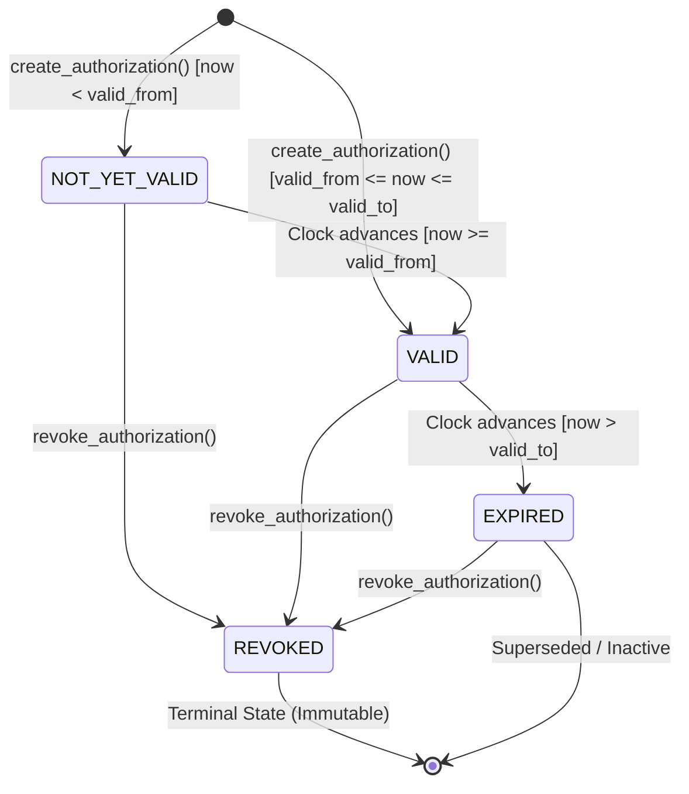
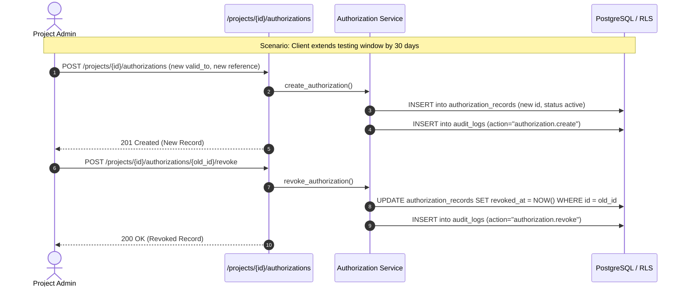

# VulnOS Phase 2.5.4 — Authorization Lifecycle & Deterministic Evaluation

## 1. Lifecycle Overview & State Machine

An `AuthorizationRecord` represents legal consent granted by a target system owner or authorized representative. Its lifecycle state is a **pure, deterministic function** of time (`now`), the validity window (`valid_from`, `valid_to`), and the revocation timestamp (`revoked_at`).

There is no mutable `is_active` boolean in the database. Computing status dynamically prevents stale cache states and ensures immediate effect across distributed components.

---

## 2. State Definitions & Evaluation Logic

| State | Evaluation Result | `allowed` | Temporal Condition | Revocation Condition | Notes |
| :--- | :--- | :--- | :--- | :--- | :--- |
| **NOT_YET_VALID** | `AUTHORIZATION_NOT_YET_VALID` | `False` | `now < valid_from` | `revoked_at IS NULL` | Future start date. Cannot validate active scans. |
| **ACTIVE / VALID** | `AUTHORIZATION_VALID` | `True` | `valid_from <= now <= valid_to` | `revoked_at IS NULL` | Eligible for operation authorization if rules match. |
| **EXPIRED** | `AUTHORIZATION_EXPIRED` | `False` | `now > valid_to` | `revoked_at IS NULL` | Past validity window. Automatic cessation of permission. |
| **REVOKED** | `AUTHORIZATION_REVOKED` | `False` | Any `now` | `revoked_at IS NOT NULL` | Immediate manual revocation by project admin. Top priority. |

---

## 3. Boundary Condition Specifications

1. **Start Boundary:**
   - `now = valid_from - 1 second` $\rightarrow$ `AUTHORIZATION_NOT_YET_VALID` (`allowed=False`)
   - `now = valid_from` $\rightarrow$ `AUTHORIZATION_VALID` (`allowed=True`)
2. **End Boundary:**
   - `now = valid_to` $\rightarrow$ `AUTHORIZATION_VALID` (`allowed=True`, inclusive final second)
   - `now = valid_to + 1 second` $\rightarrow$ `AUTHORIZATION_EXPIRED` (`allowed=False`)
3. **Revocation Priority:**
   - If `revoked_at IS NOT NULL`, the evaluation engine returns `AUTHORIZATION_REVOKED` immediately. Even if the record was previously expired or not yet valid, revocation is reported as the primary security reason.
4. **Timezone Awareness:**
   - All timestamps (`valid_from`, `valid_to`, `created_at`, `revoked_at`) are strictly validated as timezone-aware and normalized to UTC (`datetime.timezone.utc`). Comparisons against naive datetimes are rejected at the schema boundary.

---

## 4. Operation Parameters & Action Gating

Once temporal validity and non-revocation are established, the engine evaluates whether the specific requested action is permitted:

### 4.1 Allowed Actions Allowlist
Valid actions are strictly restricted to the architectural allowlist:
- `scan`
- `validate`
- `agent_run`
- `crawl`
- `reconnaissance`
- `probe`
- `fuzz`

If the requested action is not present in the record's `allowed_actions` array, the decision is:
- `allowed = False`
- `reason_code = AUTHORIZATION_ACTION_NOT_ALLOWED`

### 4.2 Destructive Operations Gating
If a test component requests intrusive or potentially destructive testing (`is_destructive=True`), the record must have `destructive_allowed=True`.
- Default: `destructive_allowed = False`
- If requested without permission: `AUTHORIZATION_DESTRUCTIVE_NOT_ALLOWED` (`allowed=False`)

### 4.3 Private IP Range Gating
If a test component targets RFC 1918 or private intranet network ranges (`is_private_range=True`), the record must have `allow_private_ranges=True`.
- Default: `allow_private_ranges = False`
- If requested without permission: `AUTHORIZATION_PRIVATE_RANGE_NOT_ALLOWED` (`allowed=False`)

---

## 5. Superseding & Re-issuing Records

Because legal records are strictly immutable, the platform uses an append-only lifecycle pattern for modifying terms:

This ensures complete auditability and forensic traceability for all historical testing activities.
