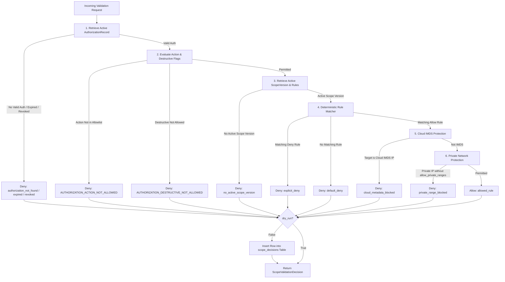

# VulnOS Phase 2.5.6 — Scope Validation Engine & Decision Auditing

**Date:** 2026-11-02  
**Milestone:** P2.5.6 — Scope Validation Endpoint & Audit Pipeline  
**Status:** Complete  

---

## 1. Executive Summary

The **Scope Validation Engine** (`POST /projects/{project_id}/scope/validate`) provides the central, authoritative decision boundary that determines whether a planned operation on a network destination is authorized.

It evaluates requests against four cascading layers:
1. **Legal Authorization Layer:** Verified via `AuthorizationRecord`.
2. **Operational Scope Layer:** Evaluated via the active `ScopeVersion` and `match_scope_rules`.
3. **Hard Fail-Closed Cloud IMDS Protection:** Cloud provider metadata services (`169.254.169.254`, etc.) are non-overridable and rejected under all circumstances.
4. **Private Network Boundaries:** RFC 1918, link-local, and loopback ranges require explicit permission (`allow_private_ranges=True` on the authorization record).

---

## 2. Evaluation Pipeline Architecture



---

## 3. Decision Reason Codes

| Reason Code | Category | Meaning |
| :--- | :--- | :--- |
| `allowed_rule` | Permit | Operation authorized by active authorization record and matching allow rule. |
| `explicit_deny` | Scope | Operation explicitly excluded by a matching `deny` rule (overrides all allows). |
| `default_deny` | Scope | Target destination does not match any active scope allow rule. |
| `no_active_scope_version` | Policy | Project has no activated scope version with defined rules. |
| `authorization_not_found` | Legal | No valid, active authorization record exists for the project. |
| `AUTHORIZATION_EXPIRED` | Legal | Project authorization record validity window has lapsed (`valid_to < now`). |
| `AUTHORIZATION_REVOKED` | Legal | Project authorization record was explicitly revoked. |
| `AUTHORIZATION_ACTION_NOT_ALLOWED` | Legal | Operation action is not in the contractual `allowed_actions` set. |
| `AUTHORIZATION_DESTRUCTIVE_NOT_ALLOWED` | Legal | Planned operation is destructive, but authorization forbids state changes. |
| `cloud_metadata_blocked` | Security | Hard-blocked cloud instance metadata address (`169.254.169.254`). Non-overridable. |
| `private_range_blocked` | Security | Destination resolves to RFC 1918/link-local/loopback without private range grant. |

---

## 4. Append-Only `ScopeDecision` Audit Table

When `dry_run = False`, the engine records an authoritative audit record into the `scope_decisions` table:

```sql
CREATE TABLE scope_decisions (
    id BIGINT GENERATED ALWAYS AS IDENTITY,
    project_id UUID NOT NULL REFERENCES projects(id),
    scan_id UUID REFERENCES scans(id),
    scope_version_id UUID NOT NULL REFERENCES scope_versions(id),
    authorization_id UUID NOT NULL REFERENCES authorization_records(id),
    subject TEXT NOT NULL,
    method TEXT,
    allowed BOOLEAN NOT NULL,
    reason_code TEXT NOT NULL,
    matched_rule_id UUID REFERENCES scope_rules(id),
    resolved_ips INET[] NOT NULL DEFAULT '{}',
    policy_hash BYTEA NOT NULL,
    decided_at TIMESTAMPTZ NOT NULL DEFAULT now(),
    context JSONB NOT NULL DEFAULT '{}',
    PRIMARY KEY (id, decided_at)
) PARTITION BY RANGE (decided_at);
```

Every network probe, scan, or autonomous tool execution in future phases will reference a recorded `ScopeDecision` proving that the operation was authorized and legally cleared at the moment of execution.
