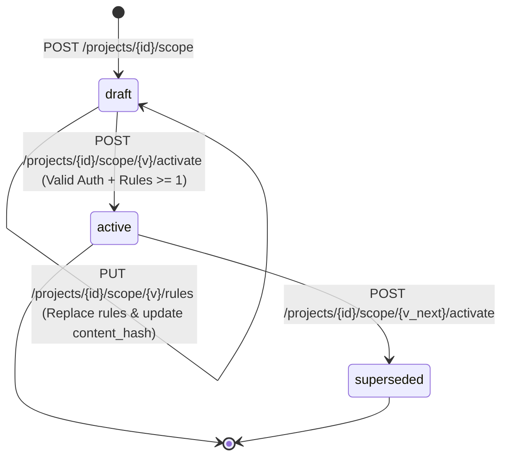

# VulnOS Phase 2.5.6 — Scope Versioning & Lifecycle Architecture

**Date:** 2026-11-02  
**Milestone:** P2.5.6 — Scope Versioning, Rule CRUD, Activation & Validation Endpoint  
**Status:** Complete  

---

## 1. Executive Summary

Milestone **P2.5.6** delivers the lifecycle and version management system for `ScopeVersion` and `ScopeRule`, completing Phase 2.5 ("Target Management, Authorization Records, Scope Rules & Deterministic Scope Validation").

In VulnOS, network operations (scans, crawling, fuzzing, probes, autonomous agents) are never permitted against an ad-hoc or unversioned scope. All operational activities must execute strictly within an immutable, cryptographically hashed, and activated **Scope Version**.

---

## 2. Critical Security Invariants

1. **Non-Authorization Boundary:**
   > A target seed is discovery data. A project membership is access to management. An allow rule is a syntax pattern.
   > **Only an active `ScopeVersion` bound to an unexpired, unrevoked `AuthorizationRecord` can permit network testing.**

2. **Immutable Active Scope:**
   > Once a `ScopeVersion` transitions to `active` or `superseded`, its rules, priorities, match types, port ranges, and protocols are **permanently frozen and immutable**.
   > Any attempt to modify rules on an active or superseded version is rejected with HTTP 409 Conflict (`ScopeVersionImmutableError`).

3. **Single Active Version Per Project:**
   > At any given instant, **at most one** scope version can have `status = 'active'` for a given project.
   > Activation of a new draft scope version atomically marks the previously active version as `superseded` and records `superseded_at`.

4. **Activation Gates:**
   > Activating a scope version strictly requires:
   > 1. Status is currently `draft` (400 if already active/superseded).
   > 2. The version contains at least one rule (400 if empty).
   > 3. The associated `AuthorizationRecord` exists, is within its validity window (`valid_from <= now <= valid_to`), and has not been revoked (422 if invalid).

5. **Deterministic Content Hashing:**
   > Every scope version computes a SHA-256 digest over its rules.
   > The rules are canonicalized into normalized dictionaries and deterministically sorted before serialization to canonical JSON and hashing.
   > Rule order on input cannot alter the content hash.

---

## 3. Scope Version Lifecycle State Machine



### State Definitions

| State | Modifiable? | Can Authorize Requests? | Notes |
| :--- | :--- | :--- | :--- |
| `draft` | **Yes** (PUT rules) | **No** | Newly created version. Rules can be defined, updated, and replaced. |
| `active` | **No** (Immutable) | **Yes** | Exactly one per project. Authoritative rule set for all project scans. |
| `superseded` | **No** (Immutable) | **No** | Historical audit snapshot. Preserved for past scan attribution. |

---

## 4. Canonical Content Hash Computation

The content hash is computed over all rules in the version using canonical serialization:

```python
def compute_scope_content_hash(rules: Sequence[...]) -> bytes:
    # 1. Normalize and serialize each rule into a uniform dictionary
    # 2. Sort deterministically by (effect, -priority, match_type, value, protocols, ports)
    # 3. Canonical JSON dumps (separators=(',', ':'), sort_keys=True)
    # 4. SHA-256 digest
    return hashlib.sha256(canonical_json.encode('utf-8')).digest()
```

This guarantees:
- **Zero order dependence:** Shuffled inputs produce identical hashes.
- **Tamper evidence:** Modifying any rule attribute (ports, protocols, priority, note) alters the hash.
- **Audit integrity:** Stored as `bytea` in PostgreSQL and exposed as a 64-character lowercase hex string over API contracts.

---

## 5. API Endpoints

| Method | Path | Required Role | Required Scope | Description |
| :--- | :--- | :--- | :--- | :--- |
| `POST` | `/projects/{project_id}/scope` | `admin` | `admin` | Create a draft scope version bound to an authorization record. |
| `GET` | `/projects/{project_id}/scope` | `viewer` | `read` | List paginated scope versions ordered by `version DESC`. |
| `GET` | `/projects/{project_id}/scope/{version_id}` | `viewer` | `read` | Get single scope version with rules eagerly loaded. |
| `PUT` | `/projects/{project_id}/scope/{version_id}/rules` | `admin` | `admin` | Replace all rules on a `draft` version. |
| `POST` | `/projects/{project_id}/scope/{version_id}/activate` | `admin` | `admin` | Activate draft version with legal consent verification. |
| `POST` | `/projects/{project_id}/scope/validate` | `operator` | `scan` | Validate a target destination against authorization and scope. |

---

## 6. Audit & Traceability

Every scope version lifecycle operation writes an append-only audit event to `audit_logs`:
- `scope_version.create`: Logs version number and bound `authorization_id`.
- `scope_rules.replace`: Logs updated rule count and new `content_hash`.
- `scope_version.activate`: Logs activated version ID, `content_hash`, and the ID of the superseded version.
