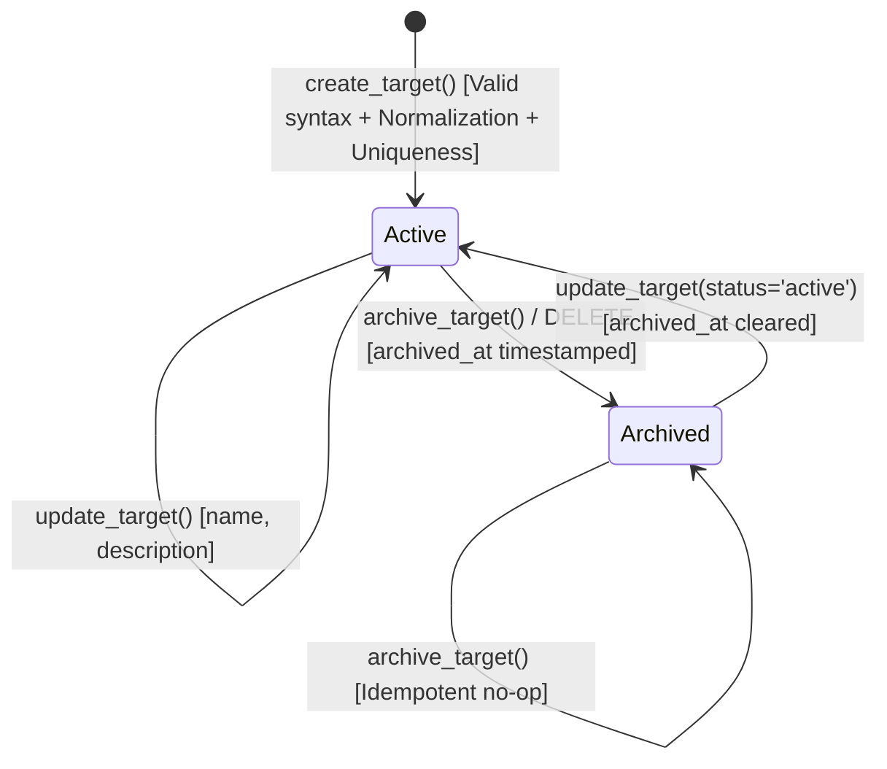

# VulnOS Phase 2.5.3 — Target Management Service Design

## 1. Architectural Purpose & Security Boundaries

The **Target Management Service** (`backend/app/scope/targets.py`) manages discovery seeds for projects within VulnOS.

### Critical Architectural Invariant

> **A target is a discovery seed, not an authorization permit.**

Registering a target into VulnOS indicates an asset of interest for discovery, asset graph mapping, and scope modeling. It confers **zero authority to execute active operations**.

Creating, updating, or archiving a target must **never**:
- Create an `AuthorizationRecord`.
- Create a `ScopeRule`.
- Create or activate a `ScopeVersion`.
- Grant permission to scan, crawl, probe, or fuzz.
- Bypass the scope validator.

Every network operation, crawler request, scanner stage, and autonomous agent action must independently pass through the deterministic scope validation pipeline against an explicitly authorized, active scope version before network packets are dispatched.

---

## 2. Multi-Tenant Isolation & Authorization Model

VulnOS enforces defense-in-depth isolation across all target operations:

```
[ Incoming HTTP Request ]
           │
           ▼
[ AuthenticatedPrincipal ] (Bearer JWT or API Key)
           │
           ▼
[ verify_project_access() ]
   ├── Checks project exists & status == 'active'
   ├── Checks user is active ProjectMember
   │     └── Non-members receive 404 (Prevents project enumeration)
   ├── Enforces Role Hierarchy (viewer < operator < admin < owner)
   └── Validates API Key Scopes ('read' for GET, 'admin' for POST/PATCH/DELETE)
           │
           ▼
[ set_tenant_context() ]
   └── Transaction-local PostgreSQL RLS context established:
       SET LOCAL app.current_project_id = :project_id;
           │
           ▼
[ Target Service & Database Execution ]
   ├── RLS Policy: targets.project_id = current_project_id()
   └── Unique Constraint: (project_id, seed_type, seed_value)
```

---

## 3. Supported Seed Types & Normalization Pipeline

Target creation mandates validation through the deterministic normalization service (`backend/app/scope/normalization.py`):

| Seed Type (`TargetType`) | Canonicalization Pipeline | Constraints & Invariants |
| :--- | :--- | :--- |
| `domain` | Lowercase folding, trailing dot removal, IDNA UTS #46 Punycode conversion. | RFC 1035/1123 syntax, label bounds 1-63, total length $\le 253$, min 2 labels. Wildcards rejected. |
| `host` | Canonical hostname or IP address. | Single-label intranet hosts permitted ($\ge 1$ label). |
| `ip` | IPv4 decimal or IPv6 RFC 5952 zero-compressed. | Dual-stack `::ffff:x.x.x.x` unpacked to IPv4. Strict CIDR network parsing (host bits rejected). Cloud metadata addresses classified. |
| `url` | Scheme restriction (`http`/`https`), default port stripping (`:80`, `:443`), RFC 3986 dot-segment canonicalization, query param sorting, fragment stripping. | Embedded credentials (`user:pass@`) strictly rejected. Port bounds 1-65535. |
| `api_base` | Root API base endpoint. Trailing slash removed. | Query parameters and fragments strictly rejected. |
| `repository` | Git source repository. Transcodes SSH (`git@host:owner/repo`) to HTTPS; strips `.git` suffix. | Non-standard git schemes rejected. |

---

## 4. Target Lifecycle & Immutability Rules



### Immutability Invariants
1. `id`: Immutable UUIDv7 generated server-side.
2. `project_id`: Strictly immutable. A target cannot be transferred between projects.
3. `seed_type` & `seed_value`: Strictly immutable on existing targets. If an operator requires a different target value or type, they must create a new target. This preserves historical provenance and audit integrity.
4. Soft-delete only: `DELETE` operations transition target to `archived` status with `archived_at` timestamp. Historical discovery records and audit logs are never orphaned.

---

## 5. API Contracts & Error Specifications

All endpoints are mounted on `api_v1_router` under `/api/v1`:

### Endpoint Matrix

| Method | Route | Min Role | API Key Scope | Purpose | Success Code |
| :--- | :--- | :--- | :--- | :--- | :--- |
| `POST` | `/projects/{project_id}/targets` | `admin` | `admin` | Add normalized target seed | `201 Created` |
| `GET` | `/projects/{project_id}/targets` | `viewer` | `read` | List project target seeds (paginated) | `200 OK` |
| `GET` | `/projects/{project_id}/targets/{target_id}` | `viewer` | `read` | Retrieve single target seed | `200 OK` |
| `PATCH` | `/projects/{project_id}/targets/{target_id}` | `admin` | `admin` | Update name, description, or status | `200 OK` |
| `DELETE` | `/projects/{project_id}/targets/{target_id}` | `admin` | `admin` | Archive (soft-delete) target seed | `200 OK` |

### Error Model Compliance

All errors conform to Section 5 of `docs/architecture/API_CONTRACTS.md`:

| Error Code | HTTP Status | Trigger Condition |
| :--- | :--- | :--- |
| `validation_error` | 400 | Malformed seed syntax, invalid port, embedded credentials in URL, disallowed schemes. |
| `unauthenticated` | 401 | Missing, malformed, or expired Bearer JWT / API key. |
| `forbidden` | 403 | Insufficient RBAC role (e.g. Viewer attempting POST/PATCH/DELETE) or insufficient API key scope. |
| `not_found` | 404 | Project does not exist, user is not a project member (prevents existence enumeration), or target does not exist in project. |
| `conflict` | 409 | Duplicate normalized seed already exists in project (`uq_targets_project_seed_type_value`). |

---

## 6. Append-Only Audit Logging

Every target mutation is recorded in the immutable `audit_logs` table:

```python
AuditLog(
    action="target.create" | "target.update" | "target.archive",
    actor_type="user",
    actor_id=str(user_id),
    project_id=project_id,
    entity_type="target",
    entity_id=str(target.id),
    ip=client_ip,
    user_agent=user_agent,
    request_id=request_id,
    metadata_={
        # target.create: captures raw_input, normalized seed_value, seed_type, name
        # target.update: captures field-level old/new diffs
        # target.archive: captures previous status
    }
)
```

---

## 7. Verification Matrix & Quality Gates

### Unit & Security Test Coverage

| Test File | Test Count | Focus Areas | Status |
| :--- | :--- | :--- | :--- |
| [`test_targets.py`](file:///C:/Users/varsh/.gemini/antigravity/scratch/vulnos/backend/tests/security/scope/test_targets.py) | 16 | Normalization during creation, duplicate prevention, cross-project isolation, listing/filtering/pagination, metadata updates, idempotent archiving, audit logs, and critical non-authorization invariants. | **PASSED** |
| [`test_target_endpoints.py`](file:///C:/Users/varsh/.gemini/antigravity/scratch/vulnos/backend/tests/security/scope/test_target_endpoints.py) | 11 | HTTP contracts, role hierarchy (admin vs viewer), non-member 404 enumeration mitigation, 400/409 error mappings, cross-project URL traversal prevention, and API key scopes (`read` vs `admin`). | **PASSED** |
| [`test_normalization.py`](file:///C:/Users/varsh/.gemini/antigravity/scratch/vulnos/backend/tests/security/scope/test_normalization.py) | 51 | Target normalization, IDNA UTS #46, IPv6 RFC 5952, SSRF classification, and cloud metadata hard-blocking. | **PASSED** |

### Quality Gate Summary
- **Linter (`ruff check .`):** 100% clean (0 errors).
- **Formatter (`ruff format --check .`):** 100% clean (78 files formatted).
- **Type Checker (`mypy backend tests`):** 100% clean (0 errors across 75 source files).
- **Full Test Suite (`pytest -v`):** **324 passed in 6.75s** (0 failures).
