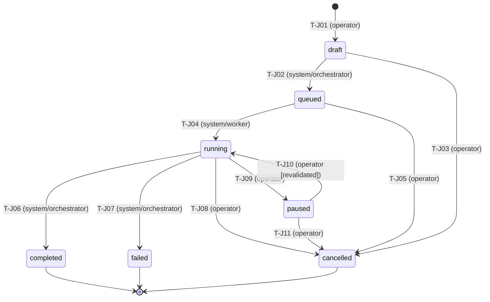

# VulnOS — P3.1.3.3 Reconnaissance Job Lifecycle Design
## Deterministic State Machine, Concurrency Control & Legal Validation

**Date:** 2026-11-02  
**Milestone:** P3.1.3.3  
**Status:** Canonical Implementation Document  
**Module:** `backend/app/recon/lifecycle.py`  
**Test Suite:** `backend/tests/security/recon/test_job_lifecycle.py` (20 passing tests)

---

## 1. Executive Summary

Milestone **P3.1.3.3** implements the deterministic, transactional lifecycle state machine for VulnOS reconnaissance jobs.

Reconnaissance jobs represent coarse-grained security campaigns (such as DNS discovery, HTTP asset enumeration, and certificate transparency scraping) initiated across one or more authorized target roots. In the canonical database schema, these jobs are persisted in the `scans` table and represented by the SQLAlchemy `Scan` model (`scan_type='recon'`).

To guarantee zero scope escape, rigorous legal compliance, and reliable distributed execution, the job lifecycle service enforces:
1. **Explicit, Validated State Transitions:** Only permitted transitions in the directed graph are allowed. Any invalid or terminal-reactivation transition fails closed.
2. **PostgreSQL Concurrency Safety:** Every lifecycle transition executes inside a transaction acquiring an explicit row lock via `SELECT ... FOR UPDATE` before evaluating state or mutating records.
3. **Execution Context Immutability:** Once a job leaves `draft` status (i.e., enters `queued`, `running`, `paused`, or any terminal state), critical security parameters (`target_ids`, `scope_version_id`, `authorization_id`, and `budget`) are strictly immutable.
4. **Server-Controlled Timestamps:** Timestamps (`started_at`, `finished_at`, `cancel_requested_at`) are generated exclusively by trusted backend logic in UTC and can never be supplied or forged by API clients.
5. **Fail-Closed Legal Authorization Revalidation:** Before unpausing a paused job (`paused -> running`), the service re-verifies that the pinned `AuthorizationRecord` is present, not revoked, and within its active UTC validity window.
6. **Append-Only Audit Logging:** Every transition and cancel request emits an immutable `AuditLog` record conforming to PostgreSQL database constraints (`ck_audit_logs_actor_type`).

---

## 2. Reconnaissance Job State Machine

The job state machine operates on `Scan.status`, which is constrained by PostgreSQL check constraint `ck_scans_status`:
```sql
CHECK (status IN ('draft', 'queued', 'running', 'paused', 'completed', 'failed', 'cancelled'))
```



### 2.1 Transition Specifications

| Transition | From State | To State | Permitted Actors | Preconditions & Validation Rules | Side Effects & Timestamps | Audit Event |
|---|---|---|---|---|---|---|
| **T-J01** | `[*] / None` | `draft` | `operator`, `admin`, `owner` | Scan schema validated; project isolation verified. | `created_at = utc_now()` | `recon_job.created` |
| **T-J02** | `draft` | `queued` | `system` | Targets owned by project; pinned authorization active; scope version active; pre-dispatch gate passes. | Immutable fields locked | `recon_job.queued` |
| **T-J03** | `draft` | `cancelled` | `operator`, `admin`, `owner`, `system` | Job is in `draft` state. | `cancel_requested_at`, `finished_at` | `recon_job.cancelled` |
| **T-J04** | `queued` | `running` | `system` | Worker claims first task lease from queue. | `started_at = utc_now()` | `recon_job.started` |
| **T-J05** | `queued` | `cancelled` | `operator`, `admin`, `owner`, `system` | Job is in `queued` state. | `cancel_requested_at`, `finished_at` | `recon_job.cancelled` |
| **T-J06** | `running` | `completed` | `system` | All planned child tasks terminal; at least 1 task succeeded; 0 unrecoverable fatal errors. | `finished_at = utc_now()`, stats updated | `recon_job.completed` |
| **T-J07** | `running` | `failed` | `system` | Fatal execution error, unrecoverable worker failure, or timeout. | `finished_at = utc_now()`, `failure_reason` | `recon_job.failed` / `recon_job.timed_out` |
| **T-J08** | `running` | `cancelled` | `operator`, `admin`, `owner`, `system` | Cancellation requested while workers are executing. | `cancel_requested_at`, `finished_at` | `recon_job.cancelled` |
| **T-J09** | `running` | `paused` | `operator`, `admin`, `owner` | Operator requests temporary execution pause. | Queued task dispatch paused | `recon_job.paused` |
| **T-J10** | `paused` | `running` | `operator`, `admin`, `owner` | Pinned `AuthorizationRecord` unrevoked and active; `ScopeVersion` valid. | Queue resumed | `recon_job.resumed` |
| **T-J11** | `paused` | `cancelled` | `operator`, `admin`, `owner`, `system` | Job is in `paused` state. | `cancel_requested_at`, `finished_at` | `recon_job.cancelled` |

### 2.2 Terminal Invariance
States `completed`, `failed`, and `cancelled` are strictly terminal.
Attempting to transition out of any terminal state raises `ReconJobAlreadyTerminalError` and is fail-closed. Re-activating a completed, failed, or cancelled job is strictly forbidden to preserve historical evidence integrity and audit fidelity.

---

## 3. Concurrency Control & Row-Level Locking

In high-concurrency environments with distributed Celery workers and multiple operator sessions, race conditions can occur if state transitions are not serialized.

The transition service implements PostgreSQL pessimistic row-level locking:
```python
stmt = select(Scan).where(
    Scan.id == scan_id,
    Scan.project_id == project_id
).with_for_update()

scan = db.scalar(stmt)
if scan is None:
    raise ReconJobNotFoundError(...)
```

### Invariants Guaranteed by Row-Level Locking:
1. **Re-Verification Under Lock:** Even if an in-memory object had status `'running'`, the database row is locked and re-checked under the lock before evaluating transition validity.
2. **Duplicate Prevention:** Two concurrent worker completion signals or an operator cancel racing against a completion cannot both succeed. One will acquire the lock first, update the row to terminal, and commit. The second will acquire the lock, discover the job is already terminal, and raise `ReconJobAlreadyTerminalError` (or return idempotently if cancelled).
3. **Cross-Project Isolation:** The query filters on `Scan.project_id == project_id` under the lock, ensuring cross-tenant lookups fail with `ReconJobNotFoundError` without leaking record existence.

---

## 4. Execution Context Immutability

Reconnaissance execution contracts require that once a job has been queued or started, its security parameters can never be modified. Modifying targets, scopes, or authorization permits in-flight would create time-of-check to time-of-use (TOCTOU) vulnerabilities.

The function `assert_scan_context_immutable(scan, updates)` enforces this invariant:
```python
IMMUTABLE_SCAN_FIELDS = frozenset({
    "target_ids",
    "scope_version_id",
    "authorization_id",
    "budget",
})
```

- When `scan.status == 'draft'`, modifications to these fields are permitted.
- When `scan.status in ('queued', 'running', 'paused', 'completed', 'failed', 'cancelled')`, modifying any of these fields immediately raises `ReconJobContextImmutableError`.

---

## 5. Server-Controlled Timestamps

Clients and external workers are untrusted and must never supply timestamps.

The lifecycle service governs three critical server timestamps:
1. `started_at`: Recorded on first transition from `queued` to `running`. Once set, it is never overwritten on subsequent pause/resume cycles.
2. `finished_at`: Set when entering any terminal state (`completed`, `failed`, `cancelled`). Cleared if unpausing.
3. `cancel_requested_at`: Set immediately when `request_scan_cancellation()` is called, establishing the exact moment the operator issued the command for SLA and worker drain tracking.

All timestamps are enforced in UTC using `datetime.now(timezone.utc)`.

---

## 6. Edge Cases & Specialized Transitions

### 6.1 Partial Completion
When some reconnaissance stages or tasks succeed while non-critical optional stages fail or are skipped, the job should not fail completely, nor should it claim 100% flawless success.

**Schema-Compliant Solution:**
- `Scan.status` is set to `'completed'`.
- `Scan.stats["partially_completed"]` is set to `True`.
- The child `ScanStageRun.status` is set to `'partial'` (supported by `ck_scan_stage_runs_status`).
- Audit log records `"partially_completed": True` in metadata.

### 6.2 Timeout Failure
When an in-flight job exceeds its execution budget or wall-clock timeout:
- `Scan.status` transitions from `'running'` to `'failed'`.
- `Scan.stats["failure_reason"]` is set to `'timeout'`.
- An audit record with action `recon_job.timed_out` is appended.

### 6.3 Idempotent Cancellation
- Calling `request_scan_cancellation()` on a job already in `cancelled` status is an idempotent no-op and returns the scan without error or duplicate audit events.
- Calling cancellation on a job in `completed` or `failed` status raises `ReconJobAlreadyTerminalError`.

### 6.4 Pause and Resume with Legal Revalidation
An operator can pause a running job (`running -> paused`).
Before resuming (`paused -> running` via `resume_scan()`):
1. Pinned `AuthorizationRecord` must still exist in the database.
2. `AuthorizationRecord.revoked_at` must be `None`. If revoked, `ReconJobAuthorizationInvalidError` is raised.
3. Current UTC timestamp must satisfy `valid_from <= now <= valid_to`. If expired or not yet valid, `ReconJobAuthorizationInvalidError` is raised.
4. Pinned `ScopeVersion` must still exist. If missing, `ReconJobScopeInvalidError` is raised.

---

## 7. Append-Only Audit Logging

Every lifecycle transition and cancellation request inserts a record into `audit_logs` before transaction commit:
- `action`: Specific to the transition (e.g., `recon_job.started`, `recon_job.completed`, `recon_job.paused`, `recon_job.resumed`, `recon_job.cancel_requested`).
- `actor_type`: Mapped to satisfy `ck_audit_logs_actor_type` (`'user'`, `'api_key'`, `'system'`, `'worker'`, `'model'`). When user roles (`'operator'`, `'admin'`, `'owner'`) are supplied, they are stored as `actor_type='user'` with `"actor_role": actor_type` captured in `metadata_`.
- `project_id`, `entity_type="scan"`, `entity_id=str(scan.id)`, `ip`, `user_agent`, `request_id`.
