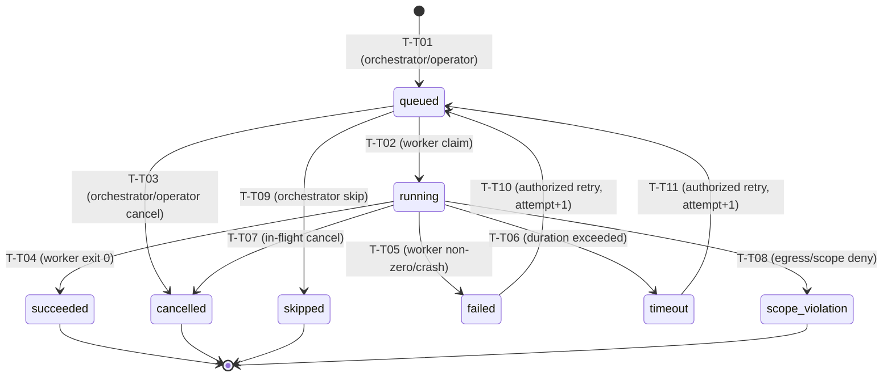

# VulnOS — P3.1.3.4.2 Pure ToolExecution Transition Validator
## Deterministic, Side-Effect-Free Task State Machine & Authorization Engine

**Date:** 2026-11-02  
**Milestone:** P3.1.3.4.2  
**Status:** Implemented & Verified (Pure Validator Unit Tests Passing)  
**Module:** `backend/app/recon/task_lifecycle.py`  
**Test Suite:** `backend/tests/security/recon/test_tool_execution_transition_validator.py` (20 passing tests)

---

## 1. Objective & Scope

Milestone **P3.1.3.4.2** implements the pure, deterministic state transition validator for individual `ToolExecution` records:
`validate_tool_execution_transition(...)`

In strict compliance with the architectural contract:
- **Zero Side-Effects:** No database queries, no SQLAlchemy sessions, no Redis interactions, no network requests, no audit writes.
- **Zero Internal Timestamps:** Timestamps are managed exclusively by subsequent transactional services.
- **Zero Mutation:** The input parameters and `context` dictionary are strictly immutable.
- **Deterministic Outcome:** Evaluates inputs using pure boolean logic and raises typed, granular exceptions on violations.

---

## 2. Implemented Transition Matrix

The validator governs all transitions across the 8 statuses defined in PostgreSQL constraint `ck_tool_executions_status`:
`'queued'`, `'running'`, `'succeeded'`, `'failed'`, `'timeout'`, `'cancelled'`, `'skipped'`, `'scope_violation'`.

### 2.1 Complete Transition Specifications

| Transition ID | Current Status | Requested Status | Permitted Actors | Preconditions & Requirements | Error on Violation |
|---|---|---|---|---|---|
| **T-T01** | `None` | `queued` | `orchestrator`, `system`, `operator`, `admin`, `owner` | Task creation. Parent Scan in `draft`, `queued`, or `running`. | `ReconTaskInvalidActorError`, `ReconTaskParentStateInvalidError` |
| **T-T02** | `queued` | `running` | `worker`, `orchestrator`, `system` | Worker lease claim. Requires non-empty `worker_id` in context. Parent Scan in `queued` or `running`. | `ReconTaskInvalidActorError`, `ReconTaskParentStateInvalidError` |
| **T-T03** | `queued` | `cancelled` | `orchestrator`, `system`, `operator`, `admin`, `owner` | Cancellation prior to claim. Parent Scan not terminal. | `ReconTaskInvalidActorError`, `ReconTaskParentStateInvalidError` |
| **T-T04** | `running` | `succeeded` | `worker`, `orchestrator`, `system` | Task successful. If worker: requires `worker_id` and positive integer `attempt` in context. Parent Scan in `running` or `paused`. | `ReconTaskInvalidAttemptError`, `ReconTaskParentStateInvalidError` |
| **T-T05** | `running` | `failed` | `worker`, `orchestrator`, `system` | Non-zero exit code or container crash. If worker: requires `worker_id` and `attempt` in context. Parent Scan in `running` or `paused`. | `ReconTaskInvalidAttemptError`, `ReconTaskParentStateInvalidError` |
| **T-T06** | `running` | `timeout` | `timeout_controller`, `orchestrator`, `system` | Duration exceeded wall-clock timeout. Parent Scan in `running` or `paused`. | `ReconTaskInvalidActorError`, `ReconTaskParentStateInvalidError` |
| **T-T07** | `running` | `cancelled` | `orchestrator`, `system`, `operator`, `admin`, `owner` | Cooperative or forced cancellation during execution. | `ReconTaskInvalidActorError`, `ReconTaskParentStateInvalidError` |
| **T-T08** | `running` | `scope_violation` | `scope_enforcement`, `orchestrator`, `system` | Runtime egress proxy or scope validator denied outbound destination. | `ReconTaskInvalidActorError`, `ReconTaskParentStateInvalidError` |
| **T-T09** | `queued` | `skipped` | `orchestrator`, `system` | Upstream DAG dependency failed or missing. Parent Scan in `draft`, `queued`, or `running`. | `ReconTaskInvalidActorError`, `ReconTaskParentStateInvalidError` |
| **T-T10** | `failed` | `queued` | `orchestrator`, `system`, `operator`, `admin`, `owner` | Explicit retry: requires `is_retry=True` and valid `attempt < max_attempts`. Parent Scan must be `running`. | `ReconTaskRetryNotAllowedError`, `ReconTaskInvalidAttemptError` |
| **T-T11** | `timeout` | `queued` | `orchestrator`, `system`, `operator`, `admin`, `owner` | Explicit retry: requires `is_retry=True` and valid `attempt < max_attempts`. Parent Scan must be `running`. | `ReconTaskRetryNotAllowedError`, `ReconTaskInvalidAttemptError` |

---

## 3. Actor Permission Categorization

Actors are categorized into explicit domains:
1. `ORCHESTRATOR_ACTORS = {'orchestrator', 'system'}`: Automated platform controllers.
2. `OPERATOR_ACTORS = {'operator', 'admin', 'owner'}`: Authenticated human operators.
3. `WORKER = 'worker'`: Untrusted container / worker nodes executing tools.
4. `TIMEOUT_CONTROLLER = 'timeout_controller'`: Dedicated watchdog process reaping timed-out tasks.
5. `SCOPE_ENFORCEMENT = 'scope_enforcement'`: Trusted egress proxy or scope validation engine.

### Strict Worker Privilege Boundaries
Workers are strictly untrusted and **forbidden** from:
- Creating tasks (`None -> queued`).
- Cancelling tasks (`queued -> cancelled`, `running -> cancelled`).
- Skipping tasks (`queued -> skipped`).
- Initiating retries (`failed -> queued`, `timeout -> queued`).
- Triggering timeout or scope violation transitions.
Workers can only claim leases (`queued -> running`) and report outcomes (`running -> succeeded`, `running -> failed`) for their assigned tasks.

---

## 4. Terminal-State & Retry Rules

### 4.1 Permanently Terminal States
States `succeeded`, `cancelled`, and `skipped` are permanently terminal. Attempting to transition out of these states raises `ReconTaskTerminalStateError`.

### 4.2 Non-Retryability of Scope Violations
Status `scope_violation` is **permanently non-retryable**.
Attempting to transition or retry a task with `status == 'scope_violation'` immediately raises `ReconTaskRetryNotAllowedError`. This invariant guarantees that a container attempting to reach an out-of-scope host, IP, or cloud IMDS cannot be repeatedly dispatched or hammer unapproved networks.

### 4.3 Explicit Retry Requirements
Transitioning from `failed` or `timeout` to `queued` represents a retry. To prevent normal transitions from accidentally becoming retries:
1. The caller **must** pass an explicit retry context: `context={"is_retry": True}`. If missing or `False`, `ReconTaskRetryNotAllowedError` is raised.
2. If `attempt` is provided, it must be a positive integer (`attempt >= 1`).
3. If `attempt >= max_attempts` (default: 3), `ReconTaskRetryNotAllowedError` is raised.
4. Attempting `is_retry=True` on non-retryable states (`succeeded`, `cancelled`, `skipped`, `running`, `queued`) is strictly rejected.

---

## 5. Parent Scan State Policy

The pure validator verifies parent Scan status when provided as an input parameter:

| Task Operation | Permitted Parent Scan Statuses | Prohibited Parent Scan Statuses |
|---|---|---|
| **Scheduling** (`None -> queued`) | `draft`, `queued`, `running` | `paused`, `completed`, `failed`, `cancelled` |
| **Claiming / Start** (`queued -> running`) | `queued`, `running` | `draft`, `paused`, `completed`, `failed`, `cancelled` |
| **Completion** (`running -> succeeded/failed/timeout/scope_violation`) | `running`, `paused` (workers allowed to drain) | `draft`, `queued`, `completed`, `failed`, `cancelled` |
| **Cancellation** (`* -> cancelled`) | `draft`, `queued`, `running`, `paused`, `cancelled` | None |
| **Skipping** (`queued -> skipped`) | `draft`, `queued`, `running` | `paused`, `completed`, `failed`, `cancelled` |
| **Retry** (`failed/timeout -> queued`) | `running` (must be actively running) | `draft`, `queued`, `paused`, `completed`, `failed`, `cancelled` |

---

## 6. Pure Validator vs. Deferred Database Checks

To preserve architectural modularity, responsibilities are cleanly bifurcated:

| Check | Pure Validator (`validate_tool_execution_transition`) | Transactional Service (`P3.1.3.4.3+`) |
|---|---|---|
| Valid state graph edge | **Enforced** | Delegated to validator |
| Valid actor category | **Enforced** | Delegated to validator |
| Terminal invariance & scope violation non-retry | **Enforced** | Delegated to validator |
| Retry context presence (`is_retry=True`) | **Enforced** | Delegated to validator |
| Positive integer attempt validation | **Enforced** | Delegated to validator |
| Parent Scan state policy | **Enforced** (when provided) | Delegated to validator |
| Database record existence & row-level locking | *Deferred* | **Enforced via `with_for_update()`** |
| Task-to-project tenant isolation | *Deferred* | **Enforced via SQL & RLS** |
| Assigned worker identity match (`worker_id == db.worker_id`) | *Deferred* | **Enforced under lock** |
| Current attempt match (`attempt == db.attempt`) | *Deferred* | **Enforced under lock** |
| Atomic attempt counter increment (`db.attempt += 1`) | *Deferred* | **Enforced in retry service** |
| Append-only audit log insertion | *Deferred* | **Enforced in transaction** |

---

## 7. Known Contract Ambiguities & Clarifications

1. **Task Creation (`None -> queued`):**
   - *Design Decision:* Explicitly supported by the validator as transition T-T01. The task creation service will invoke this check to validate initial parameters and parent Scan state before persisting new rows.
2. **In-Flight Completion while Parent is Paused:**
   - *Contract Resolution:* Aligned with `P3_1_3_LIFECYCLE_GAP_ANALYSIS.md` Section 3.3. When an operator pauses a Scan, in-flight container workers are permitted to complete or drain cleanly. Thus, parent Scan status `paused` is permitted for `running -> succeeded/failed/timeout/scope_violation`.
