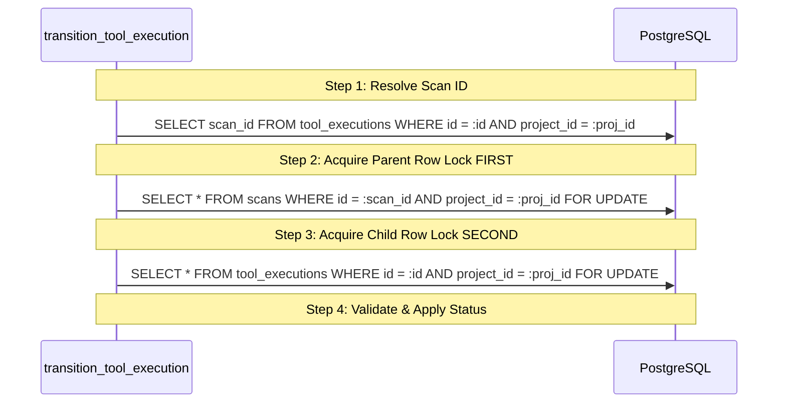

# VulnOS — P3.1.3.4.3 Transactional ToolExecution Lifecycle Service
## Concurrency-Safe State Management, Hierarchical Locking & Audit Guarantees

**Date:** 2026-11-02  
**Milestone:** P3.1.3.4.3  
**Status:** Implemented & Verified (All 20 Transactional Tests Passing)  
**Module:** `backend/app/recon/task_lifecycle.py`  
**Test Suite:** `backend/tests/security/recon/test_tool_execution_transactional_lifecycle.py` (20 passing tests)

---

## 1. Executive Summary

Milestone **P3.1.3.4.3** implements the transactional lifecycle service for existing `ToolExecution` records:
`transition_tool_execution(...)`

The service wires the pure transition validator (`validate_tool_execution_transition`) into a concurrency-safe database pipeline enforcing:
1. **Hierarchical Lock Ordering (Parent Scan FIRST, ToolExecution SECOND):** Eliminates deadlocks between concurrent scan cancellations and worker task updates.
2. **Tenant & Multitenant Isolation:** Resolves all entity queries under `project_id` tenant scoping and validates cross-project integrity triggers.
3. **Server-Controlled UTC Timestamps:** Sets `started_at` on lease start and `finished_at` upon terminal transitions, preventing timestamp forgery by untrusted workers.
4. **Append-Only Transactional Audit Logging:** Emits structured `AuditLog` events in the exact same transaction, rolling back task mutations if audit insertion fails.

---

## 2. Service Interface

```python
def transition_tool_execution(
    db: Session,
    project_id: UUID,
    execution_id: UUID,
    new_status: str,
    actor_id: str,
    actor_type: str = ACTOR_SYSTEM,
    reason: str | None = None,
    error_code: str | None = None,
    error_message: str | None = None,
    exit_code: int | None = None,
    worker_id: str | None = None,
    cost_usd: Decimal | None = None,
    stats: dict[str, Any] | None = None,
    coverage_summary: dict[str, Any] | None = None,
    ip_address: str | None = None,
    user_agent: str | None = None,
    request_id: str | None = None,
    correlation_id: str | None = None,
    evaluation_time: datetime | None = None,
    context: dict[str, Any] | None = None,
) -> ToolExecution:
```

### Supported Transitions
- `queued → running` (Worker claims task lease)
- `queued → cancelled` (Orchestrator or operator cancels)
- `running → succeeded` (Worker successful exit 0)
- `running → failed` (Worker non-zero exit code or container crash)
- `running → timeout` (Watchdog controller timeout reaping)
- `running → cancelled` (Cooperative or forced in-flight cancel)
- `running → scope_violation` (Egress guard / scope engine violation)
- `queued → skipped` (DAG upstream dependency failure)

---

## 3. Hierarchical Lock Ordering & Deadlock Prevention

In high-concurrency environments with distributed worker pools, acquiring locks in inconsistent order causes cyclic wait deadlocks (`AB-BA`).

### The Rule: Parent Scan First, Child ToolExecution Second
$$\text{Lock Acquisition Order}: \mathbf{Scan} \longrightarrow \mathbf{ToolExecution}$$



1. Query `tool_executions.scan_id` filtered strictly by `project_id`. If not found, immediately raise `ReconTaskNotFoundError`.
2. Acquire pessimistic lock on `Scan`:
   `SELECT * FROM scans WHERE id = :task_scan_id AND project_id = :project_id FOR UPDATE`
   If not found, raise `ReconJobNotFoundError`.
3. Acquire pessimistic lock on `ToolExecution`:
   `SELECT * FROM tool_executions WHERE id = :execution_id AND project_id = :project_id FOR UPDATE`
   If not found, raise `ReconTaskNotFoundError`.
4. Re-verify under lock: `task.scan_id == scan.id` and `task.project_id == project_id`.

---

## 4. Parent Scan State Compatibility

The service verifies task transitions against the locked parent `Scan.status`:

| Task Transition | Permitted Parent Scan States | Behavioral Rules |
|---|---|---|
| `queued -> running` | `queued`, `running` | Tasks cannot start on `draft`, `paused`, `completed`, `failed`, or `cancelled` Scans. Starting on paused Scan raises `ReconTaskParentStateInvalidError`. |
| `running -> succeeded/failed/timeout/scope_violation` | `running`, `paused` | In-flight container tasks are allowed to drain/finish cleanly when an operator pauses a Scan. Terminal Scans reject late completions. |
| `* -> cancelled` | `draft`, `queued`, `running`, `paused`, `cancelled` | Tasks can be cancelled at any point prior to terminal completion. |
| `queued -> skipped` | `draft`, `queued`, `running` | Dependency failures skip tasks during active pipeline execution. |

---

## 5. Server-Controlled Timestamps

External workers and API clients are untrusted. authoritative timestamps are set exclusively by the backend service:
- `started_at`: Set on transition to `running`. Once set, it cannot be overwritten by subsequent transitions or retries.
- `finished_at`: Set when entering any terminal state (`succeeded`, `failed`, `timeout`, `cancelled`, `scope_violation`, `skipped`).
- Invariance: If a transition is rejected or rolls back, neither `started_at` nor `finished_at` is mutated.

---

## 6. Audit Trail & Atomicity Guarantees

Every state change appends an immutable record to `audit_logs`:
- Actions emitted:
  - `recon_task.started`
  - `recon_task.succeeded`
  - `recon_task.failed`
  - `recon_task.timed_out`
  - `recon_task.cancelled`
  - `recon_task.scope_violation`
  - `recon_task.skipped`
- Actor Mapping:
  - Human roles (`operator`, `admin`, `owner`) map to database constraint `actor_type = 'user'` with the specific role stored in `metadata_["actor_role"]`.
  - Machine actors (`orchestrator`, `system`, `timeout_controller`, `scope_enforcement`) map to `actor_type = 'system'`.
  - Untrusted workers map to `actor_type = 'worker'`.
- Rollback Atomicity: `task` mutation and `AuditLog` are part of the same database transaction. If audit insertion fails, the entire transaction is rolled back, leaving `ToolExecution` in its previous state.

---

## 7. Deferred Functionality

In accordance with milestone scoping:
- **Worker Lease Claims & Token Validation:** Deferred to **P3.1.3.4.4**.
- **Worker Attempt Fencing & Stale Result Rejection:** Deferred to **P3.1.3.4.4**.
- **Retry Orchestration & Attempt Counter Mutation:** Deferred to **P3.1.3.4.5**.
- **Celery / Container Execution:** Deferred to future Phase 3 milestones.
