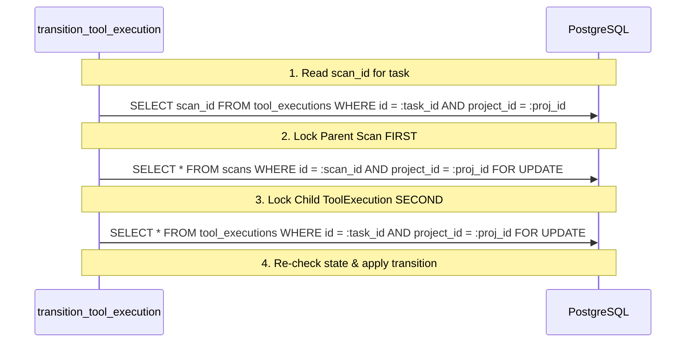

# VulnOS — P3.1.3.4.3 Transactional ToolExecution Lifecycle Audit
## Concurrency Architecture, Lock Ordering, Audit Integration & Implementation Plan

**Date:** 2026-11-02  
**Milestone:** P3.1.3.4.3  
**Status:** Pre-Implementation Architecture Audit  
**Author:** Principal Security Architect & Senior Python Backend Engineer  

---

## 1. Actual Transaction Boundaries & Session Conventions

In the VulnOS architecture:
1. **Session Lifecycle:** SQLAlchemy `Session` instances are injected by FastAPI dependency injection (`get_db` in `backend/app/db/session.py`) or instantiated in background worker/task harnesses.
2. **Transaction Ownership:** The service layer (`transition_tool_execution`) operates within the caller-provided database session. The service performs changes and calls `db.flush()`.
3. **Commit / Rollback Boundary:** 
   - A single transaction encapsulates both the model mutations (`ToolExecution`, timestamps, exit codes, telemetry) and the append-only `AuditLog` entry.
   - If audit persistence fails or any validation raises an exception, the caller or exception handler issues `db.rollback()`, ensuring atomicity.
   - No subtransactions, nested commits, or detached audit transactions are introduced.

---

## 2. Mandatory Hierarchical Lock Ordering

### 2.1 Deadlock Threat Analysis
In distributed execution, race conditions occur when:
- An operator cancels or pauses a parent `Scan` while a worker reports completion on a child `ToolExecution`.
- If Thread 1 locks `Scan` then attempts to inspect child tasks, while Thread 2 locks `ToolExecution` and attempts to verify the parent `Scan`, a cyclic wait deadlock (`AB-BA`) crashes the PostgreSQL backend.

### 2.2 Canonical Lock Hierarchy Rule
To mathematically eliminate deadlocks, strict hierarchical locking from DAG root to leaf is enforced:

$$\text{Lock Order}: \mathbf{Scan} \longrightarrow \mathbf{ToolExecution}$$



1. Query task's `scan_id` filtered strictly by `project_id`. If missing, fail closed with `ReconTaskNotFoundError`.
2. Acquire pessimistic row-level lock on `Scan`:
   ```sql
   SELECT * FROM scans WHERE id = :scan_id AND project_id = :project_id FOR UPDATE;
   ```
3. Acquire pessimistic row-level lock on `ToolExecution`:
   ```sql
   SELECT * FROM tool_executions WHERE id = :task_id AND project_id = :project_id FOR UPDATE;
   ```
4. Verify under lock that `task.scan_id == scan.id` and both belong to `project_id`.

---

## 3. Audit Event Schema & Actor Mapping

### 3.1 Audit Table Schema
Table: `audit_logs` (partitioned by range on `created_at`).
Constraint: `ck_audit_logs_actor_type IN ('user', 'api_key', 'system', 'worker', 'model')`.

### 3.2 Actor Mapping Table
| Lifecycle Actor (`actor_type`) | AuditLog `actor_type` | AuditLog `metadata_["actor_role"]` | Allowed Actions |
|---|---|---|---|
| `operator` | `'user'` | `'operator'` | Cancel, manual transition |
| `admin` | `'user'` | `'admin'` | Cancel, manual transition |
| `owner` | `'user'` | `'owner'` | Cancel, manual transition |
| `orchestrator` | `'system'` | `'orchestrator'` | Start, complete, fail, timeout, cancel, skip |
| `system` | `'system'` | `'system'` | Automated controller transitions |
| `worker` | `'worker'` | `'worker'` | Lease claim (`running`), complete (`succeeded`, `failed`) |
| `timeout_controller`| `'system'` | `'timeout_controller'` | Reaping (`timeout`) |
| `scope_enforcement` | `'system'` | `'scope_enforcement'` | Denial (`scope_violation`) |

### 3.3 Audit Actions Emitted
- `recon_task.started`
- `recon_task.succeeded`
- `recon_task.failed`
- `recon_task.timed_out`
- `recon_task.cancelled`
- `recon_task.scope_violation`
- `recon_task.skipped`

---

## 4. Server-Controlled Timestamp Semantics

External clients and distributed workers are untrusted and must never supply authoritative timestamps.

1. `started_at`:
   - Set to server UTC `now` on the initial transition from `queued` to `running`.
   - Once set, subsequent transitions or rejected operations never overwrite it.
2. `finished_at`:
   - Set to server UTC `now` upon reaching any terminal state:
     `succeeded`, `failed`, `timeout`, `cancelled`, `scope_violation`, `skipped`.
   - Cannot be overwritten once set.
3. Invariant: If a transition is rejected or rolls back, neither `started_at` nor `finished_at` is mutated.

---

## 5. Parent Scan State Compatibility & Invariants

| Requested Task Transition | Permitted Parent Scan States | Rationale & Behavioral Rules |
|---|---|---|
| `queued -> running` (claim) | `queued`, `running` | Tasks can only start if parent is ready or running. Starting a task on a `draft`, `paused`, or terminal Scan is rejected with `ReconTaskParentStateInvalidError`. |
| `queued -> cancelled` | `draft`, `queued`, `running`, `paused`, `cancelled` | Queued tasks can be cancelled during planning or execution. |
| `running -> succeeded` | `running`, `paused` | Workers in flight when a scan is paused are permitted to complete or drain cleanly. Terminal parent scans reject late completions. |
| `running -> failed` | `running`, `paused` | In-flight failure reporting allowed during active run or pause drain. |
| `running -> timeout` | `running`, `paused` | Timeout controller can reap in-flight tasks during active run or pause. |
| `running -> cancelled` | `draft`, `queued`, `running`, `paused`, `cancelled` | Running tasks can be cancelled at any point before completion. |
| `running -> scope_violation` | `running`, `paused` | Egress guard / scope engine can immediately terminate task on out-of-scope access. |
| `queued -> skipped` | `draft`, `queued`, `running` | Upstream dependency failure skips task during pipeline execution. |

### Reconciliation Confirmation
There is **zero conflict** between the pure validator `validate_tool_execution_transition()` implemented in P3.1.3.4.2 and the Scan lifecycle contracts.

---

## 6. Error & Rollback Behavior

- **Non-Existent Records:**
  - If `execution_id` does not exist or belongs to another tenant: raise `ReconTaskNotFoundError`.
  - If parent `scan_id` does not exist or belongs to another tenant: raise `ReconJobNotFoundError`.
  - No cross-tenant information is leaked through distinguishable messages.
- **State Invariants:**
  - Moving out of terminal states (`succeeded`, `cancelled`, `skipped`, `scope_violation`): raises `ReconTaskTerminalStateError`.
  - Violating transition graph: raises `ReconTaskInvalidTransitionError`.
  - Unauthorized actor: raises `ReconTaskInvalidActorError`.
  - Incompatible parent Scan state: raises `ReconTaskParentStateInvalidError`.
- **Atomic Rollback:**
  - If any validation fails or if `AuditLog` insertion raises an integrity error, the session is left uncommitted, guaranteeing that all dirty changes to `ToolExecution` are discarded upon rollback.

---

## 7. Required Security Test Suite (20 Tests)

File: `backend/tests/security/recon/test_tool_execution_transactional_lifecycle.py`

1. `test_transition_queued_to_running_success`
2. `test_transition_running_to_succeeded_success`
3. `test_transition_running_to_failed_success`
4. `test_transition_running_to_timeout_success`
5. `test_transition_queued_to_cancelled_success`
6. `test_transition_running_to_cancelled_success`
7. `test_transition_running_to_scope_violation_success`
8. `test_transition_queued_to_skipped_success`
9. `test_transition_invalid_edge_rejected`
10. `test_transition_terminal_state_immutability`
11. `test_transition_cross_project_task_access_rejected`
12. `test_transition_cross_tenant_isolation`
13. `test_transition_parent_scan_paused_permits_drain_completion`
14. `test_transition_parent_scan_paused_rejects_new_start`
15. `test_transition_parent_scan_terminal_rejects_completion`
16. `test_transition_draft_scan_scheduling_behavior`
17. `test_transition_server_timestamps_correctness`
18. `test_transition_rejected_preserves_original_timestamps`
19. `test_transition_audit_log_created_and_verified`
20. `test_transition_audit_write_failure_rolls_back_changes`
