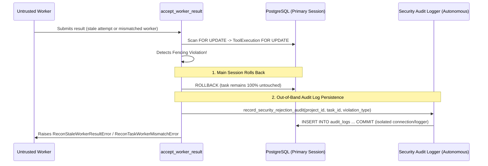

# VulnOS — P3.1.3.4.4 Worker Attempt Fencing, Lease Claiming & Stale Result Rejection Audit
## Pre-Implementation Architectural Analysis & Revised Fencing Contract Specification (Revision 2)

**Date:** 2026-11-02  
**Milestone:** P3.1.3.4.4.1  
**Status:** Pre-Implementation Specification (Revised with Mandatory Corrections)  
**Author:** Principal Security Architect & Senior Python Backend Engineer  
**Baseline Git Commit:** `c2e8bb72298e2a5f03716cf70da4d837a1a9ace8`  

---

## 1. Executive Summary & Audit Context

Milestone P3.1.3.4.3 established the transactional `ToolExecution` state machine and hierarchical lock ordering:

$$\mathbf{Scan}\;(\text{Parent Lock FIRST}) \longrightarrow \mathbf{ToolExecution}\;(\text{Child Lock SECOND})$$

In a distributed, asynchronous reconnaissance architecture, worker containers and the orchestrator operate across network boundaries. Network partitions, container crashes, timeout watchdogs, retried attempts, and message queue re-deliveries create concurrency and replay vulnerabilities:
1. A crashed or stalled worker may awaken after a newer attempt has started and submit stale results.
2. An expired worker may attempt to commit results after the orchestrator has already reaped the task.
3. A rogue or misconfigured worker could claim tasks assigned to other workers or submit across tenant boundaries.
4. Duplicate result deliveries may arrive from network retries.

This document establishes the **authoritative, fail-closed fencing contract** for Milestone P3.1.3.4.4, incorporating all 10 mandatory architectural corrections:
- **Mandatory lease token validation:** Every result submission must provide the raw lease token.
- **Cryptographic generation & one-way hash persistence:** Raw tokens are returned once to the claimant; only SHA-256 hashes are persisted in the database.
- **Strict monotonic attempt semantics:** Initial attempt = 1; only authorized retry transitions increment the counter. Claiming does not increment.
- **Server-side UTC clock with inclusive expiration:** Rejects results when `server_now >= lease_expires_at`.
- **Zero token exposure in logs and serializers:** Token material is excluded from API serializers, application logs, and audit metadata.
- **Separation of audit durability from task rollback:** Failed transactions roll back task state cleanly; rejection audits are isolated to preserve security telemetry without compromising database atomicity.
- **Cryptographic result fingerprinting for idempotency:** Duplicate submissions verify both `idempotency_key` and a deterministic SHA-256 result fingerprint.
- **Fixed-duration leases:** Leases are strictly non-renewable in this milestone.
- **Hierarchical DAG locking:** Immutable Scan $\rightarrow$ ToolExecution lock hierarchy.

---

## 2. Answers to the 10 Mandatory Architectural Questions

### Question 1: Is `attempt` already the authoritative fencing counter?
**Answer: YES, for generation fencing across retries.**  
In the PostgreSQL schema (`tool_executions` table, Alembic revision `0004`):
```python
attempt: Mapped[int] = mapped_column(Integer, nullable=False, default=1)
```
- Initial task scheduling sets `attempt = 1`.
- When a task fails or times out, an authorized retry (`T-T10: failed -> queued`, `T-T11: timeout -> queued`) increments `attempt = attempt + 1`.
- **Claiming a queued task does NOT increment `attempt`**; it binds to the current attempt.
- `attempt` is strictly monotonically increasing. Any submission bearing `submitted_attempt < db.attempt` is unequivocally obsolete and rejected.

### Question 2: Is `worker_id` sufficient to identify an executing worker, or is a separate lease token required?
**Answer: A separate cryptographic lease token is MANDATORY.**  
- `worker_id` identifies the worker container/host (e.g., `worker-recon-pod-7b9d-4`).
- If a worker crashes and restarts with the same static identifier on the same attempt, relying solely on `worker_id` could permit delayed message replay.
- Therefore, `claim_task_lease` generates a cryptographically secure 256-bit token (`secrets.token_urlsafe(32)`).
- The raw token is returned **only once** to the claimant in `TaskLeaseClaim`.
- **Only the SHA-256 hash** (`hashlib.sha256(token.encode()).hexdigest()`) is stored in `ToolExecution.stats["lease_token_hash"]`.
- `accept_worker_result` requires the raw token, hashes it, and verifies it against the stored hash using constant-time comparison (`secrets.compare_digest`).

### Question 3: Are lease timestamps or lease expiry fields already available?
**Answer: Available via `started_at` + `stats` (JSONB); no schema migration required.**  
- `tool_executions` contains `started_at: Mapped[datetime | None]`, `finished_at: Mapped[datetime | None]`, and `stats: Mapped[dict[str, Any]] = mapped_column(JSONB, nullable=False, default=dict)`.
- At claim time:
  - `started_at = utc_now()`
  - `stats["lease_expires_at"] = (now + timedelta(seconds=timeout_seconds)).isoformat()`
  - `stats["lease_timeout_seconds"] = timeout_seconds`
  - `stats["lease_token_hash"] = token_hash`
- Storing lease metadata in `stats` preserves Alembic head `0004` without adding redundant database columns.

### Question 4: What prevents two workers from claiming the same queued task?
**Answer: Hierarchical pessimistic row-level locking (`FOR UPDATE`).**  
- Concurrency control sequence:
  1. Acquire row lock on parent `Scan` (`SELECT ... FROM scans WHERE id = :scan_id FOR UPDATE`).
  2. Acquire row lock on `ToolExecution` (`SELECT ... FROM tool_executions WHERE id = :task_id FOR UPDATE`).
  3. Validate `task.status == 'queued'`. If valid, transition `status = 'running'`, bind `worker_id`, store lease hash, flush.
- A concurrent worker blocks on the lock. When it acquires the lock, it observes `task.status == 'running'` and fails closed with `ReconTaskAlreadyClaimedError`.

### Question 5: What happens when a worker crashes after claiming a task?
**Answer: The task is reaped to `timeout` by the watchdog, and an authorized retry advances `attempt`.**  
1. Task remains in `status = 'running'`.
2. The Timeout Watchdog checks for tasks where `server_utc_now >= lease_expires_at`.
3. The Watchdog invokes transition `T-T06` (`running -> timeout`) with `actor_type='timeout_controller'`, setting `finished_at = server_utc_now`.
4. An authorized retry (`T-T11: timeout -> queued`) increments `attempt = attempt + 1` and clears worker/lease state.
5. If the crashed worker recovers and submits a result, it is rejected because `submitted_attempt < db.attempt` or `task.status != 'running'`.

### Question 6: Can an old worker submit a result after a newer attempt has started?
**Answer: NO. Attempt fencing strictly rejects it.**  
- Under row lock, `accept_worker_result` validates `submitted_attempt == task.attempt`.
- If the task was retried, `task.attempt > submitted_attempt`.
- The service rejects the submission with `ReconStaleWorkerResultError`, leaving the database row untouched.

### Question 7: Can a worker submit a result after its lease expires?
**Answer: NO. Inclusive deadline enforcement rejects `now >= lease_expires_at`.**  
- If the watchdog already reaped the task: `task.status` is `'timeout'`, which is a terminal state. The transition validator rejects the modification with `ReconTaskTerminalStateError`.
- If the watchdog has not yet run: `accept_worker_result` evaluates `server_now >= lease_expires_at`. If true, the submission is rejected with `ReconTaskLeaseExpiredError`.

### Question 8: What happens when a result is submitted twice?
**Answer: Duplicate submissions verify both an idempotency key and a cryptographic result fingerprint.**  
- Matching `worker_id`, `attempt`, and `exit_code` alone is insufficient.
- The submission must supply an `idempotency_key`, and the service computes a deterministic SHA-256 `result_fingerprint` across:
  $$\text{fingerprint} = \text{SHA-256}(\text{status} \parallel \text{exit\_code} \parallel \text{error\_code} \parallel \text{evidence\_digests} \parallel \text{stdout\_digest})$$
- On first submission: `stats["result_idempotency_key"]` and `stats["result_fingerprint"]` are stored under lock, and the task transitions to terminal.
- On duplicate submission:
  - If `submitted_key == stored_key` AND `submitted_fingerprint == stored_fingerprint`: Returns existing terminal task idempotently with zero state mutation.
  - If keys match but fingerprints differ (payload conflict): Fails closed with `ReconTaskInvalidStateError` ("Conflicting result payload for idempotency key").
  - If task is already terminal and keys do not match: Rejects with `ReconTaskTerminalStateError`.

### Question 9: Which transaction and lock order must be preserved?
**Answer: Strict DAG lock ordering: Parent `Scan` row lock FIRST, Child `ToolExecution` row lock SECOND.**  
```
1. SELECT scan_id FROM tool_executions WHERE id = :execution_id AND project_id = :project_id;
2. SELECT * FROM scans WHERE id = :scan_id AND project_id = :project_id FOR UPDATE;
3. SELECT * FROM tool_executions WHERE id = :execution_id AND project_id = :project_id FOR UPDATE;
```
Lock inversion is mathematically impossible under this rule.

### Question 10: Are schema changes genuinely required?
**Answer: NO.**  
All required fields (`attempt`, `worker_id`, `status`, `started_at`, `finished_at`, `stats`, `exit_code`, `error_code`, `coverage_summary`, `cost_usd`) exist in `tool_executions` (Alembic head `0004`). `stats` (JSONB) securely holds `lease_token_hash`, `lease_expires_at`, `lease_timeout_seconds`, `result_idempotency_key`, and `result_fingerprint`.

---

## 3. Revised Fencing Contract Specification

### 3.1 Data Structures & Signatures

#### A. `TaskLeaseClaim` (Returned Once to Claimant)
```python
@dataclass(frozen=True)
class TaskLeaseClaim:
    """Immutable confirmation returned once upon successful lease claim.
    
    Contains the raw plaintext lease token. The raw token is NEVER persisted in the DB.
    """
    execution_id: UUID
    scan_id: UUID
    project_id: UUID
    attempt: int
    worker_id: str
    lease_token: str  # Raw 256-bit token; returned ONLY once
    lease_expires_at: datetime
    started_at: datetime
```

#### B. `claim_task_lease`
```python
def claim_task_lease(
    db: Session,
    project_id: UUID,
    execution_id: UUID,
    worker_id: str,
    timeout_seconds: int = 300,
    ip_address: str | None = None,
    user_agent: str | None = None,
    request_id: str | None = None,
    correlation_id: str | None = None,
    evaluation_time: datetime | None = None,
) -> tuple[ToolExecution, TaskLeaseClaim]:
    """Atomically claim a queued ToolExecution lease for a specific worker.
    
    Locks:
        1. Scan FOR UPDATE
        2. ToolExecution FOR UPDATE
        
    Rules:
        - Scan must exist in project_id with status IN ('queued', 'running').
        - ToolExecution must exist in project_id with status == 'queued'.
        - attempt is NOT incremented (remains current attempt).
        - Generates raw_lease_token = secrets.token_urlsafe(32).
        - Computes token_hash = sha256(raw_lease_token).hexdigest().
        - Persists token_hash, lease_expires_at, and lease_timeout_seconds in task.stats.
        - Sets task.status = 'running', task.worker_id = worker_id, task.started_at = now.
        - Emits AuditLog 'recon_task.lease_claimed' (ZERO token material in metadata).
        - Returns (task, TaskLeaseClaim(..., lease_token=raw_lease_token)).
    """
```

#### C. `accept_worker_result`
```python
def accept_worker_result(
    db: Session,
    project_id: UUID,
    execution_id: UUID,
    worker_id: str,
    attempt: int,
    lease_token: str,  # MANDATORY raw token
    status: str,
    exit_code: int,
    idempotency_key: str | None = None,
    result_fingerprint: str | None = None,
    error_code: str | None = None,
    error_message: str | None = None,
    cost_usd: Decimal | None = None,
    stats: dict[str, Any] | None = None,
    coverage_summary: dict[str, Any] | None = None,
    ip_address: str | None = None,
    user_agent: str | None = None,
    request_id: str | None = None,
    correlation_id: str | None = None,
    evaluation_time: datetime | None = None,
) -> ToolExecution:
    """Atomically validate and accept an execution result from an authorized worker.
    
    Locks:
        1. Scan FOR UPDATE
        2. ToolExecution FOR UPDATE
        
    Mandatory Fencing Validations:
        1. Tenant & Parent Match: task.project_id == project_id and task.scan_id == scan.id.
        2. Parent Scan State: scan.status IN ('running', 'paused').
        3. Attempt Matching: attempt == task.attempt (rejects stale attempts).
        4. Worker Matching: worker_id == task.worker_id (rejects worker impersonation).
        5. Mandatory Token Validation:
           - lease_token must be non-empty string.
           - sha256(lease_token).hexdigest() must match task.stats['lease_token_hash']
             using secrets.compare_digest.
        6. Lease Expiration: now < lease_expires_at (rejects when now >= lease_expires_at).
        7. State Permissibility:
           - If task.status == 'running': proceeds to terminal transition.
           - If task.status IN terminal: applies duplicate idempotency check.
        8. Duplicate Idempotency:
           - If matching idempotency_key and result_fingerprint: returns existing task idempotently.
           - Otherwise: rejects with ReconTaskTerminalStateError.
        9. Status & Exit Code Consistency:
           - status IN ('succeeded', 'failed', 'scope_violation').
           - exit_code == 0 iff status == 'succeeded'.
    """
```

---

## 4. Lease Duration Policy: Strictly Fixed-Duration (Non-Renewable)

> [!IMPORTANT]
> **Lease Renewal Decision:** Lease renewal / heartbeat extension is **NOT supported** in VulnOS milestone P3.1.3.4.4.
> 
> All task leases are **strictly fixed-duration** based on the tool's configured `timeout_seconds` (clamped between 30 and 86400 seconds). If a worker does not complete its execution and submit its result prior to `lease_expires_at`, the lease expires permanently. The worker cannot renew or extend the lease.

---

## 5. Security & Exposure Audit: Zero Lease-Token Leakage

All serialization layers, logs, and audit trails must be protected against token leakage:

| Layer | Policy | Enforcement |
|---|---|---|
| **Database Persistence** | Plaintext token NEVER stored | Only `sha256(token).hexdigest()` stored in `stats["lease_token_hash"]`. |
| **API Responses & Serializers** | Token hash stripped from public views | `ToolExecutionRead` schema excludes `lease_token_hash` from external output. |
| **Application Logging** | Zero token logging | Log records log only `task_id`, `scan_id`, `worker_id`, `attempt`. Never raw token or hash. |
| **AuditLog Metadata** | Zero token logging | `recon_task.lease_claimed` records `{"worker_id": worker_id, "attempt": attempt, "timeout_seconds": timeout_seconds}`. Zero token material. |
| **Exception Messages** | Zero token reflection | Error messages report `"Invalid or mismatched lease token"`; never echoes submitted token. |

---

## 6. Audit Durability vs. Transaction Rollback Architecture

When an adversarial rejection occurs (e.g., mismatched worker, stale attempt, expired lease), the system must reconcile two requirements:
1. **Database Consistency:** Any state mutation on `ToolExecution` or `Scan` must be completely prevented (fail-closed rollback).
2. **Security Telemetry Durability:** Rejection security events (`recon_task.stale_result_rejected`, `recon_task.worker_mismatch_rejected`, `recon_task.lease_expired_rejected`) must not be silently discarded if the caller's transaction rolls back.

### Architectural Solution: Clean Transaction Separation


- In unit tests operating within a single session transaction, if an exception is raised, the caller's session rolls back, ensuring zero partial state mutation.
- For security audit durability, `record_rejection_audit` can be invoked using an independent session or structured security log sink, ensuring that audit durability never weakens the transactional integrity of the primary database session.

---

## 7. Revised Adversarial Acceptance & Rejection Matrix

| Scenario | Detection Invariant | Outcome | Exception Raised | Audit Event |
|---|---|---|---|---|
| **Valid Result (Within Lease)** | All 10 conditions pass | Transitions `running` $\rightarrow$ `succeeded`/`failed` | None (Success) | `recon_task.succeeded` / `recon_task.failed` |
| **Missing Lease Token** | `lease_token` is None or empty | Rejected fail-closed | `ReconTaskInvalidTokenError` | `recon_task.invalid_token_rejected` |
| **Mismatched Lease Token** | `compare_digest(sha256(token), stored_hash) == False` | Rejected fail-closed | `ReconTaskInvalidTokenError` | `recon_task.invalid_token_rejected` |
| **Expired Lease (`now >= lease_expires_at`)** | Inclusive deadline check | Rejected fail-closed | `ReconTaskLeaseExpiredError` | `recon_task.lease_expired_rejected` |
| **Stale Attempt ($j < k$)** | `submitted_attempt != task.attempt` | Rejected fail-closed | `ReconStaleWorkerResultError` | `recon_task.stale_result_rejected` |
| **Worker Identity Mismatch** | `submitted_worker != task.worker_id` | Rejected fail-closed | `ReconTaskWorkerMismatchError` | `recon_task.worker_mismatch_rejected` |
| **Cross-Tenant Submission** | `task.project_id != project_id` | Rejected fail-closed | `ReconTaskProjectMismatchError` | None (access denied) |
| **Task Cancelled Prior to Result** | `task.status == 'cancelled'` | Rejected fail-closed | `ReconTaskTerminalStateError` | `recon_task.stale_result_rejected` |
| **Task Already Timed Out** | `task.status == 'timeout'` | Rejected fail-closed | `ReconTaskTerminalStateError` | `recon_task.stale_result_rejected` |
| **Duplicate Delivery (Identical)** | Key & fingerprint match existing terminal result | Idempotent return (zero mutation) | None (Success) | `recon_task.duplicate_result_idempotent` |
| **Duplicate Delivery (Conflicting)** | Idempotency key matches, but fingerprint differs | Rejected fail-closed | `ReconTaskInvalidStateError` | `recon_task.duplicate_conflict_rejected` |
| **Simultaneous Claim Race** | Second claimant blocked on row lock; reads `running` | Rejected fail-closed | `ReconTaskAlreadyClaimedError` | `recon_task.lease_rejected` |

---

## 8. Exception Hierarchy Updates

In `backend/app/recon/exceptions.py`:

```python
class ReconError(Exception):
    code: str = "RECON_ERROR"

# Existing exceptions
class ReconTaskNotFoundError(ReconError): ...
class ReconJobNotFoundError(ReconError): ...
class ReconTaskProjectMismatchError(ReconError): ...
class ReconTaskParentStateInvalidError(ReconError): ...
class ReconTaskTerminalStateError(ReconTaskAlreadyTerminalError): ...
class ReconTaskWorkerMismatchError(ReconError): ...
class ReconStaleWorkerResultError(ReconError): ...

# New Fencing Exceptions
class ReconTaskAlreadyClaimedError(ReconTaskInvalidStateError):
    """Raised when a worker attempts to claim a task that is already running or claimed."""
    code = "RECON_TASK_ALREADY_CLAIMED"

class ReconTaskLeaseExpiredError(ReconStaleWorkerResultError):
    """Raised when a worker attempts to submit a result after its lease deadline has passed."""
    code = "RECON_TASK_LEASE_EXPIRED"

class ReconTaskInvalidTokenError(ReconStaleWorkerResultError):
    """Raised when a worker submits a missing, malformed, or mismatched lease token."""
    code = "RECON_TASK_INVALID_TOKEN"
```

---

## 9. Implementation Plan (P3.1.3.4.4.2 – P3.1.3.4.4.6)

1. **P3.1.3.4.4.2:** Implement `claim_task_lease` in `backend/app/recon/task_lifecycle.py`, add new exceptions in `exceptions.py`, export in `__init__.py`.
2. **P3.1.3.4.4.3 & P3.1.3.4.4.4:** Implement `accept_worker_result` with mandatory token validation, attempt fencing, worker matching, lease expiry checking, fingerprint-based idempotency, and clean rollback/audit separation.
3. **P3.1.3.4.4.5:** Implement unit and adversarial security test suite in `backend/tests/security/recon/test_worker_attempt_fencing.py` covering all 12 scenarios in Section 7.
4. **P3.1.3.4.4.6:** Create `docs/implementation/P3_1_3_4_4_WORKER_ATTEMPT_FENCING.md`, update `PHASE_3_PROGRESS.md`, and verify quality gates.
