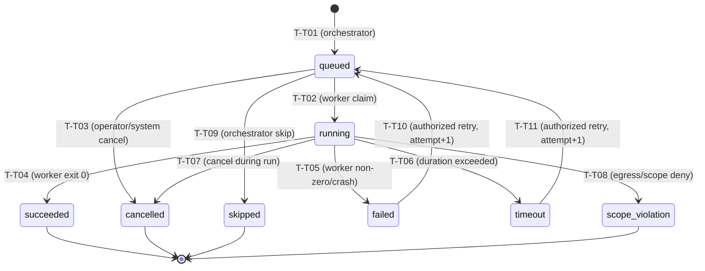

# VulnOS — P3.1.3.4.1 ToolExecution Lifecycle & Attempt Fencing Audit
## Architectural Review, Invariants, Gap Analysis & Implementation Plan

**Date:** 2026-11-02  
**Milestone:** P3.1.3.4.1  
**Status:** Audit & Implementation Plan (Pre-Implementation Review)  
**Author:** Principal Security Architect & Senior Python Backend Engineer  

---

## 1. Actual Model Fields & Constraints

The `ToolExecution` model is defined in `backend/app/db/models/execution.py` (lines 275–334) and mapped to the `tool_executions` table originally established in Alembic migration `0001_phase2_baseline.py` (lines 901–975).

### 1.1 Complete Field Inventory

| Column Name | Database Type | Nullable | Default | Constraints & Foreign Keys | Purpose / Security Function |
|---|---|---|---|---|---|
| `id` | `UUID` | No | `uuid7()` | Primary Key | Globally unique, time-ordered identifier for the task execution. |
| `project_id` | `UUID` | No | None | `FK projects.id ON DELETE CASCADE` | Multitenancy isolation boundary; enforced by PostgreSQL RLS. |
| `scan_id` | `UUID` | No | None | `FK scans.id ON DELETE CASCADE` | Parent reconnaissance job identity; cross-project trigger verified. |
| `stage` | `String(30)` | No | None | None | Scan stage (`'recon'`, `'discovery'`, etc.). |
| `tool_version_id` | `UUID` | No | None | `FK tool_versions.id ON DELETE RESTRICT` | Pinned immutable scanner container definition from Tool Registry. |
| `status` | `String(30)` | No | None | `CheckConstraint(ck_tool_executions_status)` | State machine status (8 permitted values). |
| `target_asset_id` | `UUID` | Yes | `None` | `FK assets.id ON DELETE SET NULL` | Target asset under test (if already correlated). |
| `endpoint_id` | `UUID` | Yes | `None` | `FK endpoints.asset_id ON DELETE SET NULL` | Specific HTTP endpoint target (for web/API tools). |
| `auth_context_id` | `UUID` | Yes | `None` | `FK auth_contexts.id ON DELETE SET NULL` | Target app testing identity/persona (e.g. `'anonymous'`, `'admin'`). |
| `input` | `JSONB` | No | `{}` | None | Validated task invocation parameters and CLI arguments. |
| `command_redacted` | `Text` | Yes | `None` | None | Sanitized shell execution command (all secrets scrubbed). |
| `worker_id` | `String(100)` | Yes | `None` | None | Identity of the active sandboxed Celery/container worker holding lease. |
| `attempt` | `Integer` | No | `1` | `server_default="1"` | Monotonically increasing attempt number for attempt fencing. |
| `parent_execution_id`| `UUID` | Yes | `None` | `FK tool_executions.id ON DELETE SET NULL`| Upstream dependency task ID in the reconnaissance DAG. |
| `started_at` | `DateTime(tz)` | Yes | `None` | None | Server-controlled timestamp when worker claimed lease and started task. |
| `finished_at` | `DateTime(tz)` | Yes | `None` | None | Server-controlled timestamp when task reached terminal status. |
| `exit_code` | `Integer` | Yes | `None` | None | Process exit code (0 = success, non-zero = error). |
| `error_code` | `String(100)` | Yes | `None` | None | Structured failure code (`'TIMEOUT'`, `'SCOPE_VIOLATION'`, etc.). |
| `error_message` | `Text` | Yes | `None` | None | Sanitized error diagnostic string. |
| `coverage_summary`| `JSONB` | No | `{}` | None | Statistical coverage metrics (ports scanned, endpoints discovered). |
| `stats` | `JSONB` | No | `{}` | None | Runtime telemetry (requests sent, bytes transferred, duration ms). |
| `cost_usd` | `Numeric(12,6)`| No | `0` | None | Financial compute/network cost allocated to this task. |
| `created_at` | `DateTime(tz)` | No | `utc_now` | `server_default=now()` | Task creation timestamp. |

### 1.2 Table Constraints & Indices
- **Status Check Constraint (`ck_tool_executions_status`):**
  ```sql
  CHECK (status IN (
      'queued', 'running', 'succeeded', 'failed',
      'timeout', 'cancelled', 'skipped', 'scope_violation'
  ))
  ```
- **Indices:**
  - `ix_tool_executions_scan_status`: `(scan_id, status)` — for efficient parent-child status checks.
  - `ix_tool_executions_project_created`: `(project_id, created_at DESC)` — for project-scoped listing.
  - `ix_tool_executions_tool_version`: `(tool_version_id)` — for tool inventory tracking.
- **Cross-Project Consistency Trigger:**
  - `trg_tool_executions_check_proj_scan_id`: Enforces via `check_cross_project_reference('scans', 'scan_id')` that `tool_executions.project_id == scans.project_id`.
- **Row-Level Security (RLS):**
  - RLS is enabled on `tool_executions` in `0002_phase2_rls.py`, enforcing tenant query filtering on `app.current_project_id`.

---

## 2. Existing Lifecycle Behavior

Currently:
1. `Scan` lifecycle is fully implemented in `backend/app/recon/lifecycle.py` (P3.1.3.3) with transitions T-J01 to T-J11, PostgreSQL row-level locking (`SELECT ... FOR UPDATE`), server-controlled timestamps, immutability checks, and pause/resume legal revalidation.
2. `ToolExecution` is modeled in SQLAlchemy and Alembic, but **has no dedicated state machine validator, lifecycle service, or attempt fencing service**.
3. Exception classes exist in `backend/app/recon/exceptions.py` for task operations (`ReconTaskNotFoundError`, `ReconTaskInvalidStateError`, `ReconTaskAlreadyTerminalError`, `ReconTaskScopeDeniedError`, `ReconTaskBudgetExceededError`, `ReconStaleWorkerResultError`), but are not yet wired to a transition engine.
4. Tasks can currently only be queried or inserted directly into the database without state validation or concurrency locks.

---

## 3. Missing Functionality & Implementation Gaps

To achieve production-grade task lifecycle governance, the following components must be built in P3.1.3.4:

1. **Pure State Transition Validator (`validate_tool_execution_transition`):**
   - Validates legal transitions across all 8 existing statuses.
   - Restricts permitted actors (`system`, `worker`, `operator`, `admin`, `owner`).
   - Rejects jumps between disconnected states.
   - Enforces terminal invariance (states `succeeded`, `failed`, `timeout`, `cancelled`, `skipped`, `scope_violation` cannot be arbitrarily modified).
   - Enforces non-retryability of `scope_violation`.
2. **Transactional Task Lifecycle Service (`transition_tool_execution`):**
   - Resolves tasks using `(project_id, task_id)` tenant context.
   - Acquires PostgreSQL row-level locks via `with_for_update()`.
   - Validates parent `Scan` relationship and status under lock.
   - Updates server-controlled timestamps (`started_at`, `finished_at`).
   - Logs append-only `AuditLog` records within the same transaction.
3. **Worker Attempt Fencing Service (`accept_worker_result`):**
   - Cryptographically and temporally validates worker submissions.
   - Fences stale workers: validates `submitted_worker_id == execution.worker_id` and `submitted_attempt == execution.attempt`.
   - Fails closed on duplicate completions or late submissions after timeout/cancellation.
4. **Controlled Retry Lifecycle (`retry_tool_execution`):**
   - Explicit authorized retry operation for eligible failures (`failed`, `timeout`).
   - Rejects retry if status is `scope_violation`, `cancelled`, `succeeded`, or `skipped`.
   - Rejects retry if parent `Scan` is not in `running` status.
   - Atomically increments `attempt += 1` in-place on the `ToolExecution` row.
   - Resets execution state (`status = 'queued'`, `worker_id = None`, `started_at = None`, `finished_at = None`, `exit_code = None`, `error_code = None`).
   - Invalidates any subsequent result from earlier attempts.
5. **Parent Scan Hierarchical Coordination & Deadlock-Free Locking:**
   - Tasks cannot start, resume, or be retried if parent Scan is paused, cancelled, failed, or completed.
   - Strict hierarchical lock ordering: **Always lock `Scan` first, then `ToolExecution` second** to prevent AB-BA deadlocks.
6. **Typed Exception Extensions:**
   - Add missing task-specific typed exceptions (`ReconTaskWorkerMismatchError`, `ReconTaskRetryNotAllowedError`, `ReconTaskParentScanInvalidError`, `ReconTaskProjectMismatchError`).

---

## 4. Valid Transitions Supported by Existing Database Constraints

The database check constraint `ck_tool_executions_status` permits exactly:
`'queued'`, `'running'`, `'succeeded'`, `'failed'`, `'timeout'`, `'cancelled'`, `'skipped'`, `'scope_violation'`.

### 4.1 Task State Machine Transition Graph



### 4.2 Formal Transition Matrix

| Transition ID | Current Status | Requested Status | Permitted Actors | Preconditions | Side Effects & Timestamps | Audit Action |
|---|---|---|---|---|---|---|
| **T-T01** | `[*] / None` | `queued` | `system`, `operator+` | Parent `Scan` is `queued` or `running`; scheduling preconditions pass. | `created_at = utc_now()`, `attempt = 1` | `recon_task.scheduled` |
| **T-T02** | `queued` | `running` | `worker`, `system` | Parent `Scan` is `running`; valid worker lease. | `started_at = utc_now()`, `worker_id` recorded | `recon_task.started` |
| **T-T03** | `queued` | `cancelled` | `operator+`, `system` | Task is `queued`. | `finished_at = utc_now()`, `error_code = 'JOB_CANCELLED'` | `recon_task.cancelled` |
| **T-T04** | `running` | `succeeded` | `worker`, `system` | Worker exit code 0; attempt matches; worker matches; parent Scan active. | `finished_at = utc_now()`, `exit_code = 0` | `recon_task.succeeded` |
| **T-T05** | `running` | `failed` | `worker`, `system` | Worker non-zero exit code or container crash; attempt & worker match. | `finished_at = utc_now()`, `exit_code != 0`, `error_code` | `recon_task.failed` |
| **T-T06** | `running` | `timeout` | `system` | Execution duration exceeded `timeout_seconds`. | `finished_at = utc_now()`, `error_code = 'TIMEOUT'` | `recon_task.timed_out` |
| **T-T07** | `running` | `cancelled` | `operator+`, `system` | Cancellation requested while task in flight. | `finished_at = utc_now()`, `error_code = 'CANCELLED'` | `recon_task.cancelled` |
| **T-T08** | `running` | `scope_violation` | `system` | Egress proxy guard or runtime validator detected unauthorized destination. | `finished_at = utc_now()`, `error_code = 'SCOPE_VIOLATION'` | `recon_task.scope_violation` |
| **T-T09** | `queued` | `skipped` | `system` | Upstream dependency failed, or prerequisite missing in DAG. | `finished_at = utc_now()`, `error_code = 'DEPENDENCY_FAILED'` | `recon_task.skipped` |
| **T-T10** | `failed` | `queued` | `operator+`, `system` | Authorized retry; `attempt < max_attempts`; parent Scan is `running`. | `attempt += 1`, clear `started_at`, `finished_at`, `worker_id` | `recon_task.retry_requested` |
| **T-T11** | `timeout` | `queued` | `operator+`, `system` | Authorized retry; `attempt < max_attempts`; parent Scan is `running`. | `attempt += 1`, clear `started_at`, `finished_at`, `worker_id` | `recon_task.retry_requested` |

### 4.3 Forbidden Invariants
1. **Scope Violation Non-Retryable:** Any task with `status == 'scope_violation'` can **never** transition to `queued` or be retried under any circumstances.
2. **Terminal Invariance:** Outgoing transitions from `succeeded`, `cancelled`, `skipped`, and `scope_violation` are strictly forbidden.
3. **Draft / Paused Independence:** Tasks do not possess `'draft'` or `'paused'` statuses. Task execution eligibility is conditioned on the parent `Scan.status`.

---

## 5. Retry & Attempt-Identity Design

### 5.1 Architecture Decision: In-Place Retry on Existing `ToolExecution` Row
- **Context:** The system needs to support controlled retries for transient task failures (`failed`, `timeout`) while preventing duplicate rows from polluting asset discovery and evidence foreign key references (`findings`, `evidence_objects`, `test_cases`).
- **Decision:** Retries are executed **in-place on the existing `ToolExecution` row**, atomically incrementing `ToolExecution.attempt = ToolExecution.attempt + 1`.
- **Rationale:**
  1. The existing schema defines `attempt INTEGER NOT NULL DEFAULT 1` directly on `tool_executions`.
  2. Preserves foreign key stability for downstream records.
  3. Historical audit trails of every attempt are preserved in the append-only `audit_logs` table with action `recon_task.retry_requested` recording previous attempt number, failure code, and triggering actor.
  4. Avoids phantom task rows in progress calculations and DAG resolution.

### 5.2 Attempt Fencing Mechanism
Distributed workers can experience network delays, queue lags, or zombie container states. A worker executing Attempt 1 might deliver results after the orchestrator timed out Attempt 1 and scheduled Attempt 2.

```
Time ------------------------------------------------------------------------------------>
Orchestrator: [Queued (Att 1)] -> [Running (Worker A, Att 1)] -> [Timeout (Att 1)] -> [Retry: Queued (Att 2)] -> [Running (Worker B, Att 2)]
Worker A:                                  ... delayed in container ...                      ---> Submits Succeeded (Att 1)
                                                                                                  |
                                                                                                  v
Orchestrator Guard:                                                          [REJECT: Stale Attempt (1 != 2)]
```

When a worker calls `accept_worker_result(task_id, worker_id, attempt, exit_code, stats, ...)`:
1. Row lock is acquired on the task row: `SELECT ... FROM tool_executions WHERE id = :task_id AND project_id = :project_id FOR UPDATE`.
2. **Status Check:** Task status must be `running`. If already terminal (`timeout`, `cancelled`, `succeeded`), the result is rejected with `ReconTaskAlreadyTerminalError` and logged as `recon_task.stale_result_rejected`.
3. **Worker Identity Check:** `task.worker_id` must match `worker_id`. If another worker was assigned or spoofed, reject with `ReconTaskWorkerMismatchError`.
4. **Attempt Check:** `task.attempt` must match `attempt`. If the task has moved to a newer attempt, reject with `ReconStaleWorkerResultError`.
5. **Parent Scan State Check:** Parent Scan must be active (`running` or `paused`). If parent is `cancelled` or terminal, the worker result cannot mark the task succeeded.

---

## 6. Parent Scan Coordination Requirements

### 6.1 Status Dependencies

| Parent Scan Status | Task Transition Allowed? | Operational Rules |
|---|---|---|
| `draft` | **Forbidden** | Tasks cannot be queued, started, or executed. |
| `queued` | Only T-T01 (`queued`) | Tasks can be planned/created, but cannot start. |
| `running` | **All Valid Task Transitions Allowed** | Normal execution, leasing, completion, and retries. |
| `paused` | Lease claims **Forbidden**, Retries **Forbidden** | In-flight workers may drain or report completion; unstarted tasks cannot claim leases. |
| `cancelled` | Lease claims **Forbidden**, Retries **Forbidden** | Active tasks receive cancellation; late worker completions rejected. |
| `completed` | Lease claims & Retries **Forbidden** | Scan is terminal; tasks cannot transition or reactivate. |
| `failed` | Lease claims & Retries **Forbidden** | Scan is terminal; tasks cannot transition or reactivate. |

### 6.2 Deadlock Prevention: Hierarchical Lock Ordering
When an operation needs to inspect or mutate both `Scan` and `ToolExecution`:
- **Deadlock Risk:** If Thread A locks `Scan 1` then `ToolExecution A`, while Thread B locks `ToolExecution A` then `Scan 1`, a PostgreSQL deadlock occurs.
- **Enforced Lock Ordering Rule:**
  ```
  HIERARCHICAL LOCK ORDER:
  1. Lock Parent `Scan` row (if parent verification with lock is needed):
     SELECT ... FROM scans WHERE id = :scan_id FOR UPDATE
  2. Lock Child `ToolExecution` row:
     SELECT ... FROM tool_executions WHERE id = :task_id FOR UPDATE
  ```
  By strictly maintaining the root-to-leaf direction (Scan -> ToolExecution), circular wait conditions are mathematically impossible.

---

## 7. Transaction and Audit Strategy

### 7.1 Transaction Isolation
- All state updates and audit writes execute within a single SQLAlchemy `Session` transaction.
- Transitions must acquire a row-level lock (`with_for_update()`) before inspecting current status or attempt count.
- If any validation or database constraint fails, the transaction is rolled back completely.

### 7.2 Audit Trail Compliance
- **Audit Table:** `audit_logs` (partitioned by range on `created_at`).
- **Entity Identification:** `entity_type = "tool_execution"`, `entity_id = str(task.id)`.
- **Actor Type Constraint (`ck_audit_logs_actor_type`):**
  - Allowed: `'user'`, `'api_key'`, `'system'`, `'worker'`, `'model'`.
  - Roles (`'operator'`, `'admin'`, `'owner'`) are mapped to `actor_type = 'user'` with the specific role stored in `metadata_["actor_role"]`.
- **Audit Actions:**
  - `recon_task.scheduled`
  - `recon_task.started`
  - `recon_task.succeeded`
  - `recon_task.failed`
  - `recon_task.timed_out`
  - `recon_task.cancelled`
  - `recon_task.scope_violation`
  - `recon_task.skipped`
  - `recon_task.retry_requested`
  - `recon_task.stale_result_rejected`
- **Data Protection:** No plaintext credentials, auth tokens, or unsanitized payloads stored in `metadata_`.

---

## 8. Required Security Test Suite (P3.1.3.4.8)

A dedicated test file `backend/tests/security/recon/test_tool_execution_lifecycle.py` will validate:

1. `test_validate_task_transition_all_allowed_paths`: Verifies T-T01 through T-T11.
2. `test_validate_task_transition_idempotency`: Self-transitions (`X -> X`) return cleanly.
3. `test_validate_task_transition_terminal_invariance`: Reject outgoing transitions from `succeeded`, `cancelled`, `skipped`.
4. `test_validate_task_transition_scope_violation_strictly_non_retryable`: Proves `scope_violation` cannot be retried or transitioned.
5. `test_validate_task_transition_invalid_actors`: Proves untrusted clients cannot force status changes.
6. `test_transition_task_full_lifecycle`: End-to-end traversal: `queued -> running -> succeeded` with row locking and audit logging.
7. `test_transition_task_cross_project_isolation`: Cross-tenant task lookup fails closed (`ReconTaskNotFoundError`).
8. `test_worker_claim_lease_success`: Worker claims task, records `worker_id` and `started_at`.
9. `test_worker_claim_lease_parent_paused_rejected`: Task cannot start when parent Scan is `paused`.
10. `test_worker_claim_lease_parent_cancelled_rejected`: Task cannot start when parent Scan is `cancelled`.
11. `test_accept_worker_result_success`: Valid result transitions task to `succeeded` with exit code and stats.
12. `test_accept_worker_result_worker_mismatch_rejected`: Worker B cannot submit result for task leased to Worker A.
13. `test_accept_worker_result_stale_attempt_rejected`: Result for Attempt 1 rejected after task retried to Attempt 2.
14. `test_accept_worker_result_duplicate_completion_rejected`: Submitting completion to already-finished task rejected.
15. `test_retry_task_atomic_increment`: Authorized retry increments `attempt` atomically and resets execution fields.
16. `test_retry_task_parent_scan_terminal_rejected`: Retrying a task whose parent Scan is terminal fails closed.
17. `test_task_cancellation_from_queued_and_running`: Cancelling queued and running tasks records timestamps and reasons.
18. `test_task_scope_violation_terminal_enforcement`: Runtime scope violation transitions to `scope_violation` and blocks future retries.
19. `test_audit_failure_rolls_back_task_transition`: Proves task mutation is rolled back if audit persistence fails.
20. `test_rls_and_cross_project_trigger_enforcement`: Database-level verification of project isolation.

---

## 9. Migration Necessity Gate

### Finding: NO Database Migration is Necessary.
- **Evidence:**
  1. Database check constraint `ck_tool_executions_status` already permits all 8 required status values: `'queued'`, `'running'`, `'succeeded'`, `'failed'`, `'timeout'`, `'cancelled'`, `'skipped'`, `'scope_violation'`.
  2. All required fields (`attempt`, `worker_id`, `started_at`, `finished_at`, `exit_code`, `error_code`, `error_message`, `stats`, `cost_usd`) already exist in `tool_executions`.
  3. Alembic migration head is currently `0004`. Adding tables or changing constraints is strictly unnecessary and would introduce schema drift.

---

## 10. Proposed Implementation Plan for Subsequent Milestones

1. **P3.1.3.4.2 — Pure Transition Validator:**
   - Implement `validate_tool_execution_transition()` in `backend/app/recon/task_lifecycle.py`.
   - Add task transition constants and mapping dictionaries.
2. **P3.1.3.4.3 — Transactional Lifecycle Service:**
   - Implement `transition_tool_execution()` with row-level locking (`with_for_update`), timestamp management, and audit log generation.
3. **P3.1.3.4.4 — Worker Attempt Fencing:**
   - Implement `claim_task_lease()` and `accept_worker_result()` with strict worker ID and attempt matching.
4. **P3.1.3.4.5 — Retry Lifecycle:**
   - Implement `retry_tool_execution()` with atomic attempt counter increment and non-retryable guard rails.
5. **P3.1.3.4.6 — Parent Scan Coordination:**
   - Implement hierarchical lock ordering and Scan status dependency verification.
6. **P3.1.3.4.7 — Audit & Typed Errors:**
   - Complete task exception definitions in `backend/app/recon/exceptions.py`.
   - Wire audit actions conforming to `ck_audit_logs_actor_type`.
7. **P3.1.3.4.8 — Security Test Suite:**
   - Implement all 20 security tests in `backend/tests/security/recon/test_tool_execution_lifecycle.py`.
8. **P3.1.3.4.9 — Documentation & Quality Gates:**
   - Create `P3_1_3_4_TOOL_EXECUTION_LIFECYCLE_DESIGN.md` and `P3_1_3_4_TOOL_EXECUTION_TEST_MATRIX.md`.
   - Update `P3_1_3_TRANSITION_MATRIX.md` and `PHASE_3_PROGRESS.md`.
   - Execute full quality gates (`ruff`, `format`, `mypy`, `pytest`, `alembic`).
