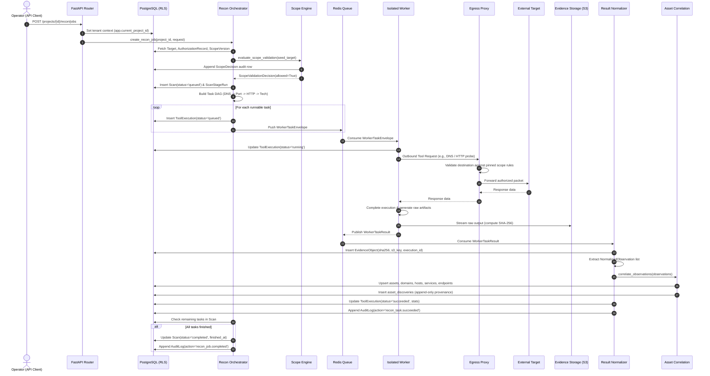

# VulnOS — P3.1.2 Data Flow Specification
## Ingestion Pipelines, Evidence Streaming & Asset Correlation Flow

**Date:** 2026-11-02  
**Milestone:** P3.1.2  
**Status:** Canonical Design  
**Author:** Principal Security Architect & Senior Backend Engineer  

---

## 1. End-to-End Sequence Diagram

---

## 2. Detailed Data Transformation Stages

### Stage 1: Raw Output Ingestion
- Worker captures tool `stdout`, `stderr`, and any output files written to `/output`.
- Artifacts are streamed directly from the worker to S3-compatible storage (`s3://vulnos-evidence/{project_id}/{sha256}`).
- An `EvidenceObject` record is persisted in PostgreSQL containing:
  - `kind`: `'tool_output'`
  - `sha256`: 32-byte cryptographic hash of payload
  - `size_bytes`: byte length
  - `storage_backend`: `'s3'`
  - `bucket`: `'vulnos-evidence'`
  - `object_key`: `{project_id}/{sha256}`
  - `created_by_execution_id`: foreign key to `tool_executions.id`

### Stage 2: Observation Extraction
- The Result Normalizer parses the tool output according to the tool's registered output format (e.g., JSON Lines, XML, Nmap greppable).
- The parsed entities are mapped into standard `NormalizedObservation` records.
- **Data Boundary:** Untrusted strings from tool output (such as HTTP banners, headers, page titles) are stripped of control characters, null bytes, and non-printable characters before insertion into database fields.

### Stage 3: Asset Correlation & Canonical Key Generation
VulnOS establishes deterministic canonical keys for assets within a project to guarantee idempotency and avoid duplicate records:

| Asset Kind | Canonical Key Algorithm | Example Key |
|---|---|---|
| `domain` | Lowercased, IDNA-normalized registrable domain or subdomain | `api.example.com` |
| `host` | Canonical hostname or compressed IPv4/IPv6 address | `198.51.100.42` or `sub.example.com` |
| `service` | `{host_canonical_name}:{transport}:{port}` | `api.example.com:tcp:443` |
| `endpoint` | `{method} {normalized_url}` | `GET https://api.example.com/v1/users` |

### Stage 4: Provenance Recording
For every asset created or updated:
- The `assets.last_seen_at` timestamp is updated to `utc_now()`.
- The `assets.source_count` is incremented.
- A new row is appended to `asset_discoveries` recording:
  - `asset_id`: FK to `assets.id`
  - `scan_id`: FK to `scans.id`
  - `tool_execution_id`: FK to `tool_executions.id`
  - `source`: Tool identifier and version (e.g., `subfinder:v2.6.6`)
  - `confidence`: Confidence score (0.0 to 1.0)
  - `discovered_at`: `utc_now()`
  - `metadata`: Tool-specific discovery context
