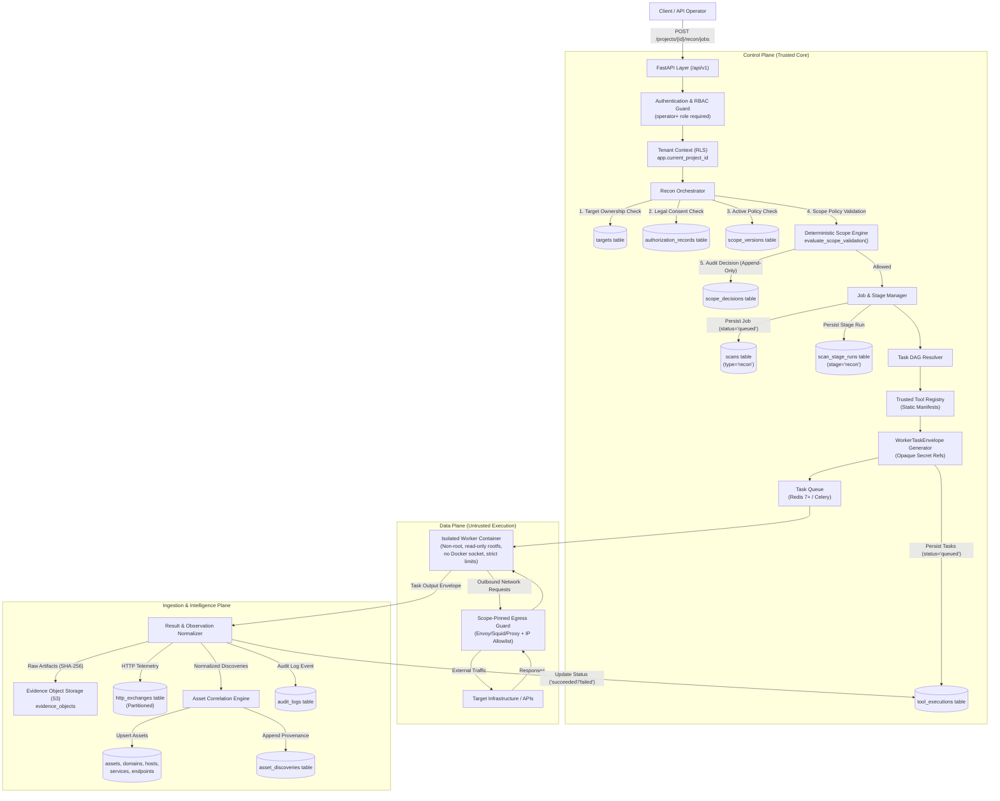
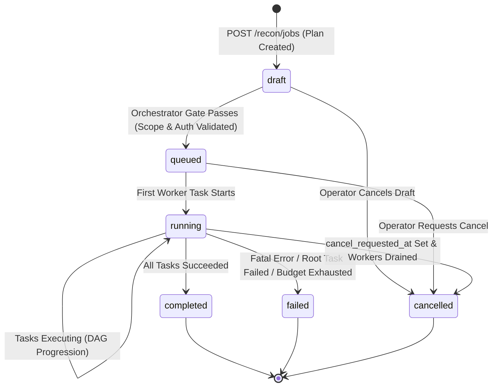
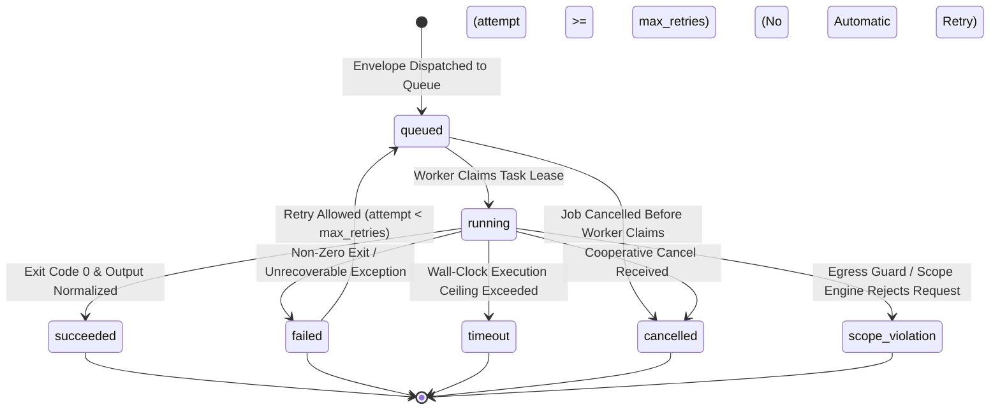

# VulnOS — P3.1.2 Reconnaissance Architecture Specification
## End-to-End Orchestration, Component Boundaries & State Machines

**Date:** 2026-11-02  
**Milestone:** P3.1.2  
**Status:** Canonical Design  
**Author:** Principal Security Architect & Senior Backend Engineer  

---

## 1. Executive Overview

The VulnOS reconnaissance subsystem is designed to discover, track, and correlate assets (domains, subdomains, IP addresses, network ports, HTTP services, parameters, and technologies) with cryptographic auditability, strict tenant isolation, and fail-closed scope enforcement.

### 1.1 Non-Negotiable Architectural Principles
1. **The Seed Invariant:** A registered target in `targets` is a discovery seed, not an authorization permit. Target creation or presence grants zero scanning rights.
2. **The Scope Invariant:** Every network operation initiated by VulnOS must be authorized by an active `AuthorizationRecord` and an active `ScopeVersion` validated by the deterministic scope engine (`evaluate_scope_validation`).
3. **The Worker Non-Trust Invariant:** Workers execute in untrusted sandboxes and must never decide their own scope. Scope validation occurs centrally in the Orchestrator prior to task dispatch and is enforced at runtime via an isolated egress proxy.
4. **The Provenance Invariant:** Discovered assets must preserve an immutable chain of custody linking every observation back to the specific `ToolExecution`, `Scan`, tool version, and timestamp. Raw outputs are stored content-addressed in S3-compatible storage; observations in PostgreSQL are normalized and lossy by design.

---

## 2. End-to-End Architecture

---

## 3. Component Responsibilities

### 3.1 FastAPI API Layer (`backend/app/api/v1/`)
- Authenticates the caller via Bearer JWT or HMAC-SHA-256 API key.
- Resolves project membership and verifies RBAC roles (`operator`, `admin`, or `owner`).
- Rejects non-members with HTTP 404 to prevent project enumeration.
- Enforces request validation using strict Pydantic v2 schemas.
- Establishes PostgreSQL transaction-local tenant context (`app.current_project_id`).

### 3.2 Recon Orchestrator (`engine/recon/orchestrator.py`)
- Coordinates the execution lifecycle of a reconnaissance job.
- Enforces prerequisites: target ownership, valid non-revoked authorization record, and single active scope version.
- Requests central scope validation via `evaluate_scope_validation()`.
- Creates and updates the primary `Scan` entity (`scan_type="recon"`).
- Initializes resource budgets (max requests, duration ceiling, max cost, concurrency).
- Resolves task dependencies via a directed acyclic graph (DAG) (e.g., DNS enumeration must precede port discovery).
- Dispatches signed, tamper-evident `WorkerTaskEnvelope` payloads to the task queue.
- Handles cooperative cancellation requests and job termination.

### 3.3 Central Scope Engine (`backend/app/scope/`)
- Evaluates destination legitimacy using pure, deterministic matching (`match_scope_rules`).
- Enforces global deny-overrides-allow precedence.
- Hard-blocks cloud metadata services (IMDS) regardless of rules (`169.254.169.254`, `fd00:ec2::254`, `metadata.google.internal`).
- Validates target destinations against `AuthorizationRecord.allow_private_ranges`.
- Writes an append-only audit record to `scope_decisions` linking `scan_id` and `matched_rule_id`.

### 3.4 Trusted Tool Registry (`backend/app/recon/tools.py`)
- Immutable, server-controlled catalog of authorized reconnaissance tools.
- Defines static execution manifests: tool name, container image, sha256 digest, required capabilities, schema, and timeouts.
- **Strict Prohibition:** API clients and workers are strictly forbidden from supplying executable paths, arbitrary shell commands, custom container images, or CLI flags.

### 3.5 Isolated Worker Runtime (`workers/`)
- Executes containerized tasks under the principle of least privilege.
- Enforces security constraints:
  - Non-root user execution (`UID 10001:10001`).
  - Read-only root filesystem (`read_only: true`) with ephemeral tmpfs mounts.
  - Zero access to Docker socket (`/var/run/docker.sock` is absent).
  - Explicit resource caps (CPU: 2.0 cores, Memory: 2 GiB, PIDs: 256).
  - Explicit task execution timeout (soft 1800s, hard 2100s).
- Routes all network egress through the Scope-Pinned Egress Guard.

### 3.6 Scope-Pinned Egress Guard
- Independent network proxy/filter sitting between the worker and external networks.
- Enforces destination allowlisting matching the job's pinned scope rules.
- Prevents DNS rebinding and redirect-based scope escapes by re-resolving and re-validating every HTTP redirect hop.
- Blocks worker access to the internal VulnOS control plane, database, Redis, and cloud metadata.

### 3.7 Result Normalizer & Asset Correlation (`engine/recon/normalizer.py`)
- Ingests worker results, verifies task authenticity, and checks envelope signatures.
- Stores raw stdout/stderr and tool artifacts in S3-compatible evidence storage, recording metadata in `evidence_objects`.
- Normalizes discovered entities into typed observation records.
- Correlates observations into canonical assets (`assets`, `domains`, `hosts`, `services`, `endpoints`) using deterministic keys.
- Records append-only discovery provenance in `asset_discoveries`.

---

## 4. Existing Database Model Mapping

Phase 3.1 reuses the canonical schema without adding redundant tables.

### 4.1 Reconnaissance Job -> `Scan` (`scans` table)
| Scan Attribute | Field Type | Reconnaissance Job Role |
|---|---|---|
| `id` | `UUID` (uuid7) | Unique identifier for the recon job. |
| `project_id` | `UUID` | Mandatory tenant isolation boundary. |
| `name` | `Text` | Human-readable job label (e.g., "Quarterly External Recon - Domain Seeds"). |
| `scan_type` | `Text` | Set to `'recon'` (enforced by `ck_scans_scan_type`). |
| `status` | `Text` | State machine: `'draft'`, `'queued'`, `'running'`, `'paused'`, `'completed'`, `'failed'`, `'cancelled'`. |
| `scope_version_id` | `UUID` | Pinned active scope version at job creation. **Immutable during execution.** |
| `authorization_id` | `UUID` | Pinned active authorization record at job creation. **Immutable during execution.** |
| `target_ids` | `ARRAY(UUID)` | Operator-supplied discovery seed target IDs. |
| `profile` | `JSONB` | Execution configuration: enabled modules, depth, aggressive flags. |
| `budget` | `JSONB` | Resource ceilings: `max_wall_clock_minutes`, `max_requests`, `max_cost_usd`, `max_concurrency`. |
| `requested_by` | `UUID` | Operator user ID who initiated the job. |
| `started_at` | `DateTime(tz)` | Timestamp when first worker task begins execution. |
| `finished_at` | `DateTime(tz)` | Terminal timestamp upon completion, failure, or cancellation. |
| `cancel_requested_at`| `DateTime(tz)` | Timestamp when cancellation was requested by an operator. |
| `cost_usd` | `Numeric(12,6)` | Aggregated dollar compute and network cost. |
| `stats` | `JSONB` | Telemetry: `requests_sent`, `assets_discovered`, `tasks_succeeded`, `tasks_failed`. |

### 4.2 Reconnaissance Stage -> `ScanStageRun` (`scan_stage_runs` table)
- `stage`: Set to `'recon'` (or sub-stages `'discovery'`, `'correlation'`).
- `attempt`: Tracked attempt sequence (1, 2, ...).
- `status`: `'pending'`, `'running'`, `'succeeded'`, `'partial'`, `'failed'`, `'skipped'`, `'cancelled'`.
- `metrics`: Stage-level breakdown of entities discovered, latency, and request throughput.

### 4.3 Reconnaissance Task -> `ToolExecution` (`tool_executions` table)
| ToolExecution Attribute | Field Type | Reconnaissance Task Role |
|---|---|---|
| `id` | `UUID` (uuid7) | Unique task execution ID. Correlates all evidence and telemetry. |
| `project_id` | `UUID` | Tenant isolation boundary. |
| `scan_id` | `UUID` | Foreign key referencing the parent `Scan`. Multiple tasks per scan. |
| `stage` | `Text` | Set to `'recon'`. |
| `tool_version_id` | `UUID` | Foreign key to `tool_versions.id`. Guarantees exact tool image and digest. |
| `status` | `Text` | Task lifecycle: `'queued'`, `'running'`, `'succeeded'`, `'failed'`, `'timeout'`, `'cancelled'`, `'skipped'`, `'scope_violation'`. |
| `target_asset_id` | `UUID` | Target asset under analysis (if resolving an existing asset). |
| `input` | `JSONB` | Bounded execution arguments passed to the worker envelope. |
| `command_redacted` | `Text` | Audit-safe string representation of the executed tool command. |
| `worker_id` | `Text` | Identity of the worker node or container that executed the task. |
| `attempt` | `Integer` | Retry attempt counter (max 3). |
| `parent_execution_id` | `UUID` | Upstream task ID that produced the seed data for this task (DAG provenance). |
| `exit_code` | `Integer` | Process exit code from tool container. |
| `error_code` | `Text` | Structured failure classification (e.g., `TIMEOUT`, `SCOPE_DENIED`, `PARSER_ERROR`). |
| `cost_usd` | `Numeric(12,6)` | Cost incurred by this specific container execution. |

### 4.4 Discovered Intelligence -> Asset & Evidence Models
1. **`assets`:** Core entity record. Kind must be `'domain'`, `'host'`, `'service'`, or `'endpoint'`.
2. **`domains`:** Detail table for domain assets (`name`, `registrable_domain`, `parent_domain`).
3. **`hosts`:** Detail table for host assets (`canonical_name`, `host_kind IN ('hostname', 'ip')`).
4. **`host_addresses`:** Tracks DNS resolution history (`host_id`, `ip`, `first_seen_at`, `last_seen_at`, `source`).
5. **`services`:** Network ports and protocols (`host_id`, `port`, `transport IN ('tcp','udp')`, `protocol`, `banner`, `tls`).
6. **`endpoints`:** HTTP API endpoints (`host_id`, `method`, `scheme`, `port`, `path`, `normalized_url`, `url_hash`).
7. **`asset_discoveries`:** Append-only provenance linking discovered asset to `scan_id` and `tool_execution_id`.
8. **`evidence_objects`:** S3 object metadata for raw tool outputs (`kind='tool_output'`, `sha256`, `bucket`, `object_key`).

---

## 5. Job Lifecycle State Machine

Reconnaissance jobs strictly use the existing `ck_scans_status` values in PostgreSQL:

### 5.1 Lifecycle Transition Matrix
| From State | To State | Trigger / Condition | Permitted Actor | Audit Event | Side Effects |
|---|---|---|---|---|---|
| `[*]` | `draft` | Job specification submitted. | `operator+` | `recon_job.created` | Scan inserted with `status='draft'`. |
| `draft` | `queued` | Pre-flight validation passes: Target valid, Auth active, Scope active, Budget allocated. | System / Orchestrator | `recon_job.queued` | Pinned `scope_version_id` locked; tasks generated in queue. |
| `draft` | `cancelled` | Operator cancels before scheduling. | `operator+` | `recon_job.cancelled` | Job marked `cancelled`; zero tasks scheduled. |
| `queued` | `running` | Worker acknowledges first task. | Worker / System | `recon_job.started` | `started_at` set to `utc_now()`. |
| `queued` | `cancelled` | Cancellation requested while queued. | `operator+` | `recon_job.cancelled` | Queued tasks purged from Redis. |
| `running` | `completed` | All planned tasks reach terminal success (`succeeded` or `skipped`). | System / Orchestrator | `recon_job.completed` | `finished_at` set; scan stats finalized. |
| `running` | `failed` | Unrecoverable error, database outage, or non-retryable task failure. | System / Orchestrator | `recon_job.failed` | `finished_at` set; remaining tasks cancelled. |
| `running` | `cancelled` | Cancellation requested during execution. | `operator+` | `recon_job.cancelled` | Cooperative cancel signal sent; workers terminate. |

---

## 6. Task Lifecycle State Machine

Reconnaissance tasks strictly use the existing `ck_tool_executions_status` values:

### 6.2 Task Invariant: Scope Violations
If a task transitions to `scope_violation`, **automatic retry is strictly forbidden**. A scope violation indicates that the tool attempted to access an unauthorized destination. Retrying against a denied destination would violate the platform's core security boundary.

---

## 7. Failure & Recovery Protocols

1. **Redis Unavailable:**
   - The Orchestrator fails closed. If Redis is unreachable, new jobs remain in `draft` status and are not marked `queued`.
   - Running workers complete their current in-memory task and spool outputs locally; if Redis remains down upon task completion, outputs are preserved in an encrypted temporary volume until connectivity resumes.
2. **Worker Crash / OOM Kill:**
   - Celery task acknowledgment (`acks_late=True`) ensures that unacknowledged crashed tasks are detected upon lease expiration.
   - If `attempt < max_retries` (default: 2) and failure was NOT `scope_violation`, the task is re-queued.
3. **Authorization Revoked During Execution:**
   - If an `AuthorizationRecord` is revoked while a job is running, the orchestrator immediately sets `cancel_requested_at = utc_now()`, revokes all worker leases, and terminates the job with status `'cancelled'`. No grace period is permitted.
4. **Scope Version Superseded During Execution:**
   - Running jobs remain pinned to their creation-time `scope_version_id` to guarantee immutable repeatability.
   - If an active scope version is superseded, existing running jobs complete using their pinned version, while new jobs must bind to the newly active version.
