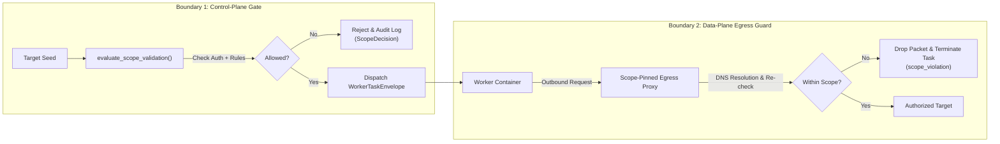

# VulnOS — P3.1.2 Scope Enforcement Specification
## Dual-Boundary Policy Gates, Pinned Invariants & Egress Protection

**Date:** 2026-11-02  
**Milestone:** P3.1.2  
**Status:** Canonical Design  
**Author:** Principal Security Architect & Senior Backend Engineer  

---

## 1. Executive Summary

Scope enforcement is the single most critical security boundary in VulnOS. A failure in scope validation could lead to unauthorized testing against third-party systems, cloud infrastructure metadata services, or unapproved tenant networks.

To achieve defense-in-depth, VulnOS establishes **two independent, non-bypassable scope enforcement boundaries**:
1. **Control-Plane Boundary (Pre-Dispatch Gate):** The Recon Orchestrator queries the deterministic Scope Engine (`evaluate_scope_validation()`) before generating any task envelope or queueing work.
2. **Data-Plane Boundary (Runtime Egress Guard):** All worker container network egress is forced through an isolated egress proxy configured with the job's pinned scope rules. Outbound packets to non-allowlisted destinations are dropped at the network layer.

---

## 2. Boundary 1: Orchestrator Pre-Dispatch Gate

Before scheduling a reconnaissance task for execution, the Orchestrator executes `evaluate_scope_validation()` (`backend/app/scope/versions.py`).

### 2.1 Pre-Flight Evaluation Pipeline
1. **Target Verification:** Resolves `Target.id` and verifies that it belongs to the active `project_id`.
2. **Authorization Verification:**
   - Verifies that `AuthorizationRecord.id` belongs to `project_id`.
   - Asserts `revoked_at IS NULL`.
   - Asserts `valid_from <= now <= valid_to`.
   - Asserts requested operation (`"recon"`, `"read"`, etc.) is present in `allowed_actions`.
   - Asserts `destructive=False` unless `destructive_allowed=True` on the authorization record.
3. **Scope Version Verification:**
   - Verifies that `ScopeVersion.id` belongs to `project_id`.
   - Asserts `status == 'active'` (at job creation) and that version contains >= 1 rule.
4. **Deterministic Rule Matching (`match_scope_rules`):**
   - Pure, idempotent rule evaluation.
   - Evaluates destination against all allow and deny rules.
   - **Global Deny Precedence:** Any matching deny rule immediately overrides any matching allow rule.
5. **SSRF & Cloud Metadata Hard-Blocking:**
   - Extracts IP literal or hostname from destination.
   - Hard-blocks non-overridable cloud metadata (IMDS) destinations (`169.254.169.254`, `fd00:ec2::254`, `metadata.google.internal`).
6. **Private Network Range Protection:**
   - Checks RFC 1918 private ranges (`10.0.0.0/8`, `172.16.0.0/12`, `192.168.0.0/16`), loopback (`127.0.0.0/8`, `::1`), and link-local.
   - Blocks private ranges unless `AuthorizationRecord.allow_private_ranges == True`.
7. **Authoritative Decision Audit Record:**
   - Persists a row in the range-partitioned `scope_decisions` table recording:
     `project_id`, `scan_id`, `scope_version_id`, `authorization_id`, `subject`, `method`, `allowed`, `reason_code`, `policy_hash`, `context`.

---

## 3. Boundary 2: Runtime Egress Guard

Even if the orchestrator approves a destination, a compromised worker or a tool following unexpected HTTP redirects could attempt an out-of-scope request.

### 3.1 Network Isolation Architecture
- Worker containers execute on an isolated Docker network bridge with **no direct default gateway to the internet**.
- All outbound HTTP/HTTPS/DNS traffic is forced through an Egress Proxy container (or Envoy sidecar).
- The Egress Proxy is dynamically provisioned with an ephemeral access token linked to the job's pinned `scope_version_id`.

### 3.2 Runtime Mitigations

#### 1. DNS Rebinding Mitigation
- **Threat:** An attacker configures a public domain with a very low TTL (e.g., 1s). The initial DNS query resolves to an authorized public IP, but the subsequent HTTP request resolves to `169.254.169.254` or `127.0.0.1`.
- **Enforcement:** The Egress Proxy performs DNS resolution internally and caches the resolved IP address for the duration of the HTTP transaction. The outbound TCP socket connects strictly to the pre-validated IP address. Direct DNS queries by tools are routed through a recursive DNS filter that blocks private/IMDS IP answers unless explicitly permitted.

#### 2. Redirect-Based Scope Escapes
- **Threat:** A target endpoint at `https://example.com/login` returns a `302 Found` with `Location: http://169.254.169.254/latest/meta-data/` or `https://unauthorized-victim.org/`.
- **Enforcement:** The Egress Proxy intercepts all `3xx` redirect responses. The proxy parses the `Location` header and re-evaluates the redirect destination against the pinned scope rules. If the redirect target fails validation, the request is aborted with HTTP 403, and the worker execution is terminated with `status='scope_violation'`.

#### 3. IPv4-Mapped IPv6 and Alternate IP Literal Bypasses
- **Threat:** Submitting IP addresses formatted as decimal integers (`http://2130706433`), octal (`http://0177.0.0.1`), or IPv4-mapped IPv6 (`http://[::ffff:127.0.0.1]`).
- **Enforcement:** `backend/app/scope/normalization.py` uses Python's standard `ipaddress.ip_address` module which unpacks IPv4-mapped IPv6 addresses (`::ffff:127.0.0.1` -> `127.0.0.1`) and normalizes all integer/octal variants before scope evaluation.

---

## 4. Immutability & Pinning Invariants

### 4.1 Strict Version Pinning
When a `Scan` is created, it writes:
- `scans.scope_version_id = active_scope_version.id`
- `scans.authorization_id = active_authorization.id`

**These foreign keys are immutable.** A running job must never silently switch to a new scope version or authorization record.

### 4.2 Revocation & Cancellation Handling
1. **Authorization Revoked:**
   If `AuthorizationRecord.revoked_at` is populated, the Orchestrator's background monitor detects the revocation, revokes the job's egress proxy token, sets `scans.cancel_requested_at = utc_now()`, and transitions all pending tasks to `cancelled`.
2. **Authorization Expired:**
   If `utc_now() > AuthorizationRecord.valid_to`, the job cannot schedule any further tasks. In-flight tasks that exceed the deadline are terminated.
3. **Zero Grace Period:**
   There is no grace period for expired or revoked authorizations. All active testing must cease immediately upon revocation.
