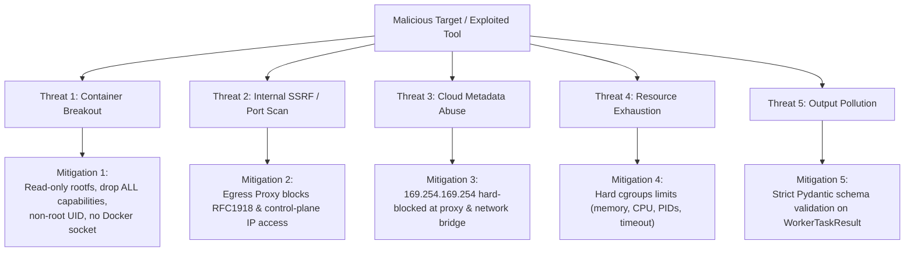

# VulnOS — P3.1.2 Worker Security & Sandboxing Specification
## Isolation Architecture, Least Privilege & Container Hardening

**Date:** 2026-11-02  
**Milestone:** P3.1.2  
**Status:** Canonical Design  
**Author:** Principal Security Architect & Senior Backend Engineer  

---

## 1. Threat Model & Trust Philosophy

Workers and containerized tools execute in a hostile, zero-trust boundary. A target web application may serve adversarial content, exploit parser bugs in security tools, or attempt prompt injection against autonomous agents.

**Fundamental Invariant:**
> **Workers are untrusted execution environments.**
> A worker must never possess credentials to the VulnOS database, administrative API keys, control plane tokens, or the Docker daemon socket. A worker must never be capable of expanding its own budget or modifying platform scope.

---

## 2. Container Sandboxing Profile

When a worker executes a task container, the following Linux kernel security controls and container attributes must be enforced:

| Security Parameter | Hardened Value | Security Rationale |
|---|---|---|
| **User Identity** | `UID 10001:GID 10001` (non-root) | Prevents container breakout via root-only host vulnerabilities. |
| **Root Filesystem** | `read_only: true` | Prevents persistence, binary trojaning, or modification of tool scripts. |
| **Docker Socket** | **ABSENT** (`/var/run/docker.sock` is NOT mounted) | Absolute defense against container escape and host takeover. |
| **Linux Capabilities** | `drop: ["ALL"]` | Drops all Linux capabilities (e.g., `CAP_NET_ADMIN`, `CAP_SYS_ADMIN`, `CAP_SYS_PTRACE`). |
| **Privilege Escalation** | `no-new-privileges: true` | Disables setuid binaries and privilege escalation flags. |
| **Ephemeral Storage** | `tmpfs: ["/tmp:size=256M,noexec,nosuid,nodev"]` | Restricted in-memory volume for temporary files; `noexec` blocks executing scripts from `/tmp`. |
| **Output Mount** | `/output:rw` (ephemeral volume) | Dedicated volume for raw tool artifacts, wiped upon task completion. |
| **Memory Limit** | Strict ceiling (e.g., 2048 MiB) | Prevents host Out-Of-Memory (OOM) denial-of-service. |
| **CPU Quota** | Strict limit (e.g., 2.0 cores) | Prevents CPU starvation of control-plane services. |
| **PID Limit** | `pids_limit: 256` | Prevents fork bombs. |

---

## 3. Secret Isolation Architecture

### 3.1 Opaque Secret Reference Resolution
Reconnaissance and testing operations often require credentials (e.g., API keys for Shodan/SecurityTrails, or HTTP Basic Auth for a target development server).

1. **Storage:** Target credentials are stored encrypted in the database or AWS Secrets Manager / HashiCorp Vault.
2. **Referencing:** In task payloads and job profiles, credentials are exclusively identified by an opaque UUID: `secret_ref_id`.
3. **Just-In-Time Resolution:**
   - The worker container **never receives the secret in environment variables or command-line arguments**.
   - If the tool requires an HTTP header (e.g., `Authorization: Bearer <token>`), the token is injected directly by the **Scope-Pinned Egress Proxy** as traffic passes through it.
   - For tools requiring API keys (e.g., Shodan), the proxy or an isolated ephemeral helper injects the credential immediately prior to execution, and redacts it from stdout/stderr.
4. **Audit Redaction:**
   - VulnOS structured loggers (`backend/app/core/logging.py`) and result normalizers automatically scrub all occurrences of recognized secrets before writing to `audit_logs` or PostgreSQL.

---

## 4. Worker Attack Scenarios & Mitigations

### 4.1 Malformed or Adversarial Tool Output
- **Threat:** A tool emits malformed JSON, extremely large payloads (>100MB), or malicious control characters attempting to crash the normalizer or poison database records.
- **Defense:**
  - Standard output is captured via a streaming reader with a 10MB cutoff limit. Excess bytes are truncated and flagged with `raw_stdout_truncated=True`.
  - Full unparsed outputs are streamed directly to S3-compatible evidence storage without entering the database text fields.
  - The ingestion parser strictly uses Pydantic v2 schemas; parsing exceptions result in `status='failed', error_code='PARSER_ERROR'` without crashing worker or normalizer services.
